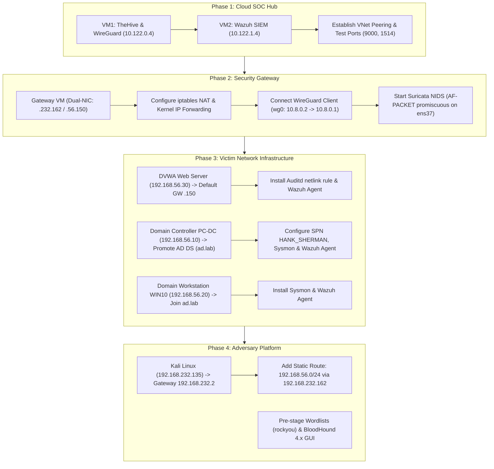

# 01 – Lab Setup & Architecture

> A production-mode hybrid SOC laboratory: local victim and attacker subnets connected over an encrypted WireGuard tunnel to a dual-VM cloud SIEM and case management stack.

---

## Complete Architecture Overview

The entire laboratory architecture—from the isolated attacker workstation on VMware to the split-cloud SIEM infrastructure—is captured in the master topology diagram below:

[](../06-Resources/Diagrams/SOC_Lab_Architecture.png)

*Figure 1: Master architecture blueprint of the SOC Lab ([view full-resolution 4K asset](../06-Resources/Diagrams/SOC_Lab_Architecture.png)).*

> [!IMPORTANT]
> **Scope Boundary — Baseline Setup vs. Attack Chain Execution:**
> This directory details only the **clean baseline state** of the laboratory infrastructure before any attack commences. Attacker-generated artifacts (such as uploaded web shells, reverse shells, SSH persistence keys, Golden Tickets, or the `backdoor` Domain Admin account created during Stage 17) are **never** pre-configured in lab setup. They are generated dynamically during the execution of the attack campaign documented in [02-Attack-Simulation/](../02-Attack-Simulation/).

> [!TIP]
> **Implementation Notice — Reference Architecture vs. Blind Copy-Paste:**
> All configuration files, commands, IP subnets, and parameter blocks documented in these setup guides serve as **an authoritative blueprint and reference implementation** of how this specific laboratory was configured and operationalized.  
> They are **not intended for blind copy-pasting** as wholesale file replacements. Many configuration snippets highlight only the *specific, targeted parameters* required to implement a mechanism (e.g., targeted XML stanzas in `ossec.conf` or specific YAML keys in Netplan). Practitioners replicating this environment must adapt interface names (e.g., `ens33` vs `eth0`), local IP assignments, hypervisor virtual network names, and credentials to match their own individual hardware and virtualization setups.

---

## Why the Lab Was Built This Way (Engineering Decisions)

Building a realistic corporate detection environment on personal hardware is tricky. You want real Active Directory traffic, deep endpoint telemetry, and a cloud SIEM, but you don't want your laptop to freeze or your cloud bills to explode. 

Here is the plain-English reasoning behind the four biggest architectural choices in this lab:

### 1. Why Split the Cloud into Two Separate VMs? (`10.122.0.4` and `10.122.1.4`)

In enterprise security, teams often try to dump their SIEM, search engine, and ticketing system onto one giant server to save time. In practice, this causes disaster:
- **The problem:** Wazuh SIEM relies on OpenSearch Indexer to index thousands of security logs per second. At the same time, TheHive 5 runs Apache Cassandra and Elasticsearch to manage case files and alert attachments. Both software stacks consume huge amounts of memory and CPU. When we simulated aggressive attacks (like heavy web fuzzing or network scans), running both on a single VM caused the memory to run out, leading to system freezes and silent log loss.
- **How we fixed it:** We split the cloud workload across two peered virtual machines on our private cloud network (`10.122.0.0/16`):
  - **VM1 — TheHive & Gateway Hub (`10.122.0.4`):** Runs TheHive 5, Cassandra, Elasticsearch, the Velociraptor DFIR server, Nginx Proxy Manager, and the WireGuard VPN server.
  - **VM2 — Wazuh SIEM (`10.122.1.4`):** Dedicated entirely to threat detection and search. Runs Wazuh Manager, Wazuh Indexer, Wazuh Dashboard, and our custom alert forwarding engine.
- **The payoff:** Each system has its own dedicated memory and CPU. Even when a simulated attack generates bursts of thousands of alerts, the SIEM never drops a single event, and TheHive's analyst interface stays fast and responsive.

### 2. Zero Public Cloud IPs & the "Single Door" Ingress Rule

Most hacked cloud servers are breached because an administrative port (like an SSH port, database, or web console) was left open to the public internet.
- **The problem:** If you expose Wazuh Dashboard, TheHive, or backend databases (like Elasticsearch on port `9200` or Cassandra on `9042`) directly to the public internet, automated scanners and bots will immediately start brute-forcing them. That floods your SIEM with internet noise and exposes the lab to compromise.
- **How we fixed it:** Neither cloud VM has public IP addresses for its services. Across the entire cloud infrastructure, there is **only one single open inbound port:** **UDP port 51820 (WireGuard VPN)** on VM1.
- **How access works:**
  - To view dashboards, the analyst connects their laptop to the WireGuard VPN (`10.8.0.0/24`).
  - Friendly internal domains (`https://wazuh.lab`, `https://thehive.lab`, and `https://velo.lab`) are routed privately through Nginx Proxy Manager with private TLS encryption.
  - The Nginx Proxy Manager administration console is accessed directly by IP and port at **`https://10.122.0.4:81`** using a custom-generated TLS certificate and private key (strictly HTTPS; unencrypted HTTP is disabled).
- **The payoff:** To anyone scanning from the public internet, the entire cloud SOC is a brick wall with no open web ports, no exposed databases, and zero attack surface.

### 3. Dual-Homed Gateway: Active Routing & Passive Wire-Level IDS

To simulate an authentic enterprise boundary where the attacker and victims reside on distinct subnets, the Security Gateway is dual-homed with two dedicated network adapters:
- **`ens33` (`192.168.232.162`):** Faces the external attack segment (`192.168.232.0/24`, VMware VMnet8 NAT).
- **`ens37` (`192.168.56.150`):** Faces the internal enterprise victim network (`192.168.56.0/24`, VMware VMnet2 Host-Only).

#### Why Passive IDS Instead of Active Inline Blocking?
Security teams often debate whether to run an inline IPS (which actively drops or resets suspicious packets) or a passive IDS (which sniffs and alerts without interfering).
- **The problem:** Running Suricata inline in IPS mode (using NFQUEUE or bridge filtering) can introduce packet jitter, reset TCP handshakes during aggressive Nmap scans, or drop payload fragments during web exploits. That would break red-team tools artificially halfway through and prevent testing multi-stage lateral movement.
- **How we fixed it:** The gateway acts as an active Layer 3 router (`net.ipv4.ip_forward = 1`) that routes packets cleanly between segments. Suricata 8.0.6 runs in **passive AF-PACKET promiscuous mode** sniffing interface `ens37`.
- **The payoff:** Attack traffic reaches victims with zero packet distortion, exactly like a genuine intrusion, while Suricata passively inspects the wire and generates rich network alerts (`eve-alert.json`).

### 4. How Traffic Routes & Preserving Real Victim IPs (No NAT on the Tunnel)

Routing in this hybrid lab coordinates three distinct traffic paths: attacker traffic, victim telemetry, and cloud management:

#### A. Attacker Traffic Flow (Kali's Single Adapter & Static Route)
- Kali Linux operates with a **single network adapter** (`eth0: 192.168.232.135/24` on VMware VMnet8 NAT).
- Because Kali is an attacker platform, it requires standard outbound internet access to install tools, pull updates, and download wordlists. Its default route (`0.0.0.0/0 via 192.168.232.2`) handles all general outbound traffic.
- Kali uses **only one static route** specifically for attacking the internal victim network:
  ```text
  up ip route add 192.168.56.0/24 via 192.168.232.162 dev eth0
  ```
- When Kali targets any internal host (`192.168.56.10`, `.20`, `.30`), its packets hit Suricata's external adapter (`192.168.232.162`), are routed across the kernel forwarding engine, are passively inspected by Suricata on `ens37`, and land directly on the victim machine.

#### B. Victim Telemetry Flow (Default Gateway `.150` & WireGuard VPN)
- Every host on the internal victim network (`192.168.56.0/24`) sets its default gateway to **`192.168.56.150`** (Suricata's internal adapter `ens37`).
- When endpoints generate telemetry—such as Wazuh agent logs on port `1514/TCP` or Velociraptor client connections on port `8000/TCP`—they send these packets to `192.168.56.150`.
- The Security Gateway acts as the router, forwarding these packets into its **WireGuard VPN tunnel interface (`wg0: 10.8.0.2/32`)** on the dedicated `10.8.0.0/24` VPN transit network.
- The VPN tunnel delivers the packets across the encrypted link (`UDP 51820`) directly to Cloud VM1 (`10.8.0.1`), which forwards them over private VNet peering (`10.122.0.0/16`) to the Wazuh SIEM (`10.122.1.4`) or TheHive/Velociraptor (`10.122.0.4`).

#### C. Preserving Real Victim IP Addresses (Zero NAT Masquerading)
- **The problem:** Routers typically apply NAT (Network Address Translation, or `MASQUERADE`) to traffic entering a VPN tunnel, replacing the sender's original IP with the router's tunnel IP. If our gateway applied NAT, every alert arriving at Wazuh in the cloud would appear to originate from `10.8.0.2` (the gateway's tunnel IP). You would lose all visibility into which machine was compromised—the Domain Controller (`.10`), Windows 10 (`.20`), or DVWA (`.30`).
- **How we fixed it:** We disabled NAT masquerading for all victim traffic entering the WireGuard tunnel (`wg0`). On the cloud hub (`10.8.0.1`), we added a static kernel return route directing `192.168.56.0/24` back through `10.8.0.2`.
- **The payoff:** Wazuh Manager sees and registers the authentic IP address of every victim host (`192.168.56.10`, `.20`, `.30`). Every alert, correlation rule, and investigation artifact maps cleanly to the exact compromised machine.

[](../06-Resources/Diagrams/Secure%20Network%20Topology%20Infographic.png)

---

## Lab Segmentation & Network Zones

The environment is cleanly divided into four zones:

[](../06-Resources/Diagrams/Neon%20Cybersecurity%20Lab%20Network%20Diagram.png)

### Zone 1: Attacker Zone (Kali Linux)
- **Subnet:** `192.168.232.0/24` (VMware VMnet8 NAT)
- **IP Address:** `192.168.232.135/24`
- **Routing:** Default route `0.0.0.0/0` points to VMware NAT gateway (`192.168.232.2`) for package updates. A static host route (`192.168.56.0/24 via 192.168.232.162`) forces all adversary traffic through the Security Gateway router.
- **Tooling:** Nmap, Metasploit, Burp Suite, Hydra, Impacket (`wmiexec`, `GetUserSPNs`, `secretsdump`), BloodHound, Responder, CrackMapExec, Hashcat.

### Zone 2: Security Gateway (Ubuntu Server & Suricata)
- **Subnets:** Dual-homed on `192.168.232.0/24` (`ens33: 192.168.232.162`) and `192.168.56.0/24` (`ens37: 192.168.56.150`).
- **Core Functions:**
  - **Linux Router:** Kernel IP forwarding enabled (`sysctl net.ipv4.ip_forward=1`).
  - **Perimeter NIDS:** Suricata 8.0.6 running passive AF-PACKET promiscuous capture on `ens37`.
  - **VPN Client:** WireGuard client interface `wg0` (`10.8.0.2/32`) maintaining the encrypted link to the cloud hub.
  - **Log Forwarder:** Wazuh Agent reading and shipping `eve-alert.json` to the cloud Wazuh Manager.

### Zone 3: Victim Network (Isolated Enterprise Subnet)
- **Subnet:** `192.168.56.0/24` (VMware VMnet2 Host-Only; completely isolated from the internet). Default gateway is `192.168.56.150`.
- **Target Hosts:**
  - **Windows Server 2022 (Domain Controller — `192.168.56.10`):** Active Directory Domain Services (`ad.lab`), DNS, Kerberos KDC, Sysmon endpoint logging, Wazuh Agent (`DomainWin10`), Velociraptor client.
  - **Windows 10 Workstation (`192.168.56.20`):** Domain-joined endpoint (`ad\victim`), Sysmon telemetry, Wazuh Agent (`Win10User`), Velociraptor client.
  - **DVWA Web Server (`192.168.56.30`):** Ubuntu Linux host acting as both the perimeter web target (Apache/MySQL) and internal adversary pivot. Monitored with Linux Auditd syscall tracking (`audit.rules`), custom Bash command execution auditing (`bashcmd`), Wazuh Agent (`DVWA`), and Velociraptor client.

### Cloud SOC Infrastructure (VM1 & VM2)
- **Private Subnet:** `10.122.0.0/16` (peered private cloud network; zero public IP exposure).
- **VM1 — Case Management & Hub (`10.122.0.4`):**
  - WireGuard VPN Server listening on `UDP 51820` (`wg0: 10.8.0.1/24`).
  - TheHive 5 incident response platform backed by Apache Cassandra 4.x and Elasticsearch 8.x.
  - Nginx Proxy Manager routing friendly `.lab` domain names to internal services, with the admin UI secured at `https://10.122.0.4:81`.
  - Velociraptor 0.77 digital forensics server.
- **VM2 — Wazuh SIEM & Integration (`10.122.1.4`):**
  - Wazuh Manager 4.x (rule engine and decoders).
  - Wazuh Indexer (OpenSearch-based search and indexing).
  - Wazuh Dashboard (`5601/TCP`).
  - `custom-thehive.py` correlation engine + `thehive-flush.service` background daemon.

---

## High-Level Automation & Response Flow

The entire detection pipeline operates in 7 clean steps:

[](../06-Resources/Diagrams/Neon%20Cybersecurity%20Incident%20Response%20Pipeline.png)

---

## IP Address Plan & Port Matrix

### Addressing Table

| Device / Network | IP Address / Range | Subnet / Interface | Purpose & Roles |
|---|---|---|---|
| **Kali Linux** | `192.168.232.135/24` | VMnet8 (NAT) / `eth0` | Attacker workstation; default route via `.2`, static route to `.56.0/24` |
| **Security Gateway (NAT)** | `192.168.232.162/24` | VMnet8 / `ens33` | External gateway interface receiving Kali attack traffic |
| **Security Gateway (Internal)** | `192.168.56.150/24` | VMnet2 / `ens37` | Default gateway for victim network; Suricata AF-PACKET sensor |
| **Domain Controller** | `192.168.56.10/24` | VMnet2 / `Ethernet0` | Windows Server 2022: AD DS, DNS, Kerberos KDC, Sysmon, Wazuh Agent |
| **Windows 10 Workstation** | `192.168.56.20/24` | VMnet2 / `Ethernet0` | Domain-joined client workstation: Sysmon, Wazuh Agent |
| **DVWA Client** | `192.168.56.30/24` | VMnet2 / `ens33` | Ubuntu 24.04: Vulnerable web app + pivot host; Auditd, `bashcmd`, Wazuh |
| **WireGuard Tunnel** | `10.8.0.0/24` | Tunnel / `wg0` | Encrypted tunnel linking Security Gateway (`.2`) to Cloud Hub (`.1`) |
| **Cloud Subnet (VM1 & VM2)** | `10.122.0.0/16` | Private Cloud VNet | Peered private cloud network for SOC services (zero public IPs) |
| **Cloud VM1 (TheHive / Hub)** | `10.122.0.4` | Private Cloud / `eth0` | TheHive 5, Cassandra, Elasticsearch, Velociraptor, NPM, WireGuard Server |
| **Cloud VM2 (Wazuh SIEM)** | `10.122.1.4` | Private Cloud / `eth0` | Wazuh Manager, Indexer, Dashboard, `custom-thehive` flush daemon |
| **Host Laptop (Physical Workstation)** | `10.8.0.3` | WireGuard / `wg0` | Windows 11 host running VMware hypervisor; direct VPN analyst access |

### Key Port Allocations

| Service / Component | Port | Protocol | Direction | Access & Exposure |
|---|---|---|---|---|
| **WireGuard VPN** | `51820` | UDP | Inbound to VM1 | **Only public internet port open** |
| **Wazuh Agent $\rightarrow$ Manager** | `1514` | TCP | Local $\rightarrow$ Cloud (VM2) | Internal WireGuard tunnel (`10.122.1.4:1514`) |
| **Wazuh Agent Enrollment** | `1515` | TCP | Local $\rightarrow$ Cloud (VM2) | Internal WireGuard tunnel |
| **Wazuh REST API** | `55000` | TCP | Local/Cloud $\rightarrow$ VM2 | Internal WireGuard tunnel |
| **Wazuh Dashboard** | `5601` / `443` | HTTPS | VPN Client $\rightarrow$ VM2 | Internal WireGuard tunnel (`https://wazuh.lab`) |
| **TheHive Web UI** | `9000` / `443` | TCP / HTTPS | VPN Client $\rightarrow$ VM1 | Internal WireGuard tunnel (`https://thehive.lab`) |
| **Velociraptor GUI** | `8889` / `443` | HTTPS | VPN Client $\rightarrow$ VM1 | Internal WireGuard tunnel (`https://velo.lab`) |
| **Nginx Proxy Manager Admin** | `81` | HTTPS | VPN Client $\rightarrow$ VM1 | Internal WireGuard tunnel (`https://10.122.0.4:81` with custom TLS cert/key) |

---

## Sensor Visibility & Blind Spot Analysis

Understanding where security sensors have full visibility versus where blind spots exist is vital for detection engineering:

| Traffic Path | Suricata Visibility | Endpoint Visibility (Sysmon / Auditd / Wazuh) | Detection Rationale |
|---|---|---|---|
| **Kali $\rightarrow$ Victim Subnet** | ✅ **Full (Wire)** | ✅ **Full (Host)** | Inbound perimeter traffic crosses the gateway router (`ens33` $\rightarrow$ `ens37`). Suricata inspects full TCP streams; endpoint agents record execution. |
| **Victim $\rightarrow$ Cloud SIEM** | ✅ **Full (Wire)** | ✅ **Full (Log)** | Telemetry leaves `ens37` and enters `wg0`. Source IPs are preserved without NAT. |
| **Victim $\leftrightarrow$ Victim (Intra-Subnet)** | ⚠️ **Partial (Promiscuous)** | ✅ **Full (Host Authoritative)** | Intra-subnet traffic does not cross the Layer 3 router. However, Suricata's AF-PACKET promiscuous listener on `ens37` captured 14 broadcast/multicast wire alerts (e.g. Kerberos TGS requests). Direct unicast lateral movement (e.g. WMI process creation, Pass-the-Hash) is caught authoritatively by **Sysmon EID 1** and **Auditd**. |
| **Cloud $\leftrightarrow$ Cloud (VNet)** | ❌ **None (Out of Scope)** | ✅ **Internal Service Logs** | Wazuh-to-TheHive traffic traverses cloud private peering; never touches the local physical gateway. |

---

## Software Component Deployment Model

| Component | Host | Deployment Method | Role & Operational Function |
|---|---|---|---|
| **Suricata 8.0.6** | Suricata Gateway | Native package (`ppa:oisf/suricata-stable`) | Passive IDS engine with AF-PACKET capture on `ens37` |
| **Wazuh Manager 4.x** | Wazuh SIEM VM | Native package | Analysis engine, decoders, rule matching, alerts log |
| **thecustomhive** | Wazuh SIEM VM | Native Python script + systemd unit | Durable SQLite ingestion queue & async flush daemon |
| **TheHive 5.x** | TheHive Hub VM | Native Debian package | Security incident response and case management |
| **Cassandra 4.x / Elasticsearch 8.x** | TheHive Hub VM | Native packages | Distributed database and search backend for TheHive 5 |
| **Nginx Proxy Manager** | TheHive Hub VM | Docker container | TLS reverse proxy for `*.lab` web UIs; admin console on `https://10.122.0.4:81` (custom TLS cert/key) |
| **Velociraptor 0.77** | TheHive Hub VM | Native systemd service | Endpoint digital forensics and artifact collection server |
| **WireGuard** | TheHive Hub & Gateway | Native kernel module | Encrypted site-to-cloud transport tunnel |

---

## System Build Order & Phased Rollout Sequence

To eliminate circular networking dependencies, broken agent registrations, or tunnel handshake failures, the environment must be provisioned in the following four-phase dependency order:



| Phase | System / Host | Step-by-Step Build Order & Critical Tasks |
|:---:|---|---|
| **Phase 1** | **Cloud SOC Core**<br>(VM1 & VM2) | 1. Deploy VM1 (`TheHive`, `10.122.0.4`): Install Cassandra, Elasticsearch, TheHive 5, Nginx Proxy Manager, and WireGuard server (`10.8.0.1`).<br>2. Deploy VM2 (`Wazuh SIEM`, `10.122.1.4`): Install Wazuh Manager, Indexer, and Dashboard.<br>3. Peer the cloud VNets; verify bidirectional ping between `10.122.0.4` and `10.122.1.4`.<br>4. Deploy `/var/ossec/integrations/custom-thehive` and enable `thehive-flush.service`. |
| **Phase 2** | **Security Gateway**<br>(Suricata) | 1. Provision dual-homed Ubuntu VM: `ens33` (`192.168.232.162`, NAT) and `ens37` (`192.168.56.150`, Host-Only).<br>2. Enable IPv4 forwarding (`net.ipv4.ip_forward = 1`) and configure `iptables` NAT routing.<br>3. Install WireGuard client (`wg0`, `10.8.0.2`); verify encrypted handshake with `10.8.0.1`.<br>4. Configure Suricata 8.0.6 for AF-PACKET promiscuous capture on `ens37`; verify `eve-alert.json`.<br>5. Install Wazuh agent; forward Suricata alerts to Wazuh (`Rule 86601` elevation). |
| **Phase 3** | **Victim Network**<br>(DVWA, DC, WIN10) | 1. **DVWA (`192.168.56.30`):** Set default gateway to `192.168.56.150`. Install Apache, PHP, MariaDB, and DVWA. Deploy Linux Auditd netlink rule (`-S execve -F uid=33 -k web_process_creation`). Configure passwordless sudo Python misconfiguration (`/etc/sudoers.d/dvwa`). Enroll Wazuh agent.<br>2. **PC-DC (`192.168.56.10`):** Install Windows Server 2022. Promote to Active Directory Domain Controller for `ad.lab`. Configure Kerberos SPN for service account `HANK_SHERMAN`. Deploy modular `sysmonconfig.xml` and Wazuh Windows Agent.<br>3. **WIN10 (`192.168.56.20`):** Install Windows 10 Enterprise. Set DNS to `192.168.56.10` and join `ad.lab`. Create local user `win10`. Install Sysmon and Wazuh Windows Agent. |
| **Phase 4** | **Adversary Platform**<br>(Kali Linux) | 1. Deploy Kali Linux on `192.168.232.135/24` with default gateway `192.168.232.2`.<br>2. Add static route: `ip route add 192.168.56.0/24 via 192.168.232.162` (persist in `/etc/network/interfaces`).<br>3. Verify ICMP reachability to `192.168.56.30` and `192.168.56.10`.<br>4. Uncompress `/usr/share/wordlists/rockyou.txt` and prepare BloodHound 4.x GUI (`bloodhound-start`). |

---

## Hardware Resource Requirements & VM Sizing Matrix

The laboratory requires a multi-threaded physical host (or split cloud hypervisor) capable of sustaining concurrent execution across all virtual machines:

| System / Host | VM Role | OS / Platform | vCPU | RAM | Disk | Network Interfaces |
|---|---|---|:---:|:---:|:---:|---|
| **VM1 (Cloud Hub)** | TheHive 5 / WireGuard / NPM | Ubuntu 24.04 LTS | 4 vCPU | 16 GB | 64 GB SSD | `eth0` (`10.122.0.4/16`), `wg0` (`10.8.0.1/24`) |
| **VM2 (Cloud SIEM)** | Wazuh Manager / OpenSearch | Ubuntu 24.04 LTS | 4 vCPU | 16 GB | 64 GB SSD | `eth0` (`10.122.1.4/16`) |
| **Security Gateway** | Router & Suricata NIDS | Ubuntu 24.04 LTS | 2 vCPU | 4 GB | 32 GB SSD | `ens33` (`.232.162`), `ens37` (`.56.150`), `wg0` (`10.8.0.2`) |
| **DVWA Server** | Web Target & Pivot Host | Ubuntu 24.04 LTS | 2 vCPU | 4 GB | 32 GB SSD | `ens33` (`192.168.56.30/24`) |
| **Domain Controller** | AD DS & DNS Server | Windows Server 2022 | 2 vCPU | 6 GB | 60 GB SSD | `Ethernet0` (`192.168.56.10/24`) |
| **Windows 10** | Domain Workstation | Windows 10 Enterprise | 2 vCPU | 4 GB | 50 GB SSD | `Ethernet0` (`192.168.56.20/24`) |
| **Kali Linux** | Attacker Platform | Kali Linux 2024.x | 4 vCPU | 6 GB | 40 GB SSD | `eth0` (`192.168.232.135/24`) |
| **TOTALS (Combined)** | **7 Dedicated VMs** | **Hybrid Cloud/Local** | **20 vCPU** | **56 GB RAM** | **342 GB SSD** | **4 Network Segments** |

> [!TIP]
> **Resource Optimization for Personal Hardware:**  
> If deploying locally on a single physical workstation (e.g., 32 GB RAM / 8 CPU cores):  
> - Run the two Cloud VMs (`VM1` and `VM2`) in Azure/AWS on free or low-cost credits.  
> - Run the 5 local VMs (Gateway: 2GB, DVWA: 2GB, DC: 4GB, Win10: 4GB, Kali: 4GB = 16 GB RAM total) comfortably in VMware Workstation or VirtualBox on the host laptop.

---

## Detailed Host Profiles & Technical Specifications

Each host has a dedicated, reproducible build specification:

| Document | Host / Role | Network Placement | Primary Software & Telemetry Stack |
|---|---|---|---|
| **[Local/kali.md](Local/kali.md)** | **Attacker Workstation** | `192.168.232.135/24` (VMnet8) | Kali Linux 2024.x, full red-team toolchain, custom routing tables |
| **[Local/suricata-gateway.md](Local/suricata-gateway.md)** | **Security Gateway & NIDS** | Dual-NIC (`.232.162` / `.56.150`) | Ubuntu 24.04 LTS, Suricata 8.0.6 (AF-PACKET), WireGuard client, Wazuh Agent |
| **[Local/dvwa.md](Local/dvwa.md)** | **Web Target & Pivot** | `192.168.56.30/24` (VMnet2) | Ubuntu 24.04 LTS, Apache/MySQL, Linux Auditd (`audit.rules`), `bashcmd` decoder |
| **[Local/win10.md](Local/win10.md)** | **Domain Workstation** | `192.168.56.20/24` (VMnet2) | Windows 10 Pro N, Sysmon modular config, Wazuh Agent, Velociraptor client |
| **[Local/dc-ad.md](Local/dc-ad.md)** | **Domain Controller** | `192.168.56.10/24` (VMnet2) | Windows Server 2022, Active Directory Domain Services, DNS, Sysmon, Wazuh Agent |
| **[Cloud/thehive.md](Cloud/thehive.md)** | **Ingress & Case Hub (VM1)** | `10.122.0.4/16` (Cloud VNet) | TheHive 5, Cassandra 4.x, Elasticsearch 8.x, Velociraptor Server, WireGuard, NPM |
| **[Cloud/wazuh.md](Cloud/wazuh.md)** | **SIEM & Analytics (VM2)** | `10.122.1.4/16` (Cloud VNet) | Wazuh Manager 4.x, Wazuh Indexer, Dashboard, `custom-thehive` correlation daemon |

---

## Verification & Health Check Commands

To verify that the complete SOC lab pipeline is operational:

```bash
# 1. Verify WireGuard tunnel status on Security Gateway
sudo wg show wg0
# Expected: peer handshake active, transfer rx/tx incrementing

# 2. Test ping reachability across the encrypted tunnel
ping -c 3 10.8.0.1
ping -c 3 10.122.1.4

# 3. Confirm Linux kernel IP forwarding is active on the Gateway
sysctl net.ipv4.ip_forward
# Expected: net.ipv4.ip_forward = 1

# 4. Verify Wazuh Agent daemon status on Gateway or DVWA
sudo systemctl status wazuh-agent --no-pager
sudo /var/ossec/bin/agent_control -l    # (Run on Wazuh Manager)

# 5. Check TheHive correlation flush daemon status on Wazuh VM
sudo systemctl status thehive-flush.service --no-pager

# 6. Verify Nginx Proxy Manager admin UI (secured over HTTPS on port 81)
curl -k -I https://10.122.0.4:81

# 7. Verify internal web dashboards over VPN
curl -k -I https://wazuh.lab
curl -k -I https://thehive.lab
curl -k -I https://velo.lab
```
