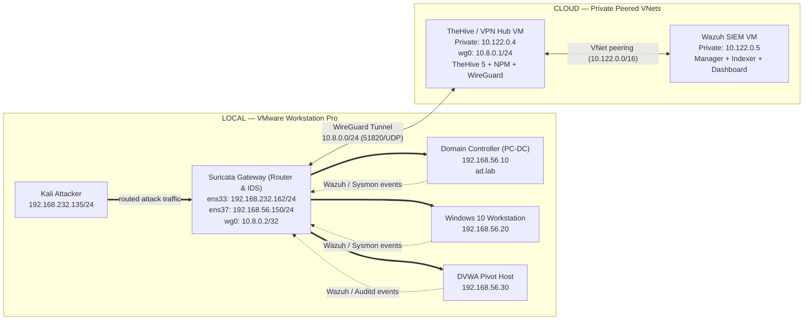

# Architecture & Network Topology

> Single authoritative reference for every host address, network segment, port, traffic flow, and trust boundary in the SOC Lab.

## Purpose

Build a realistic, end-to-end SOC pipeline: an adversary attacks a local Active Directory network from an isolated NAT subnet, telemetry is captured by a passive Suricata IDS on the gateway router and Wazuh endpoint agents, alerts are normalized and evaluated against custom rules, and correlated incident cases reach TheHive automatically across private cloud networking.

### Architectural Philosophy: Passive IDS vs. Inline IPS
Suricata is deployed in **passive IDS mode** via AF-PACKET capture on the gateway's victim-facing interface (`ens37`), rather than in inline IPS mode (NFQUEUE or bridged inline filtering). This engineering decision avoids introducing packet forwarding jitter or unintended drops during high-volume attack phases (e.g. Nikto web fuzzing or Nmap timing sweeps), ensuring authentic adversary traffic behavior while generating high-fidelity wire alerts.

---

## Three-Tier Model

| Tier | Segment | Hosts | Boundary |
|------|---------|-------|----------|
| **Attack** | `192.168.232.0/24` (VMware VMnet8 NAT) | Kali `192.168.232.135` | Reaches victims only through the gateway router |
| **Victim** | `192.168.56.0/24` (VMware VMnet2 Host-Only) | DC `.10`, Win10 `.20`, DVWA `.30` | Default gateway `192.168.56.150` (`ens37`) |
| **Cloud SOC** | Peered VNets within `10.122.0.0/16` | Wazuh VM (`.0.5`), TheHive/Hub VM (`.0.4`) | Ingress restricted to WireGuard `51820/UDP` |

---

## Network Diagram



> Latest exported diagram: [06-Resources/Diagrams/SOC_Lab_Architecture.png](../06-Resources/Diagrams/SOC_Lab_Architecture.png)

---

## Complete Host & Addressing Table

| Host | OS | Interfaces & Addresses | Default Gateway | Role | Primary Telemetry |
|------|----|------------------------|-----------------|------|-------------------|
| **Kali** | Kali Linux 2024.x | `eth0`: `192.168.232.135/24` | `192.168.232.2` (NAT) | Attacker workstation | Offline attack commands |
| **Suricata Gateway** | Ubuntu 24.04 LTS | `ens33`: `192.168.232.162/24`<br>`ens37`: `192.168.56.150/24`<br>`wg0`: `10.8.0.2/32` | `192.168.232.2` (NAT) | Linux Router + AF-PACKET IDS + VPN Client | `eve-alert.json` → Wazuh |
| **Domain Controller** | Windows Server 2022 | `Ethernet0`: `192.168.56.10/24` | `192.168.56.150` | AD DS, DNS, Kerberos KDC (`ad.lab`) | Wazuh Agent `DomainWin10` + Sysmon |
| **Windows 10** | Windows 10 Pro N | `Ethernet0`: `192.168.56.20/24` | `192.168.56.150` | Domain workstation target | Wazuh Agent `Win10User` + Sysmon |
| **DVWA** | Ubuntu 24.04 LTS | `ens33`: `192.168.56.30/24` | `192.168.56.150` | Web application target + internal pivot | Wazuh Agent `DVWA` + Auditd + `bashcmd` |
| **Wazuh VM** | Ubuntu 24.04 LTS (Cloud) | `eth0`: `10.122.0.5/24` (Private VNet) | Cloud Gateway | SIEM Manager, Indexer, Dashboard, thecustomhive | Local SQLite queue + `custom-thehive.py` |
| **TheHive VM** | Ubuntu 24.04 LTS (Cloud) | `eth0`: `10.122.0.4/24` (Private VNet)<br>`wg0`: `10.8.0.1/24` | Cloud Gateway | TheHive 5, WireGuard Hub, NGINX Reverse Proxy | Incident cases, alerts, triage queue |

---

## Network Segments & Routing Policy

| Segment | Range | Purpose | Sensor Scope | Routing / NAT Policy |
|---------|-------|---------|--------------|----------------------|
| **Attack Plane** | `192.168.232.0/24` (VMnet8) | Kali and gateway external NIC | Forwarded across router to `ens37` | Standard VMware NAT to physical host |
| **Victim Plane** | `192.168.56.0/24` (VMnet2) | DC, Win10, DVWA | Sniffed on `ens37` (AF-PACKET promiscuous mode) | Routed via gateway `.150`; no NAT |
| **WireGuard VPN** | `10.8.0.0/24` | Encrypted tunnel linking lab to cloud | Tunnel interface `wg0` | Point-to-point WireGuard routing |
| **Cloud SOC** | `10.122.0.0/16` (Peered `/24`s) | Wazuh and TheHive private cloud | Unmonitored (Internal cloud) | Cloud VNet peering; private IPs |

> [!IMPORTANT]
> **Source IP Preservation:** To ensure Wazuh agent registration and alert logs reflect the actual victim IP addresses (`192.168.56.10`, `.20`, `.30`) rather than a single NAT address, MASQUERADE is **not** applied to victim telemetry traversing the WireGuard tunnel. The cloud VPN hub (`10.8.0.1`) maintains a static kernel route directing `192.168.56.0/24` back through `10.8.0.2`.

---

## Public Ingress

Only **one** inbound port is open to the public internet across the entire architecture:

| Port | Protocol | Destination | Purpose | Firewall Policy |
|------|----------|-------------|---------|-----------------|
| `51820` | UDP | TheHive / VPN Hub VM | WireGuard tunnel listener | Allowed from any IP |
| All others | Any | Any | Management, SIEM, Web UIs | **Default-Deny** |

All administrative interfaces (Wazuh Dashboard at `443/TCP`, TheHive at `9000/TCP`, Velociraptor at `8889/TCP`, and SSH at `22/TCP`) are accessible **strictly through the WireGuard tunnel**.

---

## Traffic Flows & Sensor Visibility

| # | Flow | Path | Purpose | Suricata Visibility |
|---|------|------|---------|---------------------|
| **1** | Kali $\rightarrow$ Victim | `192.168.232.135` $\rightarrow$ `ens33` $\rightarrow$ `ens37` $\rightarrow$ `.56.x` | Attack payloads & scanning | ✅ **Yes** — Crosses gateway routing path |
| **2** | Victim $\rightarrow$ Cloud SIEM | `.56.x` $\rightarrow$ `ens37` $\rightarrow$ `wg0` $\rightarrow$ `10.8.0.1` $\rightarrow$ `10.122.0.5:1514` | Wazuh agent events | ✅ **Yes** — Transits gateway uplink to tunnel |
| **3** | Wazuh $\rightarrow$ TheHive | `10.122.0.5` $\rightarrow$ VNet peering $\rightarrow$ `10.122.0.4:9000/api/v1` | Batched alert synchronization | ❌ **No** — Internal cloud VNet peering |
| **4** | Victim $\leftrightarrow$ Victim | `.56.30` (DVWA) $\leftrightarrow$ `.56.10` (DC) / `.56.20` (Win10) | Lateral movement & AD requests | ⚠️ **Partial** — AF-PACKET promiscuous mode on `ens37` observes broadcast, multicast, and gateway-routed frames (e.g. Kerberos TGS-REQ in Stage 13); unrouted unicast frames rely on **Wazuh + Sysmon** endpoint telemetry |

---

## Software Component Deployment Model

| Component | Host | Deployment Method | Role |
|---|---|---|---|
| **Suricata 8.0.6** | Suricata Gateway | Native package (`ppa:oisf/suricata-stable`) | Passive IDS engine with AF-PACKET capture on `ens37` |
| **Wazuh Manager 4.x** | Wazuh VM | Native package | Analysis engine, decoders, rule matching, alerts log |
| **thecustomhive** | Wazuh VM | Native Python script + systemd unit | Durable SQLite ingestion queue & async flush daemon |
| **TheHive 5.x** | TheHive VM | Native Debian package | Security incident response and case management |
| **Cassandra 4.x / Elasticsearch 8.x** | TheHive VM | Native packages | Distributed database and search backend for TheHive 5 |
| **Nginx Proxy Manager** | TheHive VM | Docker container | TLS termination and reverse proxy for VPN-only web UIs |
| **Velociraptor 0.77** | TheHive VM | Native systemd service | Endpoint digital forensics and artifact collection |
| **WireGuard** | TheHive VM & Gateway | Native kernel module | Encrypted site-to-cloud transport tunnel |

---

## Verification Commands

```bash
# Verify WireGuard tunnel connectivity from Suricata Gateway
sudo wg show wg0
ping -c 3 10.8.0.1

# Confirm Linux kernel IP forwarding on Gateway
sysctl net.ipv4.ip_forward
# Output: net.ipv4.ip_forward = 1

# Check static routing to cloud network
ip route get 10.122.0.5
# Output: 10.122.0.5 dev wg0 src 10.8.0.2

# Verify VNet peering reachability from TheHive to Wazuh Manager
curl -k -I https://10.122.0.5:55000
```
