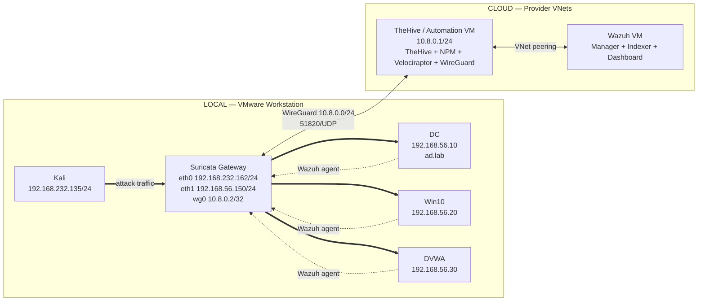

# Architecture & Network Topology

> Single authoritative reference for every host address, network segment, port, traffic flow, and trust boundary in the SOC Lab.

## Purpose

Build a small but realistic SOC pipeline: an adversary attacks a local Active Directory network, telemetry is collected by Suricata and Wazuh agents, alerts are forwarded to a cloud SIEM, and cases reach TheHive automatically — with the entire investigation documented as a portfolio artefact.

---

## Three-Tier Model

| Tier | Segment | Hosts | Boundary |
|------|---------|-------|----------|
| **Attack** | `192.168.232.0/24` (VMnet8 NAT) | Kali `192.168.232.135` | Reaches victims only through the gateway |
| **Victim** | `192.168.56.0/24` | DC `.10`, Win10 `.20`, DVWA `.30` | Default gateway `192.168.56.150` |
| **Cloud SOC** | `10.122.0.0/16` summary for two `/24` VNets | Wazuh VM, TheHive/automation VM | Public ingress limited to `51820/UDP` |

---

## Network Diagram



> Latest exported diagram: [06-Resources/Diagrams/soc-lab.png](../06-Resources/Diagrams/soc-lab.png)

---

## Complete Host & Addressing Table

| Host | OS | Address | Default Gateway | Role | Telemetry |
|------|----|---------|-----------------|------|-----------|
| Kali | Kali Linux | `192.168.232.135/24` | VMnet8 NAT gateway | Attacker | None |
| Suricata gateway | Ubuntu 24.04 | eth0 `192.168.232.162/24`, eth1 `192.168.56.150/24`, wg0 `10.8.0.2/32` | VMnet8 NAT gateway | Router + IDS + VPN client | `eve.json` → Wazuh |
| Domain Controller | Windows Server 2022 (Build 20348.587) | `192.168.56.10/24` | `192.168.56.150` | AD DS, DNS, Kerberos | Wazuh agent `DomainWin10` |
| Windows 10 | Windows 10 Pro N (Build 19045.6216) | `192.168.56.20/24` | `192.168.56.150` | Workstation target | Wazuh agent `Win10User` |
| DVWA | Ubuntu 24.04 | `192.168.56.30/24` | `192.168.56.150` | Web target + pivot | Wazuh agent `DVWA` |
| Wazuh VM | Ubuntu 24.04.4 LTS (cloud) | Private VNet in `10.122.0.0/16` | Provider VNet | Manager, indexer, dashboard | Private only |
| TheHive/automation VM | Ubuntu 24.04.4 LTS (cloud) | Private VNet + wg0 `10.8.0.1/24` | Provider VNet | Ingress, VPN hub, TheHive | Public: `51820/UDP` only |

---

## Network Segments

| Segment | Range | Purpose | Crosses Suricata |
|---------|-------|---------|------------------|
| Attack (VMnet8 NAT) | `192.168.232.0/24` | Kali + gateway external | Yes (eth0) |
| Victim | `192.168.56.0/24` | DC, Win10, DVWA | Yes (eth1), except host-to-host |
| WireGuard | `10.8.0.0/24` | VPN tunnel; hub `.1`, gateway `.2`, host laptop `.3` | Yes (wg0) |
| Cloud private | `10.122.0.0/16` | Summary for two peered `/24` VNets | No — peered VNet traffic |

---

## Public Ingress

Only **one** inbound rule exists across the entire lab:

| Port | Proto | Host | Purpose |
|------|-------|------|---------|
| 51820 | UDP | TheHive/automation VM | WireGuard listener |

Everything else is **default-deny**.

---

## VPN-Only Services

The following ports are reachable exclusively from the WireGuard tunnel (`10.8.0.0/24`):

| Port | Service |
|------|---------|
| 22 | SSH |
| 80 | NPM HTTP proxy |
| 81 | NPM admin panel |
| 443 | NPM HTTPS proxy / Wazuh dashboard |
| 1514 | Wazuh events (agent → manager) |
| 1515 | Wazuh enrollment |
| 8000 | Velociraptor frontend |
| 8889 | Velociraptor GUI |
| 9000 | TheHive |
| 9200 | Wazuh indexer API |
| 55000 | Wazuh manager API |

---

## WireGuard VPN

| Item | Value |
|------|-------|
| Subnet | `10.8.0.0/24` |
| Hub (server) | `10.8.0.1/24` on TheHive VM |
| Suricata client | `10.8.0.2/32` |
| Host laptop | `10.8.0.3` |
| Listen port | `51820/UDP` |
| AllowedIPs (server peer for Suricata) | `10.8.0.2/32, 192.168.232.0/24, 192.168.56.0/24` |
| PersistentKeepalive | 25 on client |

### Server Config (TheHive VM)

```ini
[Interface]
Address    = 10.8.0.1/24
ListenPort = 51820
PrivateKey = <REDACTED>

# Suricata gateway
[Peer]
PublicKey    = <REDACTED>
AllowedIPs   = 10.8.0.2/32, 192.168.232.0/24, 192.168.56.0/24

# Host laptop
[Peer]
PublicKey    = <REDACTED>
AllowedIPs   = 10.8.0.3/32
```

### Client Config (Suricata Gateway)

```ini
[Interface]
Address    = 10.8.0.2/32
PrivateKey = <REDACTED>

[Peer]
PublicKey            = <REDACTED>
Endpoint             = <TheHive-VM-public-IP>:51820
AllowedIPs           = 10.8.0.0/24, 10.122.0.0/16
PersistentKeepalive  = 25
```

---

## Traffic Flows

| # | Source | Destination | Purpose | Path | Suricata Sees It |
|---|--------|-------------|---------|------|------------------|
| 1 | Kali `192.168.232.135` | DC / Win10 / DVWA | Attack traffic | Kali → eth0 → Suricata → eth1 → victim | ✅ Yes |
| 2 | Victims (`.10`, `.20`, `.30`) | Wazuh VM (cloud) | Agent events (`1514`) | Agent → eth1 → Suricata → wg0 → WireGuard → Wazuh | ✅ Yes |
| 3 | thecustomhive (Wazuh VM) | TheHive API (TheHive VM) | Correlated alert push (`9000`) | Wazuh VM → VNet peering → TheHive `10.122.0.4:9000` | ❌ No (cloud ↔ cloud) |
| 4 | Analyst laptop | Any VPN-only service | Management & investigation | Laptop `10.8.0.3` → WireGuard → cloud VMs | ❌ No (enters at hub) |
| 5 | Victim → Victim | Lateral movement | e.g. DC → Win10 | Direct on `192.168.56.0/24` | ❌ No (same segment) |

---

## Suricata Visibility Matrix

| Traffic | Suricata Sees It | Reason |
|---------|------------------|--------|
| Kali → Victim | ✅ Yes | Routed through eth0 → eth1 |
| Victim → Cloud | ✅ Yes | Exits via eth1 → wg0 |
| Victim ↔ Victim | ❌ No | Same L2 segment, no routing needed |
| Cloud ↔ Cloud | ❌ No | VNet peering, never reaches local gateway |
| Loopback | ❌ No | Never leaves the host |

---

## Trust Boundaries

| Boundary | Crossed When | Control |
|----------|-------------|---------|
| Attack → Victim | Kali traffic transits the gateway | Suricata IDS on both NICs |
| Local → Cloud | Agent events / VPN traffic leave the lab | WireGuard encryption + cloud NSG |
| Internet → Cloud | Any inbound connection from the public internet | Single `51820/UDP` rule; default-deny all else |
| Cloud ↔ Cloud | TheHive VM ↔ Wazuh VM | VNet peering — private addressing only |

---

## Components

| Component | Host | Purpose |
|-----------|------|---------|
| Suricata 8.0.6 | Suricata gateway | Inline IDS — inspects all routed traffic |
| Wazuh 4.x | Wazuh VM | SIEM: manager, indexer, dashboard |
| thecustomhive | Wazuh VM | Python automation (custom-thehive & thehive-flush.service) — 2-tier correlation & push to TheHive |
| TheHive 5.x | TheHive VM | Case management and analyst workspace |
| Nginx Proxy Manager | TheHive VM | Reverse proxy with TLS for web UIs |
| Velociraptor | TheHive VM | Endpoint forensics and live response |
| WireGuard | TheHive VM (server) + Suricata gateway (client) | Site-to-cloud VPN tunnel |
| Docker | TheHive VM | Runs TheHive, Cortex, Elasticsearch, NPM containers |

---

## Domain Information

| Field | Value |
|-------|-------|
| Domain | `ad.lab` |
| Domain Controller | `PC-DC.ad.lab` / `192.168.56.10` |
| DNS Server | Domain Controller |
| Functional level | Windows Server 2016 |

---

## Design Decisions

### Inline Router vs Passive Sensor
Suricata sits on a dual-NIC Ubuntu VM that **routes** traffic between attack and victim segments. This guarantees every cross-segment packet is inspected without needing a span port or tap — simpler for a lab while demonstrating the same detection logic.

### TheHive VM as Ingress Hub
A single cloud VM runs WireGuard, NPM, TheHive, and Velociraptor. Consolidating ingress on one host means only **one public port** (`51820/UDP`) and one set of firewall rules to manage.

### Cloud SIEM vs All-Local
Running Wazuh in the cloud separates the monitoring plane from the attack surface. Agents forward events over WireGuard, making the SIEM unreachable from the victim segment directly — closer to how a real SOC operates.

### One Public Port
The entire cloud attack surface is a single UDP port for WireGuard. Every management interface (TheHive, Wazuh dashboard, Velociraptor GUI) is reachable only through the VPN tunnel.

### TheHive vs Spreadsheets
TheHive provides structured case management with API-driven alert ingestion, observable enrichment, and analyst workflows — replacing ad-hoc spreadsheet tracking.

### Stage-wise Documentation
Each lab phase is documented as it is built, producing a portfolio that mirrors a real SOC build-out rather than a single monolithic write-up.

---

## Verification Commands

### WireGuard Handshake

```bash
# On Suricata gateway — confirm tunnel is up and handshake is recent
sudo wg show wg0
```

Expected: `latest handshake` within the last 2 minutes and `transfer` counters incrementing.

### Tunnel Reachability

```bash
# From Suricata gateway — ping the hub
ping -c 3 10.8.0.1

# From host laptop — reach Wazuh dashboard through VPN
curl -sk https://10.8.0.1:443 | head -5
```

### NIC Forwarding

```bash
# Confirm IP forwarding is enabled on the gateway
sysctl net.ipv4.ip_forward
# Expected: net.ipv4.ip_forward = 1
```

### VNet Peering

```bash
# From TheHive VM — reach the Wazuh VM over the peered VNet
curl -sk https://<wazuh-private-ip>:443 | head -5
```

### Firewall Deny Tests

```bash
# From any external host — verify non-WireGuard ports are closed
nmap -Pn -p 22,80,443,9000 <TheHive-VM-public-IP>
# Expected: all filtered / closed
```

```powershell
# From Windows 10 — confirm default gateway is the Suricata box
Get-NetIPConfiguration | Select-Object InterfaceAlias, IPv4DefaultGateway
# Expected: 192.168.56.150
```
