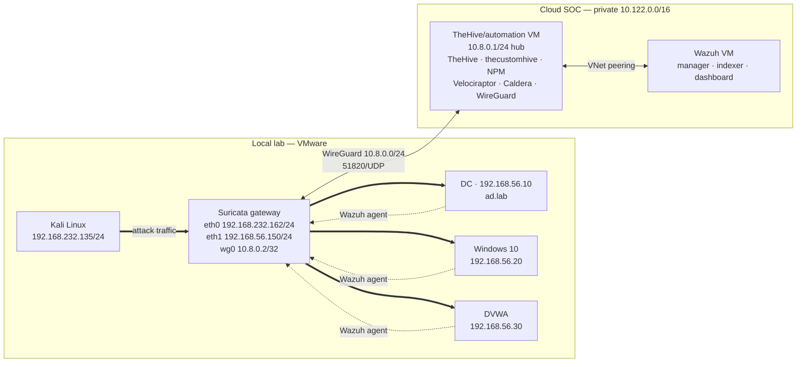

# Architecture

## Purpose

Build a small but realistic SOC pipeline: an adversary attacks a local Active Directory network, network and host telemetry is collected, alerts reach TheHive automatically, and the incident is investigated and documented.

## Three-tier model

| Tier | Segment | Hosts | Boundary |
|---|---|---|---|
| Attack | `192.168.232.0/24` (VMnet8 NAT) | Kali `192.168.232.135` | Reaches victims only through the gateway |
| Victim | `192.168.56.0/24` | DC `.10`, Win10 `.20`, DVWA `.30` | Default gateway `192.168.56.150` (gateway `eth1`) |
| Cloud SOC | `10.122.0.0/16` private plan | Wazuh VM, TheHive/automation VM | Public ingress limited to `51820/UDP` |

## Diagram

No exported image is referenced. If one is added later it must be vendor-neutral and have public IPs redacted; see [resources/README.md](../resources/README.md).

## Traffic flow

1. Kali sends attack traffic to `192.168.56.0/24`. Its only route there is `192.168.232.162`.
2. The Suricata gateway forwards it out `eth1` (`192.168.56.150`) and writes `eve.json`.
3. Wazuh agents on DVWA, Windows 10, and the DC send events to the Wazuh manager. Their default route is the gateway, so the traffic exits `wg0` and crosses the WireGuard tunnel.
4. The tunnel terminates on the TheHive/automation VM, which forwards `1514/TCP` (and the enrollment port) to the Wazuh VM across the peered VNets.
5. Wazuh matches rules and writes alerts; thecustomhive pulls them from the Wazuh API at the private VNet address.
6. thecustomhive posts to the TheHive API on the same VM (loopback/local address — no tunnel required).
7. The analyst connects over the same WireGuard VPN and works in TheHive, the Wazuh dashboard, Velociraptor, and Caldera.
8. Velociraptor clients on the victim hosts initiate connections to the server on the TheHive/automation VM; Caldera operates the same way.

## Public ingress

Exactly one rule exists in the cloud firewall for inbound traffic:

| Port | Protocol | Target | Purpose |
|---|---|---|---|
| `51820` | UDP | TheHive/automation VM | WireGuard listener |

Everything else is default-deny. That includes the TheHive UI, the Wazuh dashboard and API, Velociraptor, Caldera, SSH, and every agent/enrollment port. If SSH is closed and the tunnel is broken, the provider console is the break-glass path.

There is no public DNS record, reverse proxy listener, or dashboard URL to discover. Nginx Proxy Manager exists to terminate TLS for internal service names over the tunnel, not to publish them.

## The VPN hub

The WireGuard server runs on the TheHive/automation VM:

| Peer | Address | Role |
|---|---|---|
| Hub (server) | `10.8.0.1/24` | Terminates the tunnel, allows `10.8.0.0/24` |
| Suricata gateway | `10.8.0.2/32` | Client; carries agent logs and SOC access |

`AllowedIPs` on the server peer is `10.8.0.2/32`, `192.168.232.0/24`, and `192.168.56.0/24`. The cloud plan (`10.122.0.0/16`) is local to the hub and is reached over VNet peering, not through the Suricata client. AllowedIPs is a *routing* statement — it says which destinations may be reached through the peer. The firewall is the *authorization* statement, and it is what actually decides whether traffic passes. Both are documented in [cloud/wireguard.md](cloud/wireguard.md).

Security note: allowing the whole `192.168.232.0/24` exposes the Kali/NAT segment to any VPN client, including the attacker VM's neighbours. If only gateway management is required, narrow that entry to `192.168.232.162/32`.

## Cloud peering

The two VMs sit in `10.122.0.0/16`, split across two non-overlapping VNets connected by VNet peering. The split was required to place both VMs in the same region under the provider's placement constraints.

- Exact per-VNet and per-subnet CIDRs vary between provider builds and are not published here.
- Peering is private; neither VNet needs a public address for the other to reach it.
- Traffic between the VMs never leaves the provider network.
- The TheHive/automation VM is the only member that also has a public ingress path — the `51820/UDP` listener.

## Components

| Component | Host | Function | Why it is included |
|---|---|---|---|
| Suricata gateway | Local VM | Router between attack and victim segments; `eve.json` producer | Makes the attack path a choke point and yields network evidence |
| Wazuh manager/indexer/dashboard | Wazuh VM | Collection, rules, search | Correlates host and network telemetry |
| thecustomhive | TheHive/automation VM | Wazuh API → TheHive alert bridge | Demonstrates a real SIEM-to-case-management integration |
| TheHive | TheHive/automation VM | Case management | Structures triage, tasks, observables, timelines |
| Nginx Proxy Manager | TheHive/automation VM | Internal TLS/reverse proxy | Names and certificates for VPN-reachable services |
| Velociraptor | TheHive/automation VM | DFIR | Collects process, network, persistence, file artifacts |
| Caldera | TheHive/automation VM | Adversary emulation | Repeatable technique execution |
| WireGuard | Both sides | Encrypted transport and hub routing | Keeps telemetry off the public internet |
| Docker | TheHive/automation VM | Container runtime | Runs TheHive and supporting services |

## Trust boundaries

| Boundary | Trust | Control |
|---|---|---|
| Kali → victim network | Untrusted | Routed through Suricata; firewall on the gateway |
| Victim → cloud | Untrusted path, authenticated peers | WireGuard tunnel, per-peer AllowedIPs, cloud firewall |
| Internet → cloud | Untrusted | Default-deny; only `51820/UDP` |
| VPN client → local segments | Authenticated but broad | `10.8.0.0/24` → `192.168.232.0/24` and `192.168.56.0/24`; narrow if not needed |
| TheHive VM → Wazuh VM | Trusted, private | VNet peering; no public listener on Wazuh |
| Repository → public | Documentation only | Redaction policy in [SECURITY.md](../SECURITY.md) |

## What Suricata cannot see

| Traffic | Visible to Suricata | Why |
|---|---|---|
| Kali → victim | Yes | Crosses `eth0` → `eth1` |
| Victim → cloud | Yes | Crosses `eth1` → `wg0` |
| Victim ↔ victim on `192.168.56.0/24` | **No** | Same subnet; switched locally, no router hop |
| Cloud VM ↔ cloud VM | No | Peered VNet traffic, not on the gateway |
| Loopback and host-local activity | No | Never leaves the host |

This matters for stages 09–17: internal discovery, Responder poisoning, BloodHound, Kerberoasting, DCSync, Pass-the-Hash, Golden Ticket, and DC persistence mostly stay inside the victim subnet. Detection for those stages is a function of Wazuh rules and audit policy, not network signatures. The lab does not claim full network visibility.

## Design decisions

### Inline router instead of a passive sensor

For traffic entering the victim network from the attack segment, the gateway is the only path, so that traffic cannot be trivially rerouted away from the sensor. Once inside, victim-to-victim traffic is outside its view. The trade-off is availability: a gateway failure interrupts the lab, which is acceptable in an isolated environment, and fail-closed is the correct posture here.

### TheHive/automation VM as the ingress hub

The tunnel terminates where an analyst-facing service already runs, and one VM owns routing, naming, VPN, and automation. That keeps the public attack surface to a single host and a single port, and it means the Wazuh VM needs no public address at all. The cost is a single point of failure — see [cloud/thehive.md](cloud/thehive.md).

### Cloud SIEM instead of an all-local stack

Separating the SOC from the victim network mirrors a common enterprise pattern, exercises VPN and remote log transport, exercises VNet peering, and keeps the Wazuh load off the attack hosts.

### One public port, ever

A single inbound rule is easy to audit and easy to explain. Every additional public service is another thing to patch and monitor; the lab demonstrates that a SOC stack can be operated with none.

### TheHive instead of spreadsheets

TheHive forces the investigation into a case model: alerts, observables, tasks, TTPs, and timelines. It also produces a case report that can be summarized in `05-incident-report/`.

### Stage-wise documentation

Each attack stage has a matching investigation note. This keeps evidence traceable and makes detection gaps visible instead of hiding them inside a broad case narrative.

## Open items

- [ ] Record VM sizes and OS versions for both cloud VMs
- [ ] Record the exact per-VNet/subnet CIDRs from the provider console (private ranges only)
- [ ] Export and add a vendor-neutral architecture diagram with public IPs redacted
- [ ] Confirm the Suricata interface names and forwarding configuration as built
- [ ] Confirm whether Sysmon is deployed on the Windows hosts
- [ ] Validate that the firewall permits only `51820/UDP` from the internet
