# Stage 01 — Reconnaissance

> **Status:** Complete — evidence attached
> **Case:** [Case 01](../../04-Investigation/Cases/case-01-web-compromise.md)
> **Investigation:** [Phase 1 Deep Dive](../../04-Investigation/Deep-Dive-Attack-Chain-Investigation.md#phase-1-rattling-the-doorknobs-reconnaissance--web-exploitation)
> **Evidence:** [attack](../../06-Resources/screenshots/attack-simulation/1.png) · [alert](../../06-Resources/screenshots/thehive-alert/1.png)

## Objective

Find out what's running on the target DVWA server: check basic reachability, scan for open ports and services, fingerprint the web technologies running on it, and map out directories and obvious misconfigurations.

## Commands

```bash
# 1. Verify ICMP reachability to target host
ping -c 3 192.168.56.30

# 2. Comprehensive full TCP port and service version scan with default scripts
nmap -sC -sV -p- -oA recon_dvwa 192.168.56.30

# 3. Web technology and banner fingerprinting
whatweb http://192.168.56.30/

# 4. Automated web vulnerability and misconfiguration scanning
nikto -h http://192.168.56.30/

# 5. Directory and web resource enumeration
gobuster dir -u http://192.168.56.30/ -w /usr/share/wordlists/dirb/common.txt -x php
```

## What happened

1. **Checking connectivity:** From our Kali attack box (`192.168.232.135`), I started with a simple ping to `192.168.56.30`. Three ICMP packets went through cleanly with ~1.8 ms latency, confirming the path across our gateway was open.
2. **Scanning all TCP ports:** Next, I ran a full-port Nmap scan (`-p- -sC -sV`). In about 25 seconds, two ports answered:
   - **Port 22 (SSH):** OpenSSH 9.6p1 on Ubuntu Linux.
   - **Port 80 (HTTP):** Apache 2.4.58 running Damn Vulnerable Web Application (DVWA). Nmap also flagged missing cookie security flags (`PHPSESSID` without `httponly`), a `robots.txt` file, and an exposed `.git` directory (`http://192.168.56.30:80/.git/`).
3. **Fingerprinting the web stack:** Running `whatweb` confirmed that hitting `/` redirects (302) straight to `/login.php`, running on Apache 2.4.58, PHP, and Ubuntu.
4. **Running an automated web scanner:** I let `nikto` loose on port 80. Over 8,102 requests, it lit up: missing security headers (`X-Frame-Options`, `X-Content-Type-Options`), missing `httponly` cookie flags, open directory indexing across `/config/`, `/database/`, `/docs/`, and `/tests/`, and full exposure of git metadata files (`.git/index`, `.git/HEAD`, `.git/config`, `.gitignore`).
5. **Busting directories:** Finally, `gobuster` hammered common endpoints using the DirB `common.txt` wordlist. It immediately surfaced core application scripts: `/login.php` (200), `/setup.php` (200), `/about.php` (200), `/instructions.php` (200), and administrative directories.

## Evidence

### Attack Screenshots

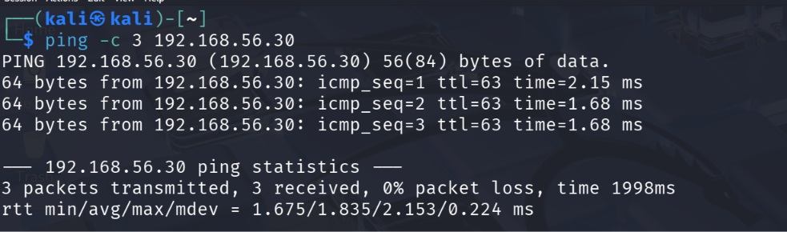
*Figure 1.1: Verification of ICMP network reachability to DVWA target (192.168.56.30).*

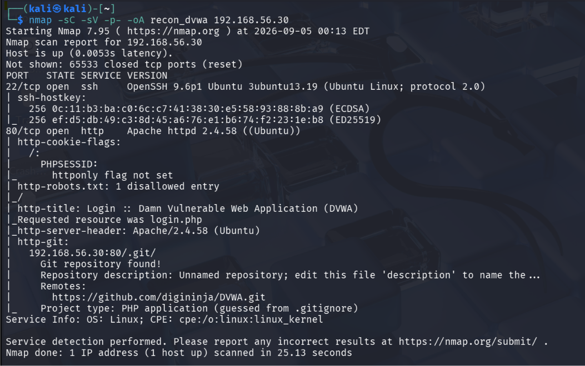
*Figure 1.2: Nmap scan results identifying OpenSSH 9.6p1, Apache 2.4.58, and exposed .git directory.*

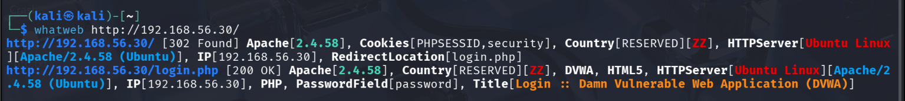
*Figure 1.3: WhatWeb fingerprinting revealing Apache, PHP, and DVWA redirect to login.php.*

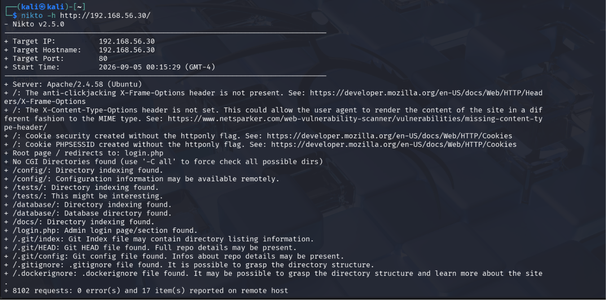
*Figure 1.4: Nikto web vulnerability scan reporting missing headers and indexed directories.*

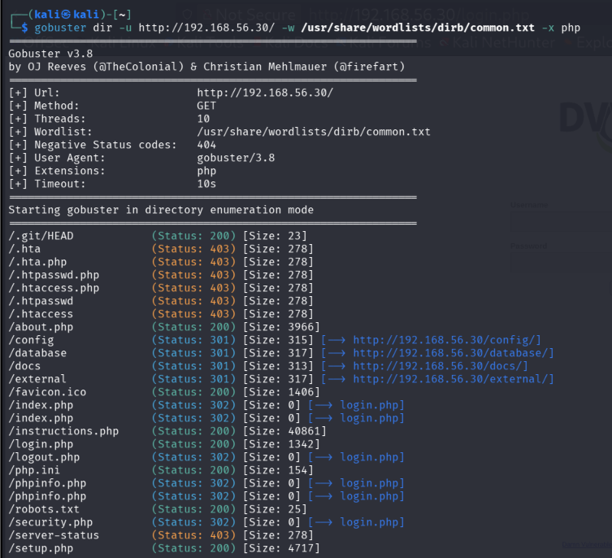
*Figure 1.5: Gobuster enumeration mapping out web application structure and sensitive PHP scripts.*

### Alert Screenshots

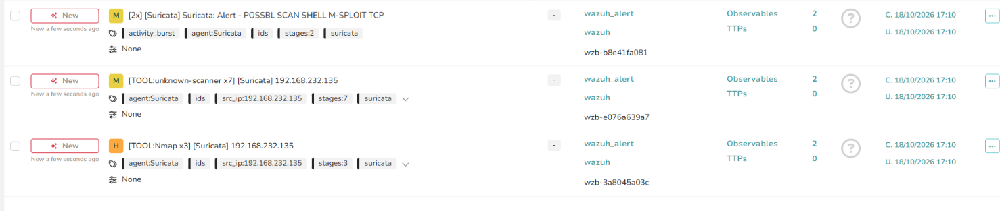
*Figure 1.6: TheHive alert dashboard showing Suricata Nmap and multi-port scan detections.*

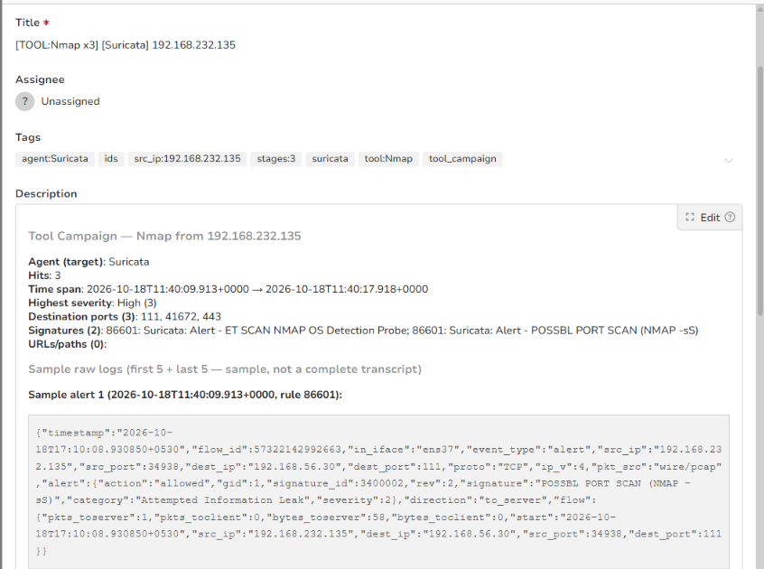
*Figure 1.7: Detailed Suricata alert for Nmap OS detection probe and SYN port scan (rule 86601).*

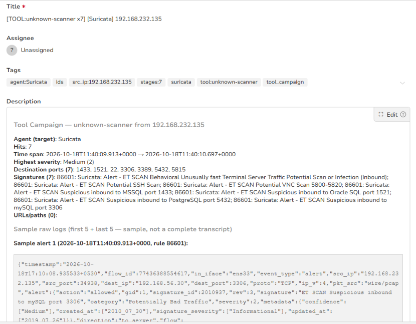
*Figure 1.8: Suricata alert tracking multi-port scan across SSH, MySQL, and database ports.*

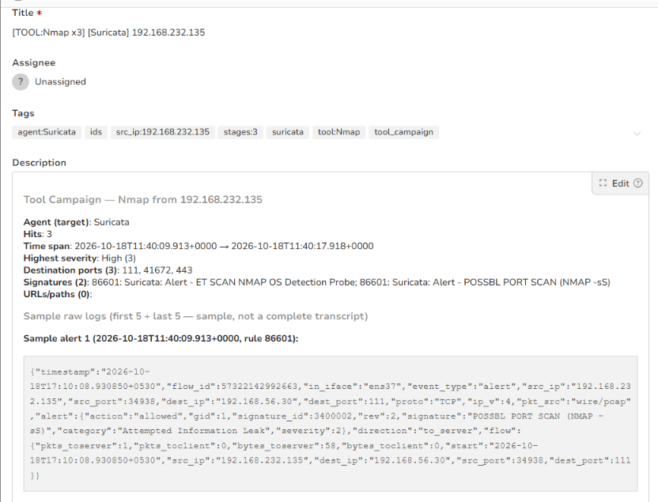
*Figure 1.9: Raw Suricata alert details captured in TheHive alert wzb-3a8045a03c.*

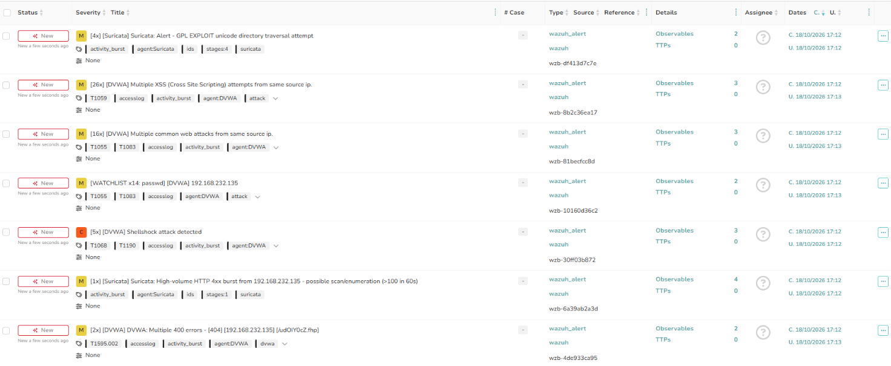
*Figure 1.10: TheHive alert inbox displaying correlated web scan and directory enumeration alerts (17:12:06–17:12:12 IST).*

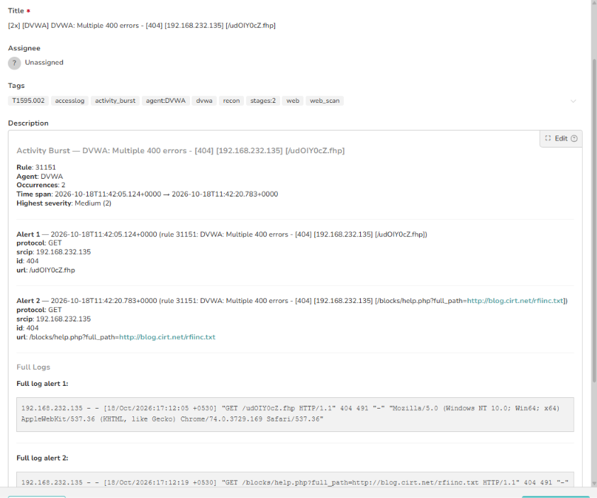
*Figure 1.11: Wazuh rule 31151 alert tracking multiple 400 client error bursts from 192.168.232.135 during Nikto scanning.*

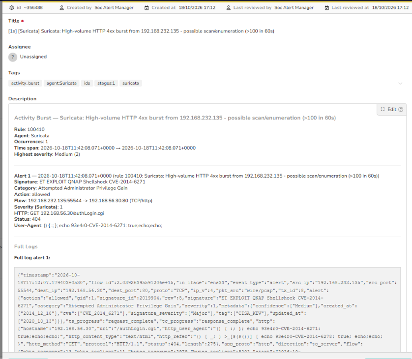
*Figure 1.12: Suricata / Wazuh rule 100410 alert capturing Gobuster high-frequency directory enumeration probes.*

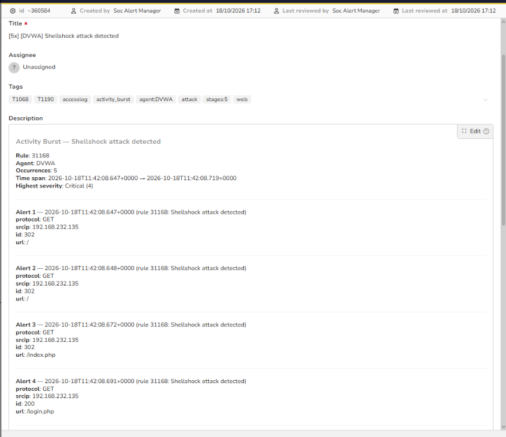
*Figure 1.13: Wazuh rule 31168 alert flagging Nikto Shellshock vulnerability probe patterns in web requests.*

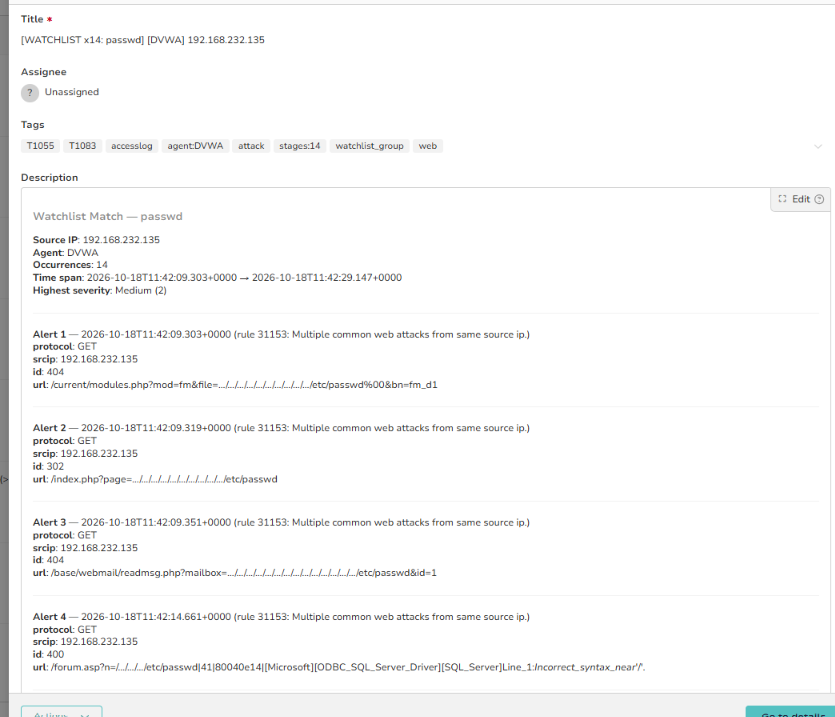
*Figure 1.14: Wazuh watchlist rule triggering on sensitive file access probe targeting /etc/passwd.*

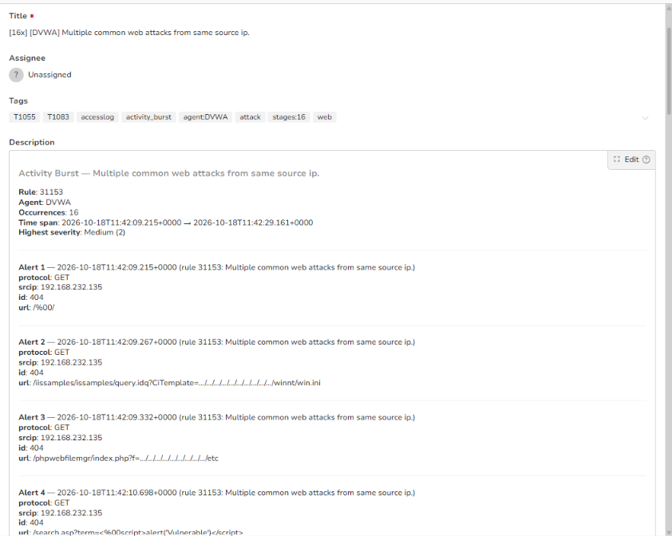
*Figure 1.15: Wazuh rule 31153 alert aggregating multiple common web attack signatures during Nikto scanning.*

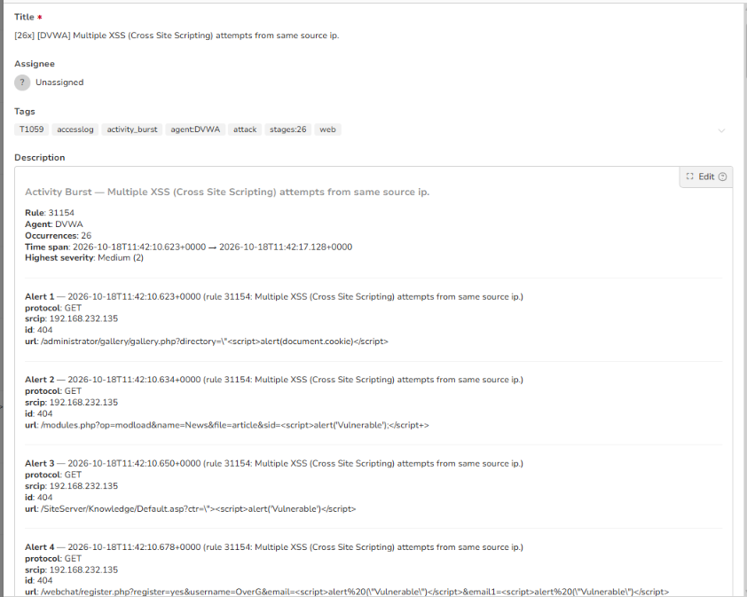
*Figure 1.16: Wazuh rule 31154 alert tracking cross-site scripting probe vectors generated by Nikto.*

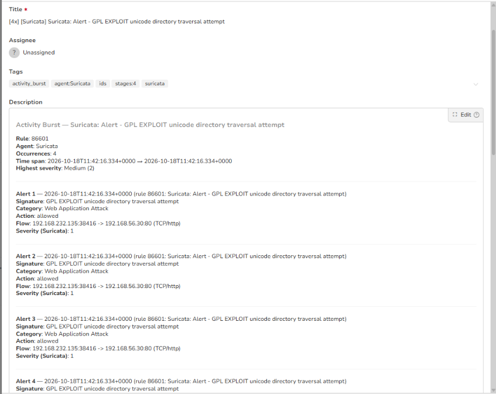
*Figure 1.17: Suricata rule 86601 alert detecting Unicode directory traversal attempt in HTTP traffic.*

## Alert observed

| Source | Rule / Signature | Rule ID | TheHive alert / Reference | Severity |
|---|---|---|---|---|
| Suricata / Wazuh | `[TOOL:Nmap x3] [Suricata] 192.168.232.135` (`ET SCAN NMAP OS Detection Probe`, `POSSBL PORT SCAN (NMAP -sS)`) | 86601 / SID `2018489`, `3400001`, `3400002` | `wzb-3a8045a03c` (`1.png`–`1.3.png`) | High (3) |
| Suricata / Wazuh | `[TOOL:unknown-scanner x7] [Suricata] 192.168.232.135` (`ET SCAN Suspicious inbound to MySQL/MSSQL/PostgreSQL/SSH/VNC/RDP`) | 86601 / 2010937 | `wzb-e076a639a7` (`1.2.png`) | Medium (2) |
| Suricata / Wazuh | `[2x] [Suricata] Suricata: Alert - POSSBL SCAN SHELL M-SPLOIT TCP` | 86601 | `wzb-b8e41fa081` | Medium (2) |
| Wazuh (Apache accesslog) | `[DVWA] Multiple web server 400 error codes from same source ip` | 31151 | `wzb-4de933ca95` (`2.1.png`) | Medium (2) |
| Suricata / Wazuh | Gobuster directory enumeration probe (>100 HTTP 4xx requests in 60s) | 100410 | `wzb-6a39ab2a3d` (`2.2.png`) | Medium (2) |
| Wazuh (Apache accesslog) | Web application Shellshock attempt | 31168 | `wzb-30ff03b872` (`2.3.png`) | High (3) |
| Wazuh (Apache accesslog) | Sensitive file access attempt: `/etc/passwd` probe | Watchlist | `wzb-10160d36c2` (`2.4.png`) | Medium (2) |
| Wazuh (Apache accesslog) | `[DVWA] Multiple common web attacks from same source ip` | 31153 | `wzb-81becfcc8d` (`2.5.png`) | Medium (2) |
| Wazuh (Apache accesslog) | Multiple XSS attempts from same source ip | 31154 | TheHive Alert #09 (`2.6.png` / `wzb-8b2c36ea17`) | Medium (2) |
| Suricata / Wazuh | GPL EXPLOIT unicode directory traversal attempt | 86601 / SID 2100982 | TheHive Alert #10 (`2.7.png` / `wzb-df413d7c7e`) | Medium (2) |

## MITRE ATT&CK

| Tactic | Technique | ID |
|---|---|---|
| Reconnaissance | Active Scanning: Scanning IP Blocks | T1595.001 |
| Reconnaissance | Active Scanning: Vulnerability Scanning | T1595.002 |
| Reconnaissance | Search Open Technical Databases | T1596 |

## Detection opportunities

- **Network-Level Intrusion Detection:** Keep Suricata tuned to catch TCP SYN sweeps, OS fingerprint probes, and fast sequential port scans across database and management ports.
- **Web Server Access Log Anomaly Detection:** Alert on sudden bursts of HTTP 404/403 errors from a single IP address (>100 bad requests in 60 seconds). Automated tools like Nikto and Gobuster throw huge volumes of errors that normal human users never produce.
- **Scanner User-Agent Matching:** Watch for default scanner User-Agents like `nikto`, `gobuster`, and `WhatWeb`—many attackers forget to spoof them.
- **WAF Inspection & Access Controls:** Place a Web Application Firewall or reverse proxy in front of web applications to block probes targeting sensitive version control paths (`/.git/`, `/.git/HEAD`) and prevent directory browsing.

## Notes

- The initial reconnaissance was fully captured by Suricata and Wazuh, feeding early warning alerts into TheHive long before any exploit was launched.
- The scans confirmed that port 80 was running a misconfigured web app with exposed `.git` metadata and an open login portal, setting up the brute-force attack in Stage 02.
