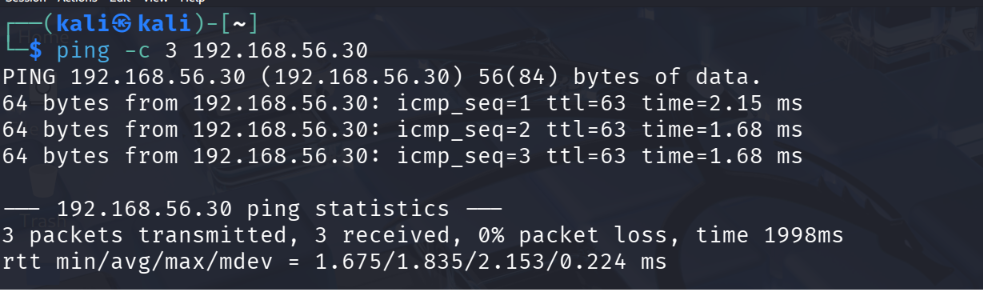
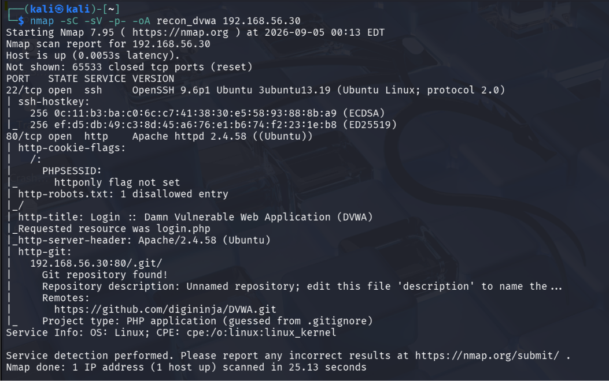
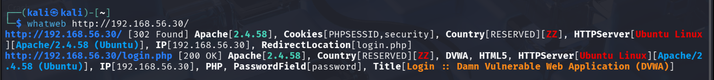
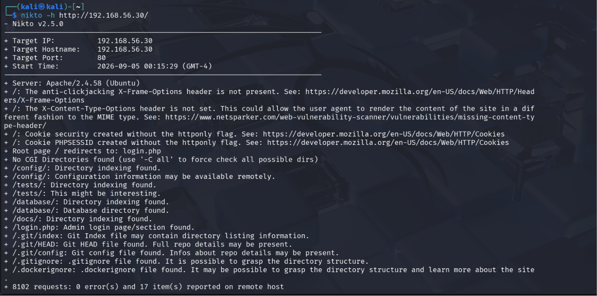
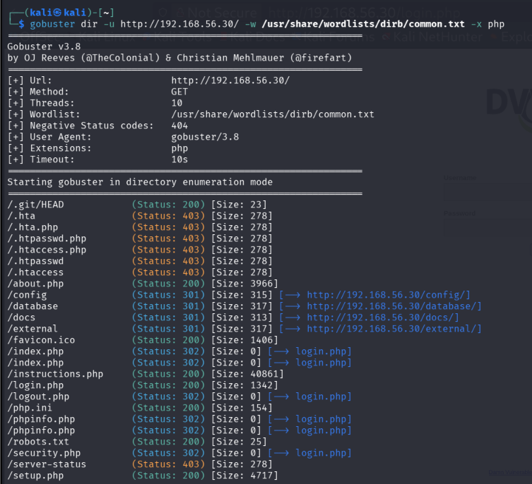
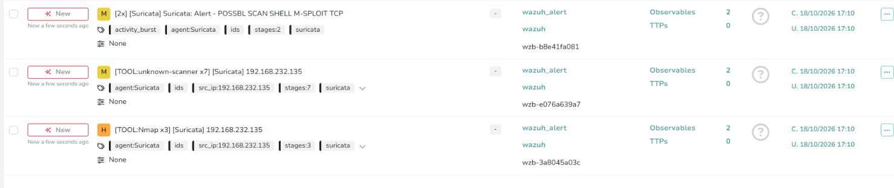
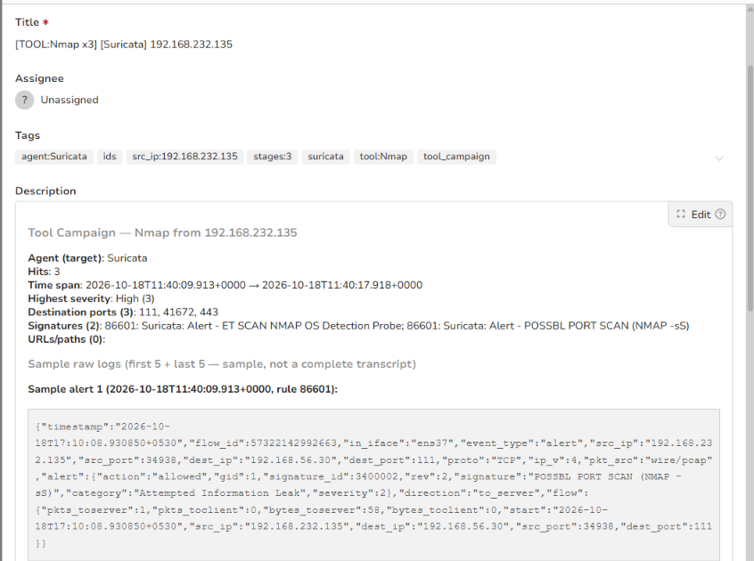
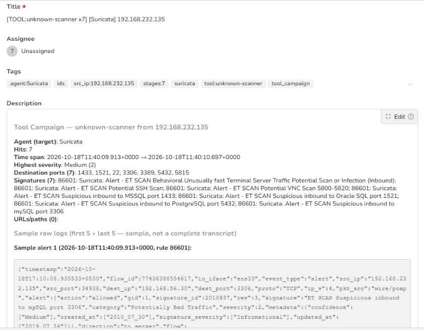
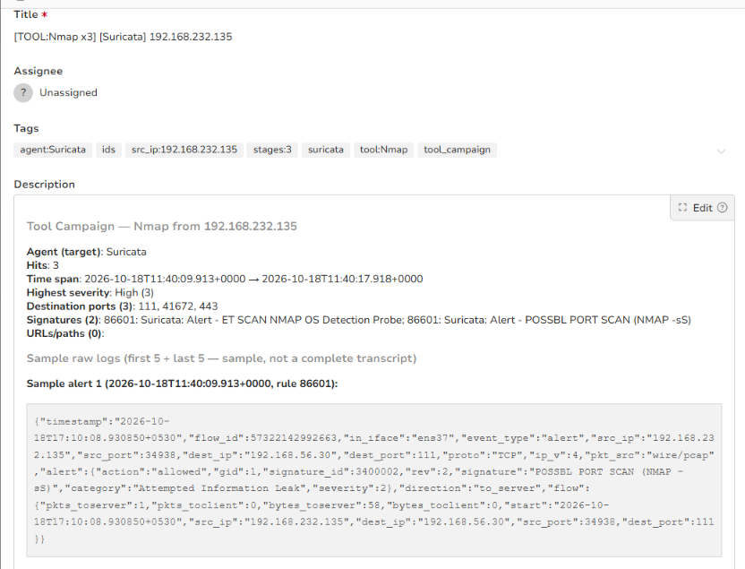

# Stage 01 — Reconnaissance

> **Status:** Complete — evidence attached
> **Case:** [Case 01](../../04-Investigation/Cases/case-01-web-compromise.md)
> **Investigation:** [Stage 01](../../04-Investigation/Stages/stage-01-recon.md)
> **Evidence:** [attack](../Attack-Screenshots/) · [alert](../../03-Detection-Engineering/TheHive_Alert-ScreenShot/)

## Objective

Discover reachable network hosts, identify open TCP/UDP ports, fingerprint running network services and operating system versions, and enumerate the web application attack surface (directories, scripts, technologies, and potential misconfigurations) on the target DVWA server.

## Commands

```bash
# 1. Verify ICMP reachability to target host
ping -c 3 192.168.56.30

# 2. Comprehensive full TCP port and service version scan with default scripts
nmap -sC -sV -p- -oA recon_dvwa 192.168.56.30

# 3. Web technology and banner fingerprinting
whatweb http://192.168.56.30/

# 4. Automated web vulnerability and misconfiguration scanning
nikto -h http://192.168.56.30/

# 5. Directory and web resource enumeration
gobuster dir -u http://192.168.56.30/ -w /usr/share/wordlists/dirb/common.txt -x php
```

## What happened

1. **ICMP Reachability & Network Verification**: The reconnaissance phase began from the Kali Linux attacker host (`192.168.232.135`), testing basic IP connectivity against the target server at `192.168.56.30`. Three ICMP echo requests were sent and successfully received with 0% packet loss and an average round-trip time of 1.83 ms.
2. **Full Port & Service Version Enumeration**: A full TCP port scan (`-p-`) was executed using `nmap` along with default scripts (`-sC`) and service detection (`-sV`). The scan concluded in 25.13 seconds, discovering two open ports:
   - **Port 22/tcp**: OpenSSH 9.6p1 Ubuntu 3ubuntu13.19 (Ubuntu Linux, protocol 2.0).
   - **Port 80/tcp**: Apache httpd 2.4.58 (Ubuntu), hosting Damn Vulnerable Web Application (DVWA). The scan uncovered missing cookie flags (`PHPSESSID` without `httponly`), an entry in `robots.txt`, and an exposed Git repository located at `http://192.168.56.30:80/.git/` referencing `https://github.com/digininja/DVWA.git`.
3. **Web Technology Fingerprinting**: Running `whatweb` confirmed that root requests (`/`) return an HTTP 302 Found redirect to `/login.php`. The web stack consists of Apache 2.4.58, PHP, HTML5, and Ubuntu Linux.
4. **Vulnerability Assessment**: A `nikto` scan against the HTTP service transmitted 8,102 requests and flagged 17 potential vulnerabilities and misconfigurations. Notable findings included absent anti-clickjacking (`X-Frame-Options`) and MIME-sniffing (`X-Content-Type-Options`) headers, missing `httponly` flags on session cookies, open directory indexing across `/config/`, `/database/`, `/docs/`, and `/tests/`, and complete exposure of Git metadata (`.git/index`, `.git/HEAD`, `.git/config`, `.gitignore`).
5. **Directory & Endpoint Brute-Forcing**: Using `gobuster` with the DirB `common.txt` wordlist and `.php` extension searching, the attacker mapped out the web structure, identifying key application scripts including `/login.php` (200), `/setup.php` (200), `/about.php` (200), `/instructions.php` (200), and restricted administrative indexes.

## Evidence

### Attack Screenshots


*Figure 1.1: Verification of ICMP network reachability to DVWA target (192.168.56.30).*


*Figure 1.2: Nmap scan results identifying OpenSSH 9.6p1, Apache 2.4.58, and exposed .git directory.*


*Figure 1.3: WhatWeb fingerprinting revealing Apache, PHP, and DVWA redirect to login.php.*


*Figure 1.4: Nikto web vulnerability scan reporting missing headers and indexed directories.*


*Figure 1.5: Gobuster enumeration mapping out web application structure and sensitive PHP scripts.*

### Alert Screenshots


*Figure 1.6: TheHive alert dashboard showing Suricata Nmap and multi-port scan detections.*


*Figure 1.7: Detailed Suricata alert for Nmap OS detection probe and SYN port scan (rule 86601).*


*Figure 1.8: Suricata alert tracking multi-port scan across SSH, MySQL, and database ports.*


*Figure 1.9: Raw Suricata alert details captured in TheHive alert wzb-3a8045a03c.*

## Alert observed

| Source | Rule / Signature | Rule ID | TheHive alert / Reference | Severity |
|---|---|---|---|---|
| Suricata / Wazuh | `[TOOL:Nmap x3] [Suricata] 192.168.232.135` (`ET SCAN NMAP OS Detection Probe`, `POSSBL PORT SCAN (NMAP -sS)`) | 86601 / SID `2018489`, `3400001`, `3400002` | `wzb-3a8045a03c` | High (3) |
| Suricata / Wazuh | `[TOOL:unknown-scanner x7] [Suricata] 192.168.232.135` (`ET SCAN Suspicious inbound to MySQL/MSSQL/PostgreSQL/SSH/VNC/RDP`) | 86601 / 2010937 | `wzb-e076a639a7` | Medium (2) |
| Suricata / Wazuh | `[2x] [Suricata] Suricata: Alert - POSSBL SCAN SHELL M-SPLOIT TCP` | 86601 | `wzb-b8e41fa081` | Medium (2) |

## MITRE ATT&CK

| Tactic | Technique | ID |
|---|---|---|
| Reconnaissance | Active Scanning: Scanning IP Blocks | T1595.001 |
| Reconnaissance | Active Scanning: Vulnerability Scanning | T1595.002 |
| Reconnaissance | Search Open Technical Databases | T1596 |

## Detection opportunities

- **Network Layer IDS/IPS Rules**: Suricata rules detecting TCP SYN scan patterns, rapid port probes across database and administrative ports, and OS fingerprint probes.
- **Web Server Access Log Anomaly Detection**: Wazuh rules alerting on high-frequency HTTP 404/403 request bursts from a single source IP address within short time windows (>100 requests in 60s), characteristic of automated tools like Nikto and Gobuster.
- **Scanner User-Agent Signatures**: Detection rules matching default scanner User-Agents including `nikto/2.5.0`, `gobuster/3.8`, and `WhatWeb/0.5.5`.
- **WAF Inspection**: Web Application Firewall rules blocking requests targeting sensitive version control paths (`/.git/`, `/.git/HEAD`, `/.gitignore`) and directory enumeration behaviors.

## Notes

- Reconnaissance activity was fully detected by the Suricata Network IDS, which logged detailed signature events to `eve.json`. Wazuh processed these logs via rule `86601` and forwarded them as prioritized alerts into TheHive case management.
- The scan activity confirmed that port 80 hosts DVWA on Apache 2.4.58 with exposed `.git` metadata and accessible login interfaces, establishing the target vector for Stage 02.
