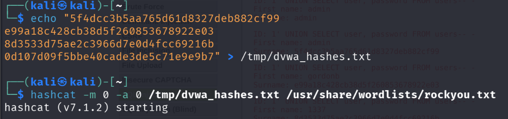
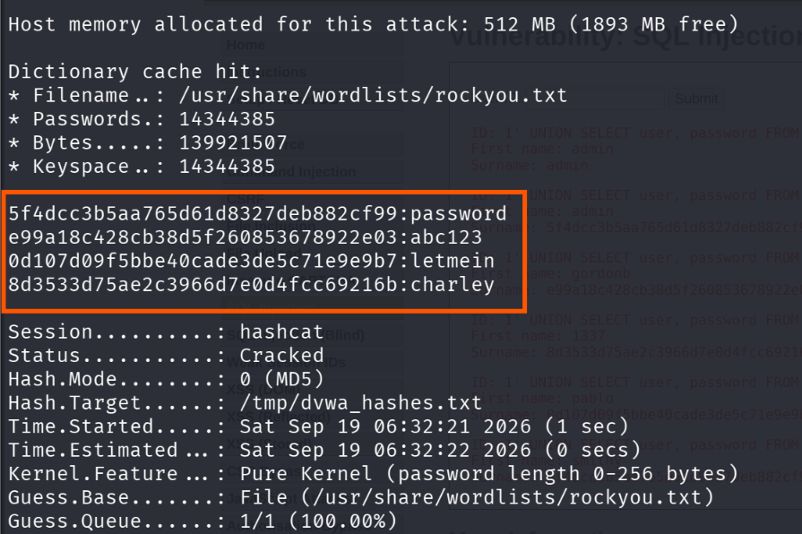

# Stage 04 — Hash Cracking

> **Status:** Complete — evidence attached
> **Case:** [Case 01](../../04-Investigation/Cases/case-01-web-compromise.md)
> **Investigation:** [Phase 1 Deep Dive](../../04-Investigation/Deep-Dive-Attack-Chain-Investigation.md#phase-1-rattling-the-doorknobs-reconnaissance--web-exploitation)
> **Evidence:** [attack](../../06-Resources/screenshots/attack-simulation/10.png) · [alert (none)](../../03-Detection-Engineering/README.md#detection-gap-register)

## Objective

Recover plaintext passwords from the database hashes dumped in Stage 03 by running an offline dictionary attack with Hashcat on the Kali machine.

## Commands

```bash
# 1. Write the extracted MD5 hashes (redacted) to a local target file on Kali Linux
echo "5f4dc***f99
e99a1***e03
8d353***16b
0d107***b7" > /tmp/dvwa_hashes.txt

# 2. Execute offline dictionary attack against the hashes using Hashcat
hashcat -m 0 -a 0 /tmp/dvwa_hashes.txt /usr/share/wordlists/rockyou.txt
```

## What happened

1. **Staging the hashes:** I took the unsalted MD5 hashes dumped from the database in Stage 03 and saved them into `/tmp/dvwa_hashes.txt` on Kali.
2. **Launching Hashcat:** I fired up `hashcat` in standard MD5 mode (`-m 0`) with a wordlist attack (`-a 0`) pointing at `rockyou.txt` (which has over 14 million passwords).
3. **Cracking the passwords in under a second:** Because the passwords were weak and the database used unsalted MD5, Hashcat cracked every single hash in less than a second:
   - `5f4dc***cf99`: `password` (used by `admin` and `smithy`)
   - `e99a1***e03`: `abc123` (used by `gordonb`)
   - `0d107***e9b7`: `letmein` (used by `pablo`)
   - `8d353***16b`: `charley` (used by `1337`)

## Evidence

### Attack Screenshots


*Figure 4.1: Extracted MD5 hashes written to /tmp/dvwa_hashes.txt and Hashcat execution initiation.*


*Figure 4.2: Hashcat status output confirming all four target hashes cracked successfully in under 1 second.*

### Alert Screenshots

> [!NOTE]
> **No Alert Generated (Offline Attack)**: Hash cracking is an offline computational activity performed entirely on the attacker's local workstation (`kali`). Because no network packets were transmitted to the lab network and no code executed on the target host, neither Suricata nor Wazuh generated telemetry. This represents an expected detection gap cataloged under **DG-04**.

## Alert observed

| Source | Rule | Rule ID | TheHive alert | Severity |
|---|---|---|---|---|
| *None (Offline Activity)* | *N/A* | *N/A* | *No alert generated (DG-04)* | *N/A* |
| **Adversary Lifecycle Attribution** | Upstream: SQLi (Stage 03 / Alert #11) · Downstream: Web Login (Stage 05 / Rule 100200) | SIDs 2010963, Wazuh 100600 / 100200 | `wzb-6a22425401` | High (3) |

## MITRE ATT&CK

| Tactic | Technique | ID |
|---|---|---|
| Credential Access | Password Cracking | T1110.002 |

## Detection opportunities

- **Why Offline Cracking Leaves No Logs (DG-04):** Offline cracking happens entirely on the attacker's own computer. Zero packets touch the victim network, and zero commands run on the victim server. There is literally nothing for a SIEM or NIDS to see here.
- **Catch the Theft Upstream:** The only way to stop offline cracking is to catch the attack that stole the hashes in the first place—detecting SQL injection (Stage 03), database dumps, or unauthorized access to password stores.
- **Detect Downstream Logins:** Watch for logins where external or unusual IP addresses suddenly start using credentials that match recently breached or weak accounts.
- **Use Modern Password Hashing:** Never use MD5 or SHA-1 for passwords. Modern slow hashes like Argon2id or bcrypt make dictionary attacks computationally unfeasible, and enforcing Multi-Factor Authentication (MFA) ensures a cracked password alone isn't enough to get in.

## Notes

- All four hashes were cracked almost instantly because the application used raw, unsalted MD5 and simple dictionary words.
- This represents an expected detection gap (**DG-04** in our [Detection Gap Register](../../03-Detection-Engineering/README.md#detection-gap-register)).
