# Stage 09 — Internal Discovery

> **Status:** Complete — evidence attached
> **Case:** [Case 02](../../04-Investigation/Cases/case-02-lateral-movement.md)
> **Investigation:** [Phase 3 Deep Dive](../../04-Investigation/Deep-Dive-Attack-Chain-Investigation.md#phase-3-making-themselves-at-home-ssh-persistence--finding-windows)
> **Evidence:** [attack](../../06-Resources/screenshots/attack-simulation/21.png) · [alert](../../06-Resources/screenshots/thehive-alert/9.png)

## Objective

Map out the internal network from our dual-homed DVWA pivot (`192.168.56.30`), identify the Active Directory Domain Controller and workstations, stage our offensive tools (Impacket, BloodHound, Responder) on the box, and configure local DNS resolution so Kerberos tools work.

## Commands

### 1. Local Network and Host Configuration Discovery (DVWA Pivot)

Enumerate local hostname, user identity, network interfaces, routing tables, and kernel ARP tables:

```bash
# Check hostname, root privileges, and IP addresses on all interfaces
hostname && id && ip a

# Display kernel routing table
ip route

# Inspect kernel ARP table to locate active neighboring internal devices
cat /proc/net/arp
```

### 2. Internal Subnet Network Scanning (192.168.56.0/24)

Execute an active Nmap service and OS detection sweep across the internal network segment:

```bash
# Scan internal lab subnet for open ports, service versions, and OS fingerprints
nmap -sV -O 192.168.56.0/24 --open
```

### 3. Management / Attacker Subnet Scanning (192.168.232.0/24)

Execute an Nmap sweep against the secondary network interface subnet:

```bash
# Scan secondary subnet
nmap -sV -O 192.168.232.0/24 --open
```

### 4. Offensive Tool Staging and Transfer (Kali Linux -> DVWA Pivot)

Stage offensive toolchains on Kali and transfer them to the pivot host over SCP using the root SSH persistence established in Stage 08:

```bash
# Transfer tool archive to DVWA pivot over SCP
scp dvwa_tools.tar.gz root@192.168.56.30:/tmp/

# Transfer Responder framework to /opt/
scp -r Responder root@192.168.56.30:/opt/
```

### 5. Toolkit Extraction and Dependency Installation (DVWA Pivot)

Extract the offensive tool archive and install Python dependencies offline on the pivot:

```bash
# Extract tools archive in /tmp
cd /tmp && tar -xzf dvwa_tools.tar.gz

# Install pre-packaged Python wheels offline
pip install /tmp/pkgs/*
```

### 6. Domain Name Resolution Configuration (DVWA Pivot)

Add the Domain Controller hostname and Active Directory realm to `/etc/hosts` to enable Kerberos and LDAP tooling resolution:

```bash
# Map Domain Controller IP to FQDN and domain realm in /etc/hosts
echo "192.168.56.10 PC-DC.ad.lab ad.lab" >> /etc/hosts
```

## What happened

1. **Finding out where we are:** With persistent root access on DVWA, I checked the network configuration: `hostname && id && ip a`. Sure enough, DVWA is dual-homed: `ens37` sits on the management/attacker subnet (`192.168.232.161/24`), while `ens33` reaches directly into the internal corporate network (`192.168.56.30/24`).
2. **Checking the neighbors (ARP cache):** Running `cat /proc/net/arp` was an instant win. DVWA had already communicated with other systems on `ens33`, revealing `192.168.56.10`, `192.168.56.20`, and `192.168.56.150` sitting in the kernel ARP table without sending a single probe.
3. **Scanning the internal subnet:** I launched an internal Nmap scan through `ens33`: `nmap -sV -O 192.168.56.0/24 --open`. The corporate crown jewels showed up right away:
   - **Domain Controller (`192.168.56.10`):** `PC-DC.ad.lab` running Windows Server. All the classic Active Directory ports were wide open: Kerberos (port 88), LDAP (port 389), SMB (port 445), and RPC (port 135).
   - **Workstation (`192.168.56.20`):** A Windows 10 desktop with SMB and RPC listening.
4. **Scanning the management network:** I also scanned `192.168.232.0/24`, mapping our own Kali machine (`192.168.232.135`) and the gateway (`192.168.232.162`).
5. **Turning DVWA into an attack box:** Rather than proxying complicated tools through multiple hops, I copied our entire offensive toolkit from Kali straight into DVWA over SCP (`dvwa_tools.tar.gz` into `/tmp/` and Responder into `/opt/`).
6. **Setting up the tools:** On DVWA, I unpacked the archive and installed dependencies locally using pre-packaged wheels with `pip install /tmp/pkgs/*`.
7. **Fixing domain name resolution:** Active Directory and Kerberos tools break if they can't resolve domain names to IPs. So I added `192.168.56.10 PC-DC.ad.lab ad.lab` directly into `/etc/hosts`. Now the Linux pivot was fully armed and ready to attack Active Directory.

## Evidence

### Attack Screenshots

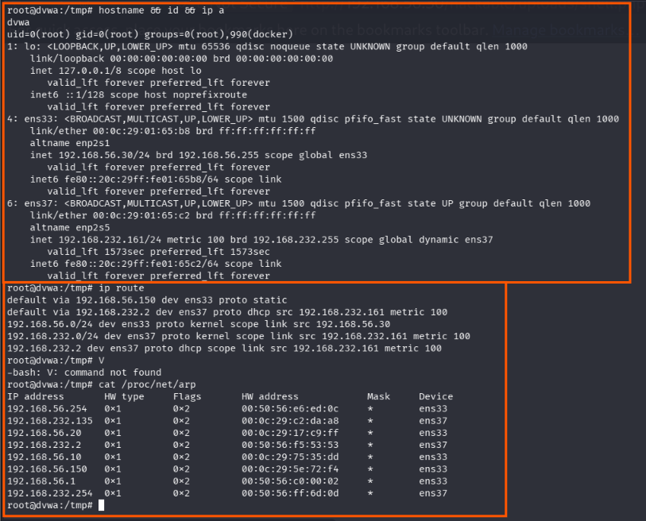
*Figure 9.1: Local network interface enumeration, routing table, and kernel ARP cache on DVWA revealing internal subnet hosts.*

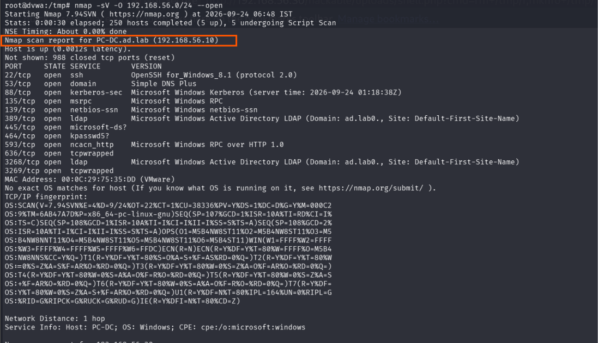
*Figure 9.2: Nmap scan output against `192.168.56.0/24` identifying the Domain Controller `PC-DC.ad.lab` (`192.168.56.10`) and exposed AD services.*

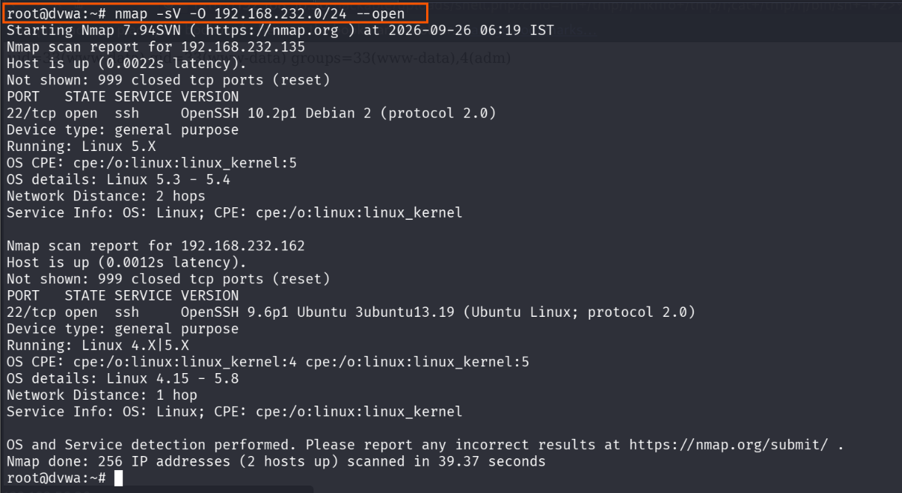
*Figure 9.3: Nmap scan of the `192.168.232.0/24` subnet identifying Kali and gateway devices.*

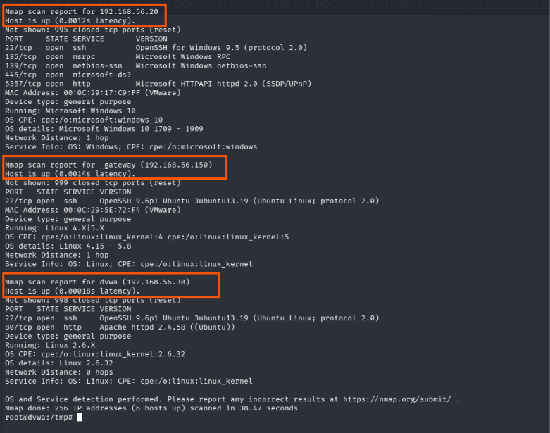
*Figure 9.4: Continuation of internal Nmap scan discovering Windows 10 endpoint (`192.168.56.20`) with open SMB and RPC ports.*

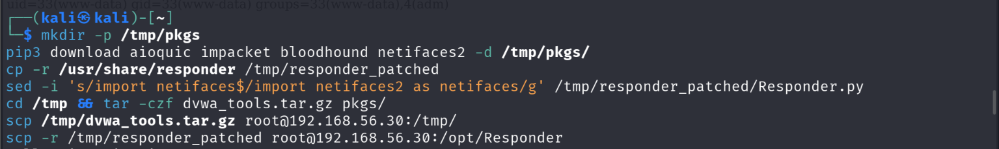
*Figure 9.5: Transferring offensive tool bundles (`dvwa_tools.tar.gz`, Responder) from Kali to the DVWA pivot via SCP.*

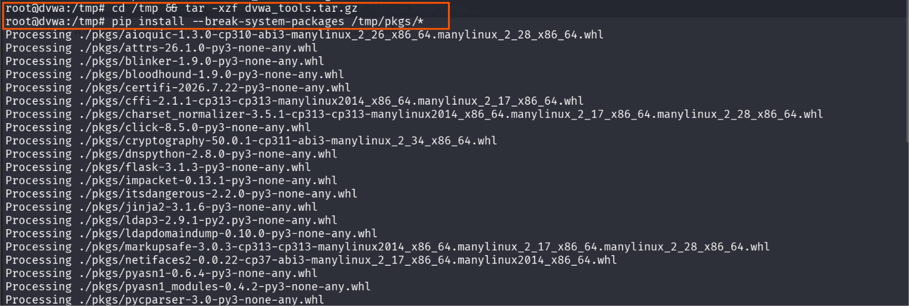
*Figure 9.6: Unpacking attack tools and installing Python packages locally on `dvwa`.*

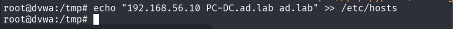
*Figure 9.7: Adding `PC-DC.ad.lab` and `ad.lab` to `/etc/hosts` for Domain Controller name resolution.*

### Alert Screenshots

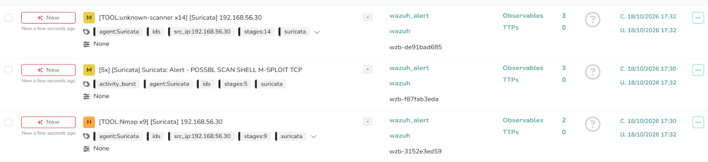
*Figure 9.8: TheHive Alerts #17–#19 overview displaying detection of internal port scanning and network reconnaissance across subnets.*

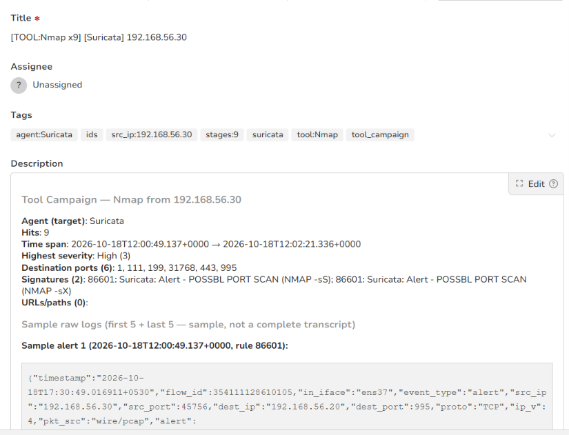
*Figure 9.9: Suricata SID 3400001/3400002 alert detail (Alert #17 wzb-3152e3ed59) capturing Nmap TCP SYN sweep on ens37.*

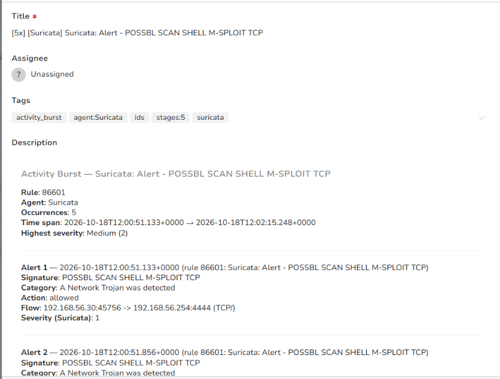
*Figure 9.10: Suricata Rule 86601 alert (Alert #18 wzb-f87fab3eda) tracking port scanning thresholds.*

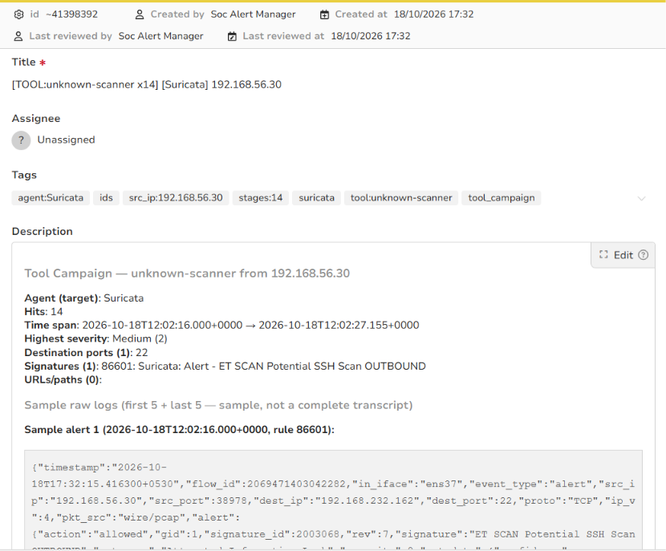
*Figure 9.11: Suricata alert (Alert #19 wzb-de91bad685) tracking multi-service probe across internal database and administrative ports.*

## Alert observed

| Source | Rule / Signature | Rule ID | TheHive Alert | Severity | Status |
|---|---|---|---|---|---|
| Suricata / Wazuh | Network Port Scanning / Internal Reconnaissance Sweep | Suricata SIDs 3400001, 3400002, 3400020 / Wazuh 86601 | TheHive Alerts #17–#19 (`9.png`–`9.3.png` / `wzb-3152e3ed59`, `wzb-f87fab3eda`, `wzb-de91bad685`) | Medium | **Target Logging Gap (DG-09)** |
| Wazuh (Host Command Audit) | Bash command by root: `nmap -sV -O 192.168.56.0/24 --open` | Rule 100220 (Level 5) | SIEM Indexed (`Wazuh-Raw-Alerts.csv` Row 9184) | Medium | **Detected (Pivot Command Capture)** |

> [!NOTE]
> **Detection Partition Reality (Target Logging Gap DG-09):**  
> While Suricata NIDS directly captured internal reconnaissance wire frames on interface `ens37` (TheHive Alerts #17–#19: SIDs 3400001, 3400002, 3400020) and Wazuh Rule 100220 captured command-line execution on the DVWA pivot at `17:31:19 IST` (Row 9184), the target Windows endpoints (`192.168.56.10` and `192.168.56.20`) produced zero host-level telemetry because Windows Filtering Platform dropped packet logging was unconfigured in the default baseline (`DG-09`). Remediated in post-campaign hardening by enabling WFP drop auditing and forwarding dropped packets to Wazuh.

## MITRE ATT&CK

| Tactic | Technique | ID | Sub-technique |
|---|---|---|---|
| Discovery | Remote System Discovery | T1018 | — |
| Discovery | Network Service Discovery | T1046 | — |
| Discovery | System Network Configuration Discovery | T1016 | — |

## Detection opportunities

- **Internal Network Portscan Alerts:** Suricata caught the internal Nmap scan on `ens37` immediately, alerting on rapid TCP SYN packets across multiple internal hosts (Alerts #17, #18, #19).
- **Flagging Discovery Commands on Servers:** Linux servers shouldn't be running `nmap`, checking routing tables, or scanning neighboring subnets. Auditd and Wazuh can easily alert on administrative and scanning binaries run on production web boxes.
- **File Integrity Monitoring on `/etc/hosts`:** Attackers often add custom domain mappings to `/etc/hosts` to hijack name resolution or point to DCs. FIM rules on `/etc/hosts` catch this tampering in real time.
- **Tool Staging in `/tmp`:** Watch for sudden transfers of attack frameworks (Impacket, Responder, BloodHound) and unexpected `pip install` commands run in `/tmp` or `/opt`.

## Notes

- **The Pivot in Action:** The dual-homed DVWA server (`192.168.56.30`) became the forward jump box for the rest of the attack chain.
- **Noise vs. Stealth:** Firing off a full Nmap scan lit up Suricata like a flare. In a real-world stealth operation, an attacker would rely more quietly on passive ARP tables and slow LDAP queries.
