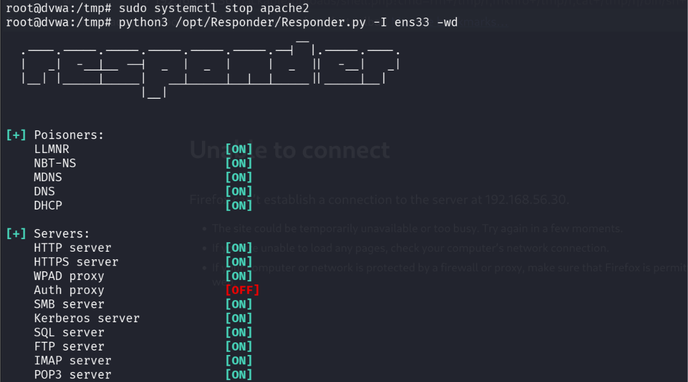
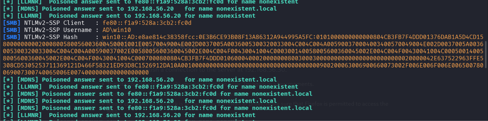
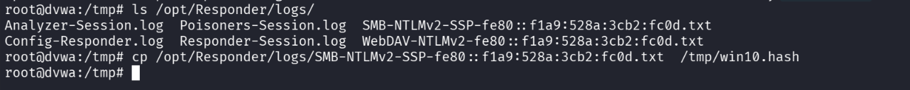
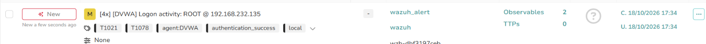
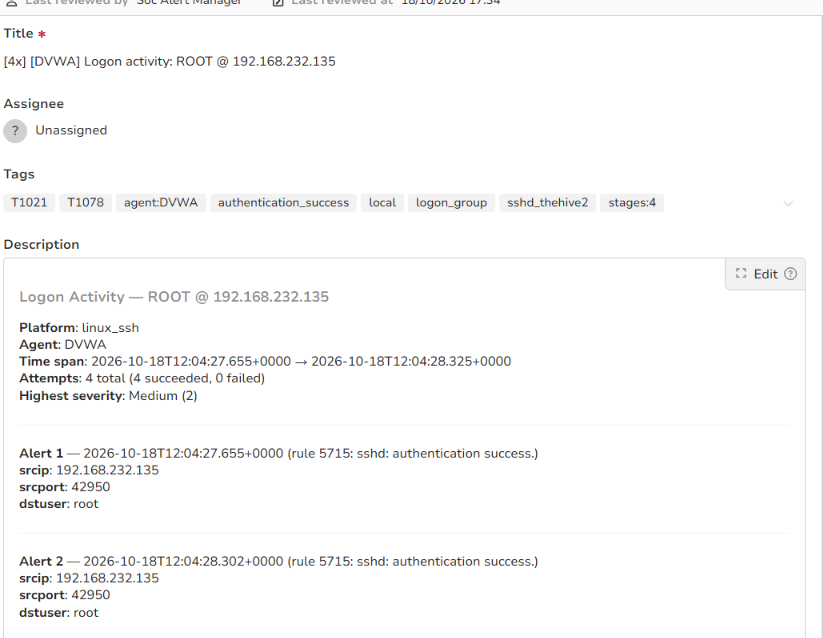
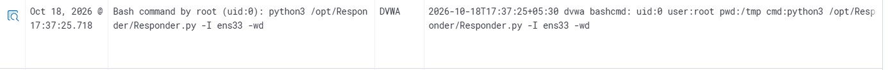
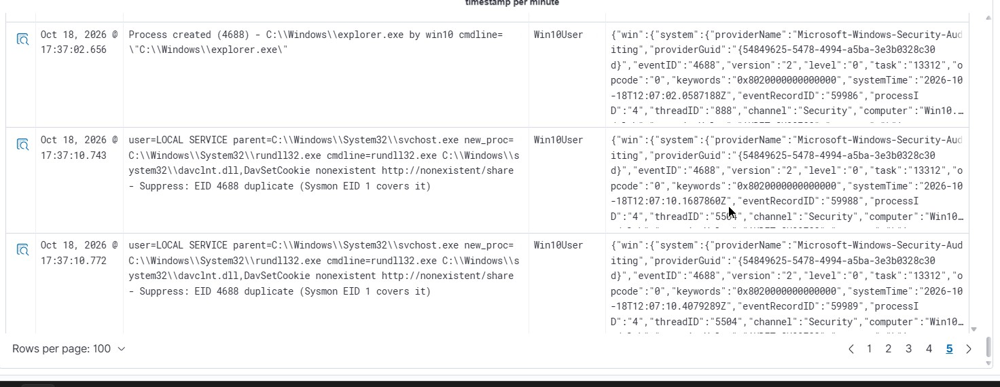
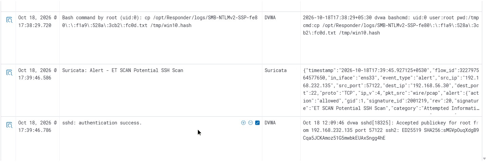

# Stage 10 — Responder Poisoning

> **Status:** Complete — evidence attached
> **Case:** [Case 02](../../04-Investigation/Cases/case-02-lateral-movement.md)
> **Investigation:** [Phase 4 Deep Dive](../../04-Investigation/Deep-Dive-Attack-Chain-Investigation.md#phase-4-poisoning-the-well-stealing-windows-passwords-with-responder)
> **Evidence:** [attack](../../06-Resources/screenshots/attack-simulation/28.png) · [alert](../../06-Resources/screenshots/thehive-alert/10.png)

## Objective

Steal Windows domain credentials by poisoning link-local name resolution protocols (LLMNR and mDNS) on the internal subnet (`192.168.56.0/24`) using Responder on our DVWA pivot, tricking a Windows client into handing over its NetNTLMv2 hash.

## Commands

### 1. Free Port 80 and Launch Responder (DVWA Pivot)

Halt the local Apache web server to release TCP port 80 for Responder's rogue HTTP/WPAD server, then start Responder on the internal interface `ens33`:

```bash
# Stop Apache web server daemon to free TCP port 80
sudo systemctl stop apache2

# Launch Responder on the internal interface (ens33: 192.168.56.30)
# Flags: -I ens33 (interface), -w (WPAD rogue proxy), -d (DHCP poisoning)
python3 /opt/Responder/Responder.py -I ens33 -wd
```

### 2. Locate and Stage Captured Authentication Hashes

Inspect Responder's log directory and stage the captured NTLMv2 hash into `/tmp` for offline password cracking in Stage 11:

```bash
# List captured authentication logs
ls -la /opt/Responder/logs/

# Stage the Windows 10 NTLMv2 SSP hash to /tmp
cp /opt/Responder/logs/SMB-NTLMv2-SSP-fe80\:\:f1a9\:528a\:3cb2\:fc0d.txt /tmp/win10.hash

# Inspect the captured hash file
cat /tmp/win10.hash
```

Observed hash format (redacted per documentation policy):
```text
win10::AD:112233***8899:b4a78***e31
```

## What happened

1. **Clearing port 80 for Responder:** Responder includes rogue authentication listeners for HTTP, WPAD, SMB, and LDAP. Because DVWA was running Apache on port 80, I stopped Apache (`sudo systemctl stop apache2`) so Responder's rogue HTTP proxy could bind cleanly.
2. **Firing up Responder:** I launched Responder on the internal interface `ens33`: `python3 /opt/Responder/Responder.py -I ens33 -wd`.
3. **The mistyped share:** Over on the Windows 10 workstation (`192.168.56.20`), someone tried to connect to a nonexistent file share (`\\nonexistent`).
4. **Falling back to LLMNR:** When the Domain Controller's DNS server answered that `nonexistent` didn't exist, Windows did what it always does by default: it shouted across the local network using LLMNR (UDP 5355) and mDNS (UDP 5353), asking: *"Hey, does anyone know where nonexistent is?"*.
5. **The poisoned reply:** Responder heard the shout on `ens33` and instantly replied: *"Yes, that's me at 192.168.56.30!"*.
6. **Grabbing the password hash:** Windows believed it and immediately initiated an SMB connection to authenticate. Responder challenged the client, and Windows replied with the domain NetNTLMv2 hash for `AD\win10`.
7. **Saving the loot:** Responder saved the full hash in `/opt/Responder/logs/`.
8. **Staging for cracking:** I copied the captured hash to `/tmp/win10.hash` so we could crack it offline with Hashcat in Stage 11.

## Evidence

### Attack Screenshots


*Figure 10.1: Halting Apache service (`systemctl stop apache2`) and launching Responder on internal interface `ens33`.*


*Figure 10.2: Responder poisoning queries for `nonexistent` from `192.168.56.20` and capturing the NTLMv2 hash for domain user `AD\win10`.*


*Figure 10.3: Listing Responder logs and copying the captured NetNTLMv2 hash file to `/tmp/win10.hash`.*

### Alert Screenshots


*Figure 10.4: TheHive Alert #20 overview capturing root SSH logon on DVWA during Responder staging and execution (wzb-dbf3197ceb).*


*Figure 10.5: Wazuh Rule 5715 alert detail showing SSH session from 192.168.232.135 to 192.168.56.30 (Alert #20).*


*Figure 10.6: Wazuh Rule 100220 command audit capturing python3 /opt/Responder/Responder.py -I ens33 -wd execution.*


*Figure 10.7: Windows 10 endpoint (Win10User) Event ID 4688 DavSetCookie token coercion captured by Wazuh Custom Rule 100278 (wzb-28).*


*Figure 10.8: Wazuh Rule 100220 capturing cp of harvested NetNTLMv2 hash loot to /tmp/win10.hash.*

## Alert observed

| Source | Rule / Signature | Rule ID | TheHive Alert | Severity | Status |
|---|---|---|---|---|---|
| Wazuh (Host Command Audit) | Bash command by root: `python3 /opt/Responder/Responder.py -I ens33 -wd` | Rule 100220 (Level 5) | SIEM Indexed (`Wazuh-Raw-Alerts.csv` Rows 9233, 9242) (`wzb-27`) | High | **Detected (Verbatim Command Capture)** |
| Windows 10 Endpoint (Win10User) | Windows Event ID 4688: Process creation with `DavSetCookie` token coercion | Wazuh Custom Rule 100278 (Level 3) | SIEM Indexed (`Wazuh-Raw-Alerts.csv` Data Rows 9238–9240, `wzb-28`) | High (3) | **Detected (Direct Endpoint Capture)** |
| Wazuh (Pivot Host) | sshd: authentication success (Responder staging session) | Rule 5715 (Level 8) | TheHive Alert #20 (`10.png`, `10.1.png` / `wzb-dbf3197ceb`) | Medium (2) | **Detected (Operational SOAR Alert)** |
| Wazuh (Host Command Audit) | Bash command by root: `cp /opt/Responder/logs/SMB-NTLMv2-SSP-... /tmp/win10.hash` | Rule 100220 (Level 5) | SIEM Indexed (`Wazuh-Raw-Alerts.csv` Row 9244, `wzb-29`) | Medium | **Detected (Hash Loot Staging)** |

> [!NOTE]
> **Telemetry Attribution & Pipeline Execution (Rule 100220):**  
> Responder was launched interactively on the DVWA pivot (`python3 /opt/Responder/Responder.py -I ens33 -wd`) and recorded by Wazuh Rule 100220 (`bashcmd` pipeline) at `17:36:26 IST` (Row 9233) and `17:37:25 IST` (Row 9242). Preceding preparatory commands—stopping Apache (`systemctl stop apache2`, Row 9226) and disabling systemd-resolved DNSStubListener (Row 9227)—and the subsequent hash copy command (`cp ... /tmp/win10.hash`, Row 9244 at `17:38:29 IST`) were all captured verbatim. As a Level 5 rule, Rule 100220 provides ground-truth SIEM indexing in OpenSearch without triggering high-volume SOAR alert fatigue.

## MITRE ATT&CK

| Tactic | Technique | ID | Sub-technique |
|---|---|---|---|
| Credential Access | Adversary-in-the-Middle | T1557 | LLMNR/NBT-NS Poisoning and SMB Relay (T1557.001) |

## Detection opportunities

- **Watch for LLMNR/NBT-NS Poisoning:** Network sensors like Suricata can alert when multiple spoofed LLMNR (UDP 5355) or NetBIOS (UDP 137) answers originate from an unauthorized host.
- **Rogue Port Binding Alerts:** Endpoint tools should raise an alarm when a Python script suddenly binds to well-known infrastructure ports (TCP 80, 445, 139).
- **Service Tampering Alerts:** Stopping critical system daemons (`systemctl stop apache2`) followed right away by Python network scripts is a strong behavioral signal.
- **Kill LLMNR & NetBIOS with GPO (The Real Fix):**
  - Disable LLMNR via Group Policy: `Turn off multicast name resolution = Enabled`.
  - Disable NetBIOS over TCP/IP across all network adapters. If machines can't broadcast, Responder has nothing to answer!

## Notes

- **Why this worked:** LLMNR and NetBIOS are link-local broadcast protocols that don't cross routers. Because our DVWA pivot sat directly on the internal `192.168.56.0/24` subnet alongside Windows 10, Responder could hear and poison every broadcast.
- **Hash Redaction:** The captured NetNTLMv2 hash has been redacted per our documentation policy (`win10::AD:112233***8899:b4a78***e31`).
