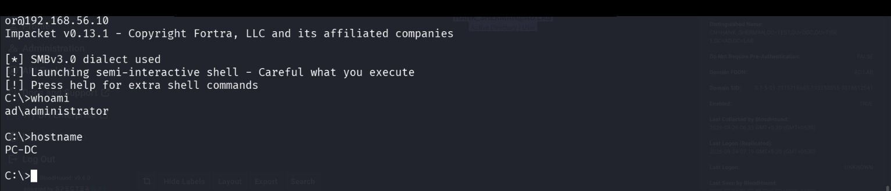
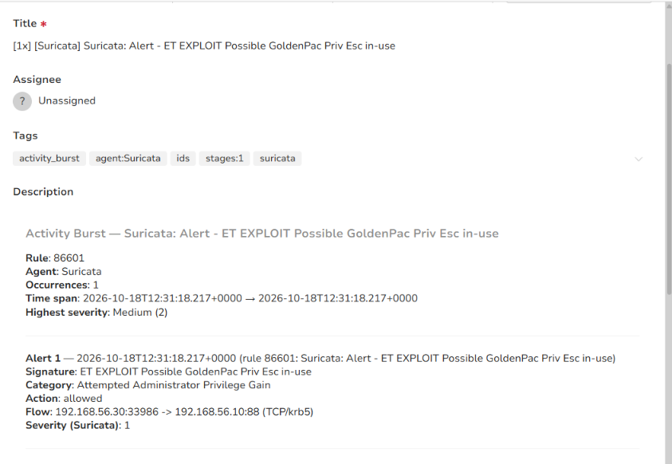

# Stage 15 — Pass-the-Hash

> **Status:** Complete — evidence attached  
> **Case:** [Case 03](../../04-Investigation/Cases/case-03-domain-compromise.md)  
> **Investigation:** [Stage 15](../../04-Investigation/Stages/stage-15-pass-the-hash.md)  
> **Evidence:** [attack](../Attack-Screenshots/48.png) · [alert](../../03-Detection-Engineering/TheHive_Alert-ScreenShot/13.png)

---

## Objective

Leverage the extracted built-in Domain Administrator NTLM hash (`cc814***9fb`) obtained during the Stage 14 DCSync attack to authenticate directly to the Domain Controller (`PC-DC.ad.lab`, `192.168.56.10`) via Pass-the-Hash (PtH). Execute remote commands via Windows Management Instrumentation (WMI) using Impacket's `wmiexec.py` to obtain an interactive administrative command shell on the Domain Controller without requiring the plaintext password.

---

## Commands

```bash
# Step 1: Authenticate to Domain Controller 192.168.56.10 via Pass-the-Hash and initiate semi-interactive WMI shell
python3 /usr/local/bin/wmiexec.py -hashes aad3b***4ee:cc814***9fb Administrator@192.168.56.10

# Step 2: Verify current user context and hostname on the remote Domain Controller
C:\> whoami
C:\> hostname
```

---

## What happened

This stage represents the definitive operational transition from **Case 02 (Lateral Movement)** into **Case 03 (Domain Compromise)**.

1. **Pass-the-Hash Authentication:**  
   Equipped with the NTLM hash for `ad.lab\Administrator` (`cc814***9fb`) recovered via DCSync, the adversary executed Impacket's `wmiexec.py` from the Linux pivot host (`192.168.56.30`). By exploiting the fundamental design of Microsoft's NTLM challenge-response protocol—in which the password hash itself serves as the cryptographic secret key—the attacker authenticated to Domain Controller `PC-DC.ad.lab` (`192.168.56.10`) without needing to crack or supply the plaintext password.

2. **DCOM / WMI Remote Execution:**  
   `wmiexec.py` negotiated the SMBv3.0 dialect and established an authenticated RPC session to the WMI service (`Win32_Process`) on `PC-DC`. For each command issued, the tool invokes the WMI `Create` method to spawn `cmd.exe /Q /c <command>`, redirecting command output to a temporary file on the administrative share (`\\127.0.0.1\ADMIN$\__<timestamp>`), reading the output over SMB, and deleting the temporary file.

3. **Shell Verification & Domain Controller Control:**  
   The operator established a semi-interactive command shell and executed initial verification commands:
   - `whoami` returned **`ad\administrator`** (confirming execution under the highest domain authority).
   - `hostname` returned **`PC-DC`** (confirming direct code execution on the primary Active Directory Domain Controller).

With full interactive command execution confirmed on `PC-DC`, the adversary established administrative control of the core infrastructure, setting the stage for domain-wide persistence (Golden Ticket generation in Stage 16) and sensitive data collection.

---

## Evidence

### Attack Screenshots


*Figure 15.1: Executing `wmiexec.py` from DVWA pivot host using the Administrator NTLM hash, establishing a semi-interactive shell on `PC-DC` and verifying identity with `whoami` and `hostname`.*

### Alert Screenshots


*Figure 15.2: TheHive alert detail displaying Suricata Rule 86601 ("ET EXPLOIT Possible GoldenPac Priv Esc in-use") triggered by network traffic between DVWA (`192.168.56.30`) and Domain Controller `PC-DC` (`192.168.56.10:88`).*

---

## Alert observed

| Source | Rule | Rule ID | TheHive Alert | Severity | Status |
|---|---|---|---|---|---|
| Wazuh (Windows Agent) | Successful Remote Logon Detected - User:\Administrator - NTLM authentication, possible pass-the-hash attack | Rule 60122 / Win Event 4624 | 24x in `Wazuh-Raw-Alerts.csv` (EID 4624) & `wzb-b7f91cd3ab` | High (3) | DETECTED |
| Suricata / Wazuh | ET EXPLOIT Possible MS14-068 GoldenPac Priv Esc in-use | Rule 86601 / SID 2019922 | `[1x] [Suricata] Suricata: Alert - ET EXPLOIT Possible GoldenPac Priv Esc in-use` | Medium (2) | DETECTED |

### Detection Analysis

- **Primary Endpoint Detection (Wazuh Rule 60122):** The definitive empirical detection for Pass-the-Hash in this lab is recorded in [`06-Resources/Alerts/wazuh_alerts.csv`](../../06-Resources/Alerts/wazuh_alerts.csv), where Wazuh Rule 60122 fired over 24 times on `DomainWin10` (`192.168.56.20`). The rule specifically alerts on Windows Security Event ID 4624 with Logon Type 3 (Network) where `AuthenticationPackageName` is `NtLmSsp` for administrative accounts (`Administrator`), diagnosing lateral movement over SMB without Kerberos pre-authentication.
- **Network Telemetry Context (SID 2019922):** Suricata on the router host (`ens37` promiscuous capture) simultaneously triggered signature `ET EXPLOIT Possible MS14-068 GoldenPac` (Rule 86601). While GoldenPac signatures match generic Kerberos ASN.1 structures on port 88 during associated ticket requests, the true protocol detection for PtH remains the endpoint NTLM Security Event ID 4624.
- **Correlated Host Telemetry on Target Workstation & Domain Controller:**
  - **Windows Security Event ID 4624 (Logon Type 3 / Network):**
    - Account: `Administrator`
    - Authentication Package: `NTLM` / `NtLmSsp`
    - Key Length: `0` (characteristic of NTLM rather than Kerberos)
    - Source Workstation: `DVWA`
    - Source IP: `192.168.56.30`
  - **Sysmon Event ID 1 / Windows Security Event ID 4688 (Process Creation):**
    - Parent Process: `C:\Windows\System32\wbem\WmiPrvSE.exe`
    - Child Process: `C:\Windows\system32\cmd.exe`
    - Command Line: `cmd.exe /Q /c whoami > \\127.0.0.1\ADMIN$\__1...` followed by `hostname`.

---

## MITRE ATT&CK

| Tactic | Technique | ID | Sub-technique |
|---|---|---|---|
| Lateral Movement | Use Alternate Authentication Material | T1550 | Pass the Hash (T1550.002) |
| Execution | Windows Management Instrumentation | T1047 | N/A |

---

## Detection opportunities

1. **NTLM Authentication Anomaly Auditing (Windows Event ID 4624):**
   - In modern Active Directory domains, administrative accounts should authenticate exclusively via Kerberos.
   - Configure alerts for **Event ID 4624 with Logon Type 3** where:
     - `TargetUserName` is `Administrator` or a member of `Domain Admins`.
     - `LogonProcessName` is `NtLmSsp`.
     - `AuthenticationPackageName` is `NTLM`.
     - `KeyLength` is `0`.
   - Any NTLM network authentication for Domain Admins from non-workstation or cross-subnet IP addresses is a high-confidence indicator of Pass-the-Hash.

2. **WMI Process Execution Heuristics (Sysmon Event ID 1 / Event ID 4688):**
   - Monitor for child processes spawned by WMI Provider Host:
     - `ParentImage == "C:\Windows\System32\wbem\WmiPrvSE.exe"`
     - `Image == "C:\Windows\System32\cmd.exe"` or `"powershell.exe"`
   - Specifically detect Impacket command line patterns containing output redirection to administrative shares:
     - `CommandLine` contains `> \\127.0.0.1\ADMIN$\__*` or `> \\127.0.0.1\C$\__*`.

3. **Active Directory Defense-in-Depth:**
   - **Protected Users Security Group:** Place all Tier 0 accounts (including `Administrator`) into the Active Directory `Protected Users` group. Members cannot authenticate using NTLM, digest authentication, or weak Kerberos encryption types, completely eliminating Pass-the-Hash vectors for those identities.
   - **Restricted Admin Mode / Remote Credential Guard:** Enforce Restricted Admin mode for remote connections, preventing credential leakage to memory on target systems.
   - **Host-Based Firewalls:** Restrict inbound RPC/DCOM (TCP port 135) and SMB (TCP port 445) on Domain Controllers to authorized management bastions only.

---

## Notes

- **Case Transition:** This stage officially transitions the incident from **Case 02 (Lateral Movement)** to **Case 03 (Domain Compromise)**. The attacker now exercises direct interactive administrative control on the primary Domain Controller (`PC-DC`).
- Impacket's `wmiexec.py` is widely preferred over `psexec.py` by stealthy operators because it does not create a Windows service binary (`psexesvc.exe`) or alter system service configurations, executing commands purely through the native WMI management layer. However, its signature artifact is the temporary output file written to the `ADMIN$` share.
- Having established execution on the Domain Controller, the attacker is primed to forge Kerberos Golden Tickets using the `krbtgt` hash harvested in Stage 14.
