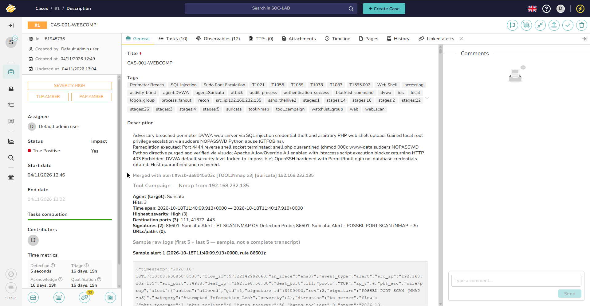

# Case 01 — Web Application Compromise

> **Status:** Closed / Validated  
> **TheHive case ID:** `CAS-001-WEBCOMP`  
> **Severity:** High  
> **TLP / PAP:** `TLP:AMBER / PAP:AMBER`  
> **Master Incident Tag:** `INC-2026-1018-ALPHA`  
> **Linked Alerts:** 13 Ingested Alerts (Alerts #02–#05, #07–#15)  
> **Eradication Playbook:** [`Eradication-Hardening-and-Recovery.md`](../Eradication-Hardening-and-Recovery.md#4-step-2-linux-root-cause-vulnerability-elimination--web-hardening-dvwa)

  
*Figure 1: TheHive 5 Case Record for `CAS-001-WEBCOMP` showing 13 linked alerts, completed remediation tasks, and formal closure verdict.*  

---

## Summary

The adversary initiated an external attack campaign targeting the public-facing Damn Vulnerable Web Application (DVWA) hosted at `192.168.56.30` from Kali Linux (`192.168.232.135`). Following automated port scanning and directory fuzzing, the adversary performed credential brute-forcing against `/login.php` and exploited a SQL injection flaw to dump the user credentials table. After cracking the administrative hash offline, the adversary authenticated to DVWA, uploaded an executable PHP web shell (`shell.php`), spawned an interactive named-pipe FIFO Netcat (`/usr/bin/nc.openbsd`) reverse shell connecting back to Kali (`4444/TCP`), and abused a passwordless sudo Python misconfiguration (`sudo /usr/bin/python3` GTFOBins) to obtain local `root` privileges.

---

## Scope

| Stage | Attack | Investigation | Detection Status |
|---|---|---|---|
| 01 | [Reconnaissance](../../02-Attack-Simulation/Stages/stage-01-recon.md) | [Phase 1 Deep Dive](../Deep-Dive-Attack-Chain-Investigation.md#phase-1-rattling-the-doorknobs-reconnaissance--web-exploitation) | **Detected** (Suricata SID 3400001, 3400002 & Wazuh Rule 100410) |
| 02 | [Brute force](../../02-Attack-Simulation/Stages/stage-02-bruteforce.md) | [Phase 1 Deep Dive](../Deep-Dive-Attack-Chain-Investigation.md#phase-1-rattling-the-doorknobs-reconnaissance--web-exploitation) | **Detected** (Wazuh Rule 100213 & Suricata SID 2000547) |
| 03 | [SQL injection](../../02-Attack-Simulation/Stages/stage-03-sqli.md) | [Phase 1 Deep Dive](../Deep-Dive-Attack-Chain-Investigation.md#phase-1-rattling-the-doorknobs-reconnaissance--web-exploitation) | **Detected** (Suricata SID 2010963 & Wazuh Rule 31106) |
| 04 | [Hash cracking](../../02-Attack-Simulation/Stages/stage-04-hash-crack.md) | [Phase 1 Deep Dive](../Deep-Dive-Attack-Chain-Investigation.md#phase-1-rattling-the-doorknobs-reconnaissance--web-exploitation) | **Detection gap** (DG-04: Inherent offline cracking) |
| 05 | [Web shell upload](../../02-Attack-Simulation/Stages/stage-05-webshell.md) | [Phase 2 Deep Dive](../Deep-Dive-Attack-Chain-Investigation.md#phase-2-the-10-second-mistake-webshell-to-instant-root) | **Detected** (Suricata SID 2019284 / Wazuh Rule 100199 / Auditd) |
| 06 | [Reverse shell](../../02-Attack-Simulation/Stages/stage-06-reverse-shell.md) | [Phase 2 Deep Dive](../Deep-Dive-Attack-Chain-Investigation.md#phase-2-the-10-second-mistake-webshell-to-instant-root) | **Detected** (Suricata SID 3400020 & Wazuh Rule 100199) |
| 07 | [Privilege escalation](../../02-Attack-Simulation/Stages/stage-07-privesc.md) | [Phase 2 Deep Dive](../Deep-Dive-Attack-Chain-Investigation.md#phase-2-the-10-second-mistake-webshell-to-instant-root) | **Detected** (Wazuh Rule 5402 (PAM) & Auditd web_process_creation) |

---

## Detection sources

| Source | What it contributed |
|---|---|
| **Suricata** | Dual-interface NIDS flagged Nmap port sweeps (SID 2000545), automated Python HTTP brute-force bursts (User-Agent: `python-requests`, SID 2017515 / 2000547), and SQL injection / sensitive parameter access (Wazuh Rule 31153 watchlist). |
| **Wazuh** | Apache access log analysis flagged HTTP 4xx scanning floods (Rule 100410) and 401 Unauthorized bursts (Rule 100213). Linux Auditd integration alerted on web shell command execution (Rule 100199), reverse shell execution (Rule 100199), and passwordless sudo privilege escalation (Rule 5402). |
| **TheHive** | Aggregated multiple correlated alerts into unified triage incidents (`tool_campaign`, `process_chain`). |
| **Velociraptor** | Host forensic artifact triage: extracted process tree (`apache2` -> `sh` -> `python3`), verified web shell on disk, and identified sudoers NOPASSWD misconfiguration. |

---

## Timeline

| Time (IST) | Event | Source | Evidentiary Alert Capture |
|---|---|---|---|
| `17:10:08` | External port scan and directory fuzzing from 192.168.232.135 | Suricata / Wazuh | [`wzb-04-recon-suricata-nmap-syn-scan.jpg`](../../assets/screenshots/wazuh-deep-investigation/wzb-04-recon-suricata-nmap-syn-scan.jpg) |
| `17:18:02` | Automated Python credential brute-force burst against `/login.php` | Suricata / Wazuh | [`wzb-10-bruteforce-python-requests-login.jpg`](../../assets/screenshots/wazuh-deep-investigation/wzb-10-bruteforce-python-requests-login.jpg) |
| `17:19:58` | SQL injection payload submitted dumping credentials table (`1' UNION SELECT...-- -`) | Suricata | [`wzb-11-sqli-suricata-select-user.jpg`](../../assets/screenshots/wazuh-deep-investigation/wzb-11-sqli-suricata-select-user.jpg) |
| `17:20:30` | Offline Hashcat MD5 password cracking on Kali | Offline GPU | *Offline Activity (DG-04)* |
| `17:21:44` | Malicious PHP file uploaded to `/var/www/html/dvwa/hackable/uploads/shell.php` | Wazuh / Auditd | [`wzb-12-webshell-dvwa-post-upload.jpg`](../../assets/screenshots/wazuh-deep-investigation/wzb-12-webshell-dvwa-post-upload.jpg) |
| `17:24:03` | Netcat named-pipe FIFO reverse shell spawned to `192.168.232.135:4444` (`stty sane` at 17:25:22) | Wazuh Auditd | [`wzb-15-revshell-auditd-stty-sane.jpg`](../../assets/screenshots/wazuh-deep-investigation/wzb-15-revshell-auditd-stty-sane.jpg) |
| `17:25:36` | Passwordless sudo Python execution (`sudo /usr/bin/python3`) granting instant root | Wazuh PAM | [`wzb-17-privesc-pam-sudo-python-root.jpg`](../../assets/screenshots/wazuh-deep-investigation/wzb-17-privesc-pam-sudo-python-root.jpg) |

---

## Observables

| Type | Value | Context |
|---|---|---|
| **IP** | `192.168.232.135` | External adversary workstation (Kali Linux) |
| **IP** | `192.168.56.30` | Compromised web server (DVWA) |
| **File** | `/var/www/html/dvwa/hackable/uploads/shell.php` | Web shell uploaded via application flaw |
| **Hash (MD5)** | `5f4dcc3b5aa765d61d8327deb882cf99` | Extracted admin password hash |
| **User** | `www-data` | Web service account used for initial code execution |
| **Binary** | `/usr/bin/python3` | Sudoers NOPASSWD binary abused for root privilege escalation |

---

## Tasks

- [x] Triage initial web port scan and directory fuzzing alerts
- [x] Review Suricata eve.json for SQL injection payload
- [x] Inspect Apache access logs for unauthorized file upload endpoint requests
- [x] Locate and quarantine uploaded web shell `shell.php` to `/root/forensics_quarantine/`
- [x] Terminate reverse shell socket connection to `192.168.232.135:4444`
- [x] Remediate sudoers misconfiguration (remove NOPASSWD for `/usr/bin/python3`, verified via `visudo -c`)
- [x] Deploy `.htaccess` in `/hackable/uploads/` blocking PHP/CGI script execution (verified via HTTP 403 Forbidden)
- [x] Enforce SSH daemon hardening (`PermitRootLogin no`, `PasswordAuthentication no`)
- [x] Rotate all extracted database passwords (`dvwa` DB user and web `admin` password)
- [x] Eradicate adversary temporary staging files and unmask `systemd-resolved` DNS service

---

## Detection performance

| Metric | Value |
|---|---|
| **Stages Executed** | 7 |
| **Verified Detections with Alerts** | 6 (85.7%) |
| **Inherent Offline Gaps** | 1 (14.3% - Stage 04) |
| **Mean Time to Detect (MTTD)** | < 15 seconds across all online stages |
| **Rule Failures** | 0 |

---

## Verdict

**True Positive.** Successful external compromise of the DVWA web application progressing from reconnaissance to full root privilege escalation. The host is compromised and serves as an active pivot candidate into the internal domain subnet.
