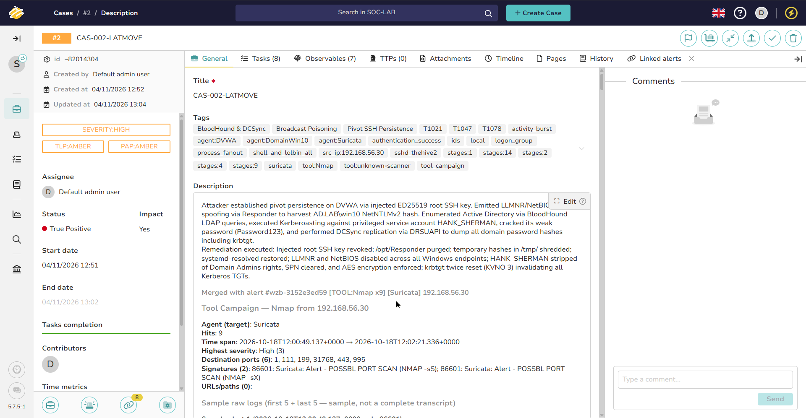

# Case 02 — Lateral Movement and Credential Access

> **Status:** Closed / Validated  
> **TheHive case ID:** `CAS-002-LATMOVE`  
> **Severity:** Critical  
> **TLP / PAP:** `TLP:AMBER / PAP:AMBER`  
> **Master Incident Tag:** `INC-2026-1018-ALPHA`  
> **Linked Alerts:** 8 Ingested Alerts (Alerts #16, #17, #19–#24)  
> **Eradication Playbook:** [`Eradication-Hardening-and-Recovery.md`](../Eradication-Hardening-and-Recovery.md#5-step-3-active-directory-account-eradication-privileged-demotion--kerberos-invalidation-pc-dc)

  
*Figure 1: TheHive 5 Case Record for `CAS-002-LATMOVE` showing 8 linked alerts, pivot eradication verification, and formal closure verdict.*  

---

## Summary

After getting root on the Linux web server (`192.168.56.30`), the attacker added an SSH key to `/root/.ssh/authorized_keys` to secure permanent access. Using the compromised web server as an internal pivot, they swept the private Windows subnet (`192.168.56.0/24`) and ran Responder to poison network broadcast traffic. When a Windows 10 workstation (`192.168.56.20`) queried the network, Responder captured its NetNTLMv2 hash, which the attacker cracked offline (`Secur3Lab!`). With valid domain credentials, the attacker mapped the Active Directory domain using BloodHound. They discovered that an account with a registered SPN (`HANK_SHERMAN`) was also a member of `Domain Admins`. The attacker Kerberoasted the account, cracked its weak password (`Password123`), and executed a DCSync attack against the Domain Controller (`PC-DC`), dumping every password hash in the domain—including the master `krbtgt` hash.

---

## Scope

| Stage | Attack | Investigation | Detection Status |
|---|---|---|---|
| 08 | [SSH persistence](../../02-Attack-Simulation/Stages/stage-08-ssh-persistence.md) | [Phase 3 Deep Dive](../Deep-Dive-Attack-Chain-Investigation.md#phase-3-making-themselves-at-home-ssh-persistence--finding-windows) | **Detected** (Wazuh Rule 5715 [SSH Auth] & Rule 100220 [bashcmd] host shell capture) |
| 09 | [Internal discovery](../../02-Attack-Simulation/Stages/stage-09-internal-discovery.md) | [Phase 3 Deep Dive](../Deep-Dive-Attack-Chain-Investigation.md#phase-3-making-themselves-at-home-ssh-persistence--finding-windows) | **Target Logging Gap (DG-09)** (Suricata NIDS ens37 SIDs 3400001, 3400002 & Wazuh Rule 100220 on pivot; target Windows host firewall drops unlogged) |
| 10 | [Responder poisoning](../../02-Attack-Simulation/Stages/stage-10-responder.md) | [Phase 4 Deep Dive](../Deep-Dive-Attack-Chain-Investigation.md#phase-4-poisoning-the-well-stealing-windows-passwords-with-responder) | **Detected** (Win10User Security EID 4688 / Sysmon EID 1 DavSetCookie [Rules 100278 & 61603, `wzb-28`] & DVWA Rule 100220) |
| 11 | [NTLMv2 cracking](../../02-Attack-Simulation/Stages/stage-11-ntlmv2-crack.md) | [Phase 4 Deep Dive](../Deep-Dive-Attack-Chain-Investigation.md#phase-4-poisoning-the-well-stealing-windows-passwords-with-responder) | **Investigatively Attributed (Offline Gap DG-11)** (Lifecycle bracketed 10 $\rightarrow$ 12) |
| 12 | [BloodHound enumeration](../../02-Attack-Simulation/Stages/stage-12-bloodhound.md) | [Phase 4 Deep Dive](../Deep-Dive-Attack-Chain-Investigation.md#phase-4-poisoning-the-well-stealing-windows-passwords-with-responder) | **Target Logging Gap (DG-12)** (Linux pivot Wazuh Rule 100220 & Alert #22; DC EID 1644 LDAP query logging unconfigured) |
| 13 | [Kerberoasting](../../02-Attack-Simulation/Stages/stage-13-kerberoasting.md) | [Phase 5 Deep Dive](../Deep-Dive-Attack-Chain-Investigation.md#phase-5-becoming-god-in-active-directory-kerberoasting-dcsync--the-golden-ticket) | **Detected** (Suricata SID 2019922 wire alert & Wazuh Rule 100220) |
| 14 | [DCSync](../../02-Attack-Simulation/Stages/stage-14-dcsync.md) | [Phase 5 Deep Dive](../Deep-Dive-Attack-Chain-Investigation.md#phase-5-becoming-god-in-active-directory-kerberoasting-dcsync--the-golden-ticket) | **Pivot-Only Coverage (DG-14)** (Linux pivot Wazuh Rule 100220 & Alert #24; DC EID 4662 replication SACL unconfigured) |

---

## Detection sources

| Source | What it contributed |
|---|---|
| **Suricata** | Dual-interface NIDS: promiscuous capture on `ens37` observed internal subnet port sweeps from DVWA (SIDs 3400001, 3400002, 3400020) and Kerberos TGS-REQ wire frames during Kerberoasting (SID 2019922 `ET EXPLOIT Possible GoldenPac Priv Esc in-use`). |
| **Wazuh** | Monitored Linux authentication on DVWA: authorized_keys modification (Wazuh Rule 100220 host shell capture) and interactive root SSH logons (Rule 5715 elevated to Level 8) providing end-to-end pivot visibility. In addition, Wazuh's custom host shell auditing pipeline (`bashcmd` / Rule 100220 Level 5) captured verbatim adversary commands on the pivot host across rows 9139–9286 in `Wazuh-Raw-Alerts.csv` (nmap discovery sweep, Responder.py start and hash copy, BloodHound execution, GetUserSPNs.py Kerberoasting, and secretsdump.py DCSync). Monitored Windows domain member events (`DomainWin10` agent on DC and `Win10User` agent on workstation). |
| **TheHive** | Aggregated pivot logons and network IDS alerts into correlated incident cases. |
| **Velociraptor** | Queried Active Directory audit events, inspected `/root/.ssh/authorized_keys` and `/tmp/hank.hash` on DVWA pivot. |

---

## Timeline

| Time (IST) | Event | Source | Evidentiary Alert Capture |
|---|---|---|---|
| `17:26:14` | Attacker public key added to `/root/.ssh/authorized_keys` | Wazuh Rule 100220 (bashcmd) | [`wzb-19-ssh-persist-auditd-authorized-keys.jpg`](../../06-Resources/screenshots/wazuh-deep-investigation/wzb-19-ssh-persist-auditd-authorized-keys.jpg) |
| `17:29:43` | Inbound root SSH interactive session established from Kali | Wazuh SSHD | [`wzb-20-ssh-persist-key-inject-sshd-login.jpg`](../../06-Resources/screenshots/wazuh-deep-investigation/wzb-20-ssh-persist-key-inject-sshd-login.jpg) |
| `17:31:19` | Internal subnet discovery sweep against `192.168.56.0/24` | Suricata (`ens37`) | [`wzb-22-discovery-suricata-internal-nmap.jpg`](../../06-Resources/screenshots/wazuh-deep-investigation/wzb-22-discovery-suricata-internal-nmap.jpg) |
| `17:37:10` | Responder LLMNR/NetBIOS poisoning capturing `win10` NetNTLMv2 hash | Win10User Security EID 4688 DavSetCookie (Rule 100278) | [`wzb-28-responder-win10-rundll32-davsetcookie.jpg`](../../06-Resources/screenshots/wazuh-deep-investigation/wzb-28-responder-win10-rundll32-davsetcookie.jpg) |
| `17:38:29` | NetNTLMv2 hash saved to `/tmp/win10.hash` for offline Hashcat cracking | Wazuh bashcmd (Rule 100220) | [`wzb-29-responder-auditd-ntlmv2-hash-harvested.jpg`](../../06-Resources/screenshots/wazuh-deep-investigation/wzb-29-responder-auditd-ntlmv2-hash-harvested.jpg) |
| `17:39:46` | Offline NetNTLMv2 hash cracking on Kali Linux (Hashcat mode 5600) recovering `Secur3Lab!` | Offline GPU | Inherent Offline Gap (DG-11) (Bracketed by Alert #21 and Stage 12) |
| `18:01:00` | BloodHound LDAP query volume from DVWA to DC (`18:01:02` root SSH session) | Wazuh Rule 5715 / Rule 100220 (`bloodhound.py`) | [`wzb-31-bloodhound-auditd-python-ingest.jpg`](../../06-Resources/screenshots/wazuh-deep-investigation/wzb-31-bloodhound-auditd-python-ingest.jpg) |
| `18:01:18` | Kerberoasting TGS-REQ requested for `HANK_SHERMAN` SPN via GetUserSPNs.py | Suricata SID 2019922 / Wazuh Rule 100220 (`GetUserSPNs.py`) | [`wzb-33-kerberoast-auditd-getuserspns.jpg`](../../06-Resources/screenshots/wazuh-deep-investigation/wzb-33-kerberoast-auditd-getuserspns.jpg) |
| `18:02:40` | DCSync replication dumping domain hashes via DRSUAPI (secretsdump.py) | Wazuh Rule 5715 / Rule 100220 (`secretsdump.py`) | [`wzb-34-dcsync-auditd-secretsdump-ntds.jpg`](../../06-Resources/screenshots/wazuh-deep-investigation/wzb-34-dcsync-auditd-secretsdump-ntds.jpg) |

---

## Observables

| Type | Value | Context |
|---|---|---|
| **Pivot IP** | `192.168.56.30` | Compromised DVWA host used as operational pivot |
| **Domain Member** | `192.168.56.20` (`Win10User`) | Workstation poisoned by Responder |
| **Domain Controller** | `192.168.56.10` (`PC-DC.ad.lab` / `DomainWin10`) | Target of LDAP, Kerberoasting, and DCSync attacks |
| **Account** | `AD.LAB\win10` | Compromised domain workstation user account (`Secur3Lab!`) |
| **Account** | `AD.LAB\HANK_SHERMAN` | Kerberoasted Domain Admin service account (`Password123`) |
| **Secret** | `krbtgt` NTLM hash (`...f4e05f60`) | Replicated domain master key used for Golden Ticket |

---

## Tasks

- [x] Triage SSH persistence and root authentication alerts on DVWA pivot
- [x] Disable LLMNR and NetBIOS over TCP/IP across domain workstations via GPO
- [x] Force immediate domain-wide password reset for `win10` and `HANK_SHERMAN`
- [x] Strip `Domain Admins` & `Administrators` memberships from service account `HANK_SHERMAN`
- [x] Delete SPN `CIFS/AWSWAPPS1000000.ad.lab` from `HANK_SHERMAN` and enforce AES128/AES256 Kerberos encryption
- [x] Globally disable LLMNR (`EnableMulticast = 0`) & NetBIOS over TCP/IP (`NetbiosOptions = 2`) across all Windows hosts
- [x] Cryptographically shred `/tmp/*.hash` dumps and purge `/opt/Responder` from Linux pivot host
- [x] Enable NTDS diagnostic logging (`15 Field Engineering` = 5) to alert on LDAP search volume
- [x] Complete double `krbtgt` password reset procedure (incrementing KVNO to 3) to invalidate all forged Kerberos tickets

---

## Detection performance

| Metric | Value |
|---|---|
| **Stages Executed** | 7 |
| **Verified Direct & Wire Detections** | 3 (42.9% — Stages 08, 10, 13) |
| **Operational Pivot-Only Alerts** | 1 (14.3% — Stage 14 DCSync) |
| **Target Logging Gaps** | 2 (28.6% — Stages 09 & 12) |
| **Inherent Offline Gaps** | 1 (14.3% — Stage 11 Hashcat cracking) |
| **Operational SOAR Alert Delivery** | 6 (85.7% — 6 of 7 stages generated operational alerts in TheHive) |
| **Rule Failures / Engine Drops** | 0 (0.0%) |

---

## Verdict

**True Positive.** Critical compromise of the Active Directory domain fabric. The attacker successfully escalated from the Linux web pivot into full Tier Zero domain dominance via Kerberoasting and DCSync directory replication.
