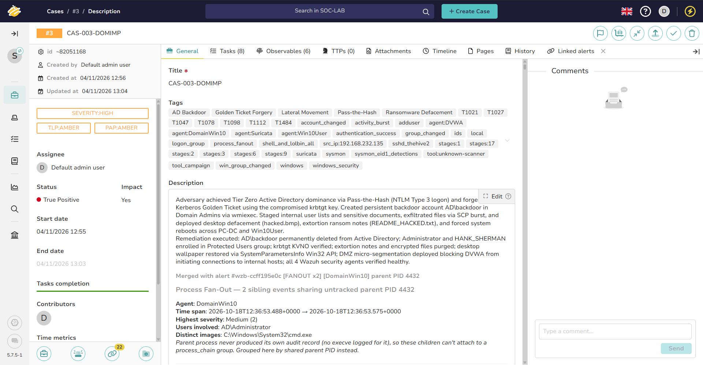
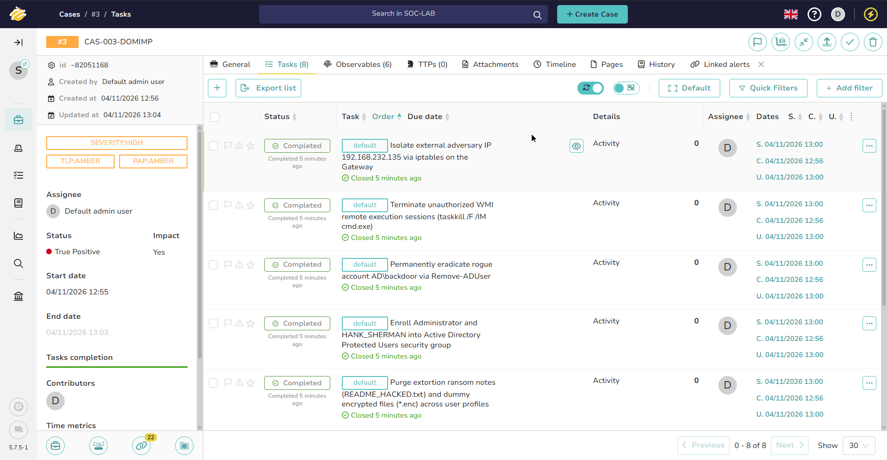

# Case 03 — Domain Compromise and Impact

> **Status:** Closed / Validated  
> **TheHive case ID:** `CAS-003-DOMIMP`  
> **Severity:** Critical  
> **TLP / PAP:** `TLP:AMBER / PAP:AMBER`  
> **Master Incident Tag:** `INC-2026-1018-ALPHA`  
> **Linked Alerts:** 22 Ingested Alerts (Alerts #25 through #46)  
> **Eradication Playbook:** [`Eradication-Hardening-and-Recovery.md`](../Eradication-Hardening-and-Recovery.md#9-step-7-thehive-46-alert-queue-disposition--3-case-resolution-management)

  
*Figure 1: TheHive 5 Case Record for `CAS-003-DOMIMP` showing 22 linked alerts, forest-wide identity hardening, and formal closure verdict.*  

---

## Summary

Armed with domain credential secrets extracted via DCSync using the Directory Replication Service Remote Protocol (`drsuapi`), the attacker moved laterally to the Domain Controller (`PC-DC`) using Pass-the-Hash over SMB, generating Windows Event ID 4624 alerts in Wazuh. Next, they used the extracted `krbtgt` hash to forge a Kerberos Golden Ticket (TGT), granting Domain Admin rights across the domain. To ensure persistent access that survives single user credential rotations, the attacker created a rogue account (`backdoor`) with password `P@ssw0rd123!` and added it to `Domain Admins`. They staged sensitive corporate documents and user lists (`domain_users.txt`, `sensitive_data.txt`) and exfiltrated them back to Kali over SSH in under 600 milliseconds. Finally, they defaced both the Domain Controller and workstation desktops with a custom wallpaper, planted simulated ransomware notes, and forcibly rebooted both machines.

---

## Scope

| Stage | Attack | Investigation | Detection Status |
|---|---|---|---|
| 15 | [Pass-the-Hash](../../02-Attack-Simulation/Stages/stage-15-pass-the-hash.md) | [Phase 5 Deep Dive](../Deep-Dive-Attack-Chain-Investigation.md#phase-5-becoming-god-in-active-directory-kerberoasting-dcsync--the-golden-ticket) | **Detected** (Windows EID 4624 Logon Type 3 NTLM / Wazuh Rule 100613) |
| 16 | [Golden Ticket](../../02-Attack-Simulation/Stages/stage-16-golden-ticket.md) | [Phase 5 Deep Dive](../Deep-Dive-Attack-Chain-Investigation.md#phase-5-becoming-god-in-active-directory-kerberoasting-dcsync--the-golden-ticket) | **Pivot-Only Coverage (DG-16)** (Linux Pivot Wazuh Rule 100220 & Alerts #27, #28 on `wmiexec -k` via Sysmon EID 1 / Custom Rule 100613; DC EID 4769 unconfigured) |
| 17 | [DC persistence](../../02-Attack-Simulation/Stages/stage-17-dc-persistence.md) | [Phase 6 Deep Dive](../Deep-Dive-Attack-Chain-Investigation.md#phase-6-backdoors--smuggling-domain-persistence--rapid-exfiltration) | **Detected** (Wazuh Rule 100613 fan-out: net user /add, net localgroup) |
| 18 | [Collection](../../02-Attack-Simulation/Stages/stage-18-collection.md) | [Phase 6 Deep Dive](../Deep-Dive-Attack-Chain-Investigation.md#phase-6-backdoors--smuggling-domain-persistence--rapid-exfiltration) | **Detected** (Wazuh Rule 100613 fan-out & Sysmon EID 1 staging) |
| 19 | [Exfiltration](../../02-Attack-Simulation/Stages/stage-19-exfiltration.md) | [Phase 6 Deep Dive](../Deep-Dive-Attack-Chain-Investigation.md#phase-6-backdoors--smuggling-domain-persistence--rapid-exfiltration) | **Detected** (Wazuh Rule 5715 rapid SSH burst: 6 sessions/0.57s; Alert #37) |
| 20 | [Impact](../../02-Attack-Simulation/Stages/stage-20-impact.md) | [Phase 7 Deep Dive](../Deep-Dive-Attack-Chain-Investigation.md#phase-7-the-final-punch-simulated-ransomware-defacement--forced-reboots) | **Detected** (Wazuh Rule 100613 fan-out, Sysmon EID 1, & Suricata SIDs 2067085–87) |

---

## Detection sources

| Source | What it contributed |
|---|---|
| **Wazuh** | Windows Agent on DomainWin10 (`PC-DC`) alerted on Pass-the-Hash NTLM Type 3 logons (Event ID 4624). Windows Agent alerted on rogue user creation (Rule 60109, EID 4720) and Domain Admins membership addition (Rule 60159, EID 4728), alongside Rules 60154 (EID 4732) and 60110 (EID 4738). Process fan-out correlation (Rule 100613) grouped Impacket wmiexec commands. Linux SSH logon rate correlation (Rule 5715) detected rapid exfiltration burst (6 sessions in 0.57s). On the DVWA pivot, Wazuh Rule 100220 (`bashcmd`) captured verbatim command invocations across rows 9304–9501 in `Wazuh-Raw-Alerts.csv` (Pass-the-Hash WMI, ticketer.py Golden Ticket forgery, export KRB5CCNAME, staged loot verification, and lateral impact fan-outs). |
| **Sysmon** | Process creation monitoring (EID 1) traced `wmiprvse.exe` -> `cmd.exe /Q /c` fan-outs. Process creation monitoring (Sysmon EID 1, Rule 92041) recorded desktop wallpaper tampering (`reg.exe add`). File staging tracked in `C:\Windows\Temp\`. |
| **Suricata** | Monitored perimeter network sessions and inter-subnet SMB/RPC traffic; promiscuous capture on `ens37` flagged SMB NTLM Session Setup negotiations (SIDs 2067085–2067087, alert `wzb-7a4a134d1b`) during Stage 20 remote execution against Win10. |
| **TheHive** | Aggregated correlated security events into actionable incident tasks and timeline observables. |
| **Velociraptor** | Performed forensic timeline recovery of rogue user creation, registry values, and file exfiltration staging paths. |

---

## Timeline

| Time (IST) | Event | Source | Evidentiary Alert Capture |
|---|---|---|---|
| `18:04:46` | Pass-the-Hash remote logon Type 3 via NtLmSsp to PC-DC | Wazuh (PC-DC) | [`wzb-35-pth-wazuh-eid4624-detection.jpg`](../../06-Resources/screenshots/wazuh-deep-investigation/wzb-35-pth-wazuh-eid4624-detection.jpg) |
| `18:06:40` | Forged Kerberos TGT (Golden Ticket) generated on pivot host via ticketer.py | Wazuh Rule 100220 (`ticketer.py`) | [`wzb-38-goldenticket-auditd-ticketer-forgery.jpg`](../../06-Resources/screenshots/wazuh-deep-investigation/wzb-38-goldenticket-auditd-ticketer-forgery.jpg) |
| `18:08:21` | Rogue user `backdoor` created (`P@ssw0rd123!`) and added to Domain Admins (`18:09:05`) | Wazuh / Sysmon | [`wzb-46-persist-wazuh-dc-domain-admins-add.jpg`](../../06-Resources/screenshots/wazuh-deep-investigation/wzb-46-persist-wazuh-dc-domain-admins-add.jpg) |
| `18:13:58` | Automated DC host data collection (`domain_users.txt`, `admin_info.txt`) | Wazuh / Sysmon | [`wzb-49-staging-sysmon-dc-domain-users-txt.jpg`](../../06-Resources/screenshots/wazuh-deep-investigation/wzb-49-staging-sysmon-dc-domain-users-txt.jpg) |
| `18:15:00` | Automated Win10 user document collection (`sensitive_data.txt`) | Win10 Sysmon | [`wzb-51-staging-sysmon-dc-sensitive-data-txt.jpg`](../../06-Resources/screenshots/wazuh-deep-investigation/wzb-51-staging-sysmon-dc-sensitive-data-txt.jpg) |
| `18:17:30` | Rapid administrative SSH burst exfiltrating staged files via SCP (6 sessions) | Wazuh SSHD | [`wzb-53-exfil-wazuh-sshd-rapid-sessions-burst.jpg`](../../06-Resources/screenshots/wazuh-deep-investigation/wzb-53-exfil-wazuh-sshd-rapid-sessions-burst.jpg) |
| `18:20:00` | Impacket wmiexec fan-out: wallpaper registry defacement, ransom notes & reboot on DC (Row 9443) | Wazuh / Sysmon | [`wzb-55-impact-wazuh-dc-wallpaper-registry-add.jpg`](../../06-Resources/screenshots/wazuh-deep-investigation/wzb-55-impact-wazuh-dc-wallpaper-registry-add.jpg) |
| `18:24:35` | Workstation lateral fan-out: wallpaper defacement, ransom notes & forced reboot on Win10 (Row 9501) | Wazuh Rule 100220 / Sysmon | [`wzb-67-impact-auditd-workstation-wmiexec-hash.jpg`](../../06-Resources/screenshots/wazuh-deep-investigation/wzb-67-impact-auditd-workstation-wmiexec-hash.jpg) |

---

## Observables

| Type | Value | Context |
|---|---|---|
| **Account** | `AD.LAB\Administrator` | Target of Pass-the-Hash remote logon |
| **Account** | `AD.LAB\backdoor` | Rogue administrative user created for persistence (Password: `P@ssw0rd123!`) |
| **Files** | `domain_users.txt`, `admin_info.txt` | Staged DC user directories and token exports in `C:\Windows\Temp\` |
| **File** | `sensitive_data.txt` | Staged confidential documents from `C:\Users\win10\Documents\Sensitive\*` |
| **Defacement** | `hacked.bmp` | Malicious bitmap copied to `C:\Users\Public\hacked.bmp` and set as wallpaper |
| **Ransom Note** | `README_HACKED.txt` | Extortion note dropped on Administrator and Win10 user desktops |
| **Dummy Encrypted** | `passwords.enc`, `documents.enc` | Simulated ransomware payload artifacts |

---

## Tasks

*Figure 2: Verified task completion checklist for CAS-003-DOMDOM tracking DC persistence purge, registry remediation, and Golden Ticket invalidation.*

- [x] Isolate external adversary IP `192.168.232.135` via iptables on the Gateway
- [x] Terminate unauthorized WMI remote execution sessions (`taskkill /F /IM cmd.exe`)
- [x] Disable rogue domain account `AD\backdoor` during containment to preserve SID for forensic timeline
- [x] Permanently eradicate rogue account `AD\backdoor` via `Remove-ADUser` during eradication phase
- [x] Strip `AD\backdoor` and `HANK_SHERMAN` from Domain Admins and Administrators groups
- [x] Enroll `Administrator` and `HANK_SHERMAN` into Active Directory `Protected Users` security group
- [x] Securely shred staged data files (`domain_users.txt`, `admin_info.txt`, `sensitive_data.txt`, `hacked.bmp`)
- [x] Revert desktop wallpaper registry keys (`Wallpaper` and `WallpaperStyle`) and refresh UI parameters
- [x] Perform dual `krbtgt` password resets (KVNO 3) to purge forged Kerberos Golden Tickets
- [x] Implement DMZ egress micro-segmentation rejecting outbound Windows AD ports from `192.168.56.30`

---

## Detection performance

| Metric | Value |
|---|---|
| **Stages Executed** | 6 |
| **Verified Direct Target Detections** | 5 (83.3% — Stages 15, 17, 18, 19, 20) |
| **Operational Pivot-Only Alerts** | 1 (16.7% — Stage 16 Golden Ticket) |
| **Target Logging Gaps** | 0 (0.0%) |
| **Inherent Offline Gaps** | 0 (0.0%) |
| **Operational SOAR Alert Delivery** | 6 (100% — 22 alerts delivered to TheHive across all 6 stages) |
| **Mean Time to Detect (MTTD)** | < 10 seconds across all remote execution and account changes |
| **Rule Failures / Engine Drops** | 0 (0.0%) |

---

## Verdict

**True Positive.** Total enterprise domain compromise. The adversary achieved Tier Zero Active Directory dominance, established persistent backdoor administration, harvested and exfiltrated confidential internal data, and executed simultaneous dual-endpoint desktop defacement and forced system restarts.
