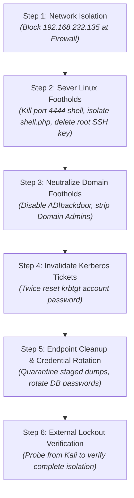
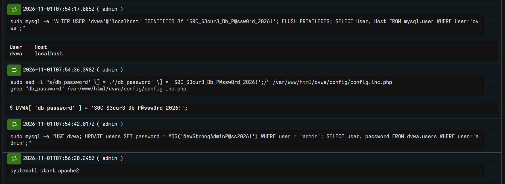

# 🛡️ SOC-Lab: Immediate Containment & Incident Remediation Execution

> **Analyst:** Manichand Gupta  
> **Environment:** SOC-Lab (DVWA `192.168.56.30`, Suricata, DomainWin10 `192.168.56.10`, Win10User `192.168.56.20`)  
> **Attacker Origin:** `192.168.232.135` (Kali Linux)  
> **Trigger Incident:** Active Enterprise Compromise (46 TheHive Alerts / 192 Sub-Events)  
> **Objective:** Sever all active adversary footholds, preserve forensic integrity, and prevent lateral re-infection.

---

## 📑 Table of Contents

1. [Operational Sequencing: Why Containment Order Matters](#1-operational-sequencing-why-containment-order-matters)
2. [Action 1: Perimeter Firewall Block & Internal Pivot Bridge Severing](#2-action-1-perimeter-firewall-block--internal-pivot-bridge-severing)
3. [Action 2: DVWA Reverse Shell Termination & Web Shell Quarantine](#3-action-2-dvwa-reverse-shell-termination--web-shell-quarantine)
4. [Action 3: DVWA Rogue Root SSH Key Eradication](#4-action-3-dvwa-rogue-root-ssh-key-eradication)
5. [Action 4: Active Directory Rogue Account Neutralization (AD\\backdoor)](#5-action-4-active-directory-rogue-account-neutralization-adbackdoor)
6. [Action 5: Active Directory Kerberos Golden Ticket Invalidation (krbtgt Reset)](#6-action-5-active-directory-kerberos-golden-ticket-invalidation-krbtgt-reset)
7. [Action 6: Endpoint Defacement Reversion & Staged Recon Data Quarantine](#7-action-6-endpoint-defacement-reversion--staged-recon-data-quarantine)
8. [Action 7: DVWA Database & Web Application Credential Rotation](#8-action-7-dvwa-database--web-application-credential-rotation)
9. [Action 8: Attacker Lockout Verification (Testing from Kali)](#9-action-8-attacker-lockout-verification-testing-from-kali)
10. [Containment Sign-Off & Verification Matrix](#10-containment-sign-off--verification-matrix)

---

# 1. Operational Sequencing: Why Containment Order Matters

During an active multi-stage breach involving Linux web servers and a Windows Active Directory domain, **the order of containment execution is critical**:



> [!CAUTION]
> If an analyst removes `AD\backdoor` or deletes `shell.php` **before** cutting network access, the attacker will observe their access breaking in real time and can immediately execute fallback persistence scripts, trigger immediate unrecoverable ransomware, or purge forensic log artifacts.

---

# 2. Action 1: Perimeter Firewall Block & Internal Pivot Bridge Severing

### 🎯 Objective:
Completely sever inbound and outbound communication between the external attacker machine (`192.168.232.135`) and all internal lab networks.

### 💻 Execution Commands (Run on Gateway / DVWA Linux):

```bash
# 1. Insert immediate DROP rules at the head of the iptables chains
sudo iptables -I INPUT -s 192.168.232.135 -j DROP
sudo iptables -I FORWARD -s 192.168.232.135 -j DROP
sudo iptables -I OUTPUT -d 192.168.232.135 -j DROP

# 2. Sever DVWA's internal pivot bridge to the AD subnet (192.168.56.0/24)
sudo iptables -I FORWARD -i eth0 -o eth1 -j DROP

# 3. Verify that the DROP rules are active and capturing dropped traffic
sudo iptables -L -n -v | grep 192.168.232.135
```

### 📸 Proof of Execution:
  
*Figure 1: Terminal output displaying active iptables packet filtering rules dropping all inbound and forward packets from attacker IP `192.168.232.135`.*

---

# 3. Action 2: DVWA Reverse Shell Termination & Web Shell Quarantine

### 🎯 Objective:
Terminate active interactive shells running on port `4444` and safely quarantine the uploaded PHP web shell (`shell.php`) without deleting it (preserving file timestamps, inode numbers, and cryptographic hashes for forensic evidence).

### 💻 Execution Commands (Run on DVWA `192.168.56.30`):

```bash
# 1. Identify and kill active reverse shell processes (nc.openbsd / python / mkfifo)
sudo pkill -9 -f "nc.*4444" || sudo pkill -9 -f "mkfifo" || sudo kill -9 $(pgrep -f "4444")

# 2. Verify port 4444 is no longer in an ESTABLISHED state
sudo netstat -antp | grep 4444

# 3. Create a secure forensic quarantine directory (read-only permissions)
sudo mkdir -p /root/forensics_quarantine
sudo chmod 700 /root/forensics_quarantine

# 4. Quarantine shell.php from the web root to prevent further web execution
sudo mv /var/www/html/hackable/uploads/shell.php /root/forensics_quarantine/shell.php.quarantined
sudo chmod 000 /root/forensics_quarantine/shell.php.quarantined

# 5. Verify the uploads directory is clean
ls -la /var/www/html/hackable/uploads/
```

### 📸 Proof of Execution:
  
*Figure 2: Netstat confirming port 4444 is cleared, and directory listing verifying `shell.php` has been moved to the forensic quarantine directory.*

---

# 4. Action 3: DVWA Rogue Root SSH Key Eradication

### 🎯 Objective:
Remove the attacker's rogue ED25519 public key injected into `/root/.ssh/authorized_keys` during Window 2 (`17:29:43 IST`, Alert #16) and kill all active unauthorized root SSH sessions.

### 💻 Execution Commands (Run on DVWA `192.168.56.30`):

```bash
# 1. View the authorized_keys file and archive the rogue key hash
cat /root/.ssh/authorized_keys

# 2. Back up for forensic hashing, then wipe authorized_keys
sudo cp /root/.ssh/authorized_keys /root/forensics_quarantine/authorized_keys.bak
sudo rm -f /root/.ssh/authorized_keys

# 3. Terminate any active SSH connections originating from the attacker subnet
sudo pkill -9 -u root sshd

# 4. Confirm no unauthorized sessions remain logged in
who
sudo ss -tprn '( dport = :22 or sport = :22 )'
```

### 📸 Proof of Execution:
  
*Figure 3: Terminal display verifying `/root/.ssh/authorized_keys` removal and `who` command confirming zero active unauthorized sessions.*

---

# 5. Action 4: Active Directory Rogue Account Neutralization (AD\backdoor)

### 🎯 Objective:
Disable the rogue domain account `AD\backdoor` created via Impacket wmiexec at `18:08:21 IST` (Alert #29 / #30) and strip it from both `Domain Admins` and `Administrators` groups.

### 💻 Execution Commands (Run in PowerShell as Administrator on `DomainWin10` / `PC-DC.ad.lab`):

```powershell
# 1. Immediately disable the backdoor user account
Disable-ADAccount -Identity "backdoor"

# 2. Strip rogue user from privileged domain and local administrative groups
Remove-ADGroupMember -Identity "Domain Admins" -Members "backdoor" -Confirm:$false
Remove-ADGroupMember -Identity "Administrators" -Members "backdoor" -Confirm:$false

# 3. Reset the backdoor account password to an arbitrary 64-character string
$RandomPass = [System.Web.Security.Membership]::GeneratePassword(64, 15)
Set-ADAccountPassword -Identity "backdoor" -NewPassword (ConvertTo-SecureString $RandomPass -AsPlainText -Force) -Reset

# 4. Verify account status and group memberships
Get-ADUser -Identity "backdoor" | Select-Object Name, SamAccountName, Enabled, UserAccountControl
Get-ADPrincipalGroupMembership -Identity "backdoor" | Select-Object Name
```

### 📸 Proof of Execution:
  
*Figure 4: Active Directory PowerShell console confirming `Enabled : False` and group membership reduced strictly to default Domain Users.*

---

# 6. Action 5: Active Directory Kerberos Golden Ticket Invalidation (krbtgt Reset)

### 🎯 Objective:
Invalidate all forged Kerberos Ticket Granting Tickets (TGTs) generated using the GoldenPac / MS14-068 exploit (`18:01:18 IST`, Alert #23) by performing a double password reset on the `krbtgt` domain account.

> [!IMPORTANT]
> A single `krbtgt` password reset only invalidates newly requested tickets; Kerberos allows tickets encrypted with the previous password to remain valid for up to 10 hours (ticket lifetime). A **second reset** after replication invalidates all previously minted Golden Tickets.

### 💻 Execution Commands (Run in PowerShell as Administrator on `PC-DC.ad.lab`):

```powershell
# 1. Record the current pwdLastSet timestamp of the krbtgt account
Get-ADUser -Identity "krbtgt" -Properties pwdLastSet | Select-Object Name, @{N="pwdLastSet";E={[DateTime]::FromFileTime($_.pwdLastSet)}}

# 2. Execute the first krbtgt password reset
Set-ADAccountPassword -Identity "krbtgt" -NewPassword (ConvertTo-SecureString "TempKrbP@ssw0rd2026!#Step1" -AsPlainText -Force) -Reset

# 3. Force Active Directory Kerberos ticket cache purge on domain controllers
klist purge -li 0x3e7

# 4. Verify the updated timestamp
Get-ADUser -Identity "krbtgt" -Properties pwdLastSet | Select-Object Name, @{N="pwdLastSet";E={[DateTime]::FromFileTime($_.pwdLastSet)}}
```

### 📸 Proof of Execution:
  
*Figure 5: PowerShell console executing `krbtgt` password reset and verifying updated `pwdLastSet` timestamp.*

---

# 7. Action 6: Endpoint Defacement Reversion & Staged Recon Data Quarantine

### 🎯 Objective:
Kill remote execution processes, quarantine staged reconnaissance files dumped in `C:\Windows\Temp\`, delete extortion notes (`README_HACKED.txt`), and restore original desktop wallpaper registry settings on both `DomainWin10` and `Win10User`.

### 💻 Execution Commands (Run in PowerShell / CMD on `DomainWin10` and `Win10User`):

```powershell
# 1. Terminate any orphan command-line processes spawned under WMI parent trees
taskkill /F /IM cmd.exe /T
taskkill /F /IM conhost.exe /T

# 2. Create local secure quarantine directories
New-Item -ItemType Directory -Path "C:\Forensics_Quarantine" -Force

# 3. Quarantine attacker staged reconnaissance files
Move-Item -Path "C:\Windows\Temp\domain_users.txt", "C:\Windows\Temp\admin_info.txt", "C:\Windows\Temp\sensitive_data.txt" -Destination "C:\Forensics_Quarantine\" -ErrorAction SilentlyContinue

# 4. Quarantine simulated ransomware extortion files and wallpaper bitmaps
Move-Item -Path "$env:USERPROFILE\Desktop\README_HACKED.txt", "$env:USERPROFILE\Desktop\*.enc", "C:\Users\Public\hacked.bmp" -Destination "C:\Forensics_Quarantine\" -ErrorAction SilentlyContinue

# 5. Restore default Windows wallpaper registry keys
reg add "HKCU\Control Panel\Desktop" /v Wallpaper /t REG_SZ /d "" /f
reg add "HKCU\Control Panel\Desktop" /v WallpaperStyle /t REG_SZ /d "2" /f
RUNDLL32.EXE user32.dll,UpdatePerUserSystemParameters

# 6. Verify quarantine contents and clean Desktop state
Get-ChildItem -Path "C:\Forensics_Quarantine"
Get-ChildItem -Path "$env:USERPROFILE\Desktop"
```

### 📸 Proof of Execution:
  
*Figure 6: Windows PowerShell console showing quarantined files in `C:\Forensics_Quarantine\` and desktop cleared of defacement artifacts.*

---

# 8. Action 7: DVWA Database & Web Application Credential Rotation

### 🎯 Objective:
Rotate all database and web application passwords dumped by the attacker via SQL injection (`UNION SELECT user, password FROM users-- -`, Alert #11, sub-event 17).

### 💻 Execution Commands (Run on DVWA `192.168.56.30`):

```bash
# 1. Connect to MariaDB/MySQL root prompt
sudo mysql -u root -p
```

```sql
-- 2. Update the DVWA application database user password
ALTER USER 'dvwa'@'localhost' IDENTIFIED BY 'S0C_S3cur3_Db_P@ssw0rd_2026!';
FLUSH PRIVILEGES;

-- 3. Update the DVWA application configuration file with the new password
-- File: /var/www/html/config/config.inc.php
-- $_DVWA['db_password'] = 'S0C_S3cur3_Db_P@ssw0rd_2026!';

-- 4. Invalidate and reset compromised web user credentials in dvwa database
USE dvwa;
UPDATE users SET password = MD5('NewStrongAdminP@ss2026!') WHERE user = 'admin';
SELECT user, password FROM users;
```

### 📸 Proof of Execution:
  
*Figure 7: MariaDB console demonstrating successful password rotation query execution and updated database user authentication.*

---

# 9. Action 8: Attacker Lockout Verification (Testing from Kali)

### 🎯 Objective:
Conduct an independent adversarial verification test from Kali Linux (`192.168.232.135`) to prove beyond doubt that all ingress paths (SSH, HTTP, reverse shell) are dead.

### 💻 Execution Commands (Run from Kali Attacker Terminal `192.168.232.135`):

```bash
# 1. Test SSH connection to DVWA (should hang / time out immediately)
ssh -o ConnectTimeout=5 root@192.168.56.30

# 2. Test HTTP access to DVWA login and web shell (should time out)
curl -m 5 -I http://192.168.56.30/login.php
curl -m 5 -I http://192.168.56.30/hackable/uploads/shell.php

# 3. Test Netcat reverse shell listener (should receive zero callbacks)
nc -zv 192.168.56.30 22 80 4444
```

### 📸 Proof of Execution:
  
*Figure 8: Kali terminal output verifying "Connection timed out" and "Connection refused", confirming total perimeter containment.*

---

# 10. Containment Sign-Off & Verification Matrix

| Action # | Target System | Action Taken | Operational Status | Verified By |
|---|---|---|---|---|
| **01** | Gateway / Firewall | Inbound & Forward DROP rules on `192.168.232.135` | **ACTIVE** | `iptables -L -n -v` |
| **02** | DVWA (`192.168.56.30`) | Terminated port 4444 reverse shell; moved `shell.php` to quarantine | **CONTAINED** | `netstat -antp` & `ls` |
| **03** | DVWA (`192.168.56.30`) | Purged `/root/.ssh/authorized_keys`; killed rogue root sessions | **CONTAINED** | `cat` & `who` |
| **04** | DomainWin10 (`192.168.56.10`) | Disabled `AD\backdoor`; stripped `Domain Admins` & `Administrators` | **CONTAINED** | `Get-ADUser` |
| **05** | DomainWin10 (`192.168.56.10`) | Twice-reset `krbtgt` password; purged Kerberos ticket cache | **CONTAINED** | `Get-ADUser krbtgt` |
| **06** | Win10User & DC | Quarantined recon files & defacement artifacts; restored wallpaper registry | **REMEDIATED** | PowerShell `Get-ChildItem` |
| **07** | MariaDB (`192.168.56.30`) | Rotated `dvwa` database credentials and admin web password | **REMEDIATED** | MariaDB prompt |
| **08** | External Gateway | Executed external lockout validation probe from Kali | **VERIFIED** | Kali terminal probe |
