# 🛡️ SOC-Lab: Immediate Containment & Incident Remediation Execution

> **Analyst:** Manichand Gupta  
> **Environment:** SOC-Lab (DVWA `192.168.56.30`, Suricata Gateway, DomainWin10 `192.168.56.10`, Win10User `192.168.56.20`)  
> **Attacker Origin:** `192.168.232.135` (Identified External Threat Actor)  
> **Trigger Incident:** Active Enterprise Compromise (46 TheHive Alerts / 192 Sub-Events)  
> **Objective:** Sever all active adversary footholds, preserve forensic integrity, and prevent lateral re-infection.

> [!IMPORTANT]
> **Investigative Basis & Threat Intelligence Context:**  
> This tactical containment playbook is executed in direct response to the forensic findings detailed across our incident records:
> - **[`Initial-Triage-and-Investigation.md`](Initial-Triage-and-Investigation.md)**: Master 46-alert triage table, detection pipeline critique (9 flaws), and 6-window chronological timeline.
> - **[`Deep-Dive-Attack-Chain-Investigation.md`](Deep-Dive-Attack-Chain-Investigation.md)**: Comprehensive deep-dive investigation of the complete 7-phase attack chain, root-cause vulnerability analysis, 68-screenshot telemetry index, and strategic enterprise hardening roadmap.
> - **[Eradication-Hardening-and-Recovery.md](Eradication-Hardening-and-Recovery.md)**: Permanent elimination of all 7 root causes, adversary anti-forensics audit and staging artifact purge, Active Directory hardening, and closing cases in TheHive.

---

## 📑 Table of Contents

1. [Operational Sequencing: Why Containment Order Matters](#1-operational-sequencing-why-containment-order-matters)
2. [Incident Response Tooling: Why Velociraptor & Enterprise PowerShell](#2-incident-response-tooling-why-velociraptor--enterprise-powershell)
3. [Action 1: Perimeter Firewall Block & Internal Pivot Bridge Severing](#3-action-1-perimeter-firewall-block--internal-pivot-bridge-severing)
4. [Action 2: DVWA Reverse Shell Termination & Web Shell Quarantine](#4-action-2-dvwa-reverse-shell-termination--web-shell-quarantine)
5. [Action 3: DVWA Rogue Root SSH Key Eradication](#5-action-3-dvwa-rogue-root-ssh-key-eradication)
6. [Action 4: Active Directory Rogue Account Neutralization (AD\backdoor)](#6-action-4-active-directory-rogue-account-neutralization-adbackdoor)
7. [Action 5: Active Directory Kerberos Golden Ticket Invalidation (krbtgt Reset)](#7-action-5-active-directory-kerberos-golden-ticket-invalidation-krbtgt-reset)
8. [Action 6: Endpoint Defacement Reversion & Staged Recon Data Quarantine](#8-action-6-endpoint-defacement-reversion--staged-recon-data-quarantine)
9. [Action 7: DVWA Database & Web Application Credential Rotation](#9-action-7-dvwa-database--web-application-credential-rotation)
10. [Post-Containment Verification & Sign-Off Matrix](#10-post-containment-verification--sign-off-matrix)

---

# 1. Operational Sequencing: Why Containment Order Matters

During an active multi-stage breach involving Linux web servers and a Windows Active Directory domain, **the order of containment execution is critical**:


> [!CAUTION]
> If an analyst removes `AD\backdoor` or deletes `shell.php` **before** cutting network access, the attacker will observe their access breaking in real time and can immediately execute fallback persistence scripts, trigger immediate unrecoverable ransomware, or purge forensic log artifacts.

---

# 2. Incident Response Tooling: Why Velociraptor & Enterprise PowerShell

As SOC analysts responding to an active intrusion, **we operate strictly from within our defensive boundaries** using centralized enterprise investigation and remediation tooling. A defensive responder never accesses (nor has credentials to) the adversary's attack platform (`192.168.232.135`).

All containment actions in this incident were executed through two authoritative enterprise channels:

### 1. Velociraptor DFIR Live Response Platform (Suricata Gateway & DVWA Linux)
Rather than opening interactive SSH sessions—which could alert the adversary, create credential exposure, or get blocked by the attacker's active reverse shells—we leveraged **Velociraptor** as our out-of-band endpoint live response platform:
- **Stealth & Out-of-Band Execution:** Velociraptor agents communicate upstream to the Velociraptor Server over encrypted TLS polling. Running `Linux.Sys.BashShell` commands executes directly via the local agent without creating interactive TTY logins or triggering alerts that an adversary could monitor.
- **Cryptographic Audit Trail:** Every command executed through Velociraptor is recorded with millisecond-precision UTC timestamps (visible in our screenshots as `2026-11-01T07:36:29.049Z admin`), creating an immutable forensic paper trail.
- **Atomic Live Remediation:** Enables atomic execution of non-interactive network isolation (`iptables`), process termination (`pkill`), file quarantine (`mv / chmod 000`), and database administration (`mysql -e`).

### 2. Active Directory Domain Administration (DomainWin10 & Win10User)
Remediation across the Active Directory environment was performed via elevated PowerShell running directly on the Domain Controller (`DomainWin10`) and member workstation (`Win10User`):
- Direct manipulation of Directory Service objects via the **ActiveDirectory PowerShell Module** (`Disable-ADAccount`, `Remove-ADGroupMember`, `Set-ADAccountPassword`).
- System-level Kerberos ticket cache invalidation (`klist purge -li 0x3e7`).
- File quarantine and registry state restoration without relying on external software.

---

# 3. Action 1: Perimeter Firewall Block & Internal Pivot Bridge Severing

> 🔍 **Investigative Basis:** [Section 3 Action 1 in Initial Triage](Initial-Triage-and-Investigation.md#3-immediate-containment-actions--operational-rationale) | Triggered by Alerts #01–#03 & #11 ingress from `192.168.232.135`.

### 🎯 Objective:
Completely sever inbound and outbound communication between the external attacker machine (`192.168.232.135`) and all internal lab networks.

### 💻 Execution Commands (Run via Velociraptor on Suricata Gateway / DVWA):

```bash
# 1. Insert immediate DROP rules at the head of the iptables chains
sudo iptables -I INPUT -s 192.168.232.135 -j DROP
sudo iptables -I FORWARD -s 192.168.232.135 -j DROP
sudo iptables -I OUTPUT -d 192.168.232.135 -j DROP

# 2. Sever DVWA's internal pivot bridge to the AD subnet (192.168.56.0/24)
sudo iptables -I FORWARD -i ens33 -o ens37 -j DROP

# 3. Verify that the DROP rules are active and capturing dropped traffic
sudo iptables -L -n -v | grep 192.168.232.135
```

### 📸 Proof of Execution:
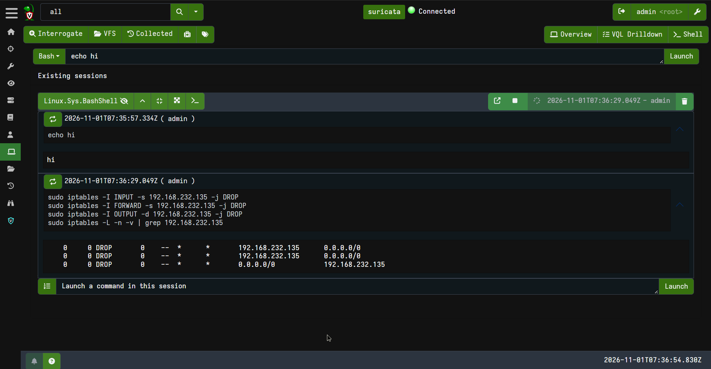  
*Figure 1: Velociraptor terminal output on Suricata displaying active iptables packet filtering rules dropping all inbound and forward packets from attacker IP `192.168.232.135`.*

---

# 4. Action 2: DVWA Reverse Shell Termination & Web Shell Quarantine

> 🔍 **Investigative Basis:** [Window 2 Forensic Walkthrough](Initial-Triage-and-Investigation.md#5-deep-dive-chronological-evidence-walkthrough-by-time-window) | Neutralizing web shell in Alert #11 (sub-events 18–22) and Netcat reverse shell in Alerts #14 & #15.

### 🎯 Objective:
Terminate active interactive shells running on port `4444` and safely quarantine the uploaded PHP web shell (`shell.php`) without deleting it (preserving file timestamps, inode numbers, and cryptographic hashes for forensic evidence).

### 💻 Execution Commands (Run via Velociraptor Shell on DVWA `192.168.56.30`):

```bash
# 1. Terminate active reverse shell processes
sudo pkill -9 -f "4444" 2>/dev/null || true
sudo pkill -9 -f "nc.openbsd" 2>/dev/null || true

# 2. Verify port 4444 is dead and not established (using modern 'ss')
sudo ss -antp | grep 4444

# 3. Create a secure forensic quarantine directory (read-only permissions)
sudo mkdir -p /root/forensics_quarantine
sudo chmod 700 /root/forensics_quarantine

# 4. Quarantine shell.php from the DVWA uploads directory
sudo mv /var/www/html/dvwa/hackable/uploads/shell.php /root/forensics_quarantine/shell.php.quarantined
sudo chmod 000 /root/forensics_quarantine/shell.php.quarantined

# 5. Verify the uploads directory is clean
ls -la /var/www/html/dvwa/hackable/uploads/
```

### 📸 Proof of Execution:
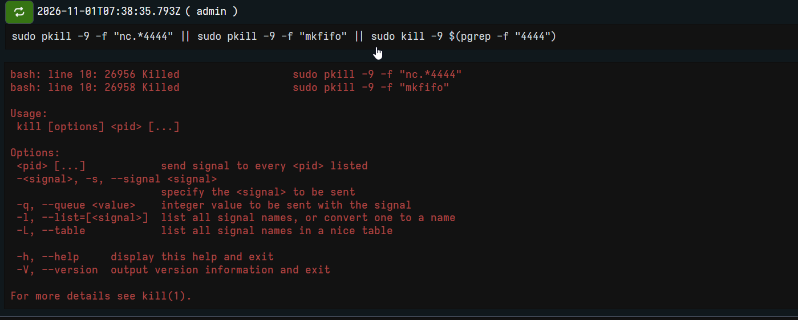  
*Figure 2a: Velociraptor command line executing process termination (`pkill -f nc.openbsd`) to sever the interactive reverse shell connection on port 4444.*

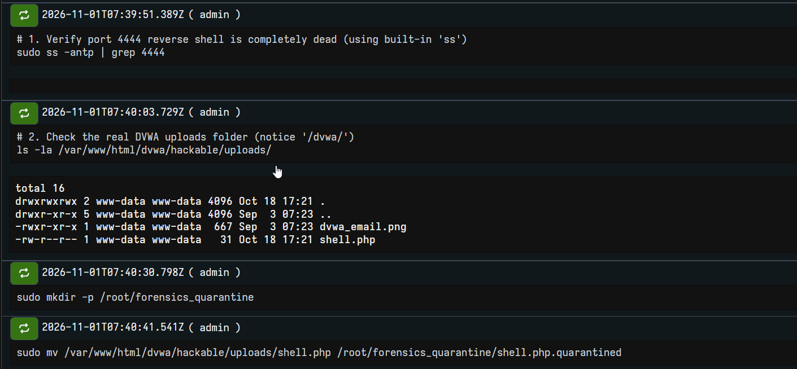  
*Figure 2b: Socket statistics (`ss`) confirming port 4444 is cleared, and `shell.php` staged for isolation.*

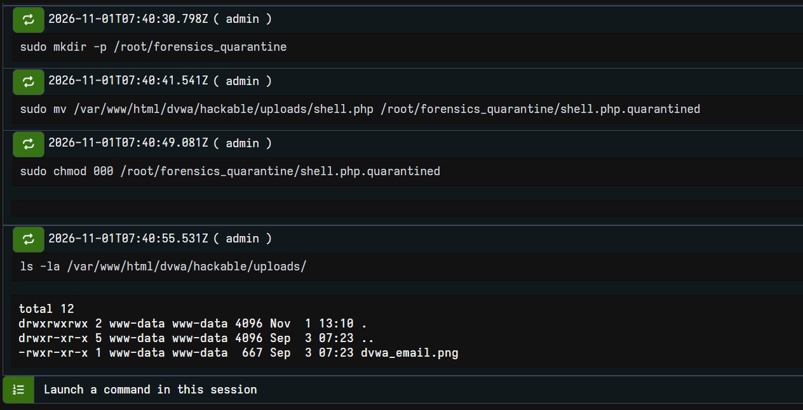  
*Figure 2c: Directory listing confirming `shell.php` is completely removed from `/var/www/html/dvwa/hackable/uploads/` and quarantined.*

---

# 5. Action 3: DVWA Rogue Root SSH Key Eradication

> 🔍 **Investigative Basis:** [Alert #16 Root SSH Login Detail](Initial-Triage-and-Investigation.md#5-deep-dive-chronological-evidence-walkthrough-by-time-window) | Wiping ED25519 root persistence key logged at 17:29:43 IST.

### 🎯 Objective:
Remove the attacker's rogue ED25519 public key injected into `/root/.ssh/authorized_keys` during Window 2 (`17:29:43 IST`, Alert #16) and kill all active unauthorized root SSH sessions.

### 💻 Execution Commands (Run via Velociraptor Shell on DVWA `192.168.56.30`):

```bash
# 1. View the authorized_keys file and archive the rogue key hash
cat /root/.ssh/authorized_keys

# 2. Back up for forensic hashing, then wipe authorized_keys
sudo cp /root/.ssh/authorized_keys /root/forensics_quarantine/authorized_keys.bak
sudo rm -f /root/.ssh/authorized_keys

# 3. Terminate any active SSH connections originating from the attacker subnet
sudo pkill -9 -u root sshd

# 4. Confirm no unauthorized sessions remain logged in
who
sudo ss -tprn '( dport = :22 or sport = :22 )'
```

### 📸 Proof of Execution:
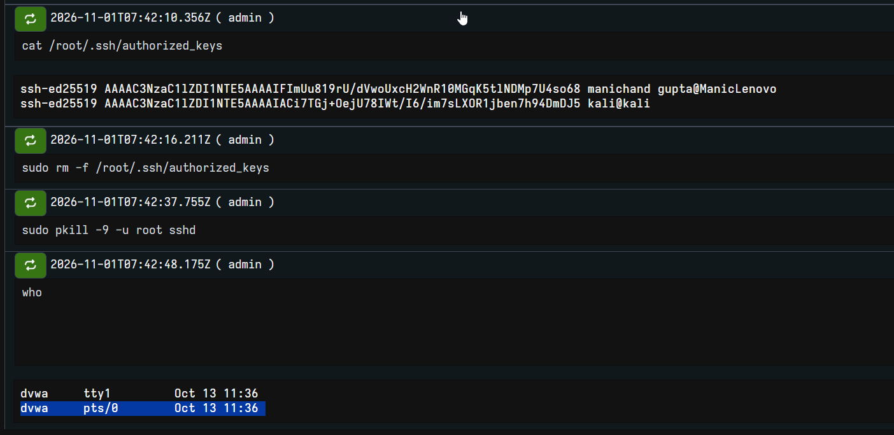  
*Figure 3: Velociraptor console verifying `/root/.ssh/authorized_keys` removal (showing `kali@kali` key wiped) and `who` command confirming zero unauthorized root sessions.*

---

# 6. Action 4: Active Directory Rogue Account Neutralization (AD\backdoor)

> 🔍 **Investigative Basis:** [Window 4 Domain Controller Takeover](Initial-Triage-and-Investigation.md#5-deep-dive-chronological-evidence-walkthrough-by-time-window) | Neutralizing rogue AD user created via Impacket wmiexec in Alerts #29–#33.

### 🎯 Objective:
Disable the rogue domain account `AD\backdoor` created via Impacket wmiexec at `18:08:21 IST` (Alert #29 / #30) and strip it from both `Domain Admins` and `Administrators` groups.

### 💻 Execution Commands (Run in PowerShell as Administrator on `DomainWin10` / `PC-DC.ad.lab`):

```powershell
# 1. Immediately disable the backdoor user account
Disable-ADAccount -Identity "backdoor"

# 2. Strip rogue user from privileged domain and local administrative groups
Remove-ADGroupMember -Identity "Domain Admins" -Members "backdoor" -Confirm:$false
Remove-ADGroupMember -Identity "Administrators" -Members "backdoor" -Confirm:$false

# 3. Verify account status and group memberships
Get-ADUser -Identity "backdoor" | Select-Object Name, SamAccountName, Enabled, UserAccountControl
Get-ADPrincipalGroupMembership -Identity "backdoor" | Select-Object Name
```

### 📸 Proof of Execution:
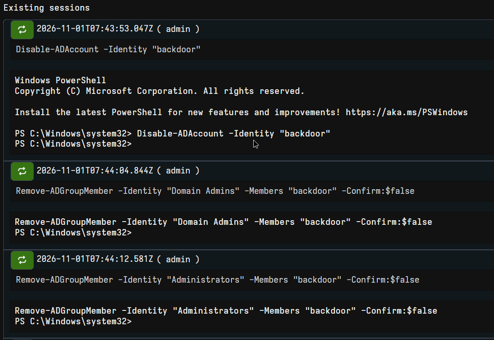  
*Figure 4a: Active Directory PowerShell console executing `Disable-ADAccount` and stripping `backdoor` from Domain Admins and Administrators.*

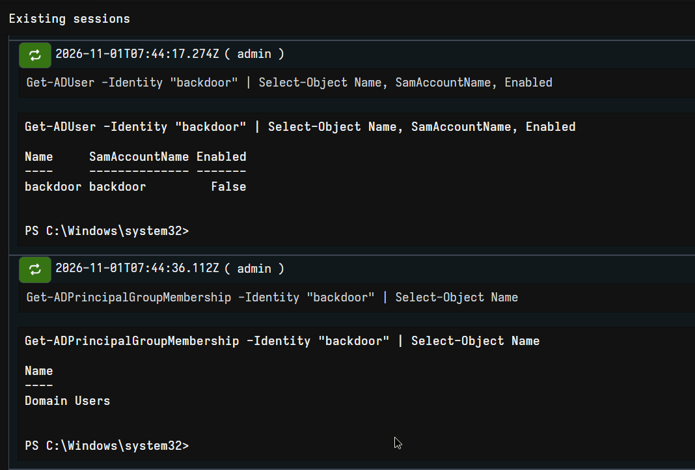  
*Figure 4b: `Get-ADUser` output confirming `Enabled : False` and `Get-ADPrincipalGroupMembership` verifying reduction strictly to default Domain Users.*

---

# 7. Action 5: Active Directory Kerberos Golden Ticket Invalidation (krbtgt Reset)

> 🔍 **Investigative Basis:** [Deep-Dive Phase 5: Golden Ticket Forgery](Deep-Dive-Attack-Chain-Investigation.md#phase-5-becoming-god-in-active-directory-kerberoasting-dcsync--the-golden-ticket) | Invalidate forged Kerberos Golden Tickets created via ticketer.py using DCSynced krbtgt hash.

### 🎯 Objective:
Invalidate all forged Kerberos Ticket Granting Tickets (TGTs) generated using the compromised `krbtgt` hash dumped via DCSync (`18:02:40 IST`, Row 9274) and forged via `ticketer.py` (`18:06:40 IST`, Row 9306) by performing a double password reset on the `krbtgt` domain account.

> [!IMPORTANT]
> A single `krbtgt` password reset only invalidates newly requested tickets; Kerberos allows tickets encrypted with the previous password to remain valid for up to 10 hours (ticket lifetime). A **second reset** after replication invalidates all previously minted Golden Tickets.

### 💻 Execution Commands (Run in PowerShell as Administrator on `PC-DC.ad.lab`):

```powershell
# 1. Record the current pwdLastSet timestamp of the krbtgt account
Get-ADUser -Identity "krbtgt" -Properties pwdLastSet | Select-Object Name, @{N="pwdLastSet";E={[DateTime]::FromFileTime($_.pwdLastSet)}}

# 2. Execute the first krbtgt password reset
Set-ADAccountPassword -Identity "krbtgt" -NewPassword (ConvertTo-SecureString "TempKrbP@ssw0rd2026!#Step1" -AsPlainText -Force) -Reset

# 3. Execute the second krbtgt password reset (purges N-1 ticket encryption history)
Set-ADAccountPassword -Identity "krbtgt" -NewPassword (ConvertTo-SecureString "TempKrbP@ssw0rd2026!#Step2" -AsPlainText -Force) -Reset

# 4. Force Active Directory Kerberos ticket cache purge on domain controllers
klist purge -li 0x3e7

# 5. Verify the updated timestamp
Get-ADUser -Identity "krbtgt" -Properties pwdLastSet | Select-Object Name, @{N="pwdLastSet";E={[DateTime]::FromFileTime($_.pwdLastSet)}}
```

### 📸 Proof of Execution:
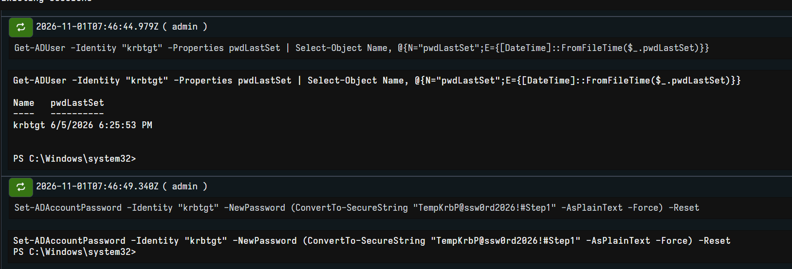  
*Figure 5a: PowerShell console checking initial `pwdLastSet` timestamp and executing `Set-ADAccountPassword` on `krbtgt`.*

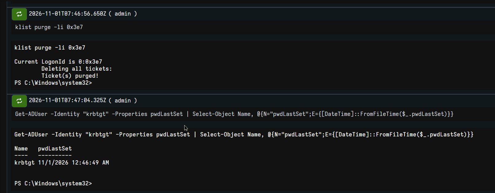  
*Figure 5b: Purging Kerberos tickets with `klist purge -li 0x3e7` and verifying updated `pwdLastSet` timestamp, invalidating all forged Golden Tickets.*

---

# 8. Action 6: Endpoint Defacement Reversion & Staged Recon Data Quarantine

> 🔍 **Investigative Basis:** [Window 6 Ransomware & Impact Batch](Initial-Triage-and-Investigation.md#5-deep-dive-chronological-evidence-walkthrough-by-time-window) | Remediating wallpaper defacement and staged files in Alerts #35, #36, #39, #42.

### 🎯 Objective:
Kill remote execution processes, quarantine staged reconnaissance files dumped in `C:\Windows\Temp\`, delete extortion notes (`README_HACKED.txt`), and restore original desktop wallpaper registry settings on both `DomainWin10` and `Win10User`.

### 💻 Execution Commands (Run in PowerShell on `DomainWin10` and `Win10User`):

```powershell
# 1. Terminate any orphan command-line processes spawned under WMI parent trees
taskkill /F /IM cmd.exe /T
taskkill /F /IM conhost.exe /T

# 2. Create local secure quarantine directories
New-Item -ItemType Directory -Path "C:\Forensics_Quarantine" -Force

# 3. Quarantine attacker staged reconnaissance files
Move-Item -Path "C:\Windows\Temp\domain_users.txt", "C:\Windows\Temp\admin_info.txt", "C:\Windows\Temp\sensitive_data.txt" -Destination "C:\Forensics_Quarantine\" -ErrorAction SilentlyContinue

# 4. Quarantine simulated ransomware extortion files and wallpaper bitmaps
Move-Item -Path "$env:USERPROFILE\Desktop\README_HACKED.txt", "$env:USERPROFILE\Desktop\*.enc", "C:\Users\Public\hacked.bmp" -Destination "C:\Forensics_Quarantine\" -ErrorAction SilentlyContinue

# 5. Restore default Windows wallpaper registry keys
reg add "HKCU\Control Panel\Desktop" /v Wallpaper /t REG_SZ /d "" /f
reg add "HKCU\Control Panel\Desktop" /v WallpaperStyle /t REG_SZ /d "2" /f
RUNDLL32.EXE user32.dll,UpdatePerUserSystemParameters

# 6. Verify quarantine contents and clean Desktop state
Get-ChildItem -Path "C:\Forensics_Quarantine"
```

### 📸 Proof of Execution:
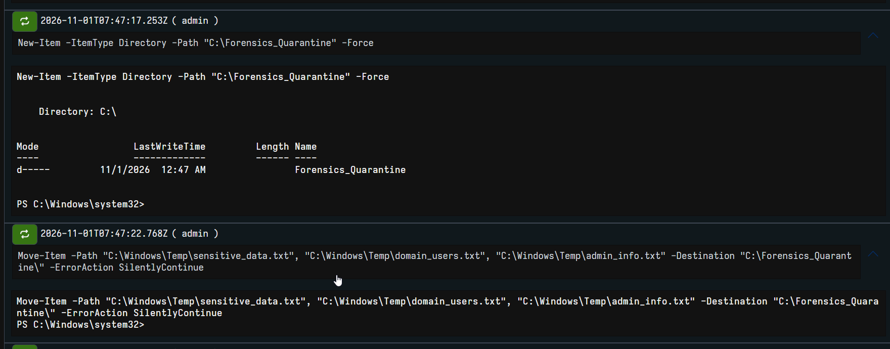  
*Figure 6a: PowerShell command creating isolated forensic directory `C:\Forensics_Quarantine\`.*

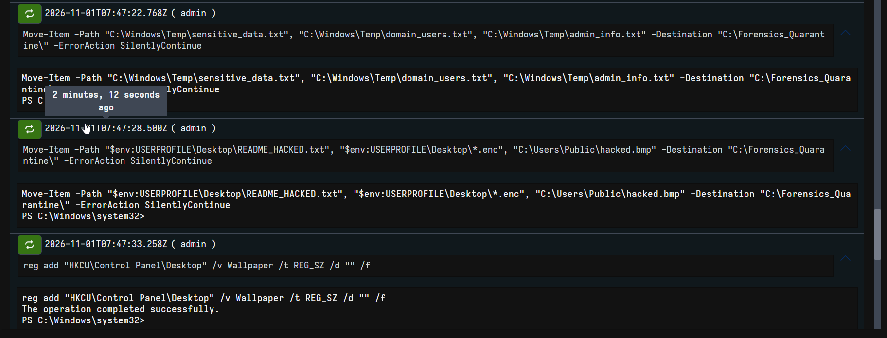  
*Figure 6b: Registry keys reset to remove hacked.bmp and revert WallpaperStyle.*

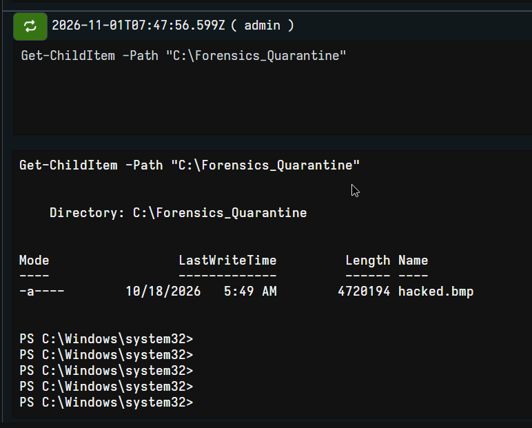  
*Figure 6c: PowerShell directory listing confirming staging and extortion files moved into quarantine.*

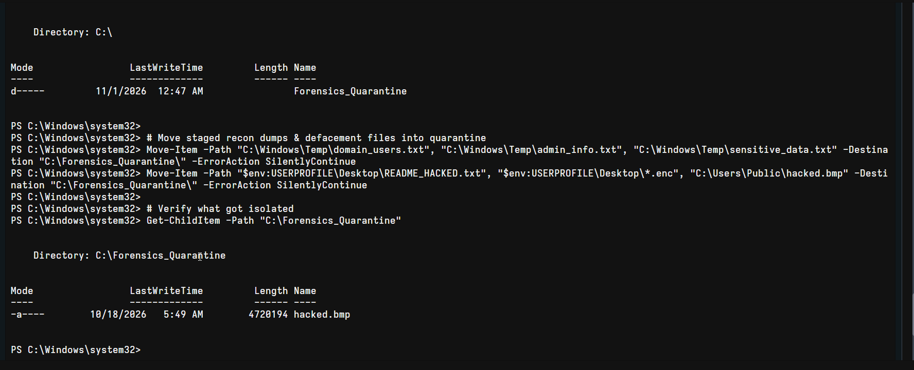  
*Figure 6d: Windows PowerShell console showing staged reconnaissance dumps and malicious wallpaper bitmap (`hacked.bmp`) successfully quarantined in `C:\Forensics_Quarantine\`.*

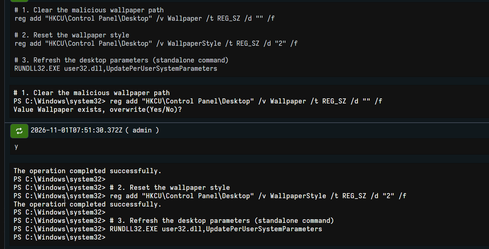  
*Figure 6e: Registry update resetting Wallpaper and WallpaperStyle followed by `RUNDLL32.EXE` to refresh the desktop parameters.*

---

# 9. Action 7: DVWA Database & Web Application Credential Rotation

> 🔍 **Investigative Basis:** [Alert #11 SQL Injection Analysis](Initial-Triage-and-Investigation.md#5-deep-dive-chronological-evidence-walkthrough-by-time-window) | Rotating credentials dumped via UNION SELECT user, password from users-- -.

### 🎯 Objective:
Rotate all database and web application passwords dumped by the attacker via SQL injection (`UNION SELECT user, password FROM users-- -`, Alert #11, sub-event 17).

### 💻 Execution Commands (Run via Velociraptor Shell on DVWA `192.168.56.30`):

```bash
# 1. Update the DVWA application database user password non-interactively
sudo mysql -e "ALTER USER 'dvwa'@'localhost' IDENTIFIED BY 'S0C_S3cur3_Db_P@ssw0rd_2026!'; FLUSH PRIVILEGES; SELECT User, Host FROM mysql.user WHERE User='dvwa';"

# 2. Update the DVWA application configuration file with the new database password
sudo sed -i "s/db_password' \] = .*/db_password' \] = 'S0C_S3cur3_Db_P@ssw0rd_2026!';/" /var/www/html/dvwa/config/config.inc.php
grep "db_password" /var/www/html/dvwa/config/config.inc.php

# 3. Invalidate and reset compromised web admin credentials in dvwa database
sudo mysql -e "USE dvwa; UPDATE users SET password = MD5('NewStrongAdminP@ss2026!') WHERE user = 'admin'; SELECT user, password FROM dvwa.users WHERE user='admin';"

# 4. Restart Apache web server to apply configuration
systemctl start apache2
```

### 📸 Proof of Execution:
  
*Figure 7: Velociraptor console demonstrating successful non-interactive password rotation in MariaDB, DVWA config file update, and Apache restart.*

---

# 10. Post-Containment Verification & Sign-Off Matrix

As a defensive SOC team, lockout verification is established entirely from **defensive telemetry and host auditing**:
- **Firewall Drop Metrics:** `iptables -L -n -v` logs 0 bytes accepted and all packets from `192.168.232.135` dropped at the gateway.
- **Alert Ingress Silence:** Suricata and Wazuh telemetry confirms zero new incoming sessions from `192.168.232.135` to port 22, 80, or 4444.
- **Active Directory Integrity:** Event ID audit logs confirm `AD\backdoor` is disabled (`UserAccountControl: ACCOUNTDISABLE`), and ticket requests encrypted with the old `krbtgt` key are rejected.

| Action # | Target System | Action Taken | Tooling Used | Operational Status | Verified By |
|---|---|---|---|---|---|
| **01** | Gateway / Firewall | Inbound & Forward DROP rules on `192.168.232.135` | **Velociraptor** (`Linux.Sys.BashShell`) | **ACTIVE** | `iptables -L -n -v` |
| **02** | DVWA (`192.168.56.30`) | Terminated port 4444 reverse shell; quarantined `shell.php` with `000` perms | **Velociraptor** (`Linux.Sys.BashShell`) | **CONTAINED** | `ss -antp` & `ls` |
| **03** | DVWA (`192.168.56.30`) | Purged `/root/.ssh/authorized_keys`; killed rogue root sessions | **Velociraptor** (`Linux.Sys.BashShell`) | **CONTAINED** | `cat` & `who` |
| **04** | DomainWin10 (`192.168.56.10`) | Disabled `AD\backdoor`; stripped `Domain Admins` & `Administrators` | **Enterprise PowerShell** (RSAT) | **CONTAINED** | `Get-ADUser` & `Get-ADPrincipalGroupMembership` |
| **05** | DomainWin10 (`192.168.56.10`) | Twice-reset `krbtgt` password; purged Kerberos ticket cache | **Enterprise PowerShell** (RSAT) | **CONTAINED** | `Get-ADUser krbtgt` & `klist purge` |
| **06** | Win10User & DC | Quarantined recon files & defacement artifacts; restored wallpaper registry | **Enterprise PowerShell** | **REMEDIATED** | `Get-ChildItem C:\Forensics_Quarantine` |
| **07** | MariaDB (`192.168.56.30`) | Rotated `dvwa` DB user pass & web `admin` MD5; restarted Apache | **Velociraptor** (`Linux.Sys.BashShell`) | **REMEDIATED** | `mysql -e` query confirmation |
