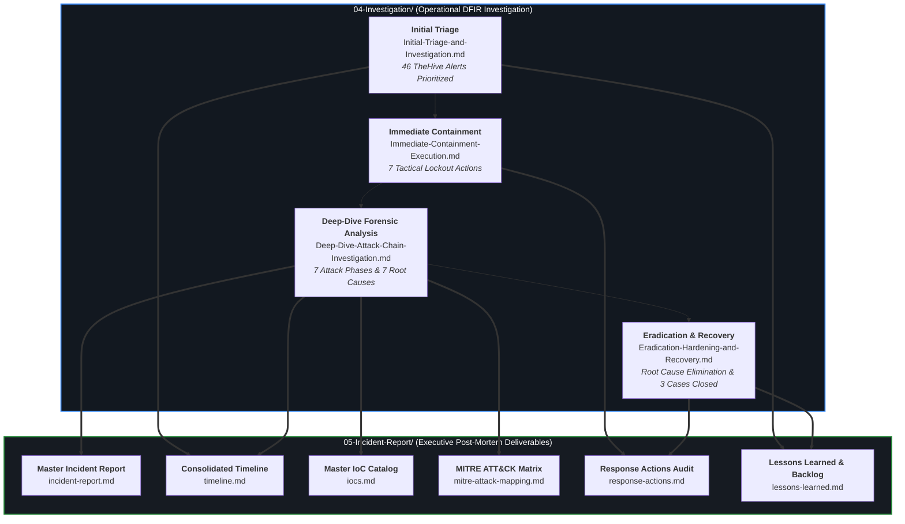

# 05 — Incident Report & Post-Mortem Deliverables

> **Incident Identifier:** `INC-2026-1018-ALPHA`  
> **Master Report ID:** `IR-2026-1018-ALPHA`  
> **Environment:** SOC-Lab Hybrid Enterprise (`192.168.56.0/24`)  
> **Lead Incident Responder:** Manichand Gupta  
> **Operational Status:** **Completed & Formally Validated** (NIST SP 800-61r2 Phase 5: Post-Incident Activity)

Welcome to the **Incident Reporting** section of the SOC Lab repository. This directory houses the executive-level, audit-ready post-mortem documentation generated following the complete triage, tactical containment, deep-dive forensic analysis, and eradication of an enterprise Active Directory breach.

*Figure 1: Full chronological incident timeline spanning 74 minutes ($T_0$ to $T_0 + 74\text{m}$), correlating attacker milestones (top) against blue-team detection alerts across Suricata, Auditd, Wazuh, Sysmon, and TheHive (bottom).*

---

## 📑 Post-Incident Deliverable Suite

This post-incident review is organized into **six authoritative deliverables** aligned with enterprise DFIR reporting standards and regulatory post-mortem requirements:

| Deliverable | Operational Purpose | Primary Target Audience | Document Link |
|:---|:---|:---|:---|
| **Incident Post-Mortem Report** | Comprehensive incident post-mortem: executive summary, affected asset inventory, detection performance metrics, 7 root causes, and strategic remediation roadmap. | CISO, SOC Leadership, IT Audit | **[`incident-report.md`](incident-report.md)** |
| **Consolidated Incident Timeline** | Unified chronological timeline cross-referencing elapsed time ($T_0$), UTC, IST, attack tradecraft, telemetry sensor SIDs, and evidentiary captures. | Senior IR Analysts, Threat Hunters | **[`timeline.md`](timeline.md)** |
| **Indicators of Compromise (IoCs)** | Exhaustive, unredacted inventory of verified network, host, identity, file, registry, and cryptographic observables with confidence ratings. | SOC Tier 1/2, Detection Engineers | **[`iocs.md`](iocs.md)** |
| **MITRE ATT&CK Mapping** | Full ATT&CK matrix mapping all 20 stages across 9 tactics and 20 techniques with detection statuses and rule attribution. | SOC Engineering, Red/Purple Teams | **[`mitre-attack-mapping.md`](mitre-attack-mapping.md)** |
| **Response Actions Log** | Detailed log of two-phase remediation: Immediate Tactical Containment (7 actions) and Permanent Eradication & Hardening (7 steps). | SysAdmins, Windows/Linux Ops | **[`response-actions.md`](response-actions.md)** |
| **Lessons Learned & Roadmap** | Strategic review of defensive successes, documented telemetry gaps, ingestion skew mechanics, and active engineering backlog. | SOC Management, SecOps Leads | **[`lessons-learned.md`](lessons-learned.md)** |

---

## 🔗 Lifecycle Relationship with 04-Investigation

The deliverables in this directory represent the **formal analytical synthesis** of the live investigation conducted in [`04-Investigation/`](../04-Investigation/):

---

## 🛡️ Ground Truth Investigation Metrics

All post-mortem analysis across these reports is grounded in the authoritative telemetry captures of our hybrid enterprise environment:

- **Total Adversary Attack Stages:** **20 Stages** (Execution span: 74 minutes).
- **Direct Target-Side Detections:** **14 Stages (70.0%)** (Target host/wire inspected payloads, commands, or process trees).
- **Operational TheHive Alert Coverage:** **16 Stages (80.0%)** (Live actionable tickets delivered to SOC analysts).
- **Documented Telemetry Limits:** **4 Stages (20.0%)** (2 Inherent Offline Cracking [DG-04, DG-11]; 2 Target Logging Limits [DG-09, DG-12]).
- **Detection Rule Failures:** **0 Stages (0.0%)** (Zero false negatives where expected telemetry reached an agent).
- **Total OpenSearch Raw Baseline Events:** **9,567 raw alerts** ([`Wazuh-Raw-Alerts.csv`](../assets/files/alerts/Wazuh-Raw-Alerts.csv)).
- **Curated Investigation Alert Dataset:** **808 forensic alerts** ([`wazuh_alerts.csv`](../assets/files/alerts/wazuh_alerts.csv)).
- **Actionable TheHive 5 Incident Tickets:** **46 ingested alerts** ([`thehive_alerts.json`](../assets/files/alerts/thehive_alerts.json)).
- **Case Management Resolution:** **3 Cases Resolved / True Positive With Impact** (`CAS-001-WEBCOMP`, `CAS-002-LATMOVE`, `CAS-003-DOMIMP`).

---

## Verification Status

**Completed & Formally Validated:** The post-incident deliverables in this directory are fully reconciled against the 46 TheHive alerts, 9,567 raw SIEM events, and authenticated forensic evidence.
