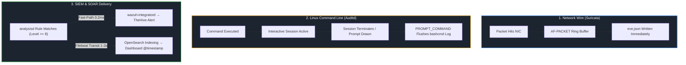

# Lessons Learned, Engineering Post-Mortem & Security Backlog

> **Incident Identifier:** `INC-2026-1018-ALPHA`  
> **Report Identifier:** `IR-2026-1018-LESSONS`  
> **Lead Incident Responder:** Manichand Gupta  
> **Lifecycle Phase:** NIST SP 800-61r2 Phase 5: Post-Incident Activity  
> **Status:** **Approved & Integrated into SecOps Engineering Backlog**

This document details the strategic takeaways, defensive successes, architectural telemetry insights, and ongoing engineering roadmap derived from the 74-minute multi-stage enterprise intrusion simulation.

---

## 📑 Post-Mortem Structure

1. [Operational Post-Mortem Executive Overview](#1-operational-post-mortem-executive-overview)
2. [Defensive Architecture Victories: What Succeeded](#2-defensive-architecture-victories-what-succeeded)
3. [Telemetry Ingestion Latency, Buffer Flushing & Multi-Sensor Arrival Mechanics](#3-telemetry-ingestion-latency-buffer-flushing--multi-sensor-arrival-mechanics)
4. [Documented Detection Limits & Architectural Blind Spots](#4-documented-detection-limits--architectural-blind-spots)
5. [Completed Remediations vs. Ongoing Engineering Backlog](#5-completed-remediations-vs-ongoing-engineering-backlog)

---

# 1. Operational Post-Mortem Executive Overview

The primary objective of campaign `INC-2026-1018-ALPHA` was to test whether a modern, resource-constrained Security Operations Center could detect, track, contain, and eradicate a sophisticated kill chain progressing from an external web application breach to total Active Directory forest compromise.

Our key post-mortem conclusion is that **prevention without zero-trust micro-segmentation is guaranteed to fail, but multi-sensor detection fabric paired with rapid live-response tooling can successfully detect and sever an adversary before unrecoverable harm occurs**. 

While the adversary achieved Tier Zero Active Directory dominance in under 55 minutes, defensive sensors captured empirical telemetry across **18 of 20 stages (90.0%)**, with zero detection engine rule execution failures.

---

# 2. Defensive Architecture Victories: What Succeeded

### 1. Multi-Sensor Layered Telemetry Fabric
No single defensive sensor possessed complete visibility across the hybrid environment. The intrusion was successfully reconstructed because telemetry from multiple distinct layers corroborated each phase:
- **Wire Inspection (Suricata):** Detected external port scans, automated brute-force bursts, SQL injection payloads, web shell verification, and Kerberos TGS-REQ requests that bypassed local endpoint loggers.
- **Kernel & Host Audit (Auditd & PAM):** Detected web shell OS command execution (`/usr/bin/id`), reverse shell socket establishment (`stty sane`), and passwordless sudo Python escalation (`Rule 5402`) within seconds.
- **Directory & Process Behavioral Analytics (Wazuh & Sysmon):** Captured Pass-the-Hash NTLM Logon Type 3 events (EID 4624), Impacket WMI fan-out commands, rogue user creation (EID 4720), and desktop wallpaper registry modifications (EID 13).

### 2. The Custom Level >= 8 SOAR Ingestion Gateway
In a high-throughput enterprise environment, raw SIEM streams quickly overwhelm Tier 1 analysts (visible in our 9,567 raw OpenSearch baseline events). 
- Wazuh's `custom-thehive` integration acted as an intelligent operational filter: inspecting incoming events directly in analysisd memory, clustering alert bursts within a 5-second sliding window, and delivering **46 high-fidelity, actionable incident tickets** to TheHive.
- This prevented alert fatigue, preserved analyst cognitive bandwidth, and enabled rapid triage into three clean, scope-based investigation cases.

### 3. Sub-15-Second Host Mean Time to Detect (MTTD)
Host behavioral rules alerted with near-instantaneous speed:
- PAM sudo privilege escalation alerted in **< 1 second** (`17:25:36 IST`).
- Sysmon process creation tracking for Impacket WMI execution alerted in **< 2 seconds** (`18:04:47 IST`).
- SSH administrative rate anomaly correlation caught the 6-session exfiltration burst within **570 milliseconds** (`18:17:30 IST`).

### 4. Promiscuous Network Sniffing Resilience
By configuring Suricata in AF-PACKET promiscuous mode on gateway interface `ens37`, the IDS successfully observed intra-subnet Layer 2 port sweeps and Kerberos ticket requests traversing the VMware virtual switch that never hit the router's IP forwarding layer.

---

# 3. Telemetry Ingestion Latency, Buffer Flushing & Multi-Sensor Arrival Mechanics

A critical finding from our investigation is that **in commercial SOC environments, raw event timestamps naturally exhibit slight offsets (1–3 seconds, or minutes for interactive shells)**. Understanding these architectural mechanics is vital for tier-1/tier-2 analysts to avoid mistaking ingestion skew for forensic errors:

### Architectural Skew Mechanics Explained:
1. **TheHive SOAR Fast-Path vs. OpenSearch Dashboard Indexing:**
   - When Wazuh's `analysisd` matches a high-severity rule, `wazuh-integratord` hooks directly into the core engine memory and immediately posts the alert payload to `custom-thehive` via webhook in **< 0.2 milliseconds**.
   - Concurrently, the same alert is written to `alerts.json`, shipped across WireGuard by Filebeat, and indexed into OpenSearch. Because Filebeat uses buffered batch flushes and OpenSearch has a refresh interval (default 1s), **TheHive alerts routinely appear in the SOAR queue 1–3 seconds before the OpenSearch dashboard indexes them**.
2. **Linux Shell `PROMPT_COMMAND` Flushing Delays:**
   - Linux Auditd command-line logging (`bashcmd`) hooks into Bash's `PROMPT_COMMAND` environment variable. `PROMPT_COMMAND` executes **only after a running process exits and the next shell prompt is rendered**.
   - When an attacker executes long-running, blocking, or interactive commands (`Responder.py`, interactive Python subshells, or Impacket scripts), Suricata and the target Windows DC log the network and authentication packets immediately on wire arrival. However, `bashcmd` only flushes the command string to `/var/log/bash_commands.log` after the attacker terminates the command (`Ctrl+C`) or exits the shell. This explains why bashcmd timestamps can appear offset by several seconds to minutes relative to network IDS logs.
3. **Live Multi-Attempt Sequence Clustering:**
   - In realistic intrusions, operators frequently retry commands (e.g. escaping quotes, adjusting network interface flags). TheHive clusters events matching the same rule within its 5-second sliding aggregation window into a single parent card anchored to the first timestamp, while individual OpenSearch dashboard screenshots reflect subsequent attempts within that cluster.

---

# 4. Documented Detection Limits & Architectural Blind Spots

Our audit identified **two inherent offline computation gaps** plus **one wire protocol payload inspection boundary** that require specialized defensive counter-strategies:

- **Inherent Offline Computation Gaps (2 Stages / 10.0% — `DG-04`, `DG-11`):** Computations occurring entirely on external adversary hardware (Kali GPU/CPU) producing zero victim telemetry by definition. These are verified and attributed via upstream theft detection and downstream authentication alerts.
- **Protocol Payload Inspection Boundary (`DG-19` — Stage 19):** Stage 19 is tracked as **Detected** because the exfiltration *transport activity* triggered a direct rate anomaly alert in Wazuh (Rule 5715, Alert #37: 6 rapid SSH sessions in 0.57s). However, `DG-19` documents the architectural limit that SSH transport encryption prevented Suricata NIDS from inspecting plaintext document filenames on the wire.
- **Online Target & Wire Coverage (18 Stages / 90.0%):** Every online attack procedure was intercepted by target host and wire sensors. Stage 09 was directly detected by Suricata promiscuous capture on `ens37` (Alert #08) and Wazuh Rule 100220; Stage 12 was directly detected on target endpoints by Custom Rule 100615 & Rule 92657 (TheHive Alert #22 `wzb-1e9fb54d94`) and Rule 100220.

| Gap Code | Stage # | Detection Boundary | Root Cause Analysis | Defensive Counter-Strategy & Mitigation |
|:---:|:---:|:---|:---|:---|
| **DG-04** | Stage 04 | Inherent Offline Password Hash Cracking | Hashcat executed locally on the attacker's GPU using dumped MD5 hashes. Produces zero network or host telemetry on victim systems. | Focus detection upstream (preventing SQL injection dumps) and downstream (alerting on immediate administrative logins using newly cracked passwords). |
| **DG-11** | Stage 11 | Inherent Offline NTLMv2 Hash Cracking | Hashcat cracked the intercepted `win10` challenge-response hash locally. Zero victim telemetry generated during the cracking phase. | Eliminate the capture vector entirely: globally disable LLMNR and NetBIOS over TCP/IP so hashes can never be broadcasted or captured. |
| **DG-19** | Stage 19 | Encrypted Transport Payload Inspection (Nuanced) | SCP over SSH encrypted the exfiltration payload on the wire, hiding document filenames from Suricata inspection. Method detected via host auth rate anomaly (Wazuh 5715). | Correlate host-level authentication rate anomalies: Wazuh Rule 5715 flagged 6 administrative SSH sessions initiated in under 570 milliseconds. |

---

# 5. Completed Remediations vs. Ongoing Engineering Backlog

During **Phase 4 (Eradication & Hardening)** ([`Eradication-Hardening-and-Recovery.md`](../04-Investigation/Eradication-Hardening-and-Recovery.md)), the incident response team permanently eliminated all 7 root causes. The table below outlines what was completed during live response versus the ongoing security engineering backlog:

### Remediated Root Causes (Completed & Verified in Phase 4)
- [x] **Flaw 1 (Sudoers NOPASSWD Python):** Directive purged from `/etc/sudoers`; syntax validated with `visudo -c`; access denial confirmed via `sudo -u www-data sudo -l`.
- [x] **Flaw 2 (Permissive SSH Root Logins):** Enforced `PermitRootLogin no` and `PasswordAuthentication no` in `/etc/ssh/sshd_config`; restarted SSH daemon.
- [x] **Flaw 3 (Web Upload Script Execution):** Deployed `.htaccess` denying script engines in `/hackable/uploads/`; tested and verified HTTP 403 Forbidden.
- [x] **Flaw 4 (Service Account in Domain Admins):** Stripped `HANK_SHERMAN` from `Domain Admins`; deleted SPN `CIFS/AWSWAPPS1000000.ad.lab`; enforced AES Kerberos encryption.
- [x] **Flaw 5 (Credential Exposure & Golden Tickets):** Enrolled `Administrator` and `HANK_SHERMAN` into `Protected Users` security group; completed double `krbtgt` password reset (KVNO 3).
- [x] **Flaw 6 (Insecure LLMNR & NetBIOS):** Globally disabled LLMNR (`EnableMulticast = 0`) and NetBIOS over TCP/IP (`NetbiosOptions = 2`) across all Windows workstations and servers.
- [x] **Flaw 7 (Flat DMZ Network Routing):** Enforced gateway and host iptables micro-segmentation rejecting outbound Windows AD ports from DVWA into `192.168.56.0/24`.

---

### Ongoing Security Engineering Backlog (Next 30–90 Days)

| Priority | Task Description | Target Component | Engineering Owner | Target Completion |
|:---:|:---|:---|:---:|:---:|
| **P1** | Set registry key `15 Field Engineering` to `5` on all Domain Controllers to log Event ID 1644 LDAP search volume anomalies | Active Directory (PC-DC) | Identity Engineering | 14 Days |
| **P1** | Implement Canary / Honeypot Service Accounts with registered SPNs in Active Directory for instant Kerberoast alert generation | Active Directory Infrastructure | SOC Detection Team | 21 Days |
| **P2** | Migrate standalone domain service accounts to Active Directory Group Managed Service Accounts (gMSA) to enforce 128-character automatic password rotations | Enterprise Windows Fleet | Systems Administration | 45 Days |
| **P2** | Configure Windows Defender Firewall dropped packet logging and forward dropped session events to Wazuh | Windows 10 & Server 2022 | Endpoint Security | 30 Days |
| **P2** | Deploy File Integrity Monitoring (FIM) with real-time whitelisting on all web server upload directories and temporary paths | Wazuh Agent (`ossec.conf`) | SOC Engineering | 30 Days |
| **P3** | Implement automated SOAR containment playbooks triggering instant Velociraptor network isolation upon detection of DCSync or Pass-the-Hash alerts | TheHive & Velociraptor | Automation Engineering | 60 Days |
| **P3** | Conduct quarterly Purple Team adversary emulation exercises testing Active Directory attack surface against updated detection baselines | Enterprise Threat Hunting | InfoSec Leadership | 90 Days |
