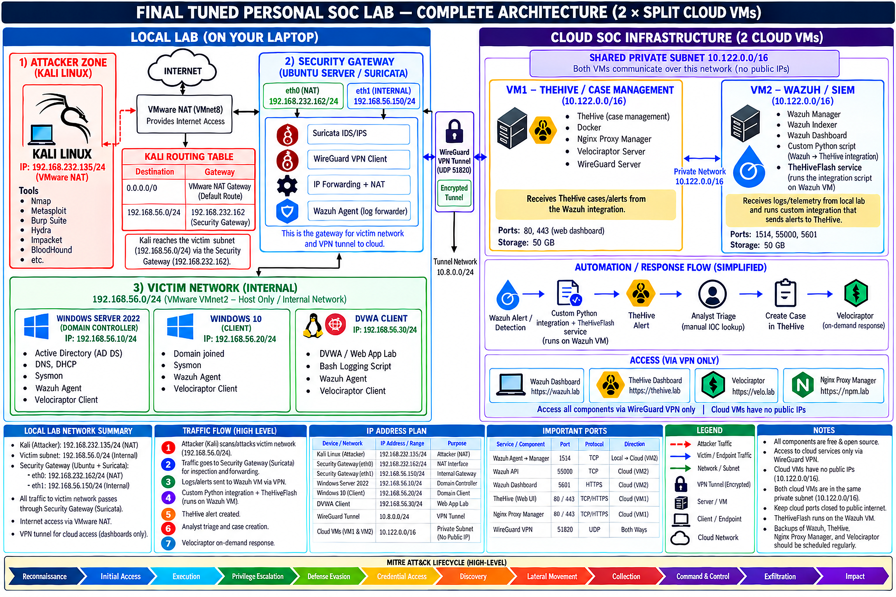
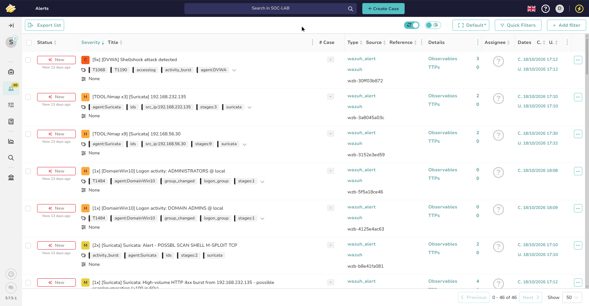
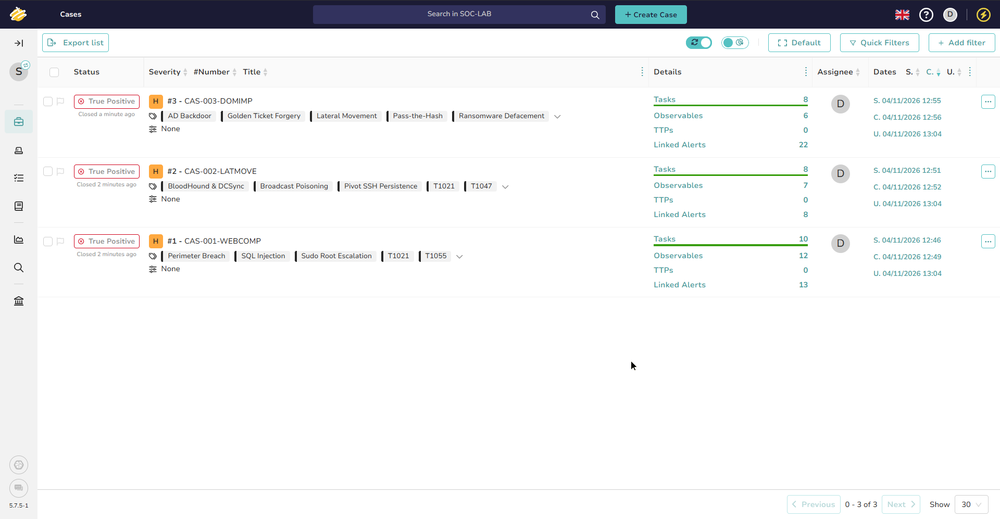

# Hybrid-Cloud SOC & Threat Engineering Lab
### 7-Node Hybrid Network, 74-Minute Attack Campaign, Multi-Sensor Detection & Incident Investigation

**Author:** Manichand Gupta ([@EclipseManic](https://github.com/EclipseManic))  
**Core Focus:** Hybrid Cloud Architecture · Red Team Attack Simulation · Detection Engineering · Hands-On SOC Triage & Incident Response  
**Live Interactive Dashboard:** <https://soc-lab.eclipsemanic.me/>

*Figure 1: Complete hybrid-cloud architecture connecting on-premise victim and attacker subnets to Azure cloud SIEM and SOAR servers over an encrypted WireGuard tunnel.*

---

## 1. Executive Overview & Purpose of the Lab

Many cybersecurity lab environments either demonstrate offensive tools against unmonitored targets or analyze pre-recorded log datasets disconnected from live infrastructure. This project was engineered to bridge that gap by building, attacking, detecting, and investigating an enterprise environment under realistic operational conditions.

I built a company-style network containing Windows systems, a Linux web server, a network security gateway, and cloud-hosted security tools. I then carried out a controlled attack across this environment to evaluate how effectively my security tools could identify suspicious activity.

The complete enterprise infrastructure is distributed across **seven virtual machines**, linking on-premises virtualization running in VMware Workstation Pro to Microsoft Azure cloud infrastructure through an encrypted, site-to-cloud WireGuard VPN tunnel. 

To rigorously test defensive visibility, I simulated a determined adversary by executing an authentic **74-minute, 20-stage attack campaign**. The intrusion progressed through every phase of the cyber kill chain:
1. External perimeter reconnaissance and automated web vulnerability scanning against an exposed Linux web server.
2. SQL injection credential dumping and PHP webshell deployment, followed by immediate privilege escalation from web service account to `root` via an administrative sudoers misconfiguration.
3. Network pivoting into an isolated Active Directory internal subnet (`192.168.56.0/24`), capturing Windows credentials through LLMNR broadcast poisoning and Kerberoasting.
4. Active Directory domain compromise via DCSync credential extraction over the Directory Replication Service Remote Protocol (`drsuapi`).
5. Domain persistence and privilege elevation using a forged Kerberos Ticket Granting Ticket (Golden Ticket), rogue Domain Admin account creation, SSH data exfiltration, desktop defacement, and simulated ransomware deployment.

On the defensive side, I authored and calibrated multi-sensor detection logic across network inspection (Suricata NIDS), kernel-level system call tracking (Linux Auditd), interactive host command auditing (`bashcmd`), and Windows endpoint instrumentation (Microsoft Sysmon and Windows Security event logs). 

To prevent alert fatigue while preserving investigative context, I engineered a custom asynchronous Security Orchestration, Automation, and Response (SOAR) pipeline (`custom-thehive.py`). The pipeline buffered incoming SIEM alerts in a local SQLite Write-Ahead Logging (WAL) queue (< 0.2 ms ingestion latency) and used an asynchronous background daemon to group related events into **46 actionable alerts consolidated across 3 formal incident cases in TheHive 5.7.5** (median end-to-end delivery latency: 4.6 seconds). 

Acting as the lead incident responder, I triaged the alerts, conducted root-cause investigations across raw telemetry, executed live containment playbooks (including terminating active reverse shells, quarantining artifacts, and invalidating forged Kerberos tickets through a double `krbtgt` password reset to **KVNO 3**), and implemented permanent architectural hardening.

---

## 2. Technical Architecture & Technology Stack

The infrastructure is engineered to mirror an enterprise network where external untrusted traffic, internal corporate assets, and central security monitoring operate in dedicated, segmented zones.

| Category | Platforms, Tools & Frameworks | Architectural Role in the Lab |
|---|---|---|
| **Cloud & Infrastructure** | Microsoft Azure (Private VNet `10.122.0.0/16`), VMware Workstation Pro, Ubuntu 24.04 LTS, Windows Server 2022 (Active Directory), Windows 10 Pro N for Workstations (22H2), WireGuard VPN (`10.8.0.0/24`) | Provides isolated victim subnets, simulated attacker environment, and cloud-hosted security analytics connected via site-to-site VPN. |
| **Network & SIEM** | Wazuh SIEM 4.14.8 (Manager, Indexer, OpenSearch Dashboard), Suricata 8.0.6 NIDS (Sniffing WAN `ens33` and LAN `ens37` interfaces) | Centralizes log ingestion, rule evaluation, compliance tracking, and wire-level signature inspection. |
| **Endpoint Telemetry** | Microsoft Sysmon 15.20 (Process and Registry monitoring), Linux Auditd (`execve` syscall tracking), Custom Wazuh `bashcmd` Interactive Command Auditing (Rule `100220`) | Captures host-level process trees, command-line arguments, parent-child relationships, network connections, and shell executions. |
| **Incident Management & SOAR** | TheHive 5.7.5-1 (Case Management), Apache Cassandra 4.x, Elasticsearch 8.x, Custom Python SOAR Gateway (`custom-thehive.py`) with SQLite WAL buffering | Groups related alerts into incident cases, manages forensic observables, and tracks response tasks and analyst notes. |
| **Adversary Emulation Suite** | MITRE ATT&CK Framework, Impacket suite (`wmiexec.py`, `secretsdump.py`, `GetUserSPNs.py`, `ticketer.py`), BloodHound (`bloodhound-python`), Responder, Hashcat, Hydra, Nmap, Nikto | Executes standardized, repeatable attack techniques across perimeter, credential access, lateral movement, and domain takeover phases. |

---

## 3. The Four Core Engineering Pillars

This project encompasses four interconnected disciplines of cybersecurity engineering:

*Figure 2: The four core pillars of the laboratory suite across infrastructure engineering, adversary attack simulation, multi-sensor detection engineering, and incident response triage.*

### Pillar 1: Hybrid Infrastructure & Network Engineering
The environment operates across seven purpose-built virtual machines across on-premises virtualization and Microsoft Azure. Rather than allowing victims direct internet access or flattening the network, the environment enforces strict segmentation:
- An isolated internal victim network (`192.168.56.0/24`) connects corporate endpoints (Domain Controller, Windows 10 workstation, and the internal interface of the DMZ web server).
- A dedicated security gateway bridges the external attack segment (`192.168.232.0/24`) and internal victim network, routing inter-segment traffic and sniffing packets passively using Suricata.
- A secure Site-to-Cloud WireGuard tunnel (`10.8.0.0/24`) links the on-premises gateway to cloud SIEM servers with Zero-NAT routing. By disabling NAT masquerading on the tunnel, the true source IP address of every victim host is preserved as logs enter Wazuh, allowing correlation rules to identify the exact host compromised.
*(Detailed VM build guides, network configurations, and firewall rules: [`01-Lab-Setup/README.md`](01-Lab-Setup/README.md))*

### Pillar 2: Adversary Attack Simulation (20 Stages / 74 Minutes)
To evaluate defensive controls against a coherent threat, I planned and executed a 20-stage attack sequence organized into three chronological operational acts:
- **Act 1: Perimeter Web Compromise to Root (Stages 01–07):** Reconnaissance, dictionary brute-forcing, UNION SELECT SQL injection, offline MD5 hash cracking, PHP webshell upload, Netcat reverse shell callback, and instant local privilege escalation via a passwordless sudo Python directive.
- **Act 2: Pivoting, Network Sweeps & Active Directory Credential Access (Stages 08–14):** SSH root persistence, internal subnet discovery sweep, Responder LLMNR broadcast poisoning, offline NetNTLMv2 cracking, BloodHound domain mapping, Kerberoasting of service account `HANK_SHERMAN`, and DCSync Active Directory credential extraction.
- **Act 3: Domain Dominance, Persistence, Data Exfiltration & Impact (Stages 15–20):** Pass-the-Hash lateral movement to the Domain Controller, Kerberos Golden Ticket forgery, rogue Domain Admin account creation (`AD\backdoor`), confidential file staging, rapid SCP exfiltration over SSH, desktop wallpaper defacement, and simulated ransomware deployment with forced reboots.
*(Step-by-step commands, payloads, tool configurations, and terminal proof: [`02-Attack-Simulation/README.md`](02-Attack-Simulation/README.md))*

### Pillar 3: Multi-Sensor Detection Engineering & SOAR Pipeline
Defending against a sophisticated intrusion requires layered telemetry. A single sensor cannot observe every phase of an attack. In this lab:
- **Network Layer:** Suricata inspects packet payloads and protocol handshakes on gateway interfaces (`ens33` external and `ens37` internal).
- **Host Kernel Layer:** Linux Auditd hooks the `execve` system call to track binary executions, while custom shell auditing (`bashcmd`) logs interactive commands executed in root terminal sessions.
- **Windows Endpoint Layer:** Microsoft Sysmon and Windows Security audit policies log process creation (Event ID 1), network connections (Event ID 3), and privileged logons (Event ID 4624 / 4672).
- **Correlation & Automation:** Wazuh SIEM evaluates events against 148 detection rules and 87 false-positive suppressions. High-fidelity alerts ($\ge \text{Level } 8$) are routed into a custom asynchronous Python SOAR integration (`custom-thehive.py`) that uses an SQLite Write-Ahead Logging buffer (< 0.2 ms ingestion latency) and a 5-second background daemon to aggregate alert bursts into **46 actionable alerts in TheHive 5.7.5**, which are then consolidated into 3 master incident cases, eliminating alert fatigue.
*(Rule XML files, decoders, latency metrics, and daemon architecture: [`03-Detection-Engineering/README.md`](03-Detection-Engineering/README.md))*

### Pillar 4: SOC Alert Triage, Incident Response & Hardening
When alerts arrive at the analyst desk, the focus shifts to structured incident handling:
- **Triage:** Analysts evaluate incoming alerts in TheHive, distinguishing high-priority true positives from automated scanner noise.
- **Investigation:** Alerts are mapped to compromised assets and correlated chronologically to establish the adversary's timeline and blast radius.
- **Containment:** Responders execute targeted containment commands—severing reverse shells, quarantining webshells, deleting unauthorized SSH keys, locking rogue domain accounts, and invalidating forged Kerberos tickets through a double `krbtgt` password reset (advancing KVNO to 3).
- **Eradication & Hardening:** Root cause flaws are permanently resolved through system reconfiguration (purging sudoers NOPASSWD directives, disabling root SSH logins, enforcing `.htaccess` script execution blocks, demoting over-privileged service accounts, and disabling legacy LLMNR/NetBIOS protocols via GPO).
*(Investigation case files, containment runbooks, and forensic proof: [`04-Investigation/README.md`](04-Investigation/README.md))*

*Figure 3: Synchronized 74-minute chronological timeline correlating offensive attacker actions (top) against blue-team detection alerts across Suricata, Auditd, Wazuh, Sysmon, and TheHive (bottom).*

---

## 4. TheHive 5.7.5 Incident Cases & Real-World Triage

In an operational SOC, receiving dozens of uncoordinated alerts leads to fragmented investigations. In this lab, incoming alerts were correlated into three distinct investigation cases in TheHive 5.7.5:

*Figure 4: Live TheHive 5.7.5 alert queue sorted by severity. Operational triage insight: automated web fuzzing triggered noisy "Critical" alerts (generic Shellshock vulnerability probes), whereas genuine reverse shell establishment and DCSync replication arrived as "Medium" alerts requiring immediate human verification.*

*Figure 5: All three formal incident cases verified, contained, and closed after forensic analysis and system remediation.*

| Case ID | Incident Scope | Stages Covered | Priority | Concrete Containment & Remediation Actions Taken | Final Disposition |
|:---:|---|:---:|:---:|---|:---:|
| **`CAS-001-WEBCOMP`** | Web Compromise to Root | 01–07 | **P1 (Critical)** | Identified and severed reverse shell socket on port 4444; moved `shell.php` to secure quarantine (`chmod 000`); purged sudoers NOPASSWD directive; disabled root SSH logins and password authentication; decommissioned unmanaged staging adapter (`ens37`). | **Resolved / Closed** |
| **`CAS-002-LATMOVE`** | Lateral Movement & AD Access | 08–14 | **P1 (Critical)** | Purged injected attacker SSH public key from `/root/.ssh/authorized_keys`; terminated unauthorized TTY sessions; disabled LLMNR and NetBIOS domain-wide via Group Policy; stripped `Domain Admins` membership and SPN from `HANK_SHERMAN`; securely shredded staged password hashes (`shred -u -z -n 3 /tmp/*.hash`). | **Resolved / Closed** |
| **`CAS-003-DOMIMP`** | Domain Takeover & Impact | 15–20 | **P1 (Critical)** | Blocked adversary source IP (`192.168.232.135`) at gateway firewall; disabled rogue account `AD\backdoor`; invalidated all forged Golden Tickets via double `krbtgt` password reset (**KVNO 3**); enrolled privileged accounts in `Protected Users`; quarantined ransom artifacts and restored workstation desktop registries. | **Resolved / Closed** |

---

## 5. Empirical Detection Scorecard: Performance & Boundary Analysis

In authentic security operations, claiming 100% automated detection is unrealistic. Attackers frequently perform computations on their own offline hardware, and default operating system audit policies leave certain activities unrecorded. In this lab, detection performance across all 20 attack stages was rigorously evaluated and categorized:

| Telemetry Category | Stages | % | How It Actually Performed in the Lab |
|---|:---:|:---:|---|
| **Direct Host & Network Detections** | **14** | **70.0%** | Intercepted directly on the victim machine or network wire by rules analyzing packet payloads, process execution trees, authentication logs, or system calls (Stages 01, 02, 03, 05, 06, 07, 08, 10, 13, 15, 17, 18, 19, 20). |
| **Operational Pivot-Only Alerts** | **2** | **10.0%** | The target Domain Controller lacked specific diagnostic auditing out-of-the-box for DCSync (Stage 14) and Golden Ticket creation (Stage 16). However, the attack was intercepted on the Linux pivot host via interactive command logging (`bashcmd` Rule 100220) and SSH exfiltration alerting. |
| **Target-Side Logging Gaps** | **2** | **10.0%** | Default Windows Server and Workstation baselines did not log dropped Layer-2 network sweep probes (`DG-09`) or LDAP search query filters (`DG-12`) without specialized diagnostic audit policies enabled. |
| **Inherent Offline Computation Gaps** | **2** | **10.0%** | Password hash cracking ran offline on the attacker's GPU (Stages 04 and 11), generating zero victim packets or host processes. Detections relied on bracketing: catching the credential theft upstream and spotting the unauthorized login downstream. |
| **Operational Alert Delivery Rate** | **16** | **80.0%** | Delivered 46 high-priority alerts to TheHive 5.7.5 across 16 different attack stages via the Level $\ge 8$ SIEM-to-SOAR threshold, consolidated into 3 formal incident cases. |
| **Detection Rule / Engine Crashes** | **0** | **0.0%** | Zero syntax errors, decoder crashes, or dropped events across both Wazuh and Suricata throughout the entire 74-minute execution. |

> **Master Traceability Matrix:** To inspect the full technical mapping cross-referencing every attack stage against MITRE ATT&CK technique IDs, SIEM alert IDs, rule numbers, and forensic screenshots, consult [`INDEX.md`](INDEX.md).

### Transparent Defensive Limits & Hardening Backlog
1. **Offline Password Cracking (`DG-04`, `DG-11`):**  
   Security sensors cannot observe computations executed on an adversary's private laptop GPU. When an attacker cracks extracted hashes offline using Hashcat, detection depends entirely on intercepting credential theft upstream (such as SQL injection alerts or LLMNR broadcast detection) and alerting on abnormal subsequent authentication attempts downstream.
2. **Missing Diagnostic Logging (`DG-09`, `DG-12`):**  
   Default Windows installations drop unsolicited network scan packets without logging them unless Windows Filtering Platform (WFP) dropped packet auditing is configured. Similarly, Active Directory domain controllers do not log the specific filters of LDAP queries without NTDS Field Engineering diagnostics (Event ID 1644). Both diagnostic policies were added as formal hardening remediations in [`05-Incident-Report/lessons-learned.md`](05-Incident-Report/lessons-learned.md).
3. **Pivot-Only Visibility (`DG-14`, `DG-16`):**  
   For DCSync (`DG-14`) and Kerberos Golden Tickets (`DG-16`), the Domain Controller recorded generic logon (EID 4624) and privilege assignment (EID 4672) events, but lacked Directory Service Replication SACLs (EID 4662) and Ticket Granting Service auditing (EID 4769) in its baseline. Fortunately, our Linux command auditing pipeline captured Impacket's `secretsdump.py` and `ticketer.py` commands on the pivot host, demonstrating the vital role of defense-in-depth.
4. **Encrypted Transport Payload Inspection (`DG-19`):**  
   When the adversary exfiltrated sensitive data via SCP over SSH, transport encryption prevented Suricata NIDS from reading plaintext filenames on the wire. However, host-level authentication monitoring in Wazuh detected the anomaly by triggering Rule 5715 on a rapid burst of 6 administrative SSH sessions in 0.57 seconds.

---

## 6. Incident Deliverables & Documentation Index

The repository contains complete documentation covering infrastructure, simulation, detection, and investigation:

- **Incident Post-Mortem Report:** [`05-Incident-Report/incident-report.md`](05-Incident-Report/incident-report.md) — Comprehensive technical report detailing the breach narrative, impact, root causes, containment, and sign-off.
- **Master MITRE ATT&CK Mapping:** [`05-Incident-Report/mitre-attack-mapping.md`](05-Incident-Report/mitre-attack-mapping.md) — Technique-by-technique breakdown across all ATT&CK tactics.
- **Indicators of Compromise (IoC) Register:** [`05-Incident-Report/iocs.md`](05-Incident-Report/iocs.md) — Categorized network, host, account, and file indicators with confidence levels.
- **Lessons Learned & Hardening Roadmap:** [`05-Incident-Report/lessons-learned.md`](05-Incident-Report/lessons-learned.md) — Root-cause analysis, completed remediations, and prioritized ongoing engineering roadmap.
- **Chronological 74-Minute Timeline:** [`05-Incident-Report/timeline.md`](05-Incident-Report/timeline.md) — Minute-by-minute correlation linking offensive actions directly to defensive alerts.
- **Master Traceability Matrix:** [`INDEX.md`](INDEX.md) — Central register linking every attack stage, rule ID, alert, and investigation case file.

---

## 7. Reproducing This Environment

This laboratory is fully reproducible using the configuration files and scripts stored in this repository:
- **Configuration Templates:** Baseline configuration files for Wazuh Manager, Wazuh Agent, Suricata, Sysmon, and Auditd are located in [`06-Resources/configs/`](06-Resources/configs/).
- **Detection Rules:** Custom Wazuh XML rules, decoders, and Suricata signatures are maintained in [`06-Resources/rules/`](06-Resources/rules/).
- **SOAR Gateway Script:** The Python integration daemon and SQLite database schema are provided in [`06-Resources/scripts/`](06-Resources/scripts/).

---

## 8. Redaction & Safe Credentials Notice

In compliance with [`SECURITY.md`](SECURITY.md), all cloud subscription identifiers, cloud public IP addresses, and private SSH keys have been sanitized or redacted. All usernames, passwords, NTLM hashes, and Kerberos keys displayed in this repository (such as `P@ssw0rd123!` or `HANK_SHERMAN` hashes) are **laboratory test fixtures** generated specifically inside this isolated, private network segment.

---

## 9. Recommended Reading Guides

To explore this repository based on your specific focus:

- **For SOC Analysts & Incident Responders (30 mins):**
  1. [`04-Investigation/Initial-Triage-and-Investigation.md`](04-Investigation/Initial-Triage-and-Investigation.md) — Triage methodology, case correlation, and noise filtering.
  2. [`04-Investigation/Immediate-Containment-Execution.md`](04-Investigation/Immediate-Containment-Execution.md) — Live response playbooks with before-and-after verification.
  3. [`04-Investigation/Deep-Dive-Attack-Chain-Investigation.md`](04-Investigation/Deep-Dive-Attack-Chain-Investigation.md) — Complete 7-phase incident analysis cross-referencing 68 SIEM alert cards.
  4. [`05-Incident-Report/incident-report.md`](05-Incident-Report/incident-report.md) — Executive incident report and post-mortem review.

- **For Detection Engineers & Threat Hunters (25 mins):**
  1. [`03-Detection-Engineering/README.md`](03-Detection-Engineering/README.md) — Detection architecture, custom rule design, latency tiers, and tuning decisions.
  2. [`06-Resources/rules/wazuh/local_rules.xml`](06-Resources/rules/wazuh/local_rules.xml) — Full custom Wazuh ruleset and false-positive suppression rules.
  3. [`03-Detection-Engineering/Wazuh/README.md`](03-Detection-Engineering/Wazuh/README.md) — Technical deep dive into decoders, rule hierarchies, and interactive command auditing (`bashcmd`).

- **For Cloud & Infrastructure Engineers (20 mins):**
  1. [`01-Lab-Setup/README.md`](01-Lab-Setup/README.md) — 7-node hybrid cloud network architecture and virtualization specifications.
  2. [`01-Lab-Setup/Local/suricata-gateway.md`](01-Lab-Setup/Local/suricata-gateway.md) — Dual-homed network sensor configuration and Zero-NAT WireGuard tunnel design.
  3. [`01-Lab-Setup/Cloud/thehive.md`](01-Lab-Setup/Cloud/thehive.md) — Private cloud infrastructure, Cassandra/Elasticsearch cluster setup, and Nginx reverse proxy architecture.

- **For Red Teamers & Adversary Emulators (25 mins):**
  1. [`02-Attack-Simulation/README.md`](02-Attack-Simulation/README.md) — 20-stage kill chain roadmap and execution matrix.
  2. Key execution guides: [Stage 03 SQLi](02-Attack-Simulation/Stages/stage-03-sqli.md), [Stage 10 Responder](02-Attack-Simulation/Stages/stage-10-responder.md), [Stage 14 DCSync](02-Attack-Simulation/Stages/stage-14-dcsync.md), [Stage 16 Golden Ticket](02-Attack-Simulation/Stages/stage-16-golden-ticket.md).

---

## 10. Disclaimer & License

> **Authorized Educational Research Only:** All attack simulations, vulnerability demonstrations, and defensive evaluations documented in this repository were performed entirely within a private, isolated virtual laboratory owned and operated by the author. No production networks, third-party infrastructure, or external systems were targeted. Consult [DISCLAIMER.md](DISCLAIMER.md) and [SECURITY.md](SECURITY.md).

This project is licensed under the [MIT License](LICENSE).  
Copyright © 2026 Manichand Gupta.
