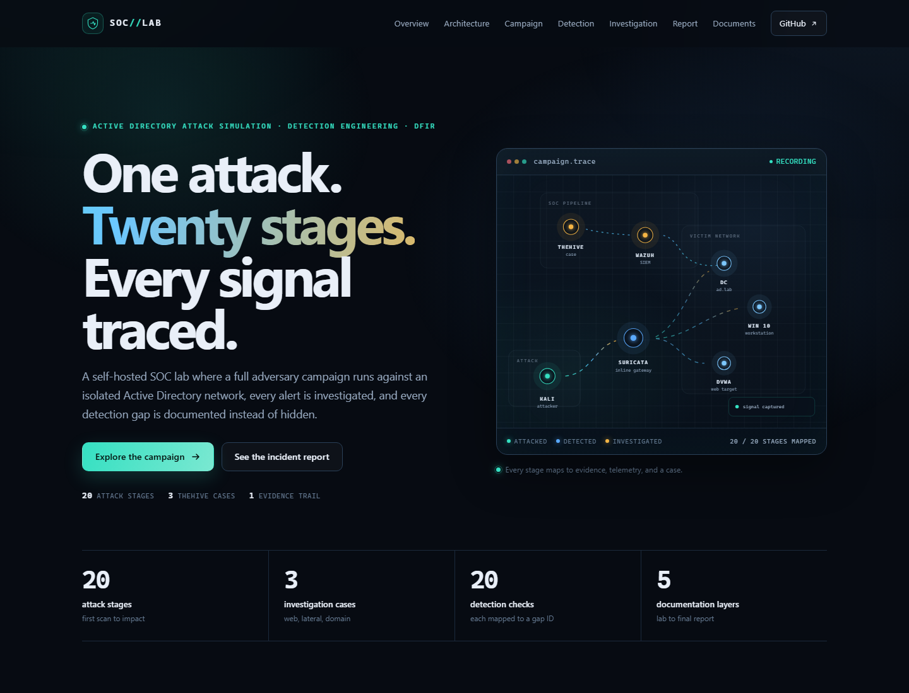

# SOC Lab — Attack Simulation, Detection & Incident Response

A self-hosted SOC lab that emulates a full adversary campaign against an Active Directory environment, detects it with Suricata and Wazuh, routes alerts into TheHive, and documents the investigation end to end.

> **Authorized lab only.** Every action in this repository was performed against systems I own in an isolated environment. See [DISCLAIMER.md](DISCLAIMER.md).

## Visual documentation

[](site/README.md)

The guided site turns the repository into one readable story: an animated attack path, a filterable 20-stage campaign board, a 20-row detection coverage matrix, three investigation cases, and the report package. It is plain HTML, CSS, and JavaScript with no build step.

- **Guided tour:** open `site/index.html` locally, or follow [site/README.md](site/README.md) for the one-command preview.
- **Detailed record:** [INDEX.md](INDEX.md) remains the source of truth for stage, alert, rule, case, and evidence links.
- **Deployment:** [.github/workflows/pages.yml](.github/workflows/pages.yml) publishes only `site/` after GitHub Pages is set to **GitHub Actions**.

## What this lab demonstrates

- Adversary emulation across the full MITRE ATT&CK kill chain
- Network detection with Suricata deployed as an inline security gateway
- Endpoint and log detection with Wazuh agents on Linux and Windows
- Automated alert pipeline: Wazuh -> custom Python bridge -> TheHive
- Case management, triage, observables, tasks, and timeline reconstruction
- Endpoint forensics and response with Velociraptor and Caldera
- Formal incident reporting aligned to NIST SP 800-61r3 and SANS PICERL

## Architecture

```text
Kali Linux (attacker)
  -> Security Gateway (Suricata, inline)
     -> Victim network
        - DVWA (Ubuntu)          + Wazuh agent
        - Windows 10             + Wazuh agent
        - Domain Controller      + Wazuh agent
           ad.lab / PC-DC.ad.lab
     -> WireGuard VPN
        -> Cloud: Wazuh Manager / Indexer / Dashboard
           -> thecustomhive (Python bridge)
              -> TheHive alerts and cases
                 -> Investigation
                    -> Velociraptor / Caldera response
```

A detailed diagram, IP table, and traffic flow live in [01-lab-setup/architecture.md](01-lab-setup/architecture.md) and [01-lab-setup/network-topology.md](01-lab-setup/network-topology.md).

## Stack

| Layer | Component | Role |
|---|---|---|
| Attack | Kali Linux | Adversary workstation and tooling |
| Network detection | Suricata on a security gateway | Inspects all lab traffic inline |
| Web target | DVWA on Ubuntu | Initial access and web attack surface |
| Workstation | Windows 10 | Credential access and lateral movement target |
| Identity | Windows Server / Active Directory | Domain Controller, `ad.lab` |
| SIEM | Wazuh Manager, Indexer, Dashboard | Log collection, detection, alerting |
| Case management | TheHive | Alert triage, cases, observables, tasks |
| Automation | thecustomhive (Python) | Wazuh alert -> TheHive alert pipeline |
| DFIR | Velociraptor | Endpoint forensic collection |
| Adversary emulation | Caldera | Repeatable technique execution |
| Connectivity | WireGuard | Encrypted local-to-cloud log transport |
| Reverse proxy | Nginx Proxy Manager | Controlled access to cloud services |

## Repository map

| Section | Purpose |
|---|---|
| [site](site/README.md) | Guided visual tour: campaign board, coverage matrix, cases, and report |
| [01-lab-setup](01-lab-setup/README.md) | Architecture, network, VMs, cloud stack, and thecustomhive pipeline |
| [02-attack-simulation](02-attack-simulation/README.md) | 20-stage attack chain with commands and evidence |
| [03-detection-engineering](03-detection-engineering/README.md) | Rule catalogue, ATT&CK coverage, false positives, detection gaps |
| [04-investigation](04-investigation/README.md) | Stage-wise analyst notes and three TheHive cases |
| [05-incident-report](05-incident-report/README.md) | Executive report, timeline, IOCs, ATT&CK mapping, response and lessons |
| [INDEX.md](INDEX.md) | Master traceability matrix: stage, alert, rule, case, evidence |
| [resources](resources/) | Source PDF and diagrams |

## Attack chain at a glance

The ATT&CK mappings below are **suggested starting points** and must be verified against the actual commands and alerts for each stage.

| # | Stage | Tactic | Suggested ATT&CK |
|---|---|---|---|
| 01 | Reconnaissance | Reconnaissance | T1595 Active Scanning |
| 02 | Brute force | Credential Access | T1110 Brute Force |
| 03 | SQL injection | Initial Access | T1190 Exploit Public-Facing Application |
| 04 | Hash cracking | Credential Access | T1110.002 Password Cracking |
| 05 | Web shell upload | Persistence | T1505.003 Server Web Shell |
| 06 | Reverse shell | Execution | T1059.004 Unix Shell |
| 07 | Privilege escalation | Privilege Escalation | T1068 Exploitation for Privilege Escalation |
| 08 | SSH persistence | Persistence | T1098.004 SSH Authorized Keys |
| 09 | Internal discovery | Discovery | T1018 Remote System Discovery |
| 10 | Responder poisoning | Credential Access | T1557.001 LLMNR/NBT-NS Poisoning and SMB Relay |
| 11 | NTLMv2 cracking | Credential Access | T1110.002 Password Cracking |
| 12 | BloodHound enumeration | Discovery | T1087.002 Domain Account |
| 13 | Kerberoasting | Credential Access | T1558.003 Kerberoasting |
| 14 | DCSync | Credential Access | T1003.006 DCSync |
| 15 | Pass-the-Hash | Lateral Movement | T1550.002 Pass the Hash |
| 16 | Golden Ticket | Credential Access / Persistence | T1558.001 Golden Ticket |
| 17 | DC persistence | Persistence | T1136.002 Domain Account |
| 18 | Collection | Collection | T1005 Data from Local System |
| 19 | Exfiltration | Exfiltration | T1041 Exfiltration Over C2 Channel |
| 20 | Impact | Impact | T1491.001 Internal Defacement |

Full detail: [02-attack-simulation/README.md](02-attack-simulation/README.md).

## Project status

This repository is being built from the evidence already collected. Scaffolding is complete; content and evidence are being added stage by stage.

| Area | Status |
|---|---|
| Visual documentation | Complete — guided site in `site/` |
| Lab setup documentation | Scaffolded — content in progress |
| Attack stage write-ups | Scaffolded — evidence in progress |
| Detection coverage matrix | Scaffolded — rules pending |
| Stage-wise investigation | Scaffolded — analyst notes pending |
| TheHive case summaries | Scaffolded — cases pending |
| Incident report | Scaffolded — draft pending |

## Evidence convention

All attack and alert evidence screenshots live in two folders under `02-attack-simulation/`:

- `attack-screenshots/stage-XX/` — attacker-side evidence
- `alert-screenshots/stage-XX/` — TheHive, Wazuh, or Suricata alert evidence

Files are embedded in the stage and investigation documents by relative link. Do not copy the same image into multiple folders. Use descriptive lowercase names, for example `stage-03-01-burp-request.png`. Compress images before committing; GitHub recommends keeping individual objects around 1 MB or less.

The site preview image is the exception: it lives at `site/assets/preview.png` and is used only by the README.

## Detection performance

Fill this after the investigation is complete. It is the summary a SOC reviewer will look for first.

| Metric | Value |
|---|---|
| Stages executed | TBD |
| Stages with at least one alert | TBD |
| Logging gaps | TBD |
| Detection gaps | TBD |
| Rule failures | TBD |
| Mean time to detect | TBD |
| False positives reviewed | TBD |

## Start here

1. [Visual tour](site/README.md)
2. [Architecture and network](01-lab-setup/architecture.md)
3. [Attack chain overview](02-attack-simulation/README.md)
4. [Detection coverage](03-detection-engineering/coverage-matrix.md)
5. [Investigation methodology](04-investigation/README.md)
6. [Incident report](05-incident-report/incident-report.md)
7. [Master index](INDEX.md)

## Skills demonstrated

Attack simulation, Active Directory attack paths, Suricata and Wazuh detection, detection engineering, alert triage, TheHive case management, IOC extraction, timeline reconstruction, Velociraptor forensics, incident reporting, and technical documentation.

## License

MIT. See [LICENSE](LICENSE).
