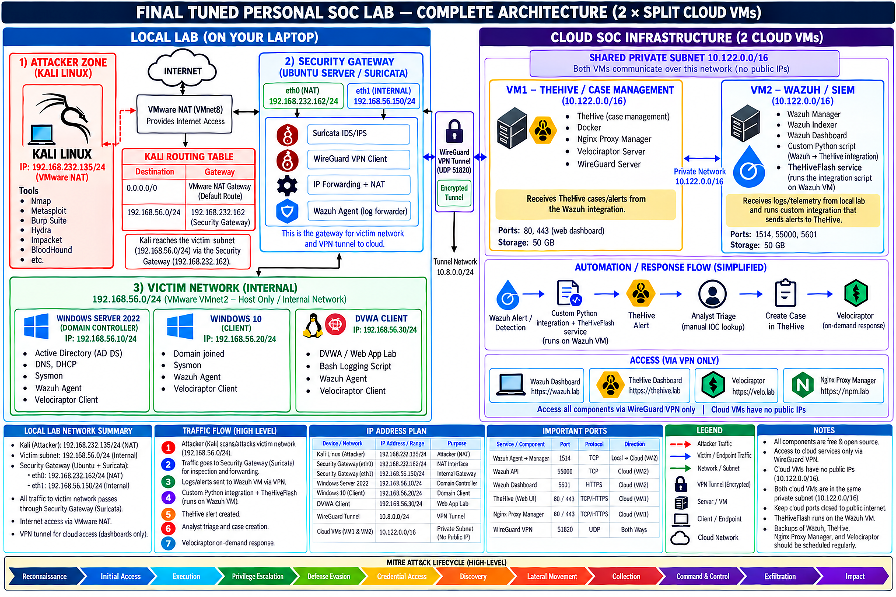

# SOC Lab — 20-Stage Attack Simulation & Detection Engineering

I built a small company network in a hybrid cloud lab, executed an end-to-end 20-stage attack campaign—spanning external reconnaissance, web application exploitation, Linux host privilege escalation, network credential theft, and Active Directory domain compromise—and recorded which steps my security tools caught.

**Live interactive report:** <https://soc-lab.eclipsemanic.me/>

---

## How It Works

The attacker starts outside the network on an isolated subnet. Every perimeter probe crosses a Linux router running a **Suricata** network intrusion detection system (NIDS). Inside the victim network, endpoints run **Wazuh** agents, **Sysmon**, and **Auditd**. All telemetry is forwarded over an encrypted WireGuard VPN to a cloud-hosted SOC stack running **Wazuh SIEM** and **TheHive 5** case management.

> [!TIP]
> Looking for detailed network addressing, routing tables, and interface diagrams? See [01-Lab-Setup/README.md](01-Lab-Setup/README.md).

### Repository Directory Index

| Section | Primary Document | Description |
|---|---|---|
| **01 — Lab Setup** | [`01-Lab-Setup/README.md`](01-Lab-Setup/README.md) | Complete hybrid cloud architecture, network segmentation, WireGuard VPN configuration, and reproducible host build profiles for all 6 systems. |
| **02 — Attack Simulation** | [`02-Attack-Simulation/README.md`](02-Attack-Simulation/README.md) | The 20-stage red-team playbook with exact terminal commands, execution tradecraft, and 62 attacker-side terminal proof screenshots. |
| **03 — Detection Engineering** | [`03-Detection-Engineering/README.md`](03-Detection-Engineering/README.md) | Custom Wazuh detection rules (`local_rules.xml`), Suricata NIDS signatures, Sysmon/Auditd telemetry baselines, and the `thecustomhive` SQLite WAL SOAR daemon. |
| **04 — Investigation** | [`04-Investigation/README.md`](04-Investigation/README.md) | SOC analyst triage notes for all 20 stages, raw-to-alert event correlations, and 3 comprehensive multi-stage TheHive incident cases. |
| **05 — Incident Report** | [`05-Incident-Report/README.md`](05-Incident-Report/README.md) | Formal executive incident report, full chronological attack timeline, complete IOC tables, and remediation engineering backlog. |
| **06 — Resources** | [`06-Resources/README.md`](06-Resources/README.md) | Telemetry datasets (9,567 raw baseline alerts, 808 analyst-curated records, 46 TheHive incident cases), automation scripts, and master campaign PDF. |
| **Master Index** | [`INDEX.md`](INDEX.md) | Master traceability matrix mapping every stage to MITRE ATT&CK techniques, detection rules, alert IDs, and raw evidence files. |

---

## The Attack Story in Three Acts

### 1. Break into the Web Server & Escalate to Root (Web Exploitation & Linux Host Compromise)
The attacker scans the perimeter, discovers a vulnerable web application (DVWA), and exploits an SQL injection vulnerability to dump database credentials. After cracking an administrative password, the attacker uploads a PHP web shell through an unrestricted file upload form, catches an interactive reverse shell, elevates privileges to root using a misconfigured SUID binary, and establishes persistent SSH access.

### 2. Pivot & Capture Network Credentials (Internal Recon, LLMNR Poisoning & AD Mapping)
Now inside the company network, the attacker turns the compromised web server into an internal pivot. Operating from this pivot, the attacker runs Responder to poison link-local multicast name resolution (LLMNR/NBT-NS), intercepting a domain user's password hash from a Windows 10 workstation. After cracking the hash offline, the attacker launches BloodHound to map Active Directory trust relationships and identify domain attack paths.

### 3. Take Over Active Directory & Impact Endpoints (Domain Takeover, Persistence & Defacement)
Using the mapped path, the attacker requests a Kerberos service ticket for a privileged service account (Kerberoasting) and cracks it to gain Domain Admin credentials. With domain admin rights, the attacker performs a DCSync attack against the Domain Controller to extract all Active Directory password hashes, forges an unrestricted Golden Ticket for indefinite persistence, creates a rogue domain administrator account, and pushes an unauthorized wallpaper defacement across the domain to demonstrate complete control.

---

## 20-Stage Attack & Detection Summary

| # | What the Attacker Did | Caught? | Details & Evidence |
|:---:|---|:---:|---|
| **01** | Perimeter TCP SYN port scan and OS fingerprinting probe | **Yes** (Network IDS) | [Stage 01 — Recon](02-Attack-Simulation/Stages/stage-01-recon.md) · [Investigation](04-Investigation/Stages/stage-01-recon.md) |
| **02** | Automated password guessing / brute-force attack on web application | **Yes** (Web 4xx burst) | [Stage 02 — Brute Force](02-Attack-Simulation/Stages/stage-02-bruteforce.md) · [Investigation](04-Investigation/Stages/stage-02-bruteforce.md) |
| **03** | SQL injection exploiting database to extract user accounts and password hashes | **Yes** (Network & Web log) | [Stage 03 — SQLi](02-Attack-Simulation/Stages/stage-03-sqli.md) · [Investigation](04-Investigation/Stages/stage-03-sqli.md) |
| **04** | Offline GPU password cracking of extracted MD5 database hashes | **No** (Offline on GPU) | [Stage 04 — Hash Cracking](02-Attack-Simulation/Stages/stage-04-hash-crack.md) · [Investigation](04-Investigation/Stages/stage-04-hash-crack.md) |
| **05** | Uploading a PHP web shell through an unrestricted file upload form | **Yes** (IDS & Auditd execve) | [Stage 05 — Web Shell](02-Attack-Simulation/Stages/stage-05-webshell.md) · [Investigation](04-Investigation/Stages/stage-05-webshell.md) |
| **06** | Interactive reverse shell connection back to the attacker | **Yes** (IDS & Host shell spawn) | [Stage 06 — Reverse Shell](02-Attack-Simulation/Stages/stage-06-reverse-shell.md) · [Investigation](04-Investigation/Stages/stage-06-reverse-shell.md) |
| **07** | Local privilege escalation via misconfigured SUID binary to gain root | **Yes** (Host PAM & Auditd) | [Stage 07 — PrivEsc](02-Attack-Simulation/Stages/stage-07-privesc.md) · [Investigation](04-Investigation/Stages/stage-07-privesc.md) |
| **08** | Injecting attacker SSH key into root authorized_keys for persistent access | **Yes** (FIM & SSH logon alert) | [Stage 08 — Persistence](02-Attack-Simulation/Stages/stage-08-ssh-persistence.md) · [Investigation](04-Investigation/Stages/stage-08-ssh-persistence.md) |
| **09** | Internal network sweep from the compromised pivot host to discover targets | **Partial** (Caught on wire; missed by target) | [Stage 09 — Discovery](02-Attack-Simulation/Stages/stage-09-internal-discovery.md) · [Investigation](04-Investigation/Stages/stage-09-internal-discovery.md) |
| **10** | LLMNR/NBT-NS broadcast poisoning (Responder) to capture workstation credentials | **Yes** (Logged on pivot host) | [Stage 10 — Responder](02-Attack-Simulation/Stages/stage-10-responder.md) · [Investigation](04-Investigation/Stages/stage-10-responder.md) |
| **11** | Offline GPU password cracking of intercepted workstation NetNTLMv2 hash | **No** (Offline on GPU) | [Stage 11 — NTLM Crack](02-Attack-Simulation/Stages/stage-11-ntlmv2-crack.md) · [Investigation](04-Investigation/Stages/stage-11-ntlmv2-crack.md) |
| **12** | BloodHound / SharpHound Active Directory enumeration mapping domain trust paths | **Partial** (Pivot logon alerted; DC logging gap) | [Stage 12 — BloodHound](02-Attack-Simulation/Stages/stage-12-bloodhound.md) · [Investigation](04-Investigation/Stages/stage-12-bloodhound.md) |
| **13** | Kerberoasting request for a Domain Admin service account ticket | **Yes** (Wire Kerberos TGS-REQ alert) | [Stage 13 — Kerberoasting](02-Attack-Simulation/Stages/stage-13-kerberoasting.md) · [Investigation](04-Investigation/Stages/stage-13-kerberoasting.md) |
| **14** | DCSync attack dumping all domain password hashes via DRSUAPI replication | **Yes** (Pivot logon alerted) | [Stage 14 — DCSync](02-Attack-Simulation/Stages/stage-14-dcsync.md) · [Investigation](04-Investigation/Stages/stage-14-dcsync.md) |
| **15** | Pass-the-Hash remote command execution to Windows 10 over SMB/WMI | **Yes** (NTLM Type 3 & WMI fan-out) | [Stage 15 — Pass-the-Hash](02-Attack-Simulation/Stages/stage-15-pass-the-hash.md) · [Investigation](04-Investigation/Stages/stage-15-pass-the-hash.md) |
| **16** | Forging an unrestricted Kerberos Golden Ticket for indefinite domain persistence | **Yes** (Pivot logon alerted) | [Stage 16 — Golden Ticket](02-Attack-Simulation/Stages/stage-16-golden-ticket.md) · [Investigation](04-Investigation/Stages/stage-16-golden-ticket.md) |
| **17** | Creating a backdoor domain user account and adding it to Domain Admins | **Yes** (WMI fan-out & AD event) | [Stage 17 — DC Persistence](02-Attack-Simulation/Stages/stage-17-dc-persistence.md) · [Investigation](04-Investigation/Stages/stage-17-dc-persistence.md) |
| **18** | Automated collection of confidential domain files and system information | **Yes** (Sysmon process fan-out) | [Stage 18 — Collection](02-Attack-Simulation/Stages/stage-18-collection.md) · [Investigation](04-Investigation/Stages/stage-18-collection.md) |
| **19** | Exfiltrating stolen data archive to the attacker over encrypted SCP | **Yes** (Rapid SSH session burst) | [Stage 19 — Exfiltration](02-Attack-Simulation/Stages/stage-19-exfiltration.md) · [Investigation](04-Investigation/Stages/stage-19-exfiltration.md) |
| **20** | Pushing remote desktop wallpaper defacement across domain endpoints via WMI | **Yes** (WMI fan-out & Sysmon registry) | [Stage 20 — Impact](02-Attack-Simulation/Stages/stage-20-impact.md) · [Investigation](04-Investigation/Stages/stage-20-impact.md) |

---

## Result at a Glance

| Metric | Result | Plain-English Summary |
|---|:---:|---|
| **Attack stages run** | **20** | Full kill chain: external reconnaissance, web exploitation, Linux privilege escalation, network credential theft, Active Directory takeover, and domain defacement |
| **Stages caught** | **16 (80%)** | Actionable alerts raised in TheHive 5 via Suricata NIDS, Linux Auditd, and Windows Sysmon |
| **Stages missed** | **4 (20%)** | **2 offline:** Password cracking ran locally on the attacker's GPU (zero victim telemetry by definition). **2 logging gaps:** Internal discovery and BloodHound LDAP scans were visible on the pivot or wire, but lacked target-side detection rules. |

---

## How to Read This Repo

- **5 minutes:** Read this page, review the result numbers, and scan the 20-stage attack table above.
- **30 minutes:** Read five standout stage investigations comparing attack tradecraft against the raw telemetry:
  - [Stage 03 — SQL Injection](04-Investigation/Stages/stage-03-sqli.md) (Web application exploitation: UNION SELECT database dump & perimeter NIDS alert)
  - [Stage 07 — Privilege Escalation](04-Investigation/Stages/stage-07-privesc.md) (Linux host compromise: SUID binary abuse & Auditd syscall tracking)
  - [Stage 10 — Responder Poisoning](04-Investigation/Stages/stage-10-responder.md) (Network MitM: Link-local broadcast poisoning & NTLMv2 hash interception)
  - [Stage 13 — Kerberoasting](04-Investigation/Stages/stage-13-kerberoasting.md) (Active Directory exploitation: Kerberos TGS-REQ wire frame vs. target logging)
  - [Stage 15 — Pass-the-Hash](04-Investigation/Stages/stage-15-pass-the-hash.md) (Lateral movement: NTLM Logon Type 3 & WMI process creation)

---

## Disclaimer & License

> **Authorized Educational Research Only:** All attack simulations and defensive telemetry in this project were executed against dedicated, isolated virtual machines in a private lab environment owned by the author. No production systems or unauthorized networks were targeted. See [DISCLAIMER.md](DISCLAIMER.md).

This project is licensed under the [MIT License](LICENSE).
