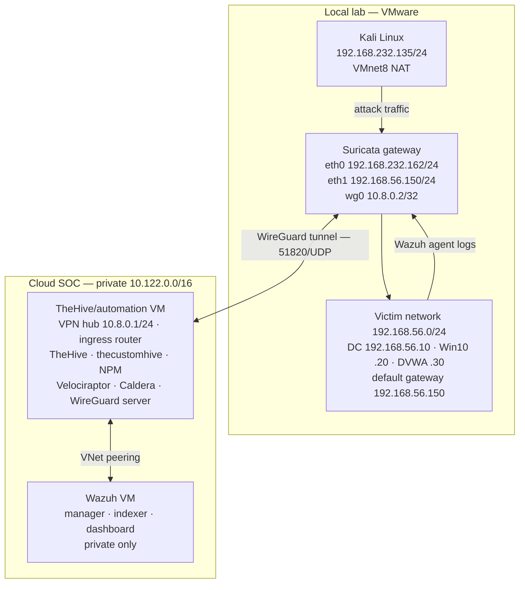

# SOC Lab — Attack Simulation, Detection & Response

A self-hosted SOC lab that emulates an Active Directory attack campaign, collects network and host telemetry through a Suricata gateway and Wazuh, routes alerts into TheHive, and documents the investigation end to end.

> **Authorized lab only.** Everything here was performed against systems I own in an isolated environment. See [DISCLAIMER.md](DISCLAIMER.md).

## What this lab is

Three tiers, one story:

| Tier | What it is | Where it runs |
|---|---|---|
| Attack | Kali Linux on an isolated NAT segment | Local VMware |
| Victim | Windows Server 2022 DC, Windows 10, DVWA — routed through the Suricata gateway | Local VMware |
| SOC | Wazuh VM plus the TheHive/automation VM, joined by VNet peering and reached over WireGuard | Cloud (any provider) |

The point of the design is not the tool list. It is that a single public port opens the lab, every hop is documented, and the places where visibility is incomplete are named rather than hidden.

## Architecture

The tunnel terminates on the TheHive/automation VM, not on Wazuh. That VM is the cloud ingress point, the VPN hub, and the router that reaches the Wazuh VM across the peered VNets.

Full detail: [01-lab-setup/architecture.md](01-lab-setup/architecture.md) · addresses and flows: [01-lab-setup/network-topology.md](01-lab-setup/network-topology.md).

## Network at a glance

| Group | What is reachable | Notes |
|---|---|---|
| **Public ingress** | `51820/UDP` on the TheHive/automation VM — nothing else | Default-deny for all other public inbound |
| **VPN-only** | TheHive UI, Wazuh dashboard/API/agent ports, Velociraptor, Caldera, SSH, NPM admin | Reachable from `10.8.0.0/24` only |
| **Private / peering** | TheHive VM ↔ Wazuh VM over the peered VNets in `10.122.0.0/16` | No public listener on the Wazuh VM |

The VPN policy allows `10.8.0.0/24` to both `192.168.232.0/24` and `192.168.56.0/24`, so the gateway can be managed and the local hosts can be reached for troubleshooting. That also exposes the Kali/NAT segment to VPN clients; if only gateway management is needed, narrow it to `192.168.232.162`.

## Stack

| Layer | Component | Where | Role |
|---|---|---|---|
| Attack | Kali Linux | Local, `192.168.232.0/24` | Adversary workstation and tooling |
| Network detection | Suricata gateway | Local, `192.168.56.150` / `192.168.232.162` | Router between attack and victim segments; `eve.json` to Wazuh |
| Web target | DVWA on Ubuntu | Local, `192.168.56.30` | Initial access and web attack surface |
| Workstation | Windows 10 | Local, `192.168.56.20` | Credential access and lateral movement target |
| Identity | Windows Server 2022 DC, `ad.lab` | Local, `192.168.56.10` | AD DS, DNS, Kerberos |
| SIEM | Wazuh manager, indexer, dashboard | Wazuh VM, private only | Log collection, rules, alerting |
| Case management | TheHive | TheHive/automation VM | Alerts, cases, observables, tasks, timelines |
| Automation | thecustomhive (Python) | TheHive/automation VM | Wazuh API → TheHive alert pipeline |
| DFIR | Velociraptor | TheHive/automation VM | Endpoint artifact collection |
| Adversary emulation | Caldera | TheHive/automation VM | Repeatable technique execution |
| Ingress | Nginx Proxy Manager | TheHive/automation VM | Internal TLS/reverse proxy for SOC services |
| Connectivity | WireGuard | Both sides | VPN hub on `10.8.0.1/24`, Suricata client on `10.8.0.2/32` |

## Design principles

1. **One public port.** `51820/UDP` on the TheHive/automation VM is the only public inbound rule. Everything else is VPN, peering, or closed. The provider console is the break-glass path.
2. **Vendor-neutral.** DigitalOcean, OVHcloud, Vultr, and Azure have all hosted this lab. The provider does not matter — the firewall, VPN, routing, peering, and segmentation do.
3. **TheHive VM routes telemetry.** It is the ingress hub: it terminates the tunnel, forwards agent traffic to the Wazuh VM, and runs the pipeline that turns Wazuh alerts into TheHive alerts.
4. **Fail closed.** If the tunnel or the hub is down, agents queue or fail; no service falls back to a public listener.
5. **Document the blind spot.** Suricata sees attacker↔victim and victim↔cloud traffic. It does not see victim-to-victim traffic on `192.168.56.0/24`, which is same-subnet. Lateral-movement detection for those stages depends on Wazuh and host telemetry.
6. **Honest evidence.** Unverified rules are marked unverified. Missing artifacts are marked missing. Nothing is presented as a result until it exists.

## Repository map

| Section | Purpose |
|---|---|
| [01-lab-setup](01-lab-setup/README.md) | Architecture, network, local VMs, cloud stack, thecustomhive pipeline |
| [02-attack-simulation](02-attack-simulation/README.md) | 20-stage attack chain with commands and evidence |
| [03-detection-engineering](03-detection-engineering/README.md) | Rule catalogue, ATT&CK coverage, false positives, detection gaps |
| [04-investigation](04-investigation/README.md) | Stage-wise analyst notes and three TheHive cases |
| [05-incident-report](05-incident-report/README.md) | Executive report, timeline, IOCs, ATT&CK mapping, response and lessons |
| [INDEX.md](INDEX.md) | Master traceability matrix: stage, alert, rule, case, evidence |
| [resources](resources/README.md) | Reference material; diagrams are planned, not present |
| [SECURITY.md](SECURITY.md) | Redaction and secret-handling policy |

## Attack chain at a glance

The ATT&CK mappings below are **suggested starting points** and must be verified against the actual commands and alerts for each stage.

| # | Stage | Tactic | Suggested ATT&CK |
|---|---|---|---|
| 01 | Reconnaissance | Reconnaissance | T1595 Active Scanning |
| 02 | Brute force | Credential Access | T1110 Brute Force |
| 03 | SQL injection | Initial Access | T1190 Exploit Public-Facing Application |
| 04 | Hash cracking | Credential Access | T1110.002 Password Cracking |
| 05 | Web shell upload | Persistence | T1505.003 Server Web Shell |
| 06 | Reverse shell | Execution | T1059.004 Unix Shell |
| 07 | Privilege escalation | Privilege Escalation | T1068 Exploitation for Privilege Escalation |
| 08 | SSH persistence | Persistence | T1098.004 SSH Authorized Keys |
| 09 | Internal discovery | Discovery | T1018 Remote System Discovery |
| 10 | Responder poisoning | Credential Access | T1557.001 LLMNR/NBT-NS Poisoning and SMB Relay |
| 11 | NTLMv2 cracking | Credential Access | T1110.002 Password Cracking |
| 12 | BloodHound enumeration | Discovery | T1087.002 Domain Account |
| 13 | Kerberoasting | Credential Access | T1558.003 Kerberoasting |
| 14 | DCSync | Credential Access | T1003.006 DCSync |
| 15 | Pass-the-Hash | Lateral Movement | T1550.002 Pass the Hash |
| 16 | Golden Ticket | Credential Access / Persistence | T1558.001 Golden Ticket |
| 17 | DC persistence | Persistence | T1136.002 Domain Account |
| 18 | Collection | Collection | T1005 Data from Local System |
| 19 | Exfiltration | Exfiltration | T1041 Exfiltration Over C2 Channel |
| 20 | Impact | Impact | T1491.001 Internal Defacement |

Full detail: [02-attack-simulation/README.md](02-attack-simulation/README.md).

## Known gaps

- **Cloud addressing is summarized, not published.** The plan is `10.122.0.0/16` split across two non-overlapping VNets joined by peering. Exact per-VNet/subnet CIDRs vary by provider build and are not documented here. Public cloud IPs are dynamic and are deliberately excluded.
- **Intra-subnet lateral movement is invisible to Suricata.** Victim-to-victim traffic stays inside `192.168.56.0/24` and never crosses the gateway. Detection on those stages relies on Wazuh and host telemetry.
- **Detection rules are not validated.** Rules are written against expected behavior; none are confirmed to fire on a real stage yet.
- **Evidence is being collected.** Screenshots, alert IDs, and case IDs are pending.

## Project status

| Area | Status |
|---|---|
| Lab setup documentation | Written — being reconciled with the final build |
| Attack stage write-ups | Scaffolded — evidence in progress |
| Detection coverage matrix | Scaffolded — rules pending validation |
| Stage-wise investigation | Scaffolded — analyst notes pending |
| TheHive case summaries | Scaffolded — cases pending |
| Incident report | Scaffolded — draft pending |

No stage is marked **Detected**. The status vocabulary is defined in [INDEX.md](INDEX.md).

## Evidence convention

All attack and alert evidence screenshots live in two folders under `02-attack-simulation/`:

- `attack-screenshots/stage-XX/` — attacker-side evidence
- `alert-screenshots/stage-XX/` — TheHive, Wazuh, or Suricata alert evidence

Files are embedded in the stage and investigation documents by relative link. Do not copy the same image into multiple folders. Use descriptive lowercase names, for example `stage-03-01-burp-request.png`. Compress images before committing; GitHub recommends keeping individual objects around 1 MB or less.

Never include cloud public IPs, provider hostnames, API keys, VPN keys, or real password hashes. See [SECURITY.md](SECURITY.md).

## Detection performance

Fill this after the investigation is complete. It is the summary a SOC reviewer will look for first.

| Metric | Value |
|---|---|
| Stages executed | Not tested |
| Stages with at least one alert | Not tested |
| Logging gaps | Not tested |
| Detection gaps | Not tested |
| Rule failures | Not tested |
| Mean time to detect | Not tested |
| False positives reviewed | Not tested |

## Skills demonstrated

Attack simulation, Active Directory attack paths, Suricata and Wazuh detection, detection engineering, alert triage, TheHive case management, IOC extraction, timeline reconstruction, Velociraptor forensics, network segmentation and VPN design, incident reporting, and technical documentation.

## Visual tour (optional)

The repository is the record; the site is a presentation layer over the same data. It is not required to read the lab.

- **Open locally:** `python -m http.server 8000 --directory site`, then <http://localhost:8000/>
- **Site notes and deployment:** [site/README.md](site/README.md)
- **Pages workflow:** [.github/workflows/pages.yml](.github/workflows/pages.yml) publishes only `site/`

## Start here

1. [Architecture](01-lab-setup/architecture.md)
2. [Network topology](01-lab-setup/network-topology.md)
3. [Attack chain overview](02-attack-simulation/README.md)
4. [Detection coverage](03-detection-engineering/coverage-matrix.md)
5. [Investigation methodology](04-investigation/README.md)
6. [Incident report](05-incident-report/incident-report.md)
7. [Master index](INDEX.md)

## License

MIT. See [LICENSE](LICENSE).
